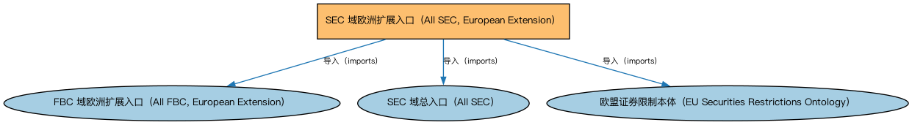

# SEC 域欧洲扩展入口（All SEC, European Extension）聚合说明

本文档对应 `AllSEC-Europe.rdf` / `AllSEC-Europe.ttl`。

## 1. 本文件是什么

聚合 SEC 域中欧洲法域的扩展本体（欧盟证券发行与交易限制）。

从机制上说，这是一个聚合入口（load-all）文件：它本身不定义任何新的类或属性，只通过 `owl:imports` 把一组本体打包在一起。应用只要导入这一个文件，推理机就会把它列出的所有本体一次性加载进来，免去逐个声明的麻烦。因此它的价值不在「内容」，而在「组合」——组合方式本身就表达了发布方的意图（例如按域打包、按区域扩展打包、按是否含参考数据打包）。

## 2. 聚合的本地本体（3 个）

以下本体均可在本目录结构中找到同名 `.rdf` 文件及配套中文文档：

| 导入本体 | 中文名称 | 简介 |
|---|---|---|
| `FBC/AllFBC-Europe.rdf` | FBC 域欧洲扩展入口（All FBC, European Extension） | 聚合 FBC 域中欧洲法域的扩展本体（欧盟金融服务实体、欧盟监管机构、欧洲市场参考个体等），与 AllFBC 配合用于欧洲场景。 |
| `SEC/AllSEC.rdf` | SEC 域总入口（All SEC） | 聚合证券（Securities，SEC）域的全部生产本体：债券、股票、基金、证券化产品、证券识别、分类、发行、上市与限制等，一次导入即获得 SEC 域完整模型。 |
| `SEC/Securities/EuropeanSecurities/EUSecuritiesRestrictions.rdf` | 欧盟证券限制本体（EU Securities Restrictions Ontology） | 定义欧盟法域下的证券发行与交易限制。 |

## 3. 文件

- 官方 RDF/XML：`AllSEC-Europe.rdf`
- 中文 Turtle：`AllSEC-Europe.ttl`
- 结构图：`AllSEC-Europe-structure.png` / `AllSEC-Europe-structure.svg`