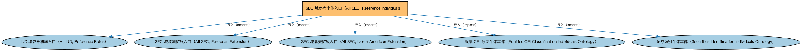

# SEC 域参考个体入口（All SEC, Reference Individuals）聚合说明

本文档对应 `AllSEC-ReferenceIndividuals.rdf` / `AllSEC-ReferenceIndividuals.ttl`。

## 1. 本文件是什么

聚合 SEC 域全部参考数据个体本体（CFI 分类、证券识别方案等参考数据），供需要完整参考数据的应用加载。

从机制上说，这是一个聚合入口（load-all）文件：它本身不定义任何新的类或属性，只通过 `owl:imports` 把一组本体打包在一起。应用只要导入这一个文件，推理机就会把它列出的所有本体一次性加载进来，免去逐个声明的麻烦。因此它的价值不在「内容」，而在「组合」——组合方式本身就表达了发布方的意图（例如按域打包、按区域扩展打包、按是否含参考数据打包）。

## 2. 聚合的本地本体（5 个）

以下本体均可在本目录结构中找到同名 `.rdf` 文件及配套中文文档：

| 导入本体 | 中文名称 | 简介 |
|---|---|---|
| `IND/AllIND-ReferenceRates.rdf` | IND 域参考利率入口（All IND, Reference Rates） | 聚合市场常用参考利率的个体本体（各期限基准及发布机构），供需要利率主数据的场景加载。 |
| `SEC/AllSEC-Europe.rdf` | SEC 域欧洲扩展入口（All SEC, European Extension） | 聚合 SEC 域中欧洲法域的扩展本体（欧盟证券发行与交易限制）。 |
| `SEC/AllSEC-NorthAmerica.rdf` | SEC 域北美扩展入口（All SEC, North American Extension） | 聚合 SEC 域中北美法域的扩展本体（美国证券发行与转售限制）。 |
| `SEC/Equities/EquityCFIClassificationIndividuals.rdf` | 股票 CFI 分类个体本体（Equities CFI Classification Individuals Ontology） | 收录 ISO 10962 金融工具分类（CFI）中股票类别的参考个体（普通股、优先股等类别代码）。 |
| `SEC/Securities/SecuritiesIdentificationIndividuals.rdf` | 证券识别个体本体（Securities Identification Individuals Ontology） | 收录证券标识方案的参考个体（如 ISIN、CUSIP 编码方案本身）。 |

## 3. 文件

- 官方 RDF/XML：`AllSEC-ReferenceIndividuals.rdf`
- 中文 Turtle：`AllSEC-ReferenceIndividuals.ttl`
- 结构图：`AllSEC-ReferenceIndividuals-structure.png` / `AllSEC-ReferenceIndividuals-structure.svg`