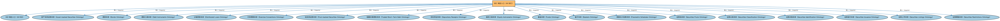

# SEC 域总入口（All SEC）聚合说明

本文档对应 `AllSEC.rdf` / `AllSEC.ttl`。

## 1. 本文件是什么

聚合证券（Securities，SEC）域的全部生产本体：债券、股票、基金、证券化产品、证券识别、分类、发行、上市与限制等，一次导入即获得 SEC 域完整模型。

从机制上说，这是一个聚合入口（load-all）文件：它本身不定义任何新的类或属性，只通过 `owl:imports` 把一组本体打包在一起。应用只要导入这一个文件，推理机就会把它列出的所有本体一次性加载进来，免去逐个声明的麻烦。因此它的价值不在「内容」，而在「组合」——组合方式本身就表达了发布方的意图（例如按域打包、按区域扩展打包、按是否含参考数据打包）。

## 2. 聚合的本地本体（19 个）

以下本体均可在本目录结构中找到同名 `.rdf` 文件及配套中文文档：

| 导入本体 | 中文名称 | 简介 |
|---|---|---|
| `IND/AllIND.rdf` | IND 域总入口（All IND） | 聚合指标与指数（Indices and Indicators，IND）域的全部生产本体：指标、利率、外汇、市场指数与经济指标等，一次导入即获得 IND 域完整模型。 |
| `SEC/Debt/AssetBackedSecurities.rdf` | 资产支持证券本体（Asset-backed Securities Ontology） | 定义以资产池（如贷款、应收账款）为支持的资产支持证券（ABS）。 |
| `SEC/Debt/Bonds.rdf` | 债券本体（Bonds Ontology） | 定义债券（bond）：期限、票面利率、付息方式与偿还结构。 |
| `SEC/Debt/DebtInstruments.rdf` | 债务工具本体（Debt Instruments Ontology） | 定义债务工具（debt instrument）的通用概念：可交易的债权凭证，是债券、票据等的上位模型。 |
| `SEC/Debt/DistributedLoans.rdf` | 分销贷款本体（Distributed Loans Ontology） | 定义银团贷款等被分销给多个持有人持有的贷款。 |
| `SEC/Debt/ExerciseConventions.rdf` | 行权惯例本体（Exercise Conventions Ontology） | 定义债务工具中嵌入期权的行权惯例：美式、欧式、百慕大式。 |
| `SEC/Debt/PoolBackedSecurities.rdf` | 池支持证券本体（Pool-backed Securities Ontology） | 定义以资产池为支持的证券的通用结构：资产池、分层（tranche）与过手安排。 |
| `SEC/Debt/TradedShortTermDebt.rdf` | 短期交易债务本体（Traded Short-Term Debt Ontology） | 定义货币市场工具等短期可交易债务：商业票据、国库券等。 |
| `SEC/Equities/DepositaryReceipts.rdf` | 存托凭证本体（Depositary Receipts Ontology） | 定义存托凭证（DR，如 ADR、GDR）：代表境外公司股票的可交易凭证。 |
| `SEC/Equities/EquityInstruments.rdf` | 股权工具本体（Equity Instruments Ontology） | 定义股票等股权工具：普通股、优先股及其附带的权利。 |
| `SEC/Funds/Funds.rdf` | 基金本体（Funds Ontology） | 定义投资基金（fund）：基金份额、净值与管理结构。 |
| `SEC/Securities/Baskets.rdf` | 篮子本体（Baskets Ontology） | 定义证券篮子（basket）：作为整体交易或定价的一组证券。 |
| `SEC/Securities/ParametricSchedules.rdf` | 参数化计划表本体（Parametric Schedules Ontology） | 定义由参数驱动的日期与金额计划表（如分期偿还表、付息表）。 |
| `SEC/Securities/Pools.rdf` | 证券池本体（Securities Pools Ontology） | 定义证券池（pool）：归集起来作为证券化基础的一组资产。 |
| `SEC/Securities/SecuritiesClassification.rdf` | 证券分类本体（Securities Classification Ontology） | 定义证券分类方案：按 CFI 代码、按资产类别等对证券归类。 |
| `SEC/Securities/SecuritiesIdentification.rdf` | 证券识别本体（Securities Identification Ontology） | 定义证券标识符（ISIN、CUSIP、SEDOL 等）及其编码方案的结构。 |
| `SEC/Securities/SecuritiesIssuance.rdf` | 证券发行本体（Securities Issuance Ontology） | 定义证券发行（issuance）：发行人、发行条款与发行结果。 |
| `SEC/Securities/SecuritiesListings.rdf` | 证券上市本体（Securities Listings Ontology） | 定义证券在交易所上市（listing）及其上市状态。 |
| `SEC/Securities/SecuritiesRestrictions.rdf` | 证券限制本体（Securities Restrictions Ontology） | 定义证券发行与转让限制的通用概念，是各法域具体限制本体的基础。 |

## 3. 文件

- 官方 RDF/XML：`AllSEC.rdf`
- 中文 Turtle：`AllSEC.ttl`
- 结构图：`AllSEC-structure.png` / `AllSEC-structure.svg`