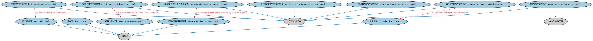

# 资产支持证券本体（Asset-backed Securities Ontology）结构与公理说明

本文档对应 `AssetBackedSecurities.rdf` / `AssetBackedSecurities.ttl`，说明该本体的类、继承关系、属性和公理约定。结构图见 `AssetBackedSecurities-structure.png`（`AssetBackedSecurities-structure.svg` 为可缩放版本）。

## 1. 本体概述

定义资产支持证券（ABS）：以贷款、应收账款、租赁等资产池为支持发行的证券。

**在体系中的位置**：SEC 债务模块中证券化产品的主要品种之一。

**上下游关系**：上游继承池支持证券本体；下游与 MBS、CDO 并列构成证券化产品谱系。

**与相近概念的差别**：ABS 与 MBS 的差别在底层资产——ABS 以非抵押贷款（车贷、信用卡应收）为主，MBS 以住房/商业抵押贷款为主；与 CDO 的差别——CDO 底层是债务工具（债券、贷款份额）。

## 2. 类（Class）

| 类（Class） | 定义（Definition） |
|---|---|
| 汽车资产支持证券（auto asset-backed security） | 由汽车相关贷款和/或租赁组成的标的资产池支持的资产支持证券。 |
| 汽车债务池（auto debt pool） | 由机动车相关贷款和/或租赁组成的债务池。 |
| 债券池（bond pool） | 由债券组成的债务池。 |
| 消费资产支持证券（consumer asset-backed security） | 以汽车贷款和租赁（汽车 ABS）、信用卡应收账款（信用卡 ABS）或学生贷款等资产池为抵押的结构化金融证券。 |
| 受控摊销资产支持证券（controlled amortization asset-backed security） | 基于采用受控摊销结构证券化的债券池的资产支持证券。 |
| 信用卡账户池（credit card account pool） | 与指定账户相关联的信用卡应收账款池。 |
| 信用卡资产支持证券（credit card asset-backed security） | 以信用卡应收账款为基础的资产支持证券。 |
| 完全摊销资产支持证券（fully amortizing asset-backed security） | 基于在证券存续期内向投资者逐步归还本金的债务工具池的资产支持证券。 |
| 房屋净值信用额度池（home equity line of credit pool） | 由房屋净值贷款组成的债务池。 |
| 房屋净值贷款资产支持证券（home equity loan asset-backed security） | 以房屋净值贷款应收款为基础的资产支持证券。 |
| 学生贷款资产支持证券（student loan asset-backed security） | 以学生贷款应收款为基础的资产支持证券。 |
| 学生贷款池（student loan pool） | 由学生贷款组成的债务池。 |

### 2.1 继承关系（Inheritance）

- 汽车资产支持证券（auto asset-backed security） ⊑ 资产支持证券
- 汽车债务池（auto debt pool） ⊑ 债务池
- 债券池（bond pool） ⊑ 债务池
- 消费资产支持证券（consumer asset-backed security） ⊑ 资产支持证券
- 消费资产支持证券（consumer asset-backed security） ⊑ 结构化金融工具
- 受控摊销资产支持证券（controlled amortization asset-backed security） ⊑ 资产支持证券
- 信用卡账户池（credit card account pool） ⊑ 债务池
- 信用卡资产支持证券（credit card asset-backed security） ⊑ 资产支持证券
- 完全摊销资产支持证券（fully amortizing asset-backed security） ⊑ 资产支持证券
- 房屋净值信用额度池（home equity line of credit pool） ⊑ 债务池
- 房屋净值贷款资产支持证券（home equity loan asset-backed security） ⊑ 资产支持证券
- 学生贷款资产支持证券（student loan asset-backed security） ⊑ 资产支持证券
- 学生贷款池（student loan pool） ⊑ 债务池

## 5. 公理约定（Axioms）

- 汽车资产支持证券（auto asset-backed security）：基于 some 汽车债务池（auto debt pool）
- 汽车债务池（auto debt pool）：具有部分 some（restriction）
- 债券池（bond pool）：具有部分 some 债券
- 受控摊销资产支持证券（controlled amortization asset-backed security）：基于 some 债务池
- 受控摊销资产支持证券（controlled amortization asset-backed security）：具有偿还条款 some 债券摊销支付条款
- 信用卡账户池（credit card account pool）：具有部分 some 信用卡账户
- 信用卡资产支持证券（credit card asset-backed security）：基于 some 信用卡账户池（credit card account pool）
- 完全摊销资产支持证券（fully amortizing asset-backed security）：基于 some 债务池
- 完全摊销资产支持证券（fully amortizing asset-backed security） 与 受控摊销资产支持证券（controlled amortization asset-backed security） 互斥（disjointWith）
- 房屋净值信用额度池（home equity line of credit pool）：具有部分 some 房屋净值信用额度
- 房屋净值贷款资产支持证券（home equity loan asset-backed security）：基于 some 房屋净值信用额度池（home equity line of credit pool）
- 学生贷款资产支持证券（student loan asset-backed security）：基于 some 学生贷款池（student loan pool）
- 学生贷款池（student loan pool）：具有部分 some 学生贷款

## 6. 依赖（owl:imports，20 个）

本本体通过 `owl:imports` 引入以下本体，各项的中文名称与简介如下：

| 导入本体 | 中文名称 | 简介 |
|---|---|---|
| `BE/FunctionalEntities/FunctionalEntities.rdf` | 功能实体本体（Functional Entities Ontology） | 定义「功能实体」：按其在商业中承担的功能（而非法律形式）刻画的实体，是出版方、登记机构等功能性主体的基础。 |
| `FBC/DebtAndEquities/Debt.rdf` | 债务本体（Debt Ontology） | 定义债务（debt）与债权债务关系的核心概念：借款人、贷款人、本金与利息义务。 |
| `FBC/FinancialInstruments/FinancialInstruments.rdf` | 金融工具本体（Financial Instruments Ontology） | FIBO 核心本体之一，定义金融工具（financial instrument）的通用概念：可交易、代表某种权利义务的合同工具，是证券、衍生品等具体工具的共同基础。 |
| `FND/Accounting/CurrencyAmount.rdf` | 货币金额本体（Currency Amount Ontology） | 定义「金额＋币种」的货币金额（currency amount）表示，是 FIBO 中表达价格、债务金额、付款额等一切带币种数值的基础构件。 |
| `FND/OwnershipAndControl/Ownership.rdf` | 所有权本体（Ownership Ontology） | 定义「拥有」关系：所有者、被拥有资产及所有权份额。 |
| `FND/Utilities/Analytics.rdf` | 分析本体（Analytics Ontology） | 定义分析工具、度量与比率的通用概念，支撑指标与模型的表达。 |
| `FND/Utilities/AnnotationVocabulary.rdf` | FIBO 标注词汇表（FIBO Annotation Vocabulary） | 定义 FIBO 专用的标注属性（如释义来源、成熟度等级），用于本体自身的元数据标注。 |
| `IND/EconomicIndicators/EconomicIndicators.rdf` | 经济指标本体（Economic Indicators Ontology） | 定义宏观经济指标（GDP、CPI、失业率等）的通用结构：发布机构、发布频率与数值。 |
| `IND/Indicators/Indicators.rdf` | 指标本体（Indicators Ontology） | 定义「指标」（indicator）的通用概念：对某现象的可度量表示，是经济指标、利率等的上位模型。 |
| `LOAN/LoansSpecific/CardAccounts.rdf` | 卡账户本体（Card Accounts Ontology） | 定义信用卡、借记卡账户及其信贷特征。 |
| `LOAN/LoansSpecific/ConsumerLoans.rdf` | 消费贷款本体（Consumer Loans Ontology） | 定义面向个人消费者的贷款。 |
| `LOAN/LoansSpecific/StudentLoans.rdf` | 学生贷款本体（Student Loans Ontology） | 定义用于教育支出的学生贷款。 |
| `SEC/Debt/Bonds.rdf` | 债券本体（Bonds Ontology） | 定义债券（bond）：期限、票面利率、付息方式与偿还结构。 |
| `SEC/Debt/DebtInstruments.rdf` | 债务工具本体（Debt Instruments Ontology） | 定义债务工具（debt instrument）的通用概念：可交易的债权凭证，是债券、票据等的上位模型。 |
| `SEC/Debt/PoolBackedSecurities.rdf` | 池支持证券本体（Pool-backed Securities Ontology） | 定义以资产池为支持的证券的通用结构：资产池、分层（tranche）与过手安排。 |
| `SEC/Funds/Funds.rdf` | 基金本体（Funds Ontology） | 定义投资基金（fund）：基金份额、净值与管理结构。 |
| `SEC/Securities/Pools.rdf` | 证券池本体（Securities Pools Ontology） | 定义证券池（pool）：归集起来作为证券化基础的一组资产。 |
| `SEC/Securities/SecuritiesIssuance.rdf` | 证券发行本体（Securities Issuance Ontology） | 定义证券发行（issuance）：发行人、发行条款与发行结果。 |
| `https://www.omg.org/spec/Commons/AnnotationVocabulary/` | OMG 通用标注词汇表（OMG Commons Annotation Vocabulary） | OMG 通用本体库（Commons）中的标注词汇表，提供概念映射等标注属性，FIBO 用它标注术语与外部标准的对应关系。 |
| `https://www.omg.org/spec/Commons/Collections/` | OMG 通用集合本体（OMG Commons Collections） | Commons 库中的集合本体，定义集合、成员等通用概念。 |

## 7. 文件

- 官方 RDF/XML：`AssetBackedSecurities.rdf`
- 中文 Turtle：`AssetBackedSecurities.ttl`
- 结构图：`AssetBackedSecurities-structure.png` / `AssetBackedSecurities-structure.svg`