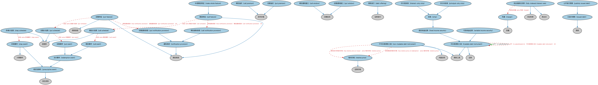

# 债务工具本体（Debt Instruments Ontology）结构与公理说明

本文档对应 `DebtInstruments.rdf` / `DebtInstruments.ttl`，说明该本体的类、继承关系、属性和公理约定。结构图见 `DebtInstruments-structure.png`（`DebtInstruments-structure.svg` 为可缩放版本）。

## 1. 本体概述

定义债务工具（debt instrument）的通用概念：可交易的债权凭证，承诺还本付息。

**在体系中的位置**：SEC 债务模块的根基，债券、票据、资产证券化产品的共同上游。

**上下游关系**：上游继承 FBC 金融工具并依赖 FBC 债务本体；下游被 SEC 债务模块全部本体引用。

**与相近概念的差别**：债务工具≠债务——债务是欠款的法律关系，债务工具是把这种关系做成可交易凭证；与贷款的差别——债务工具面向资本市场可流通，贷款是双边安排。

本本体中类与类的核心关系如下（完整细节见各类小节）：

- **赎回事件（call event）** 继承 **兑付事件（redemption event）**
- **赎回特征（call feature）** 继承 **赎回条款（RedemptionProvision）**
- **赎回通知条款（call notification provision）** 继承 **通知条款（notification provision）**
- **赎回溢价（call premium）** 继承 **货币价格（MonetaryPrice）**
- **赎回计划表（call schedule）** 继承 **进度表（Schedule）**
- **赎回通知窗口（call window）** 继承 **日期区间（DatePeriod）**
- **债务发行（debt offering）** 继承 **证券发行（SecuritiesOffering）**
- **固定收益证券（fixed income security）** 继承 **可交易债务工具（tradable debt instrument）**
- **完全指数化利率（fully-indexed interest rate）** 继承 **浮动利率（FloatingInterestRate）**
- **完全指数化利率（fully-indexed interest rate）** 继承 **表达式（Expression）**
- **仅付息拆条（interest-only strip）** 继承 **拆条（strip）**
- **已发行债务（issued debt）** 继承 **债务（Debt）**
- 其余 25 条关系从略。

## 2. 类（Class）

| 类（Class） | 定义（Definition） |
|---|---|
| 赎回事件（call event） | 与债务工具赎回计划表相关联的事件。 |
| 赎回特征（call feature） | 规定发行人在赎回保护期后按赎回价买回证券之权利的赎回条款。 |
| 赎回通知条款（call notification provision） | 赎回特征中规定通知要求的条款。 |
| 赎回溢价（call premium） | 发行人行使赎回条款时为赎回证券而支付的超过面值的价格。 |
| 赎回计划表（call schedule） | 赎回价格及其生效时间的计划表。 |
| 赎回通知窗口（call window） | 在赎回日之前发行人或代理人必须向持有人发出通知的明确时间段。 |
| 债务发行（debt offering） | 一种或多种债务工具的出售发行。 |
| 固定收益证券（fixed income security） | 以固定定期付款形式提供回报、并通常在到期时归还本金的可交易债务工具。 |
| 完全指数化利率（fully-indexed interest rate） | 通过在指定指数利率上加一个利差计算得出的可变利率。 |
| 仅付息拆条（interest-only strip） | 代表标的债务工具（如债券）月度付款中非本金部分的拆条。 |
| 已发行债务（issued debt） | 借款人以某种金融证券形式设立的债务，贷款人为该证券的持有人或交易对手。 |
| 补偿赎回特征（make whole feature） | 允许发行人提前清偿剩余债务的赎回条款。 |
| 利差（margin） | 加在指定指数利率之上、用于确定就信用余额向借款人收取的完全指数化利率的变量。 |
| 不可交易债务工具（non-tradable debt instrument） | 不得买卖的债务工具。 |
| 通知条款（notification provision） | 表明相关事件发生前须作出通知的条款。 |
| 规定性事件（prescriptive event） | 与规则、方法、公式等的设定或执行相关的事件。 |
| 仅付本拆条（principal-only strip） | 代表标的债务工具（如债券）月度付款中本金部分的拆条。 |
| 公开发行债务（publicly issued debt） | 以可交易债务工具（证券）形式发行的债务。 |
| 回售事件（put event） | 与债务工具回售计划表相关联的事件，即持有人「回售」或交出工具的事件。 |
| 回售特征（put feature） | 赋予持有人在到期前卖出指定数量债务工具（即要求赎回）之权利（而非义务）的赎回条款。 |
| 回售通知条款（put notification provision） | 回售特征中规定通知要求的条款。 |
| 回售溢价（put premium） | 债务工具持有人提前卖出证券时须支付的超过面值的金额。 |
| 回售计划表（put schedule） | 规定债务工具回售特征相关事件（即可以何种价格于何日卖出债务工具）的计划表。 |
| 回售通知窗口（put window） | 在回售日之前持有人或代理人必须向发行人发出通知的明确时间段。 |
| 兑付事件（redemption event） | 涉及向优先股或债券等固定收益证券投资者返还本金、或出售单位的规定性事件。 |
| 相对价格（relative price） | 相对于债务工具在某一时点的面值或市值所标示的证券价格。 |
| 阶梯事件（step event） | 规定给定合同的某一合同条款（如利率或名义金额）发生变更的事件。 |
| 阶梯计划表（step schedule） | 规定具有阶梯特征的合同之合同条款（如利率或名义金额）变更日期的计划表。 |
| 拆条（strip） | 通过将债券票息剥离、并将各部分作为零息债券分别出售而创造的可交易债务工具。 |
| 可交易债务工具（tradable debt instrument） | 同时属于证券、即可由持有人买卖的债务工具。 |
| 可变收益证券（variable income security） | 为持有人提供由市场力量决定的动态回报率的可交易债务工具。 |

以下按类逐个展开：每个类给出继承关系、相关属性与公理约定；子类在父类之下降一级编号。

### 2.1 赎回特征（call feature）

定义：规定发行人在赎回保护期后按赎回价买回证券之权利的赎回条款。

- 父类：**赎回条款（RedemptionProvision）**
- 直接子类：**补偿赎回特征（make whole feature）**

属性：

| 属性 | 定义 | 说明 |
|---|---|---|
| **具有通知条款（has notification provision）** | 将债务工具的赎回条款与通知条款（如赎回或回售通知）关联起来。 | 值域：通知条款（notification provision）；子属性：具有合同要素 |
| **包含（comprises）** | — | — |

公理：

- **具有通知条款（has notification provision）**可以有 0 个或多个**赎回通知条款（call notification provision）**。
- **包含（comprises）**至少有一个取值，类型是**赎回计划表（call schedule）**。

#### 2.1.1 补偿赎回特征（make whole feature）

定义：允许发行人提前清偿剩余债务的赎回条款。

- 父类：**赎回特征（call feature）**

### 2.2 赎回溢价（call premium）

定义：发行人行使赎回条款时为赎回证券而支付的超过面值的价格。

- 父类：**货币价格（MonetaryPrice）**

### 2.3 赎回计划表（call schedule）

定义：赎回价格及其生效时间的计划表。

- 父类：**进度表（Schedule）**

属性：

| 属性 | 定义 | 说明 |
|---|---|---|
| **包含（comprises）** | — | — |

公理：

- **包含（comprises）**至少有一个取值，类型是**赎回事件（call event）**。
- **包含（comprises）**至少有一个取值，该取值满足：该属性存在取值约束。

### 2.4 赎回通知窗口（call window）

定义：在赎回日之前发行人或代理人必须向持有人发出通知的明确时间段。

- 父类：**日期区间（DatePeriod）**

### 2.5 债务发行（debt offering）

定义：一种或多种债务工具的出售发行。

- 父类：**证券发行（SecuritiesOffering）**

属性：

| 属性 | 定义 | 说明 |
|---|---|---|
| **适用于（appliesTo）** | — | — |

公理：

- **适用于（appliesTo）**至少有一个取值，类型是**债务工具（DebtInstrument）**。

### 2.6 完全指数化利率（fully-indexed interest rate）

定义：通过在指定指数利率上加一个利差计算得出的可变利率。

- 父类：**浮动利率（FloatingInterestRate）**、**表达式（Expression）**

属性：

| 属性 | 定义 | 说明 |
|---|---|---|
| **具有自变量（hasArgument）** | — | — |

公理：

- **具有自变量（hasArgument）**恰好有 1 个**基准利率（BaseRate）**。
- **具有自变量（hasArgument）**至少有一个取值，类型是**利差（margin）**。

### 2.7 已发行债务（issued debt）

定义：借款人以某种金融证券形式设立的债务，贷款人为该证券的持有人或交易对手。

- 父类：**债务（Debt）**
- 直接子类：**公开发行债务（publicly issued debt）**

属性：

| 属性 | 定义 | 说明 |
|---|---|---|
| **具有债务金额（hasDebtAmount）** | — | — |
| **由……授予（isConferredBy）** | — | — |

公理：

- **具有债务金额（hasDebtAmount）**的所有取值只能是**货币数量（MonetaryAmount）**。
- **由……授予（isConferredBy）**的所有取值只能是**债务工具（DebtInstrument）**。

#### 2.7.1 公开发行债务（publicly issued debt）

定义：以可交易债务工具（证券）形式发行的债务。

- 父类：**已发行债务（issued debt）**

属性：

| 属性 | 定义 | 说明 |
|---|---|---|
| **由……授予（isConferredBy）** | — | — |
| **具有池编号（has pool number）** | 指明该债务所属池的编号。 | 值域：xsd:integer；子属性：具有数值 |

公理：

- **由……授予（isConferredBy）**的所有取值只能是**可交易债务工具（tradable debt instrument）**。

### 2.8 利差（margin）

定义：加在指定指数利率之上、用于确定就信用余额向借款人收取的完全指数化利率的变量。

- 父类：**变量（Variable）**

### 2.9 不可交易债务工具（non-tradable debt instrument）

定义：不得买卖的债务工具。

- 父类：**债务工具（DebtInstrument）**、**书面合同（WrittenContract）**

属性：

| 属性 | 定义 | 说明 |
|---|---|---|
| **具有赎回条款（hasRedemptionProvision）** | — | — |
| **具有发行时相对价格（has relative price at issue）** | 指明工具发行时相对于面值的相对价格，即平价、溢价或折价。 | 值域：相对价格（relative price）；子属性：具有价格 |
| **具有赎回时相对价格（has relative price at redemption）** | 指明工具赎回时相对于面值的相对价格，即平价、折价或溢价。 | 值域：相对价格（relative price）；子属性：具有价格 |

公理：

- **具有发行时相对价格（has relative price at issue）**至少有一个取值，类型是**相对价格（relative price）**。
- **具有赎回时相对价格（has relative price at redemption）**至少有一个取值，类型是**相对价格（relative price）**。
- **具有赎回条款（hasRedemptionProvision）**可以有 0 个或多个**赎回条款（RedemptionProvision）**。
- 与**可交易债务工具（tradable debt instrument）**互斥：同一个体不能同时属于两者。

### 2.10 通知条款（notification provision）

定义：表明相关事件发生前须作出通知的条款。

- 父类：**赎回条款（RedemptionProvision）**
- 直接子类：**赎回通知条款（call notification provision）**、**回售通知条款（put notification provision）**

属性：

| 属性 | 定义 | 说明 |
|---|---|---|
| **具有日期区间（hasDatePeriod）** | — | — |

公理：

- **具有日期区间（hasDatePeriod）**的所有取值只能是**日期区间（DatePeriod）**。

#### 2.10.1 赎回通知条款（call notification provision）

定义：赎回特征中规定通知要求的条款。

- 父类：**通知条款（notification provision）**

属性：

| 属性 | 定义 | 说明 |
|---|---|---|
| **具有日期区间（hasDatePeriod）** | — | — |

公理：

- **具有日期区间（hasDatePeriod）**的所有取值只能是**赎回通知窗口（call window）**。

#### 2.10.2 回售通知条款（put notification provision）

定义：回售特征中规定通知要求的条款。

- 父类：**通知条款（notification provision）**

属性：

| 属性 | 定义 | 说明 |
|---|---|---|
| **具有日期区间（hasDatePeriod）** | — | — |

公理：

- **具有日期区间（hasDatePeriod）**的所有取值只能是**回售通知窗口（put window）**。

### 2.11 规定性事件（prescriptive event）

定义：与规则、方法、公式等的设定或执行相关的事件。

- 父类：**发生类别（OccurrenceKind）**
- 直接子类：**兑付事件（redemption event）**、**阶梯事件（step event）**

#### 2.11.1 兑付事件（redemption event）

定义：涉及向优先股或债券等固定收益证券投资者返还本金、或出售单位的规定性事件。

- 父类：**规定性事件（prescriptive event）**
- 直接子类：**赎回事件（call event）**、**回售事件（put event）**

##### 2.11.1.1 赎回事件（call event）

定义：与债务工具赎回计划表相关联的事件。

- 父类：**兑付事件（redemption event）**

##### 2.11.1.2 回售事件（put event）

定义：与债务工具回售计划表相关联的事件，即持有人「回售」或交出工具的事件。

- 父类：**兑付事件（redemption event）**

#### 2.11.2 阶梯事件（step event）

定义：规定给定合同的某一合同条款（如利率或名义金额）发生变更的事件。

- 父类：**计算事件（CalculationEvent）**、**规定性事件（prescriptive event）**

### 2.12 回售特征（put feature）

定义：赋予持有人在到期前卖出指定数量债务工具（即要求赎回）之权利（而非义务）的赎回条款。

- 父类：**债务条款（DebtTerms）**、**赎回条款（RedemptionProvision）**

属性：

| 属性 | 定义 | 说明 |
|---|---|---|
| **是否具有遗产/身故回售特征（has estate or death put feature）** | 表明该证券在持有人身故时可被要求赎回。 | 值域：xsd:boolean |
| **具有通知条款（has notification provision）** | 将债务工具的赎回条款与通知条款（如赎回或回售通知）关联起来。 | 值域：通知条款（notification provision）；子属性：具有合同要素 |
| **保留权（right to retain）** | 表明在发行人行使回售特征时，持有人是否有权选择保留该证券。 | 值域：xsd:boolean |
| **包含（comprises）** | — | — |

公理：

- **具有通知条款（has notification provision）**可以有 0 个或多个**回售通知条款（put notification provision）**。
- **包含（comprises）**至少有一个取值，类型是**回售计划表（put schedule）**。

### 2.13 回售溢价（put premium）

定义：债务工具持有人提前卖出证券时须支付的超过面值的金额。

- 父类：**货币价格（MonetaryPrice）**

### 2.14 回售计划表（put schedule）

定义：规定债务工具回售特征相关事件（即可以何种价格于何日卖出债务工具）的计划表。

- 父类：**进度表（Schedule）**

属性：

| 属性 | 定义 | 说明 |
|---|---|---|
| **包含（comprises）** | — | — |

公理：

- **包含（comprises）**至少有一个取值，类型是**回售事件（put event）**。
- **包含（comprises）**至少有一个取值，该取值满足：该属性存在取值约束。

### 2.15 回售通知窗口（put window）

定义：在回售日之前持有人或代理人必须向发行人发出通知的明确时间段。

- 父类：**日期区间（DatePeriod）**

### 2.16 相对价格（relative price）

定义：相对于债务工具在某一时点的面值或市值所标示的证券价格。

- 父类：**证券价格（SecurityPrice）**

### 2.17 阶梯计划表（step schedule）

定义：规定具有阶梯特征的合同之合同条款（如利率或名义金额）变更日期的计划表。

- 父类：**进度表（Schedule）**

属性：

| 属性 | 定义 | 说明 |
|---|---|---|
| **包含（comprises）** | — | — |

公理：

- **包含（comprises）**至少有一个取值，类型是**阶梯事件（step event）**。

### 2.18 可交易债务工具（tradable debt instrument）

定义：同时属于证券、即可由持有人买卖的债务工具。

- 父类：**债务工具（DebtInstrument）**、**证券（Security）**
- 直接子类：**固定收益证券（fixed income security）**、**可变收益证券（variable income security）**

属性：

| 属性 | 定义 | 说明 |
|---|---|---|
| **具有担保人（hasGuarantor）** | — | — |
| **次于（is subordinated to）** | 表明目标证券（即区间所指证券）的优先级高于所讨论的证券。 | 值域：可交易债务工具（tradable debt instrument） |

公理：

- **具有担保人（hasGuarantor）**可以有 0 个或多个**担保人（Guarantor）**。
- **次于（is subordinated to）**可以有 0 个或多个**可交易债务工具（tradable debt instrument）**。

#### 2.18.1 固定收益证券（fixed income security）

定义：以固定定期付款形式提供回报、并通常在到期时归还本金的可交易债务工具。

- 父类：**可交易债务工具（tradable debt instrument）**
- 直接子类：**拆条（strip）**

##### 2.18.1.1 拆条（strip）

定义：通过将债券票息剥离、并将各部分作为零息债券分别出售而创造的可交易债务工具。

- 父类：**固定收益证券（fixed income security）**
- 直接子类：**仅付息拆条（interest-only strip）**、**仅付本拆条（principal-only strip）**

###### 2.18.1.1.1 仅付息拆条（interest-only strip）

定义：代表标的债务工具（如债券）月度付款中非本金部分的拆条。

- 父类：**拆条（strip）**

###### 2.18.1.1.2 仅付本拆条（principal-only strip）

定义：代表标的债务工具（如债券）月度付款中本金部分的拆条。

- 父类：**拆条（strip）**

公理：

- 与**仅付息拆条（interest-only strip）**互斥：同一个体不能同时属于两者。

#### 2.18.2 可变收益证券（variable income security）

定义：为持有人提供由市场力量决定的动态回报率的可交易债务工具。

- 父类：**可交易债务工具（tradable debt instrument）**

## 3. 其他属性

以下属性未绑定到本体的具体类（定义域在外部本体或未声明）：

对象属性（Object Property）：

| 属性 | 定义 | 说明 |
|---|---|---|
| **具有赎回特征（has call feature）** | 指明发行文件/工具中规定的任何内蕴赎回特征的具体条款。 | 值域：赎回特征（call feature）；子属性：具有偿还条款（has repayment terms） |
| **具有起息日（has dated date）** | 规定固定收益证券开始计息的日期。 | 值域：显式日期；子属性：具有显式日期 |
| **具有利息支付条款（has interest payment terms）** | 指明工具或相关合同文件中规定的本金利息支付的具体条款。 | 值域：利息支付条款；子属性：具有合同要素 |
| **具有价格与收益率计日惯例（has price and yield day count convention）** | 指明进行收益率和价格计算时用于确定每月天数和每年天数的惯例。 | 值域：计日惯例；子属性：具有营业重复区间惯例 |
| **具有回售特征（has put feature）** | 指明发行文件/工具中规定的任何内蕴回售特征的具体条款。 | 值域：回售特征（put feature）；子属性：具有偿还条款（has repayment terms） |
| **具有到期时相对价格（has relative price at maturity）** | 指明工具到期时相对于面值的相对价格，即平价、折价或溢价。 | 值域：相对价格（relative price）；子属性：具有价格 |
| **具有偿还条款（has repayment terms）** | 指明工具或相关合同文件中规定的本金偿还的具体条款。 | 值域：本金偿还条款；子属性：具有合同要素 |

数据属性（Datatype Property）：

| 属性 | 定义 |
|---|---|
| **是否允许自动再投资（allows auto-reinvestment）** | 表明该证券是否允许将其利息自动再投资用于购买同一证券的额外份额或单位。 |
| **是否允许实物支付（allows payment in kind）** | 表明本金是否可以用实物（即以另一工具替代）而非现金偿付。 |
| **具有默认手数（has default lot size）** | 指明任一时刻可持有该证券的默认单位数量。 |
| **是否可赎回（is callable）** | 表明债务合同的发行人（签署方，即债务人）是否可以在到期前赎回该债务。 |
| **是否可交换（is exchangeable）** | 表明该证券是否可由发行人酌情决定交换为另一证券。 |
| **持有人是否可展期（is extendable by holder）** | 表明持有人是否可以延长到期日。 |
| **发行人是否可展期（is extendable by issuer）** | 表明发行人是否有权选择将债务展期而非再融资。 |
| **是否可回售（is putable）** | 表明持有人是否有权在最终到期前要求赎回该证券。 |
| **是否可拆条（is strippable）** | 表明该工具是否可以拆条，使利息和本金可分别交易。 |
| **是否为次级（is subordinated）** | 表明该证券是否为次级证券，即其优先级低于另一证券，从而在资产处置时后受偿。 |

## 4. 依赖（owl:imports，20 个）

本本体通过 `owl:imports` 引入以下本体，各项的中文名称与简介如下：

| 导入本体 | 中文名称 | 简介 |
|---|---|---|
| `FBC/DebtAndEquities/Debt.rdf` | 债务本体（Debt Ontology） | 定义债务（debt）与债权债务关系的核心概念：借款人、贷款人、本金与利息义务。 |
| `FBC/DebtAndEquities/Guaranty.rdf` | 担保本体（Guaranty Ontology） | 定义担保（guaranty）：担保人、被担保债务与担保范围。 |
| `FBC/FinancialInstruments/FinancialInstruments.rdf` | 金融工具本体（Financial Instruments Ontology） | FIBO 核心本体之一，定义金融工具（financial instrument）的通用概念：可交易、代表某种权利义务的合同工具，是证券、衍生品等具体工具的共同基础。 |
| `FBC/FinancialInstruments/InstrumentPricing.rdf` | 工具定价本体（Instrument Pricing Ontology） | 定义金融工具的价格、报价与估值概念。 |
| `FBC/ProductsAndServices/FinancialProductsAndServices.rdf` | 金融产品与服务本体（Financial Products and Services Ontology） | 定义金融产品（financial product）与金融服务（financial service）及其提供、购买关系。 |
| `FND/Accounting/CurrencyAmount.rdf` | 货币金额本体（Currency Amount Ontology） | 定义「金额＋币种」的货币金额（currency amount）表示，是 FIBO 中表达价格、债务金额、付款额等一切带币种数值的基础构件。 |
| `FND/Agreements/Contracts.rdf` | 合同本体（Contracts Ontology） | 在协议之上定义具有法律约束力的合同（contract）：合同当事方、合同条款、义务与权利，是金融工具与交易合同建模的基石。 |
| `FND/DatesAndTimes/BusinessDates.rdf` | 营业日期本体（Business Dates Ontology） | 定义营业日、营业日历与日期调整规则（如顺延约定），支撑金融合同中的营业日计算。 |
| `FND/DatesAndTimes/FinancialDates.rdf` | 金融日期本体（Financial Dates Ontology） | 定义金融语境下的日期与期间概念：结算日、付息日、到期日、日计数基准等。 |
| `FND/DatesAndTimes/Occurrences.rdf` | 事件与发生本体（Occurrences Ontology） | 定义「发生」（occurrence）、事件与触发条件，用于表达企业行动、信用事件等「发生了什么」。 |
| `FND/Relations/Relations.rdf` | 关系本体（Relations Ontology） | FIBO 最底层的基础本体，定义参考（reference）、分类（classify）等通用关系与抽象概念，全库普遍依赖。 |
| `FND/Utilities/AnnotationVocabulary.rdf` | FIBO 标注词汇表（FIBO Annotation Vocabulary） | 定义 FIBO 专用的标注属性（如释义来源、成熟度等级），用于本体自身的元数据标注。 |
| `IND/EconomicIndicators/EconomicIndicators.rdf` | 经济指标本体（Economic Indicators Ontology） | 定义宏观经济指标（GDP、CPI、失业率等）的通用结构：发布机构、发布频率与数值。 |
| `IND/InterestRates/InterestRates.rdf` | 利率本体（Interest Rates Ontology） | 定义利率（interest rate）的结构：基准利率、利差、期限与重置机制。 |
| `SEC/Securities/SecuritiesIssuance.rdf` | 证券发行本体（Securities Issuance Ontology） | 定义证券发行（issuance）：发行人、发行条款与发行结果。 |
| `https://www.omg.org/spec/Commons/AnnotationVocabulary/` | OMG 通用标注词汇表（OMG Commons Annotation Vocabulary） | OMG 通用本体库（Commons）中的标注词汇表，提供概念映射等标注属性，FIBO 用它标注术语与外部标准的对应关系。 |
| `https://www.omg.org/spec/Commons/Collections/` | OMG 通用集合本体（OMG Commons Collections） | Commons 库中的集合本体，定义集合、成员等通用概念。 |
| `https://www.omg.org/spec/Commons/ContextualDesignators/` | OMG 通用语境指称本体（OMG Commons Contextual Designators） | Commons 库中的语境指称本体，定义「在某个语境下指代某物的名称/符号」，是地址、账户号码等语境相关标识的基础。 |
| `https://www.omg.org/spec/Commons/DatesAndTimes/` | OMG 通用日期与时间本体（OMG Commons Dates and Times） | Commons 库中的日期时间本体，定义日期、期间、时间点等通用时间概念。 |
| `https://www.omg.org/spec/Commons/QuantitiesAndUnits/` | OMG 通用量与单位本体（OMG Commons Quantities and Units） | Commons 库中的量与单位本体，定义数量、度量单位、量纲的通用概念，支撑金额、比率等数值表达。 |

## 5. 文件

- 官方 RDF/XML：`DebtInstruments.rdf`
- 中文 Turtle：`DebtInstruments.ttl`
- 结构图：`DebtInstruments-structure.png` / `DebtInstruments-structure.svg`