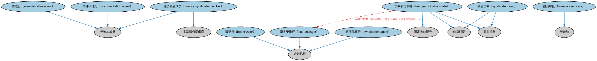

# 分销贷款本体（Distributed Loans Ontology）结构与公理说明

本文档对应 `DistributedLoans.rdf` / `DistributedLoans.ttl`，说明该本体的类、继承关系、属性和公理约定。结构图见 `DistributedLoans-structure.png`（`DistributedLoans-structure.svg` 为可缩放版本）。

## 1. 本体概述

定义分销贷款（distributed loan）：银团贷款等由牵头行分销给多个持有人的贷款。

**在体系中的位置**：SEC 债务模块的品种本体之一，连接贷款市场与资本市场。

**上下游关系**：上游继承债务工具并依赖 LOAN 贷款本体；下游服务银团贷款交易与贷款转让建模。

**与相近概念的差别**：分销贷款≠普通贷款——普通贷款是双边关系不可流通，分销贷款被切成份额在机构间转让；与债券的差别——仍是贷款法律形式，不是证券（多数法域）。

## 2. 类（Class）

| 类（Class） | 定义（Definition） |
|---|---|
| 代理行（administrative agent） | 金融机构（通常是银团中的主要贷款人之一）被指定在借款人与银团成员之间充当中介的角色。 |
| 簿记行（bookrunner） | 负责协调贷款安排、结构设计和营销的金融机构（通常是商业银行或投资银行）。 |
| 文件代理行（documentation agent） | 被指定负责贷款文件起草、谈判和定稿的金融机构。 |
| 融资银团（finance syndicate） | 集体同意向单一借款人提供大额贷款的一组金融机构或贷款人。 |
| 融资银团成员（finance syndicate member） | 为银团贷款或贷款参与票据出资的金融服务提供商类型的银团成员。 |
| 牵头安排行（lead arranger） | 代表借款人主导贷款结构设计和银团组建过程的金融机构。 |
| 贷款参与票据（loan participation note） | 可在多个贷款人之间分销的信贷额度和固定收益证券。 |
| 银团贷款（syndicated loan） | 由一组称为银团的贷款人集体向单一借款人提供大额贷款的信贷协议。 |
| 银团代理行（syndication agent） | 被指定协助构建、安排和管理贷款银团组建过程的金融机构（通常是商业银行或投资银行）。 |

### 2.1 继承关系（Inheritance）

- 代理行（administrative agent） ⊑ 辛迪加成员
- 簿记行（bookrunner） ⊑ 金融机构
- 文件代理行（documentation agent） ⊑ 辛迪加成员
- 融资银团（finance syndicate） ⊑ 辛迪加
- 融资银团成员（finance syndicate member） ⊑ 辛迪加成员
- 融资银团成员（finance syndicate member） ⊑ 金融服务提供商
- 牵头安排行（lead arranger） ⊑ 金融机构
- 贷款参与票据（loan participation note） ⊑ 信贷额度
- 贷款参与票据（loan participation note） ⊑ 商业贷款
- 贷款参与票据（loan participation note） ⊑ 固定收益证券
- 银团贷款（syndicated loan） ⊑ 信贷额度
- 银团贷款（syndicated loan） ⊑ 商业贷款
- 银团代理行（syndication agent） ⊑ 金融机构

## 5. 公理约定（Axioms）

- 融资银团成员（finance syndicate member）：由…扮演（is played by） some（是……的成员 only 融资银团（finance syndicate））
- 贷款参与票据（loan participation note）：具有行为者（has actor） 牵头安排行（lead arranger） =1
- 银团贷款（syndicated loan）：具有行为者（has actor） some（restriction）

## 6. 依赖（owl:imports，11 个）

本本体通过 `owl:imports` 引入以下本体，各项的中文名称与简介如下：

| 导入本体 | 中文名称 | 简介 |
|---|---|---|
| `BE/FunctionalEntities/FunctionalEntities.rdf` | 功能实体本体（Functional Entities Ontology） | 定义「功能实体」：按其在商业中承担的功能（而非法律形式）刻画的实体，是出版方、登记机构等功能性主体的基础。 |
| `FBC/DebtAndEquities/Debt.rdf` | 债务本体（Debt Ontology） | 定义债务（debt）与债权债务关系的核心概念：借款人、贷款人、本金与利息义务。 |
| `FBC/FunctionalEntities/FinancialServicesEntities.rdf` | 金融服务实体本体（Financial Services Entities Ontology） | FBC 域核心本体，定义金融服务机构（银行、券商、保险公司、资管机构等）的功能分类体系。 |
| `FBC/ProductsAndServices/FinancialProductsAndServices.rdf` | 金融产品与服务本体（Financial Products and Services Ontology） | 定义金融产品（financial product）与金融服务（financial service）及其提供、购买关系。 |
| `FND/Utilities/AnnotationVocabulary.rdf` | FIBO 标注词汇表（FIBO Annotation Vocabulary） | 定义 FIBO 专用的标注属性（如释义来源、成熟度等级），用于本体自身的元数据标注。 |
| `LOAN/LoansSpecific/CommercialLoans.rdf` | 商业贷款本体（Commercial Loans Ontology） | 定义面向企业的商业贷款。 |
| `SEC/Debt/DebtInstruments.rdf` | 债务工具本体（Debt Instruments Ontology） | 定义债务工具（debt instrument）的通用概念：可交易的债权凭证，是债券、票据等的上位模型。 |
| `https://www.omg.org/spec/Commons/AnnotationVocabulary/` | OMG 通用标注词汇表（OMG Commons Annotation Vocabulary） | OMG 通用本体库（Commons）中的标注词汇表，提供概念映射等标注属性，FIBO 用它标注术语与外部标准的对应关系。 |
| `https://www.omg.org/spec/Commons/Collections/` | OMG 通用集合本体（OMG Commons Collections） | Commons 库中的集合本体，定义集合、成员等通用概念。 |
| `https://www.omg.org/spec/Commons/PartiesAndSituations/` | OMG 通用参与方与情境本体（OMG Commons Parties and Situations） | Commons 库中的参与方本体，定义独立主体、参与方及其角色扮演的通用概念，是 FIBO 参与方模型的上游。 |
| `https://www.omg.org/spec/Commons/RolesAndCompositions/` | OMG 通用角色与构成本体（OMG Commons Roles and Compositions） | Commons 库中的角色本体，定义角色及整体—部分构成关系的通用概念。 |

## 7. 文件

- 官方 RDF/XML：`DistributedLoans.rdf`
- 中文 Turtle：`DistributedLoans.ttl`
- 结构图：`DistributedLoans-structure.png` / `DistributedLoans-structure.svg`