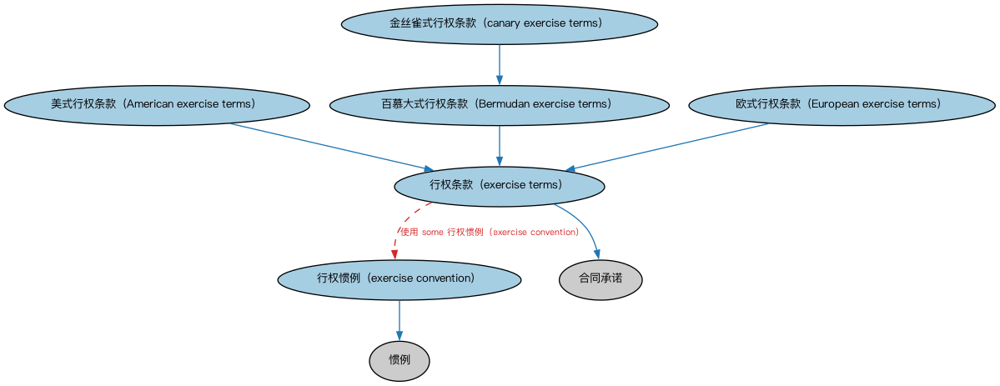

# 行权惯例本体（Exercise Conventions Ontology）结构与公理说明

本文档对应 `ExerciseConventions.rdf` / `ExerciseConventions.ttl`，说明该本体的类、继承关系、属性和公理约定。结构图见 `ExerciseConventions-structure.png`（`ExerciseConventions-structure.svg` 为可缩放版本）。

## 1. 本体概述

定义债务工具中嵌入期权的行权惯例：美式（随时可行权）、欧式（到期行权）、百慕大式（特定日期可行权）。

**在体系中的位置**：SEC 债务模块的构件本体，服务可赎回债、可回售债等含权工具。

**上下游关系**：上游依赖 DER 期权概念与 FND 日期本体；下游被债券及结构化工具引用。

**与相近概念的差别**：行权惯例是「什么时候可以行权」的规则约定，区别于行权行为本身；三种惯例的差别在行权时间窗口的宽窄。

## 2. 类（Class）

| 类（Class） | 定义（Definition） |
|---|---|
| 美式行权条款（American exercise terms） | 规定期权可在到期日或之前任何时间行权的行权条款。 |
| 百慕大式行权条款（Bermudan exercise terms） | 规定期权仅可在行权窗口内的预定日期（通常每月或每周某一日）行权的行权条款。 |
| 欧式行权条款（European exercise terms） | 规定期权仅可在到期日行权的行权条款。 |
| 金丝雀式行权条款（canary exercise terms） | 规定期权仅可在达到第一个阶梯日之前的预定日期行权、之后不得行权的行权条款。 |
| 行权惯例（exercise convention） | 确定期权持有人或未来持有人何时可以行使期权所规定权利的惯例。 |
| 行权条款（exercise terms） | 与期权或权益凭证行权相关的条件、惯例和其他规定的合同条款。 |

### 2.1 继承关系（Inheritance）

- 美式行权条款（American exercise terms） ⊑ 行权条款（exercise terms）
- 百慕大式行权条款（Bermudan exercise terms） ⊑ 行权条款（exercise terms）
- 欧式行权条款（European exercise terms） ⊑ 行权条款（exercise terms）
- 金丝雀式行权条款（canary exercise terms） ⊑ 百慕大式行权条款（Bermudan exercise terms）
- 行权惯例（exercise convention） ⊑ 惯例
- 行权条款（exercise terms） ⊑ 合同承诺

## 3. 对象属性（Object Property）

| 属性（Property） | 中文（English） | 定义（Definition） | 说明 |
|---|---|---|---|
| fibo-sec-dbt-ex:hasExerciseDate | 具有行权日（has exercise date） | 指明合约条款规定的期权可行权的日期。 | 值域（range）：显式日期；子属性（subPropertyOf）：具有显式日期 |
| fibo-sec-dbt-ex:hasExerciseTerms | 具有行权条款（has exercise terms） | 将期权或权益凭证等衍生品与其中规定的行权条款关联起来。 | 定义域（domain）：衍生工具；值域（range）：行权条款（exercise terms）；子属性（subPropertyOf）：具有合同要素 |
| fibo-sec-dbt-ex:hasExerciseWindow | 具有行权窗口（has exercise window） | 指明合约条款规定的期权可行权的时间段。 | 值域（range）：日期区间 |

## 5. 公理约定（Axioms）

- 美式行权条款（American exercise terms）：restriction
- 美式行权条款（American exercise terms） 与 百慕大式行权条款（Bermudan exercise terms） 互斥（disjointWith）
- 美式行权条款（American exercise terms） 与 欧式行权条款（European exercise terms） 互斥（disjointWith）
- 百慕大式行权条款（Bermudan exercise terms）：restriction
- 百慕大式行权条款（Bermudan exercise terms）：具有行权日（has exercise date） some 显式日期
- 百慕大式行权条款（Bermudan exercise terms）：具有行权窗口（has exercise window） some 日期区间
- 百慕大式行权条款（Bermudan exercise terms） 与 欧式行权条款（European exercise terms） 互斥（disjointWith）
- 欧式行权条款（European exercise terms）：restriction
- 欧式行权条款（European exercise terms）：具有行权日（has exercise date） 显式日期 =1
- 金丝雀式行权条款（canary exercise terms）：restriction
- 行权条款（exercise terms）：使用 some 行权惯例（exercise convention）

## 6. 依赖（owl:imports，7 个）

本本体通过 `owl:imports` 引入以下本体，各项的中文名称与简介如下：

| 导入本体 | 中文名称 | 简介 |
|---|---|---|
| `FBC/FinancialInstruments/FinancialInstruments.rdf` | 金融工具本体（Financial Instruments Ontology） | FIBO 核心本体之一，定义金融工具（financial instrument）的通用概念：可交易、代表某种权利义务的合同工具，是证券、衍生品等具体工具的共同基础。 |
| `FND/Agreements/Contracts.rdf` | 合同本体（Contracts Ontology） | 在协议之上定义具有法律约束力的合同（contract）：合同当事方、合同条款、义务与权利，是金融工具与交易合同建模的基石。 |
| `FND/DatesAndTimes/BusinessDates.rdf` | 营业日期本体（Business Dates Ontology） | 定义营业日、营业日历与日期调整规则（如顺延约定），支撑金融合同中的营业日计算。 |
| `FND/Utilities/AnnotationVocabulary.rdf` | FIBO 标注词汇表（FIBO Annotation Vocabulary） | 定义 FIBO 专用的标注属性（如释义来源、成熟度等级），用于本体自身的元数据标注。 |
| `https://www.omg.org/spec/Commons/AnnotationVocabulary/` | OMG 通用标注词汇表（OMG Commons Annotation Vocabulary） | OMG 通用本体库（Commons）中的标注词汇表，提供概念映射等标注属性，FIBO 用它标注术语与外部标准的对应关系。 |
| `https://www.omg.org/spec/Commons/ContextualDesignators/` | OMG 通用语境指称本体（OMG Commons Contextual Designators） | Commons 库中的语境指称本体，定义「在某个语境下指代某物的名称/符号」，是地址、账户号码等语境相关标识的基础。 |
| `https://www.omg.org/spec/Commons/DatesAndTimes/` | OMG 通用日期与时间本体（OMG Commons Dates and Times） | Commons 库中的日期时间本体，定义日期、期间、时间点等通用时间概念。 |

## 7. 文件

- 官方 RDF/XML：`ExerciseConventions.rdf`
- 中文 Turtle：`ExerciseConventions.ttl`
- 结构图：`ExerciseConventions-structure.png` / `ExerciseConventions-structure.svg`