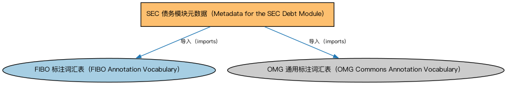

# SEC 债务模块元数据（Metadata for the SEC Debt Module）说明

本文档对应 `MetadataSECDebt.rdf` / `MetadataSECDebt.ttl`。

## 1. 本文件是什么

声明债务（Debt）模块的构成：债务工具、债券、短期交易债务、行权惯例、分销贷款、池支持证券、资产支持证券、抵押贷款支持证券、担保债务凭证、合成 CDO 十个本体。

从机制上说，这是一个元数据清单（metadata manifest）文件：它本身不定义任何类或属性，而是通过 `dct:hasPart` 声明一个域或模块由哪些本体构成，并携带版本 IRI、版权、许可与成熟度等发布管理信息。它回答的问题是「这个域/模块包含什么、当前是什么版本」，供发布工具和文档系统按模块组织内容；它的 `owl:imports` 只引入标注词汇表，不是用来加载业务本体的入口（加载入口是 `All*` 与 `About*` 聚合文件）。

## 2. 声明的构成（dct:hasPart，10 个）

| 构成项 | 中文名称 | 简介 |
|---|---|---|
| `SEC/Debt/AssetBackedSecurities.rdf` | 资产支持证券本体（Asset-backed Securities Ontology） | 定义以资产池（如贷款、应收账款）为支持的资产支持证券（ABS）。 |
| `SEC/Debt/Bonds.rdf` | 债券本体（Bonds Ontology） | 定义债券（bond）：期限、票面利率、付息方式与偿还结构。 |
| `SEC/Debt/CollateralizedDebtObligations.rdf` | 担保债务凭证本体（Collateralized Debt Obligations Ontology） | 定义担保债务凭证（CDO）：以债务资产池分层发行的证券。 |
| `SEC/Debt/DebtInstruments.rdf` | 债务工具本体（Debt Instruments Ontology） | 定义债务工具（debt instrument）的通用概念：可交易的债权凭证，是债券、票据等的上位模型。 |
| `SEC/Debt/DistributedLoans.rdf` | 分销贷款本体（Distributed Loans Ontology） | 定义银团贷款等被分销给多个持有人持有的贷款。 |
| `SEC/Debt/ExerciseConventions.rdf` | 行权惯例本体（Exercise Conventions Ontology） | 定义债务工具中嵌入期权的行权惯例：美式、欧式、百慕大式。 |
| `SEC/Debt/MortgageBackedSecurities.rdf` | 抵押贷款支持证券本体（Mortgage-backed Securities Ontology） | 定义抵押贷款支持证券（MBS）：以抵押贷款池为支持的证券。 |
| `SEC/Debt/PoolBackedSecurities.rdf` | 池支持证券本体（Pool-backed Securities Ontology） | 定义以资产池为支持的证券的通用结构：资产池、分层（tranche）与过手安排。 |
| `SEC/Debt/SyntheticCDOs.rdf` | 合成 CDO 本体（Synthetic CDOs Ontology） | 定义以信用衍生品（而非实际债务资产）构建风险敞口的合成型担保债务凭证。 |
| `SEC/Debt/TradedShortTermDebt.rdf` | 短期交易债务本体（Traded Short-Term Debt Ontology） | 定义货币市场工具等短期可交易债务：商业票据、国库券等。 |

## 3. 标注依赖（owl:imports，2 个）

以下导入仅用于支撑元数据标注本身（如成熟度等级、概念映射），不属于业务内容：

| 导入本体 | 中文名称 | 简介 |
|---|---|---|
| `FND/Utilities/AnnotationVocabulary.rdf` | FIBO 标注词汇表（FIBO Annotation Vocabulary） | 定义 FIBO 专用的标注属性（如释义来源、成熟度等级），用于本体自身的元数据标注。 |
| `https://www.omg.org/spec/Commons/AnnotationVocabulary/` | OMG 通用标注词汇表（OMG Commons Annotation Vocabulary） | OMG 通用本体库（Commons）中的标注词汇表，提供概念映射等标注属性，FIBO 用它标注术语与外部标准的对应关系。 |

## 4. 文件

- 官方 RDF/XML：`MetadataSECDebt.rdf`
- 中文 Turtle：`MetadataSECDebt.ttl`
- 结构图：`MetadataSECDebt-structure.png` / `MetadataSECDebt-structure.svg`