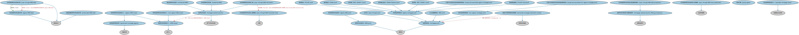

# 抵押贷款支持证券本体（Mortgage-backed Securities Ontology）结构与公理说明

本文档对应 `MortgageBackedSecurities.rdf` / `MortgageBackedSecurities.ttl`，说明该本体的类、继承关系、属性和公理约定。结构图见 `MortgageBackedSecurities-structure.png`（`MortgageBackedSecurities-structure.svg` 为可缩放版本）。

## 1. 本体概述

定义抵押贷款支持证券（MBS）：以住房或商业抵押贷款池为支持、按过手或分层结构发行的证券。

**在体系中的位置**：SEC 债务模块中证券化产品的主要品种之一。

**上下游关系**：上游继承池支持证券本体并依赖 LOAN 抵押贷款（底层资产）；下游关联 BP 的 MBS 发行流程与机构/私人品牌分类。

**与相近概念的差别**：与 ABS 的差别在底层资产是抵押贷款；机构 MBS 有政府担保、私人品牌 MBS 靠结构增信——提前还款风险（prepayment）是 MBS 特有的核心风险。

本本体中类与类的核心关系如下（完整细节见各类小节）：

- **房地美金牌池（FHLMC Gold pool）** 继承 **机构抵押贷款池（agency mortgage pool）**
- **房地美池（FHLMC pool）** 继承 **机构抵押贷款池（agency mortgage pool）**
- **房利美池（FNMA pool）** 继承 **机构抵押贷款池（agency mortgage pool）**
- **吉利美白金池（GNMA Platinum pool）** 继承 **机构抵押贷款池（agency mortgage pool）**
- **吉利美二号池（GNMA-II pool）** 继承 **机构抵押贷款池（agency mortgage pool）**
- **吉利美一号池（GNMA-I pool）** 继承 **机构抵押贷款池（agency mortgage pool）**
- **小企业管理局池（SBA pool）** 继承 **抵押贷款池（mortgage pool）**
- **机构抵押支持证券交易（agency MBS deal）** 继承 **债务发行（DebtOffering）**
- **机构抵押支持证券发行人（agency MBS issuer）** 继承 **政府抵押贷款机构（government mortgage agency）**
- **机构抵押支持证券发行人（agency MBS issuer）** 继承 **抵押支持证券发行人（MBS issuer）**
- **机构抵押支持证券池（agency MBS pool）** 继承 **抵押支持证券池（MBS pool）**
- **机构抵押贷款池（agency mortgage pool）** 继承 **抵押贷款池（mortgage pool）**
- 其余 22 条关系从略。

## 2. 类（Class）

| 类（Class） | 定义（Definition） |
|---|---|
| 房地美金牌池（FHLMC Gold pool） | 联邦住房贷款抵押公司（FHLMC，房地美）金牌计划的抵押贷款池。 |
| 房地美池（FHLMC pool） | 联邦住房贷款抵押公司（FHLMC，房地美）的抵押贷款池。 |
| 房利美池（FNMA pool） | 联邦国民抵押贷款协会（FNMA，房利美）的抵押贷款池。 |
| 吉利美白金池（GNMA Platinum pool） | 政府国民抵押贷款协会（GNMA，吉利美）白金计划的抵押贷款池。 |
| 吉利美二号池（GNMA-II pool） | 政府国民抵押贷款协会（GNMA，吉利美）二号计划的抵押贷款池。 |
| 吉利美一号池（GNMA-I pool） | 政府国民抵押贷款协会（GNMA，吉利美）一号计划的抵押贷款池。 |
| 小企业管理局池（SBA pool） | 由美国小企业管理局（SBA）担保贷款组成的池。 |
| 机构抵押支持证券交易（agency MBS deal） | 由政府机构持有的抵押贷款池支持的证券的一次发行。 An issue of securities backed by pools of mortgages held by government agencies. |
| 机构抵押支持证券发行人（agency MBS issuer） | 过手型 MBS 的发行人为机构发行人，即专门为发行此类工具而设立的某种机构。 The issuer of the pass through MBS is an Agency issuer. This is identified as being some kind of agency that is set up specifically to issue these instruments. |
| 机构抵押支持证券池（agency MBS pool） | 由一组机构 MBS 工具组成的池投资。 A pool investment consisting of a collection of Agency MBS instruments. |
| 机构抵押贷款池（agency mortgage pool） | 由机构抵押贷款组成的池。 A pool of agency mortgages. |
| 商业抵押支持证券（commercial MBS） | 由商业房地产抵押贷款池支持的抵押支持证券。 |
| 政府抵押贷款机构（government mortgage agency） | 由政府为发行抵押贷款（证券）之目的而设立的机构。 An agency set up by a government for the purpose of issuing mortgages. |
| 已发行并证券化的机构抵押贷款池（issued and securitized agency mortgage pool） | 已作为机构抵押支持证券一部分证券化的机构抵押贷款池。 An agency mortgage pool which has been securitized as part of an agency Mortgage Backed Security. |
| 已发行并证券化的非机构抵押贷款池（issued and securitized non-agency mortgage pool） | 已作为分档型抵押支持证券一部分证券化的非机构抵押贷款池。 A non agency mortgage pool which has been securitized as part of a tranched Mortgage Backed Security. |
| 抵押支持证券发行人（MBS issuer） | 抵押支持证券的发行人。 The issuer of a Mortgage Backed Security. |
| 抵押支持证券池（MBS pool） | 由一组 MBS 工具组成的池投资。 A pool investment consisting of a collection of MBS instruments. |
| 抵押贷款池（mortgage pool） | 由信托持有、作为发行抵押支持证券之抵押品的贷款池。 loan pool consisting of mortgages that are held in trust as collateral for the issuance of a mortgage-backed security |
| 抵押支持证券（mortgage-backed security） | 代表对抵押贷款池（最常见为住宅房产抵押贷款）现金流请求权的债务凭证。 debt obligations that represent claims to the cash flows from pools of mortgage loans, most commonly on residential property |
| 抵押支持证券发行招募说明书（mortgage-backed security offering prospectus） | 描述抵押支持证券发行条款及所含各工具的招募说明书。 Prospectus describing the terms of the issue and each of the instruments included in the mortgage backed security issue. Term origin:SMER |
| 非机构抵押支持证券发行人（non-agency MBS issuer） | MBS 证券的非机构发行人，其身份可以是银行或专业（非机构）抵押贷款公司。 A party which is a non agency issuer of MBS securities. The identity of this party may be a bank or a specialist (non agency) mortgage company. Term origin:MBS PoC Reviews |
| 非机构抵押贷款池（non-agency mortgage pool） | 由非机构抵押贷款组成的池。 |
| 过手型抵押支持证券交易（pass-through MBS deal） | 池中付款直接过手给投资者的抵押支持证券工具的一次发行。 An issue of Mortgage Backed Security instruments in which payments on the pool are passed through to investors |
| 过手型抵押支持证券交易招募说明书（pass-through MBS deal prospectus） | 机构过手型抵押支持证券发行的书面招募说明书。 The written prospectus for an agency, pass through issue of Mortgage Backed Securities |
| 过手型抵押支持证券工具（pass-through MBS instrument） | 标的资产池现金流通过赎回付款方式过手给投资者的证券。 A security in which the cash flows from the underlying asset pool are passed through to the investor by way of redemption payments. |
| 过手型抵押支持证券工具票据（pass-through MBS instrument note） | 过手型工具中的单张票据。 An individual note of a pass through instrument. |
| 过手型抵押支持证券发行承销商（pass-through MBS issue underwriter） | 同意买入投资者未认购之任何凭证的一方。 The party which agrees to buy any certificates that are not bought by investors Term origin:MBS PoC Reviews |
| 过手池（pass-through pool） | 现金流直接过手给投资者的抵押贷款池。 |
| 付款代理（paying agent） | 代表发行人向证券持有人付款的代理机构。 |
| 私募品牌抵押支持证券交易（private label MBS deal） | 由私人机构（而非政府机构）发行的抵押支持证券的一次发行。 |
| 房地产抵押贷款投资管道（real estate mortgage investment conduit） | 将抵押贷款汇聚成池并发行抵押支持证券的特殊目的载体（REMIC）。 special purpose vehicle that pools mortgage loans together and issues mortgage-backed securities |
| 住宅抵押支持证券（residential MBS） | 由住宅抵押贷款池支持的信托凭证（债券）。 Residential Mortgage-Backed Securities, which are trust certificates (bonds) backed by a pool of residential mortgage loans. |
| 专业抵押贷款发行人（specialist mortgage issuer） | 专门从事面向公众发行抵押贷款业务的商业组织。 A business organization that specialises in and exists for the issuance of mortgages to the general public. |

以下按类逐个展开：每个类给出继承关系、相关属性与公理约定；子类在父类之下降一级编号。

### 2.1 机构抵押支持证券交易（agency MBS deal）

定义：由政府机构持有的抵押贷款池支持的证券的一次发行。

- 父类：**债务发行（DebtOffering）**

公理：

- 与**私募品牌抵押支持证券交易（private label MBS deal）**互斥：同一个体不能同时属于两者。

### 2.2 政府抵押贷款机构（government mortgage agency）

定义：由政府为发行抵押贷款（证券）之目的而设立的机构。

- 父类：**功能实体（FunctionalEntity）**
- 直接子类：**机构抵押支持证券发行人（agency MBS issuer）**

属性：

| 属性 | 定义 | 说明 |
|---|---|---|
| **由…扮演（is played by）** | — | — |

公理：

- **由…扮演（is played by）**至少有一个取值，类型是**法律实体（LegalEntity）**。

#### 2.2.1 机构抵押支持证券发行人（agency MBS issuer）

定义：过手型 MBS 的发行人为机构发行人，即专门为发行此类工具而设立的某种机构。

- 父类：**政府抵押贷款机构（government mortgage agency）**、**抵押支持证券发行人（MBS issuer）**

### 2.3 抵押支持证券发行人（MBS issuer）

定义：抵押支持证券的发行人。

- 父类：**发行人（Issuer）**
- 直接子类：**机构抵押支持证券发行人（agency MBS issuer）**、**非机构抵押支持证券发行人（non-agency MBS issuer）**

公理：

- 该属性存在取值约束。

#### 2.3.2 非机构抵押支持证券发行人（non-agency MBS issuer）

定义：MBS 证券的非机构发行人，其身份可以是银行或专业（非机构）抵押贷款公司。

- 父类：**抵押支持证券发行人（MBS issuer）**

公理：

- 该属性存在取值约束。

### 2.4 抵押支持证券池（MBS pool）

定义：由一组 MBS 工具组成的池投资。

- 父类：**债务池（DebtPool）**
- 直接子类：**机构抵押支持证券池（agency MBS pool）**

#### 2.4.1 机构抵押支持证券池（agency MBS pool）

定义：由一组机构 MBS 工具组成的池投资。

- 父类：**抵押支持证券池（MBS pool）**

### 2.5 抵押贷款池（mortgage pool）

定义：由信托持有、作为发行抵押支持证券之抵押品的贷款池。

- 父类：**债务池（DebtPool）**
- 直接子类：**小企业管理局池（SBA pool）**、**机构抵押贷款池（agency mortgage pool）**、**非机构抵押贷款池（non-agency mortgage pool）**、**过手池（pass-through pool）**

属性：

| 属性 | 定义 | 说明 |
|---|---|---|
| **具有成员（hasMember）** | — | — |

公理：

- **具有成员（hasMember）**至少有一个取值，类型是**房地产担保贷款（LoanSecuredByRealEstate）**。

#### 2.5.1 小企业管理局池（SBA pool）

定义：由美国小企业管理局（SBA）担保贷款组成的池。

- 父类：**抵押贷款池（mortgage pool）**

#### 2.5.2 机构抵押贷款池（agency mortgage pool）

定义：由机构抵押贷款组成的池。

- 父类：**抵押贷款池（mortgage pool）**
- 直接子类：**房地美金牌池（FHLMC Gold pool）**、**房地美池（FHLMC pool）**、**房利美池（FNMA pool）**、**吉利美白金池（GNMA Platinum pool）**、**吉利美二号池（GNMA-II pool）**、**吉利美一号池（GNMA-I pool）**、**已发行并证券化的机构抵押贷款池（issued and securitized agency mortgage pool）**

公理：

- 与**非机构抵押贷款池（non-agency mortgage pool）**互斥：同一个体不能同时属于两者。

##### 2.5.2.1 房地美金牌池（FHLMC Gold pool）

定义：联邦住房贷款抵押公司（FHLMC，房地美）金牌计划的抵押贷款池。

- 父类：**机构抵押贷款池（agency mortgage pool）**

##### 2.5.2.2 房地美池（FHLMC pool）

定义：联邦住房贷款抵押公司（FHLMC，房地美）的抵押贷款池。

- 父类：**机构抵押贷款池（agency mortgage pool）**

##### 2.5.2.3 房利美池（FNMA pool）

定义：联邦国民抵押贷款协会（FNMA，房利美）的抵押贷款池。

- 父类：**机构抵押贷款池（agency mortgage pool）**

##### 2.5.2.4 吉利美白金池（GNMA Platinum pool）

定义：政府国民抵押贷款协会（GNMA，吉利美）白金计划的抵押贷款池。

- 父类：**机构抵押贷款池（agency mortgage pool）**

##### 2.5.2.5 吉利美二号池（GNMA-II pool）

定义：政府国民抵押贷款协会（GNMA，吉利美）二号计划的抵押贷款池。

- 父类：**机构抵押贷款池（agency mortgage pool）**

##### 2.5.2.6 吉利美一号池（GNMA-I pool）

定义：政府国民抵押贷款协会（GNMA，吉利美）一号计划的抵押贷款池。

- 父类：**机构抵押贷款池（agency mortgage pool）**

##### 2.5.2.7 已发行并证券化的机构抵押贷款池（issued and securitized agency mortgage pool）

定义：已作为机构抵押支持证券一部分证券化的机构抵押贷款池。

- 父类：**机构抵押贷款池（agency mortgage pool）**

属性：

| 属性 | 定义 | 说明 |
|---|---|---|
| **具有阶段（hasStage）** | — | — |

公理：

- **具有阶段（hasStage）**至少有一个取值，类型是**fibo-bp-iss-dbti:Issued（Issued）**。

#### 2.5.3 非机构抵押贷款池（non-agency mortgage pool）

定义：由非机构抵押贷款组成的池。

- 父类：**抵押贷款池（mortgage pool）**
- 直接子类：**已发行并证券化的非机构抵押贷款池（issued and securitized non-agency mortgage pool）**

##### 2.5.3.1 已发行并证券化的非机构抵押贷款池（issued and securitized non-agency mortgage pool）

定义：已作为分档型抵押支持证券一部分证券化的非机构抵押贷款池。

- 父类：**非机构抵押贷款池（non-agency mortgage pool）**

属性：

| 属性 | 定义 | 说明 |
|---|---|---|
| **具有阶段（hasStage）** | — | — |

公理：

- **具有阶段（hasStage）**至少有一个取值，类型是**fibo-bp-iss-dbti:Issued（Issued）**。

#### 2.5.4 过手池（pass-through pool）

定义：现金流直接过手给投资者的抵押贷款池。

- 父类：**抵押贷款池（mortgage pool）**

### 2.6 抵押支持证券（mortgage-backed security）

定义：代表对抵押贷款池（最常见为住宅房产抵押贷款）现金流请求权的债务凭证。

- 父类：**资产池支持证券（PoolBackedSecurity）**
- 直接子类：**商业抵押支持证券（commercial MBS）**、**过手型抵押支持证券工具（pass-through MBS instrument）**、**住宅抵押支持证券（residential MBS）**

属性：

| 属性 | 定义 | 说明 |
|---|---|---|
| **由……发行（isIssuedBy）** | — | — |
| **具有票据（has note）** | 将分档或发行与其中的单张票据关联起来。 | 值域：本票；子属性：具有部分 |
| **以……为特征（isCharacterizedBy）** | — | — |

公理：

- **以……为特征（isCharacterizedBy）**至少有一个取值，类型是**加权平均剩余期限（WeightedAverageRemainingTerm）**。
- **由……发行（isIssuedBy）**至少有一个取值，类型是**抵押支持证券发行人（MBS issuer）**。

#### 2.6.1 商业抵押支持证券（commercial MBS）

定义：由商业房地产抵押贷款池支持的抵押支持证券。

- 父类：**抵押支持证券（mortgage-backed security）**

公理：

- 与**住宅抵押支持证券（residential MBS）**互斥：同一个体不能同时属于两者。

#### 2.6.2 过手型抵押支持证券工具（pass-through MBS instrument）

定义：标的资产池现金流通过赎回付款方式过手给投资者的证券。

- 父类：**抵押支持证券（mortgage-backed security）**

属性：

| 属性 | 定义 | 说明 |
|---|---|---|
| **具有票据（has note）** | 将分档或发行与其中的单张票据关联起来。 | 值域：本票；子属性：具有部分 |

公理：

- **具有票据（has note）**至少有一个取值，类型是**过手型抵押支持证券工具票据（pass-through MBS instrument note）**。

#### 2.6.3 住宅抵押支持证券（residential MBS）

定义：由住宅抵押贷款池支持的信托凭证（债券）。

- 父类：**抵押支持证券（mortgage-backed security）**

属性：

| 属性 | 定义 | 说明 |
|---|---|---|
| **是否优质（prime）** | 表明该抵押贷款池是否被标识为优质（Prime）贷款池。 Whether the mortage pool is identified as Prime or not. | 值域：xsd:boolean |

### 2.7 抵押支持证券发行招募说明书（mortgage-backed security offering prospectus）

定义：描述抵押支持证券发行条款及所含各工具的招募说明书。

- 父类：**招募说明书（Prospectus）**
- 直接子类：**过手型抵押支持证券交易招募说明书（pass-through MBS deal prospectus）**

#### 2.7.1 过手型抵押支持证券交易招募说明书（pass-through MBS deal prospectus）

定义：机构过手型抵押支持证券发行的书面招募说明书。

- 父类：**抵押支持证券发行招募说明书（mortgage-backed security offering prospectus）**

### 2.8 过手型抵押支持证券交易（pass-through MBS deal）

定义：池中付款直接过手给投资者的抵押支持证券工具的一次发行。

- 父类：**债务发行（DebtOffering）**

属性：

| 属性 | 定义 | 说明 |
|---|---|---|
| **同时是（is also）** | 表明某分档同时属于另一类型。 | 值域：机构抵押支持证券交易（agency MBS deal） |

公理：

- **同时是（is also）**至少有一个取值，类型是**机构抵押支持证券交易（agency MBS deal）**。

### 2.9 过手型抵押支持证券工具票据（pass-through MBS instrument note）

定义：过手型工具中的单张票据。

- 父类：**本票（PromissoryNote）**

属性：

| 属性 | 定义 | 说明 |
|---|---|---|
| **票面金额（denomination）** | 票据计价的货币金额，例如 500 美元面额的票据。 The currency amount in which the Note is denominated, for example $500 notes. This term added by symmettry with MBS Tranche Note. needs to be reviewed and validated. | 值域：货币数量 |

### 2.10 过手型抵押支持证券发行承销商（pass-through MBS issue underwriter）

定义：同意买入投资者未认购之任何凭证的一方。

- 父类：**证券承销商（SecurityUnderwriter）**

### 2.11 付款代理（paying agent）

定义：代表发行人向证券持有人付款的代理机构。

属性：

| 属性 | 定义 | 说明 |
|---|---|---|
| **负责（responsible for）** | 表明某一方对某一发行、池或工具负有责任。 | 值域：支付 |

公理：

- **负责（responsible for）**至少有一个取值，类型是**支付（Payment）**。

### 2.12 私募品牌抵押支持证券交易（private label MBS deal）

定义：由私人机构（而非政府机构）发行的抵押支持证券的一次发行。

- 父类：**债务发行（DebtOffering）**

### 2.13 房地产抵押贷款投资管道（real estate mortgage investment conduit）

定义：将抵押贷款汇聚成池并发行抵押支持证券的特殊目的载体（REMIC）。

- 父类：**特殊目的载体（SpecialPurposeVehicle）**

属性：

| 属性 | 定义 | 说明 |
|---|---|---|
| **拥有（owns）** | — | — |

公理：

- **拥有（owns）**可以有 0 个或多个**抵押贷款池（mortgage pool）**。

### 2.14 专业抵押贷款发行人（specialist mortgage issuer）

定义：专门从事面向公众发行抵押贷款业务的商业组织。

- 父类：**功能型企业实体（FunctionalBusinessEntity）**

## 3. 其他属性

以下属性未绑定到本体的具体类（定义域在外部本体或未声明）：

对象属性（Object Property）：

| 属性 | 定义 | 说明 |
|---|---|---|
| **是……的切片（is slice of）** | 表明某一持有是某一分档的切片。 | 值域：抵押支持证券（mortgage-backed security）；逆属性：具有票据（has note）；子属性：是……的部分 |

## 4. 依赖（owl:imports，26 个）

本本体通过 `owl:imports` 引入以下本体，各项的中文名称与简介如下：

| 导入本体 | 中文名称 | 简介 |
|---|---|---|
| `BE/FunctionalEntities/FunctionalEntities.rdf` | 功能实体本体（Functional Entities Ontology） | 定义「功能实体」：按其在商业中承担的功能（而非法律形式）刻画的实体，是出版方、登记机构等功能性主体的基础。 |
| `BE/LegalEntities/LegalPersons.rdf` | 法律主体本体（Legal Persons Ontology） | 定义法律主体（legal person）与法定实体（legal entity）的核心概念：能持有权利义务、可起诉与被诉的主体。 |
| `BP/SecuritiesIssuance/DebtIssuance.rdf` | 债务发行本体（Debt Issuance Ontology） | 定义债券等债务工具的发行流程与参与方。 |
| `FBC/FinancialInstruments/FinancialInstruments.rdf` | 金融工具本体（Financial Instruments Ontology） | FIBO 核心本体之一，定义金融工具（financial instrument）的通用概念：可交易、代表某种权利义务的合同工具，是证券、衍生品等具体工具的共同基础。 |
| `FBC/FunctionalEntities/FinancialServicesEntities.rdf` | 金融服务实体本体（Financial Services Entities Ontology） | FBC 域核心本体，定义金融服务机构（银行、券商、保险公司、资管机构等）的功能分类体系。 |
| `FND/Accounting/CurrencyAmount.rdf` | 货币金额本体（Currency Amount Ontology） | 定义「金额＋币种」的货币金额（currency amount）表示，是 FIBO 中表达价格、债务金额、付款额等一切带币种数值的基础构件。 |
| `FND/Agreements/Contracts.rdf` | 合同本体（Contracts Ontology） | 在协议之上定义具有法律约束力的合同（contract）：合同当事方、合同条款、义务与权利，是金融工具与交易合同建模的基石。 |
| `FND/Arrangements/Lifecycles.rdf` | 生命周期本体（Lifecycles Ontology） | 定义生命周期、生命周期阶段与状态转移，用于描述合同、金融工具、机构从创设到终止的演化过程。 |
| `FND/DatesAndTimes/BusinessDates.rdf` | 营业日期本体（Business Dates Ontology） | 定义营业日、营业日历与日期调整规则（如顺延约定），支撑金融合同中的营业日计算。 |
| `FND/DatesAndTimes/FinancialDates.rdf` | 金融日期本体（Financial Dates Ontology） | 定义金融语境下的日期与期间概念：结算日、付息日、到期日、日计数基准等。 |
| `FND/OwnershipAndControl/Ownership.rdf` | 所有权本体（Ownership Ontology） | 定义「拥有」关系：所有者、被拥有资产及所有权份额。 |
| `FND/ProductsAndServices/PaymentsAndSchedules.rdf` | 付款与计划表本体（Payments and Schedules Ontology） | 定义付款、付款计划表（payment schedule）及其日期与金额结构，是贷款还款、债券付息建模的基础。 |
| `FND/Relations/Relations.rdf` | 关系本体（Relations Ontology） | FIBO 最底层的基础本体，定义参考（reference）、分类（classify）等通用关系与抽象概念，全库普遍依赖。 |
| `FND/Utilities/AnnotationVocabulary.rdf` | FIBO 标注词汇表（FIBO Annotation Vocabulary） | 定义 FIBO 专用的标注属性（如释义来源、成熟度等级），用于本体自身的元数据标注。 |
| `LOAN/RealEstateLoans/Mortgages.rdf` | 抵押贷款本体（Mortgages Ontology） | 定义以不动产为抵押的贷款：抵押物、抵押登记与止赎。 |
| `SEC/Debt/AssetBackedSecurities.rdf` | 资产支持证券本体（Asset-backed Securities Ontology） | 定义以资产池（如贷款、应收账款）为支持的资产支持证券（ABS）。 |
| `SEC/Debt/DebtInstruments.rdf` | 债务工具本体（Debt Instruments Ontology） | 定义债务工具（debt instrument）的通用概念：可交易的债权凭证，是债券、票据等的上位模型。 |
| `SEC/Debt/PoolBackedSecurities.rdf` | 池支持证券本体（Pool-backed Securities Ontology） | 定义以资产池为支持的证券的通用结构：资产池、分层（tranche）与过手安排。 |
| `SEC/Funds/Funds.rdf` | 基金本体（Funds Ontology） | 定义投资基金（fund）：基金份额、净值与管理结构。 |
| `SEC/Securities/Pools.rdf` | 证券池本体（Securities Pools Ontology） | 定义证券池（pool）：归集起来作为证券化基础的一组资产。 |
| `SEC/Securities/SecuritiesIssuance.rdf` | 证券发行本体（Securities Issuance Ontology） | 定义证券发行（issuance）：发行人、发行条款与发行结果。 |
| `https://www.omg.org/spec/Commons/AnnotationVocabulary/` | OMG 通用标注词汇表（OMG Commons Annotation Vocabulary） | OMG 通用本体库（Commons）中的标注词汇表，提供概念映射等标注属性，FIBO 用它标注术语与外部标准的对应关系。 |
| `https://www.omg.org/spec/Commons/Classifiers/` | OMG 通用分类器本体（OMG Commons Classifiers） | OMG 通用本体库（Commons）中的分类器本体，定义分类方案、类别与归类关系的通用概念，FIBO 的分类建模建立在其上。 |
| `https://www.omg.org/spec/Commons/Collections/` | OMG 通用集合本体（OMG Commons Collections） | Commons 库中的集合本体，定义集合、成员等通用概念。 |
| `https://www.omg.org/spec/Commons/Organizations/` | OMG 通用组织本体（OMG Commons Organizations） | Commons 库中的组织本体，定义组织、组织成员与组织结构的通用概念。 |
| `https://www.omg.org/spec/Commons/RolesAndCompositions/` | OMG 通用角色与构成本体（OMG Commons Roles and Compositions） | Commons 库中的角色本体，定义角色及整体—部分构成关系的通用概念。 |

## 5. 文件

- 官方 RDF/XML：`MortgageBackedSecurities.rdf`
- 中文 Turtle：`MortgageBackedSecurities.ttl`
- 结构图：`MortgageBackedSecurities-structure.png` / `MortgageBackedSecurities-structure.svg`