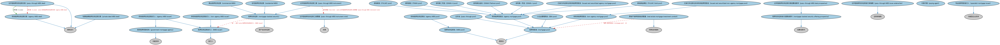

# 抵押贷款支持证券本体（Mortgage-backed Securities Ontology）结构与公理说明

本文档对应 `MortgageBackedSecurities.rdf` / `MortgageBackedSecurities.ttl`，说明该本体的类、继承关系、属性和公理约定。结构图见 `MortgageBackedSecurities-structure.png`（`MortgageBackedSecurities-structure.svg` 为可缩放版本）。

## 1. 本体概述

定义抵押贷款支持证券（MBS）：以住房或商业抵押贷款池为支持、按过手或分层结构发行的证券。

**在体系中的位置**：SEC 债务模块中证券化产品的主要品种之一。

**上下游关系**：上游继承池支持证券本体并依赖 LOAN 抵押贷款（底层资产）；下游关联 BP 的 MBS 发行流程与机构/私人品牌分类。

**与相近概念的差别**：与 ABS 的差别在底层资产是抵押贷款；机构 MBS 有政府担保、私人品牌 MBS 靠结构增信——提前还款风险（prepayment）是 MBS 特有的核心风险。

## 2. 类（Class）

| 类（Class） | 定义（Definition） |
|---|---|
| 房地美金牌池（FHLMC Gold pool） | 联邦住房贷款抵押公司（FHLMC，房地美）金牌计划的抵押贷款池。 |
| 房地美池（FHLMC pool） | 联邦住房贷款抵押公司（FHLMC，房地美）的抵押贷款池。 |
| 房利美池（FNMA pool） | 联邦国民抵押贷款协会（FNMA，房利美）的抵押贷款池。 |
| 吉利美白金池（GNMA Platinum pool） | 政府国民抵押贷款协会（GNMA，吉利美）白金计划的抵押贷款池。 |
| 吉利美二号池（GNMA-II pool） | 政府国民抵押贷款协会（GNMA，吉利美）二号计划的抵押贷款池。 |
| 吉利美一号池（GNMA-I pool） | 政府国民抵押贷款协会（GNMA，吉利美）一号计划的抵押贷款池。 |
| 小企业管理局池（SBA pool） | 由美国小企业管理局（SBA）担保贷款组成的池。 |
| 机构抵押支持证券交易（agency MBS deal） | 由政府机构持有的抵押贷款池支持的证券的一次发行。 |
| 机构抵押支持证券发行人（agency MBS issuer） | 过手型 MBS 的发行人为机构发行人，即专门为发行此类工具而设立的某种机构。 |
| 机构抵押支持证券池（agency MBS pool） | 由一组机构 MBS 工具组成的池投资。 |
| 机构抵押贷款池（agency mortgage pool） | 由机构抵押贷款组成的池。 |
| 商业抵押支持证券（commercial MBS） | 由商业房地产抵押贷款池支持的抵押支持证券。 |
| 政府抵押贷款机构（government mortgage agency） | 由政府为发行抵押贷款（证券）之目的而设立的机构。 |
| 已发行并证券化的机构抵押贷款池（issued and securitized agency mortgage pool） | 已作为机构抵押支持证券一部分证券化的机构抵押贷款池。 |
| 已发行并证券化的非机构抵押贷款池（issued and securitized non-agency mortgage pool） | 已作为分档型抵押支持证券一部分证券化的非机构抵押贷款池。 |
| 抵押支持证券发行人（MBS issuer） | 抵押支持证券的发行人。 |
| 抵押支持证券池（MBS pool） | 由一组 MBS 工具组成的池投资。 |
| 抵押贷款池（mortgage pool） | 由信托持有、作为发行抵押支持证券之抵押品的贷款池。 |
| 抵押支持证券（mortgage-backed security） | 代表对抵押贷款池（最常见为住宅房产抵押贷款）现金流请求权的债务凭证。 |
| 抵押支持证券发行招募说明书（mortgage-backed security offering prospectus） | 描述抵押支持证券发行条款及所含各工具的招募说明书。 |
| 非机构抵押支持证券发行人（non-agency MBS issuer） | MBS 证券的非机构发行人，其身份可以是银行或专业（非机构）抵押贷款公司。 |
| 非机构抵押贷款池（non-agency mortgage pool） | 由非机构抵押贷款组成的池。 |
| 过手型抵押支持证券交易（pass-through MBS deal） | 池中付款直接过手给投资者的抵押支持证券工具的一次发行。 |
| 过手型抵押支持证券交易招募说明书（pass-through MBS deal prospectus） | 机构过手型抵押支持证券发行的书面招募说明书。 |
| 过手型抵押支持证券工具（pass-through MBS instrument） | 标的资产池现金流通过赎回付款方式过手给投资者的证券。 |
| 过手型抵押支持证券工具票据（pass-through MBS instrument note） | 过手型工具中的单张票据。 |
| 过手型抵押支持证券发行承销商（pass-through MBS issue underwriter） | 同意买入投资者未认购之任何凭证的一方。 |
| 过手池（pass-through pool） | 现金流直接过手给投资者的抵押贷款池。 |
| 付款代理（paying agent） | 代表发行人向证券持有人付款的代理机构。 |
| 私募品牌抵押支持证券交易（private label MBS deal） | 由私人机构（而非政府机构）发行的抵押支持证券的一次发行。 |
| 房地产抵押贷款投资管道（real estate mortgage investment conduit） | 将抵押贷款汇聚成池并发行抵押支持证券的特殊目的载体（REMIC）。 |
| 住宅抵押支持证券（residential MBS） | 由住宅抵押贷款池支持的信托凭证（债券）。 |
| 专业抵押贷款发行人（specialist mortgage issuer） | 专门从事面向公众发行抵押贷款业务的商业组织。 |

### 2.1 继承关系（Inheritance）

- 房地美金牌池（FHLMC Gold pool） ⊑ 机构抵押贷款池（agency mortgage pool）
- 房地美池（FHLMC pool） ⊑ 机构抵押贷款池（agency mortgage pool）
- 房利美池（FNMA pool） ⊑ 机构抵押贷款池（agency mortgage pool）
- 吉利美白金池（GNMA Platinum pool） ⊑ 机构抵押贷款池（agency mortgage pool）
- 吉利美二号池（GNMA-II pool） ⊑ 机构抵押贷款池（agency mortgage pool）
- 吉利美一号池（GNMA-I pool） ⊑ 机构抵押贷款池（agency mortgage pool）
- 小企业管理局池（SBA pool） ⊑ 抵押贷款池（mortgage pool）
- 机构抵押支持证券交易（agency MBS deal） ⊑ 债务发行
- 机构抵押支持证券发行人（agency MBS issuer） ⊑ 政府抵押贷款机构（government mortgage agency）
- 机构抵押支持证券发行人（agency MBS issuer） ⊑ 抵押支持证券发行人（MBS issuer）
- 机构抵押支持证券池（agency MBS pool） ⊑ 抵押支持证券池（MBS pool）
- 机构抵押贷款池（agency mortgage pool） ⊑ 抵押贷款池（mortgage pool）
- 商业抵押支持证券（commercial MBS） ⊑ 抵押支持证券（mortgage-backed security）
- 政府抵押贷款机构（government mortgage agency） ⊑ 功能实体
- 已发行并证券化的机构抵押贷款池（issued and securitized agency mortgage pool） ⊑ 机构抵押贷款池（agency mortgage pool）
- 已发行并证券化的非机构抵押贷款池（issued and securitized non-agency mortgage pool） ⊑ 非机构抵押贷款池（non-agency mortgage pool）
- 抵押支持证券发行人（MBS issuer） ⊑ 发行人
- 抵押支持证券池（MBS pool） ⊑ 债务池
- 抵押贷款池（mortgage pool） ⊑ 债务池
- 抵押支持证券（mortgage-backed security） ⊑ 资产池支持证券
- 抵押支持证券发行招募说明书（mortgage-backed security offering prospectus） ⊑ 招募说明书
- 非机构抵押支持证券发行人（non-agency MBS issuer） ⊑ 抵押支持证券发行人（MBS issuer）
- 非机构抵押贷款池（non-agency mortgage pool） ⊑ 抵押贷款池（mortgage pool）
- 过手型抵押支持证券交易（pass-through MBS deal） ⊑ 债务发行
- 过手型抵押支持证券交易招募说明书（pass-through MBS deal prospectus） ⊑ 抵押支持证券发行招募说明书（mortgage-backed security offering prospectus）
- 过手型抵押支持证券工具（pass-through MBS instrument） ⊑ 抵押支持证券（mortgage-backed security）
- 过手型抵押支持证券工具票据（pass-through MBS instrument note） ⊑ 本票
- 过手型抵押支持证券发行承销商（pass-through MBS issue underwriter） ⊑ 证券承销商
- 过手池（pass-through pool） ⊑ 抵押贷款池（mortgage pool）
- 私募品牌抵押支持证券交易（private label MBS deal） ⊑ 债务发行
- 房地产抵押贷款投资管道（real estate mortgage investment conduit） ⊑ 特殊目的载体
- 住宅抵押支持证券（residential MBS） ⊑ 抵押支持证券（mortgage-backed security）
- 专业抵押贷款发行人（specialist mortgage issuer） ⊑ 功能型企业实体

## 3. 对象属性（Object Property）

| 属性（Property） | 中文（English） | 定义（Definition） | 说明 |
|---|---|---|---|
| fibo-sec-dbt-mbs:denomination.1 | 票面金额（denomination） | 票据计价的货币金额，例如 500 美元面额的票据。 | 定义域（domain）：过手型抵押支持证券工具票据（pass-through MBS instrument note）；值域（range）：货币数量 |
| fibo-sec-dbt-mbs:hasNote | 具有票据（has note） | 将分档或发行与其中的单张票据关联起来。 | 定义域（domain）：抵押支持证券（mortgage-backed security）；值域（range）：本票；子属性（subPropertyOf）：具有部分 |
| fibo-sec-dbt-mbs:isAlso | 同时是（is also） | 表明某分档同时属于另一类型。 | 定义域（domain）：过手型抵押支持证券交易（pass-through MBS deal）；值域（range）：机构抵押支持证券交易（agency MBS deal） |
| fibo-sec-dbt-mbs:isSliceOf | 是……的切片（is slice of） | 表明某一持有是某一分档的切片。 | 定义域（domain）：本票；值域（range）：抵押支持证券（mortgage-backed security）；逆属性（inverseOf）：具有票据（has note）；子属性（subPropertyOf）：是……的部分 |
| fibo-sec-dbt-mbs:responsibleFor | 负责（responsible for） | 表明某一方对某一发行、池或工具负有责任。 | 定义域（domain）：付款代理（paying agent）；值域（range）：支付 |

## 4. 数据属性（Datatype Property）

| 属性（Property） | 中文（English） | 定义（Definition） |
|---|---|---|
| fibo-sec-dbt-mbs:prime | 是否优质（prime） | 表明该抵押贷款池是否被标识为优质（Prime）贷款池。 |

## 5. 公理约定（Axioms）

- 机构抵押支持证券交易（agency MBS deal） 与 私募品牌抵押支持证券交易（private label MBS deal） 互斥（disjointWith）
- 机构抵押贷款池（agency mortgage pool） 与 非机构抵押贷款池（non-agency mortgage pool） 互斥（disjointWith）
- 商业抵押支持证券（commercial MBS） 与 住宅抵押支持证券（residential MBS） 互斥（disjointWith）
- 政府抵押贷款机构（government mortgage agency）：由…扮演（is played by） some 法律实体
- 已发行并证券化的机构抵押贷款池（issued and securitized agency mortgage pool）：具有阶段 some fibo-bp-iss-dbti:Issued
- 已发行并证券化的非机构抵押贷款池（issued and securitized non-agency mortgage pool）：具有阶段 some fibo-bp-iss-dbti:Issued
- 抵押支持证券发行人（MBS issuer）：restriction
- 抵押贷款池（mortgage pool）：具有成员 some 房地产担保贷款
- 抵押支持证券（mortgage-backed security）：由……发行 some 抵押支持证券发行人（MBS issuer）
- 抵押支持证券（mortgage-backed security）：以……为特征 some 加权平均剩余期限
- 非机构抵押支持证券发行人（non-agency MBS issuer）：restriction
- 过手型抵押支持证券交易（pass-through MBS deal）：同时是（is also） some 机构抵押支持证券交易（agency MBS deal）
- 过手型抵押支持证券工具（pass-through MBS instrument）：具有票据（has note） some 过手型抵押支持证券工具票据（pass-through MBS instrument note）
- 付款代理（paying agent）：负责（responsible for） some 支付
- 房地产抵押贷款投资管道（real estate mortgage investment conduit）：拥有 抵押贷款池（mortgage pool） ≥0

## 6. 依赖（owl:imports，26 个）

本本体通过 `owl:imports` 引入以下本体，各项的中文名称与简介如下：

| 导入本体 | 中文名称 | 简介 |
|---|---|---|
| `BE/FunctionalEntities/FunctionalEntities.rdf` | 功能实体本体（Functional Entities Ontology） | 定义「功能实体」：按其在商业中承担的功能（而非法律形式）刻画的实体，是出版方、登记机构等功能性主体的基础。 |
| `BE/LegalEntities/LegalPersons.rdf` | 法律主体本体（Legal Persons Ontology） | 定义法律主体（legal person）与法定实体（legal entity）的核心概念：能持有权利义务、可起诉与被诉的主体。 |
| `BP/SecuritiesIssuance/DebtIssuance.rdf` | 债务发行本体（Debt Issuance Ontology） | 定义债券等债务工具的发行流程与参与方。 |
| `FBC/FinancialInstruments/FinancialInstruments.rdf` | 金融工具本体（Financial Instruments Ontology） | FIBO 核心本体之一，定义金融工具（financial instrument）的通用概念：可交易、代表某种权利义务的合同工具，是证券、衍生品等具体工具的共同基础。 |
| `FBC/FunctionalEntities/FinancialServicesEntities.rdf` | 金融服务实体本体（Financial Services Entities Ontology） | FBC 域核心本体，定义金融服务机构（银行、券商、保险公司、资管机构等）的功能分类体系。 |
| `FND/Accounting/CurrencyAmount.rdf` | 货币金额本体（Currency Amount Ontology） | 定义「金额＋币种」的货币金额（currency amount）表示，是 FIBO 中表达价格、债务金额、付款额等一切带币种数值的基础构件。 |
| `FND/Agreements/Contracts.rdf` | 合同本体（Contracts Ontology） | 在协议之上定义具有法律约束力的合同（contract）：合同当事方、合同条款、义务与权利，是金融工具与交易合同建模的基石。 |
| `FND/Arrangements/Lifecycles.rdf` | 生命周期本体（Lifecycles Ontology） | 定义生命周期、生命周期阶段与状态转移，用于描述合同、金融工具、机构从创设到终止的演化过程。 |
| `FND/DatesAndTimes/BusinessDates.rdf` | 营业日期本体（Business Dates Ontology） | 定义营业日、营业日历与日期调整规则（如顺延约定），支撑金融合同中的营业日计算。 |
| `FND/DatesAndTimes/FinancialDates.rdf` | 金融日期本体（Financial Dates Ontology） | 定义金融语境下的日期与期间概念：结算日、付息日、到期日、日计数基准等。 |
| `FND/OwnershipAndControl/Ownership.rdf` | 所有权本体（Ownership Ontology） | 定义「拥有」关系：所有者、被拥有资产及所有权份额。 |
| `FND/ProductsAndServices/PaymentsAndSchedules.rdf` | 付款与计划表本体（Payments and Schedules Ontology） | 定义付款、付款计划表（payment schedule）及其日期与金额结构，是贷款还款、债券付息建模的基础。 |
| `FND/Relations/Relations.rdf` | 关系本体（Relations Ontology） | FIBO 最底层的基础本体，定义参考（reference）、分类（classify）等通用关系与抽象概念，全库普遍依赖。 |
| `FND/Utilities/AnnotationVocabulary.rdf` | FIBO 标注词汇表（FIBO Annotation Vocabulary） | 定义 FIBO 专用的标注属性（如释义来源、成熟度等级），用于本体自身的元数据标注。 |
| `LOAN/RealEstateLoans/Mortgages.rdf` | 抵押贷款本体（Mortgages Ontology） | 定义以不动产为抵押的贷款：抵押物、抵押登记与止赎。 |
| `SEC/Debt/AssetBackedSecurities.rdf` | 资产支持证券本体（Asset-backed Securities Ontology） | 定义以资产池（如贷款、应收账款）为支持的资产支持证券（ABS）。 |
| `SEC/Debt/DebtInstruments.rdf` | 债务工具本体（Debt Instruments Ontology） | 定义债务工具（debt instrument）的通用概念：可交易的债权凭证，是债券、票据等的上位模型。 |
| `SEC/Debt/PoolBackedSecurities.rdf` | 池支持证券本体（Pool-backed Securities Ontology） | 定义以资产池为支持的证券的通用结构：资产池、分层（tranche）与过手安排。 |
| `SEC/Funds/Funds.rdf` | 基金本体（Funds Ontology） | 定义投资基金（fund）：基金份额、净值与管理结构。 |
| `SEC/Securities/Pools.rdf` | 证券池本体（Securities Pools Ontology） | 定义证券池（pool）：归集起来作为证券化基础的一组资产。 |
| `SEC/Securities/SecuritiesIssuance.rdf` | 证券发行本体（Securities Issuance Ontology） | 定义证券发行（issuance）：发行人、发行条款与发行结果。 |
| `https://www.omg.org/spec/Commons/AnnotationVocabulary/` | OMG 通用标注词汇表（OMG Commons Annotation Vocabulary） | OMG 通用本体库（Commons）中的标注词汇表，提供概念映射等标注属性，FIBO 用它标注术语与外部标准的对应关系。 |
| `https://www.omg.org/spec/Commons/Classifiers/` | OMG 通用分类器本体（OMG Commons Classifiers） | OMG 通用本体库（Commons）中的分类器本体，定义分类方案、类别与归类关系的通用概念，FIBO 的分类建模建立在其上。 |
| `https://www.omg.org/spec/Commons/Collections/` | OMG 通用集合本体（OMG Commons Collections） | Commons 库中的集合本体，定义集合、成员等通用概念。 |
| `https://www.omg.org/spec/Commons/Organizations/` | OMG 通用组织本体（OMG Commons Organizations） | Commons 库中的组织本体，定义组织、组织成员与组织结构的通用概念。 |
| `https://www.omg.org/spec/Commons/RolesAndCompositions/` | OMG 通用角色与构成本体（OMG Commons Roles and Compositions） | Commons 库中的角色本体，定义角色及整体—部分构成关系的通用概念。 |

## 7. 文件

- 官方 RDF/XML：`MortgageBackedSecurities.rdf`
- 中文 Turtle：`MortgageBackedSecurities.ttl`
- 结构图：`MortgageBackedSecurities-structure.png` / `MortgageBackedSecurities-structure.svg`