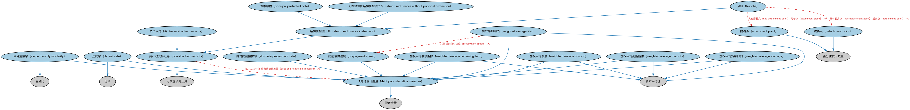

# 池支持证券本体（Pool-backed Securities Ontology）结构与公理说明

本文档对应 `PoolBackedSecurities.rdf` / `PoolBackedSecurities.ttl`，说明该本体的类、继承关系、属性和公理约定。结构图见 `PoolBackedSecurities-structure.png`（`PoolBackedSecurities-structure.svg` 为可缩放版本）。

## 1. 本体概述

定义以资产池为支持的证券的通用结构：资产池、分层（tranche）、过手（pass-through）安排。

**在体系中的位置**：SEC 债务模块中资产证券化的框架本体，ABS、MBS、CDO 的共同上游。

**上下游关系**：上游继承债务工具并依赖证券池本体；下游被资产支持证券、抵押贷款支持证券、担保债务凭证特化。

**与相近概念的差别**：池支持证券≠普通债券——偿付来源是资产池现金流而非发行人信用；分层机制使不同档（tranche）承担不同风险，这是普通债券没有的结构。

本本体中类与类的核心关系如下（完整细节见各类小节）：

- **绝对提前偿付率（absolute prepayment rate）** 继承 **债务池统计度量（debt pool statistical measure）**
- **资产支持证券（asset-backed security）** 继承 **资产池支持证券（pool-backed security）**
- **附着点（attachment point）** 继承 **百分比货币数量（PercentageMonetaryAmount）**
- **债务池统计度量（debt pool statistical measure）** 继承 **限定度量（QualifiedMeasure）**
- **违约率（default rate）** 继承 **债务池统计度量（debt pool statistical measure）**
- **违约率（default rate）** 继承 **比率（Ratio）**
- **脱离点（detachment point）** 继承 **百分比货币数量（PercentageMonetaryAmount）**
- **资产池支持证券（pool-backed security）** 继承 **可交易债务工具（TradableDebtInstrument）**
- **提前偿付速度（prepayment speed）** 继承 **债务池统计度量（debt pool statistical measure）**
- **保本票据（principal protected note）** 继承 **结构化金融工具（structured finance instrument）**
- **单月清偿率（single monthly mortality）** 继承 **债务池统计度量（debt pool statistical measure）**
- **单月清偿率（single monthly mortality）** 继承 **百分比（Percentage）**
- 其余 13 条关系从略。

## 2. 类（Class）

| 类（Class） | 定义（Definition） |
|---|---|
| 绝对提前偿付率（absolute prepayment rate） | 以原始资产池余额百分比表示的月度贷款提前偿付率。 measure of the monthly rate of loan prepayments as a percentage of the original pool balance |
| 资产支持证券（asset-backed security） | 由房地产贷款或抵押贷款以外应收款支持的债务工具。 debt instrument backed by receivables other than those arising out of real estate loans or mortgages |
| 附着点（attachment point） | 分档的下边界，以发行时或某一时点抵押品总池价值的百分比表示。 lower tranche boundary of a tranche defined as a percentage of the value of the total pool of collateral, either at issuance or as of some point in time |
| 债务池统计度量（debt pool statistical measure） | 对一个或多个债务工具可能随时间变化之行为的某方面进行的限定性度量。 qualified measure of some aspect of the behavior of one or more debt instrument(s) that may vary over time |
| 违约率（default rate） | 对池中债务工具持有人违约比率的限定性度量。 qualified measure of the rate at which holders of the debt instruments in the pool default on those instruments |
| 脱离点（detachment point） | 分档的上边界，以发行时或某一时点抵押品总池价值的百分比表示。 upper tranche boundary of a tranche defined as a percentage of the value of the total pool of collateral, either at issuance or as of some point in time |
| 资产池支持证券（pool-backed security） | 现金流来源于标的抵押贷款池或其他应收款池的债务工具。 debt instrument that derives its cashflow from an underlying pool of mortgage loans or other receivables |
| 提前偿付速度（prepayment speed） | 对债务或部分债务提前清偿比率的估计。 estimated rate at which a debt or part of a debt is paid off ahead of schedule |
| 保本票据（principal protected note） | 通过多种方式和不对称支付结构为投资者提供选定标的资产风险敞口的结构化金融产品。 structured finance that offers investors exposure to chosen underlying assets using various approaches and asymmetric pay-off profiles |
| 单月清偿率（single monthly mortality） | 对抵押支持证券（MBS）池中每月将提前清偿之抵押贷款百分比的估计。 estimated per-month percentage of mortgages in an MBS pool that will be paid off early |
| 结构化金融工具（structured finance instrument） | 通过特定结构将资产池风险与发起机构风险相隔离的资产池支持证券。 pool-backed security wherein the risk associated with the pool has been uncoupled from the risk associated with the originating institution through a special purpose vehicle |
| 无本金保护结构化金融产品（structured finance without principal protection） | 与标的资产挂钩、提供稳定收入流的短期票据类结构化金融产品。 structured finance that is a short-term note linked to an underlying asset that offers a steady stream of income |
| 分档（tranche） | 证券池（通常为债务工具）的一个部分。 segment of a pool of securities, typically debt instruments |
| 加权平均票息（weighted average coupon） | 抵押支持证券（MBS）标的抵押贷款池按余额加权的平均总利率。 weighted-average gross interest rates of the pool of mortgages that underlie a mortgage-backed security (MBS) weighed by their balances at the time the securities were issued |
| 加权平均期限（weighted average life） | 本金偿还时间的加权平均值，按收取全部未来现金流的时间加权计算。 weighted average of the times of the principal repayments Average life is calculated using the weighted average time to the receipt of all future cash flows. |
| 加权平均贷款账龄（weighted average loan age） | 衡量抵押转手证券或集合证券中各笔贷款账龄的金额加权平均值。 dollar-weighted average measuring the age of the individual loans in a mortgage pass-through or pooled security |
| 加权平均到期期限（weighted average maturity） | 抵押支持证券（MBS）中抵押贷款到期时间的加权平均值。 weighted average amount of time until the maturities on mortgages in a mortgage-backed security (MBS) |
| 加权平均剩余期限（weighted average remaining term） | 资产支持证券（ABS）或抵押支持证券（MBS）组合的加权平均到期时间。 weighted average time to maturity of a portfolio of asset-backed securities (ABS) or mortgage-backed (MBS) securities |

以下按类逐个展开：每个类给出继承关系、相关属性与公理约定；子类在父类之下降一级编号。

### 2.1 附着点（attachment point）

定义：分档的下边界，以发行时或某一时点抵押品总池价值的百分比表示。

- 父类：**百分比货币数量（PercentageMonetaryAmount）**

属性：

| 属性 | 定义 | 说明 |
|---|---|---|
| **是……的估计价值（isEstimatedValueOf）** | — | — |

公理：

- **是……的估计价值（isEstimatedValueOf）**可以有 0 个或多个**截至日抵押品价值（CollateralValueAsOfDate）**。

### 2.2 债务池统计度量（debt pool statistical measure）

定义：对一个或多个债务工具可能随时间变化之行为的某方面进行的限定性度量。

- 父类：**限定度量（QualifiedMeasure）**
- 直接子类：**绝对提前偿付率（absolute prepayment rate）**、**违约率（default rate）**、**提前偿付速度（prepayment speed）**、**单月清偿率（single monthly mortality）**、**加权平均票息（weighted average coupon）**、**加权平均期限（weighted average life）**、**加权平均贷款账龄（weighted average loan age）**、**加权平均到期期限（weighted average maturity）**、**加权平均剩余期限（weighted average remaining term）**

属性：

| 属性 | 定义 | 说明 |
|---|---|---|
| **适用于（appliesTo）** | — | — |
| **具有适用期间（hasApplicablePeriod）** | — | — |

公理：

- **具有适用期间（hasApplicablePeriod）**可以有 0 个或多个**日期区间（DatePeriod）**。
- **适用于（appliesTo）**至少有一个取值，类型是**债务池（DebtPool）**。

#### 2.2.1 绝对提前偿付率（absolute prepayment rate）

定义：以原始资产池余额百分比表示的月度贷款提前偿付率。

- 父类：**债务池统计度量（debt pool statistical measure）**

#### 2.2.2 违约率（default rate）

定义：对池中债务工具持有人违约比率的限定性度量。

- 父类：**债务池统计度量（debt pool statistical measure）**、**比率（Ratio）**

#### 2.2.3 提前偿付速度（prepayment speed）

定义：对债务或部分债务提前清偿比率的估计。

- 父类：**债务池统计度量（debt pool statistical measure）**

#### 2.2.4 单月清偿率（single monthly mortality）

定义：对抵押支持证券（MBS）池中每月将提前清偿之抵押贷款百分比的估计。

- 父类：**债务池统计度量（debt pool statistical measure）**、**百分比（Percentage）**

#### 2.2.5 加权平均票息（weighted average coupon）

定义：抵押支持证券（MBS）标的抵押贷款池按余额加权的平均总利率。

- 父类：**算术平均值（ArithmeticMean）**、**债务池统计度量（debt pool statistical measure）**

#### 2.2.6 加权平均期限（weighted average life）

定义：本金偿还时间的加权平均值，按收取全部未来现金流的时间加权计算。

- 父类：**算术平均值（ArithmeticMean）**、**债务池统计度量（debt pool statistical measure）**

属性：

| 属性 | 定义 | 说明 |
|---|---|---|
| **引用（refersTo）** | — | — |

公理：

- **引用（refersTo）**可以有 0 个或多个**提前偿付速度（prepayment speed）**。

#### 2.2.7 加权平均贷款账龄（weighted average loan age）

定义：衡量抵押转手证券或集合证券中各笔贷款账龄的金额加权平均值。

- 父类：**算术平均值（ArithmeticMean）**、**债务池统计度量（debt pool statistical measure）**

#### 2.2.8 加权平均到期期限（weighted average maturity）

定义：抵押支持证券（MBS）中抵押贷款到期时间的加权平均值。

- 父类：**算术平均值（ArithmeticMean）**、**债务池统计度量（debt pool statistical measure）**

#### 2.2.9 加权平均剩余期限（weighted average remaining term）

定义：资产支持证券（ABS）或抵押支持证券（MBS）组合的加权平均到期时间。

- 父类：**算术平均值（ArithmeticMean）**、**债务池统计度量（debt pool statistical measure）**

### 2.3 脱离点（detachment point）

定义：分档的上边界，以发行时或某一时点抵押品总池价值的百分比表示。

- 父类：**百分比货币数量（PercentageMonetaryAmount）**

属性：

| 属性 | 定义 | 说明 |
|---|---|---|
| **是……的估计价值（isEstimatedValueOf）** | — | — |

公理：

- **是……的估计价值（isEstimatedValueOf）**可以有 0 个或多个**截至日抵押品价值（CollateralValueAsOfDate）**。

### 2.4 资产池支持证券（pool-backed security）

定义：现金流来源于标的抵押贷款池或其他应收款池的债务工具。

- 父类：**可交易债务工具（TradableDebtInstrument）**
- 直接子类：**资产支持证券（asset-backed security）**、**结构化金融工具（structured finance instrument）**

属性：

| 属性 | 定义 | 说明 |
|---|---|---|
| **基于（isBasedOn）** | — | — |
| **是……的估计价值（is estimated value of）** | 将评估价值关联到评估日所关注的资产。 indicates the estimated value of the combined underlying collateral for a given tranche at the time the instrument was issued | 值域：截至日抵押品价值；子属性：是……的估计价值 |
| **是否过手（is pass through）** | 表明标的资产池的现金流是否通过赎回付款方式过手给投资者。 indicates whether the cash flows from the underlying asset pool are passed through to the investor by way of redemption payments | 值域：xsd:boolean |
| **以……为特征（isCharacterizedBy）** | — | — |

公理：

- **以……为特征（isCharacterizedBy）**可以有 0 个或多个**债务池统计度量（debt pool statistical measure）**。
- **基于（isBasedOn）**至少有一个取值，类型是**工具池（InstrumentPool）**。
- **是……的估计价值（is estimated value of）**可以有 0 个或多个**截至日抵押品价值（CollateralValueAsOfDate）**。
- **是否过手（is pass through）**存在取值约束。

#### 2.4.1 资产支持证券（asset-backed security）

定义：由房地产贷款或抵押贷款以外应收款支持的债务工具。

- 父类：**资产池支持证券（pool-backed security）**

#### 2.4.2 结构化金融工具（structured finance instrument）

定义：通过特定结构将资产池风险与发起机构风险相隔离的资产池支持证券。

- 父类：**资产池支持证券（pool-backed security）**
- 直接子类：**保本票据（principal protected note）**、**无本金保护结构化金融产品（structured finance without principal protection）**、**分档（tranche）**

属性：

| 属性 | 定义 | 说明 |
|---|---|---|
| **由……发行（isIssuedBy）** | — | — |

公理：

- **由……发行（isIssuedBy）**至少有一个取值，该取值满足：**由…扮演（is played by）**至少有一个取值，类型是**特殊目的载体（SpecialPurposeVehicle）**。

##### 2.4.2.1 保本票据（principal protected note）

定义：通过多种方式和不对称支付结构为投资者提供选定标的资产风险敞口的结构化金融产品。

- 父类：**结构化金融工具（structured finance instrument）**

##### 2.4.2.2 无本金保护结构化金融产品（structured finance without principal protection）

定义：与标的资产挂钩、提供稳定收入流的短期票据类结构化金融产品。

- 父类：**结构化金融工具（structured finance instrument）**

公理：

- 与**保本票据（principal protected note）**互斥：同一个体不能同时属于两者。

##### 2.4.2.3 分档（tranche）

定义：证券池（通常为债务工具）的一个部分。

- 父类：**结构化金融工具（structured finance instrument）**

属性：

| 属性 | 定义 | 说明 |
|---|---|---|
| **具有附着点（has attachment point）** | 指明标的抵押品总价值的下限（以发行时或某一时点计），达到该点时该分档开始承担损失。 indicates the minimum (lower boundary) of the total value of the underlying collateral, either at issuance or as of some point in time, at which point a given tranche becomes liable for losses | 值域：附着点（attachment point）；子属性：具有量值 |
| **具有脱离点（has detachment point）** | 指明标的抵押品总价值的上限（以发行时或某一时点计），达到该点时该分档不再承担损失。 indicates the maximum (upper boundary) of the total value of the underlying collateral, either at issuance or as of some point in time, at which point the value of given tranche is wiped out | 值域：脱离点（detachment point）；子属性：具有量值 |
| **是……的估计价值（is estimated value of）** | 将评估价值关联到评估日所关注的资产。 indicates the estimated value of the combined underlying collateral for a given tranche at the time the instrument was issued | 值域：截至日抵押品价值；子属性：是……的估计价值 |
| **包含（comprises）** | — | — |

公理：

- **具有脱离点（has detachment point）**可以有 0 个或多个**脱离点（detachment point）**。
- **具有附着点（has attachment point）**可以有 0 个或多个**附着点（attachment point）**。
- **包含（comprises）**至少有一个取值，该取值满足：**是……的部分（isPartOf）**至少有一个取值，类型是**工具池（InstrumentPool）**。
- **是……的估计价值（is estimated value of）**可以有 0 个或多个**截至日抵押品价值（CollateralValueAsOfDate）**。

## 3. 依赖（owl:imports，17 个）

本本体通过 `owl:imports` 引入以下本体，各项的中文名称与简介如下：

| 导入本体 | 中文名称 | 简介 |
|---|---|---|
| `BE/LegalEntities/LegalPersons.rdf` | 法律主体本体（Legal Persons Ontology） | 定义法律主体（legal person）与法定实体（legal entity）的核心概念：能持有权利义务、可起诉与被诉的主体。 |
| `FBC/DebtAndEquities/Debt.rdf` | 债务本体（Debt Ontology） | 定义债务（debt）与债权债务关系的核心概念：借款人、贷款人、本金与利息义务。 |
| `FND/Accounting/CurrencyAmount.rdf` | 货币金额本体（Currency Amount Ontology） | 定义「金额＋币种」的货币金额（currency amount）表示，是 FIBO 中表达价格、债务金额、付款额等一切带币种数值的基础构件。 |
| `FND/Arrangements/Assessments.rdf` | 评估本体（Assessments Ontology） | 定义评估活动、评估结果与评估方的通用结构，为信用评级、风险打分等判断性活动提供基础模型。 |
| `FND/Relations/Relations.rdf` | 关系本体（Relations Ontology） | FIBO 最底层的基础本体，定义参考（reference）、分类（classify）等通用关系与抽象概念，全库普遍依赖。 |
| `FND/Utilities/Analytics.rdf` | 分析本体（Analytics Ontology） | 定义分析工具、度量与比率的通用概念，支撑指标与模型的表达。 |
| `FND/Utilities/AnnotationVocabulary.rdf` | FIBO 标注词汇表（FIBO Annotation Vocabulary） | 定义 FIBO 专用的标注属性（如释义来源、成熟度等级），用于本体自身的元数据标注。 |
| `SEC/Debt/DebtInstruments.rdf` | 债务工具本体（Debt Instruments Ontology） | 定义债务工具（debt instrument）的通用概念：可交易的债权凭证，是债券、票据等的上位模型。 |
| `SEC/Securities/Pools.rdf` | 证券池本体（Securities Pools Ontology） | 定义证券池（pool）：归集起来作为证券化基础的一组资产。 |
| `https://www.omg.org/spec/Commons/AnnotationVocabulary/` | OMG 通用标注词汇表（OMG Commons Annotation Vocabulary） | OMG 通用本体库（Commons）中的标注词汇表，提供概念映射等标注属性，FIBO 用它标注术语与外部标准的对应关系。 |
| `https://www.omg.org/spec/Commons/Classifiers/` | OMG 通用分类器本体（OMG Commons Classifiers） | OMG 通用本体库（Commons）中的分类器本体，定义分类方案、类别与归类关系的通用概念，FIBO 的分类建模建立在其上。 |
| `https://www.omg.org/spec/Commons/Collections/` | OMG 通用集合本体（OMG Commons Collections） | Commons 库中的集合本体，定义集合、成员等通用概念。 |
| `https://www.omg.org/spec/Commons/ContextualDesignators/` | OMG 通用语境指称本体（OMG Commons Contextual Designators） | Commons 库中的语境指称本体，定义「在某个语境下指代某物的名称/符号」，是地址、账户号码等语境相关标识的基础。 |
| `https://www.omg.org/spec/Commons/DatesAndTimes/` | OMG 通用日期与时间本体（OMG Commons Dates and Times） | Commons 库中的日期时间本体，定义日期、期间、时间点等通用时间概念。 |
| `https://www.omg.org/spec/Commons/Documents/` | OMG 通用文档本体（OMG Commons Documents） | Commons 库中的文档本体，定义文档及其组成部分的通用概念。 |
| `https://www.omg.org/spec/Commons/QuantitiesAndUnits/` | OMG 通用量与单位本体（OMG Commons Quantities and Units） | Commons 库中的量与单位本体，定义数量、度量单位、量纲的通用概念，支撑金额、比率等数值表达。 |
| `https://www.omg.org/spec/Commons/RolesAndCompositions/` | OMG 通用角色与构成本体（OMG Commons Roles and Compositions） | Commons 库中的角色本体，定义角色及整体—部分构成关系的通用概念。 |

## 4. 文件

- 官方 RDF/XML：`PoolBackedSecurities.rdf`
- 中文 Turtle：`PoolBackedSecurities.ttl`
- 结构图：`PoolBackedSecurities-structure.png` / `PoolBackedSecurities-structure.svg`