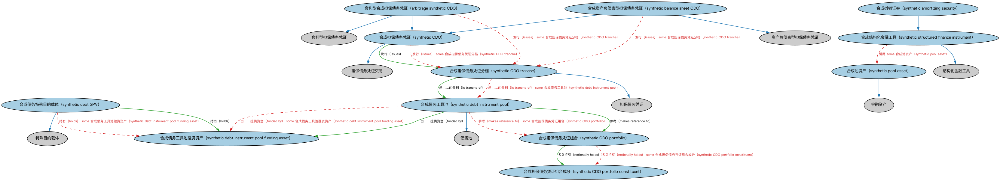

# 合成 CDO 本体（Synthetic CDOs Ontology）结构与公理说明

本文档对应 `SyntheticCDOs.rdf` / `SyntheticCDOs.ttl`，说明该本体的类、继承关系、属性和公理约定。结构图见 `SyntheticCDOs-structure.png`（`SyntheticCDOs-structure.svg` 为可缩放版本）。

## 1. 本体概述

定义合成型担保债务凭证（synthetic CDO）：不持有真实债务资产，而是通过信用违约互换（CDS）构建风险敞口的 CDO。

**在体系中的位置**：SEC 债务模块中 CDO 的衍生形态。

**上下游关系**：上游继承 CDO 本体并依赖 DER 信用违约互换；下游服务结构化信用产品建模。

**与相近概念的差别**：与现金型 CDO 的根本差别——现金型持有真实债券/贷款，合成型只通过 CDS「模拟」资产池的信用表现，也因此可以做空信用、放大风险敞口（2008 年危机的关键工具）。

## 2. 类（Class）

| 类（Class） | 定义（Definition） |
|---|---|
| 套利型合成担保债务凭证（arbitrage synthetic CDO） | 出于监管或实务考量而构造的合成 CDO，使银行在保留债务所有权的同时实现风险转移等目的。 |
| 合成摊销证券（synthetic amortizing security） | 为模拟摊销证券行为而构造的证券。 |
| 合成资产负债表型担保债务凭证（synthetic balance sheet CDO） | 以合成方式将资产负债表资产风险转移出去的 CDO。 |
| 合成担保债务凭证（synthetic CDO） | 通过信用衍生品（而非真实资产）合成标的组合的担保债务凭证。 |
| 合成担保债务凭证组合（synthetic CDO portfolio） | 合成 CDO 的标的组合，由信用衍生品头寸构成而非实际持有资产。 |
| 合成担保债务凭证组合成分（synthetic CDO portfolio constituent） | 被定义为合成工具池成分的工具；它们并非实际持有，但在其他方面与持有类似。 |
| 合成担保债务凭证分档（synthetic CDO tranche） | 合成 CDO 的一个分档。 |
| 合成债务工具池（synthetic debt instrument pool） | 模拟一篮子债务证券行为的现金流结构，例如用信用衍生品合成的 CDO/债券/ABS 组合。 |
| 合成债务工具池融资资产（synthetic debt instrument pool funding asset） | 为合成 CDO 中使用的合成债务工具池提供资金的资产。 |
| 合成债务特殊目的载体（synthetic debt SPV） | 为发行合成 CDO 而设立的特殊目的载体（SPV），该实体（同所有 SPV）本身注册为某种法律实体。 |
| 合成池资产（synthetic pool asset） | 合成池中的资产成分。 |
| 合成结构化金融工具（synthetic structured finance instrument） | 以合成方式构造的结构化金融工具。 |

### 2.1 继承关系（Inheritance）

- 套利型合成担保债务凭证（arbitrage synthetic CDO） ⊑ 套利型担保债务凭证
- 套利型合成担保债务凭证（arbitrage synthetic CDO） ⊑ 合成担保债务凭证（synthetic CDO）
- 合成摊销证券（synthetic amortizing security） ⊑ 合成结构化金融工具（synthetic structured finance instrument）
- 合成资产负债表型担保债务凭证（synthetic balance sheet CDO） ⊑ 资产负债表型担保债务凭证
- 合成资产负债表型担保债务凭证（synthetic balance sheet CDO） ⊑ 合成担保债务凭证（synthetic CDO）
- 合成担保债务凭证（synthetic CDO） ⊑ 担保债务凭证交易
- 合成担保债务凭证分档（synthetic CDO tranche） ⊑ 担保债务凭证
- 合成债务工具池（synthetic debt instrument pool） ⊑ 债务池
- 合成债务特殊目的载体（synthetic debt SPV） ⊑ 特殊目的载体
- 合成池资产（synthetic pool asset） ⊑ 金融资产
- 合成结构化金融工具（synthetic structured finance instrument） ⊑ 结构化金融工具

## 3. 对象属性（Object Property）

| 属性（Property） | 中文（English） | 定义（Definition） | 说明 |
|---|---|---|---|
| fibo-sec-dbt-syn:assetsManagedBy | 资产由……管理（assets managed by） | 指明管理某一组合资产的管理人。 | 定义域（domain）：套利型合成担保债务凭证（arbitrage synthetic CDO）；值域（range）：担保债务凭证组合管理人 |
| fibo-sec-dbt-syn:fundedBy | 由……提供资金（funded by） | 指明为某一合成池提供资金的资产。 | 定义域（domain）：合成债务工具池（synthetic debt instrument pool）；值域（range）：合成债务工具池融资资产（synthetic debt instrument pool funding asset） |
| fibo-sec-dbt-syn:hasInvestmentGrade | 具有投资级别（has investment grade） | 指明工具或分档所具有的投资级别。 | 定义域（domain）：合成债务工具池融资资产（synthetic debt instrument pool funding asset）；值域（range）：工具信用评级 |
| fibo-sec-dbt-syn:hasUnderlyingContract | 具有标的合约（has underlying contract） | 为在合成组合中实现现金流而创设的标的信用违约互换（CDS）。 | 定义域（domain）：合成债务工具池（synthetic debt instrument pool）；值域（range）：信用违约互换 |
| fibo-sec-dbt-syn:holds | 持有（holds） | 参与方与其占有、或对其实施某种所有权或控制、或可自主支配的事物之间的关系。 | 定义域（domain）：合成债务特殊目的载体（synthetic debt SPV）；值域（range）：合成债务工具池融资资产（synthetic debt instrument pool funding asset） |
| fibo-sec-dbt-syn:isTrancheOf | 是……的分档（is tranche of） | 表明某一档属于某一发行。 | 定义域（domain）：合成担保债务凭证分档（synthetic CDO tranche）；值域（range）：合成债务工具池（synthetic debt instrument pool） |
| fibo-sec-dbt-syn:issues | 发行（issues） | 正式使某事物可得。 | 定义域（domain）：合成担保债务凭证（synthetic CDO）；值域（range）：合成担保债务凭证分档（synthetic CDO tranche） |
| fibo-sec-dbt-syn:makesReferenceTo | 参考（makes reference to） | 表明某工具参考某一标的资产或组合。 | 定义域（domain）：合成债务工具池（synthetic debt instrument pool）；值域（range）：合成担保债务凭证组合（synthetic CDO portfolio） |
| fibo-sec-dbt-syn:notionallyHolds | 名义持有（notionally holds） | 表明以名义（而非实际持有）方式拥有某一资产头寸。 | 定义域（domain）：合成担保债务凭证组合（synthetic CDO portfolio）；值域（range）：合成担保债务凭证组合成分（synthetic CDO portfolio constituent） |
| fibo-sec-dbt-syn:percentageOfDefaultsThisTranche | 本分档违约百分比（percentage of defaults this tranche） | 该分档持有人所暴露的违约百分比，即该分档所代表的违约份额。 | 定义域（domain）：合成担保债务凭证分档（synthetic CDO tranche）；值域（range）：百分比 |
| fibo-sec-dbt-syn:simulatedBy | 由……模拟（simulated by） | 为在合成组合中实现现金流而创设的标的信用违约互换（CDS）。 | 定义域（domain）：合成池资产（synthetic pool asset）；值域（range）：信用违约互换 |
| fibo-sec-dbt-syn:simulates | 模拟（simulates） | 表明某合成工具模拟某一真实工具或组合的行为。 | 定义域（domain）：合成池资产（synthetic pool asset） |
| fibo-sec-dbt-syn:simulates.1 | 模拟（simulates） | 表明某合成工具模拟某一真实工具或组合的行为。 | 定义域（domain）：合成债务工具池（synthetic debt instrument pool） |
| fibo-sec-dbt-syn:trancheType | 分档类型（tranche type） | 指明分档的类型。 | 定义域（domain）：合成担保债务凭证分档（synthetic CDO tranche）；值域（range）：担保债务凭证分档优先级选择 |

## 4. 数据属性（Datatype Property）

| 属性（Property） | 中文（English） | 定义（Definition） |
|---|---|---|
| fibo-sec-dbt-syn:isCash | 是否现金型（is cash） | 表明 CDO 是否拥有真实资产的标的池：是则为现金型，否则为合成型标的池。 |

## 5. 公理约定（Axioms）

- 套利型合成担保债务凭证（arbitrage synthetic CDO）：资产由……管理（assets managed by） some 担保债务凭证组合管理人
- 套利型合成担保债务凭证（arbitrage synthetic CDO）：发行（issues） some 合成担保债务凭证分档（synthetic CDO tranche）
- 套利型合成担保债务凭证（arbitrage synthetic CDO） 与 合成资产负债表型担保债务凭证（synthetic balance sheet CDO） 互斥（disjointWith）
- 合成资产负债表型担保债务凭证（synthetic balance sheet CDO）：发行（issues） some 合成担保债务凭证分档（synthetic CDO tranche）
- 合成担保债务凭证（synthetic CDO）：发行（issues） some 合成担保债务凭证分档（synthetic CDO tranche）
- 合成担保债务凭证组合（synthetic CDO portfolio）：名义持有（notionally holds） some 合成担保债务凭证组合成分（synthetic CDO portfolio constituent）
- 合成担保债务凭证分档（synthetic CDO tranche）：是……的分档（is tranche of） some 合成债务工具池（synthetic debt instrument pool）
- 合成债务工具池（synthetic debt instrument pool）：由……提供资金（funded by） some 合成债务工具池融资资产（synthetic debt instrument pool funding asset）
- 合成债务工具池（synthetic debt instrument pool）：具有标的合约（has underlying contract） some 信用违约互换
- 合成债务工具池（synthetic debt instrument pool）：参考（makes reference to） some 合成担保债务凭证组合（synthetic CDO portfolio）
- 合成债务工具池融资资产（synthetic debt instrument pool funding asset）：具有投资级别（has investment grade） some 工具信用评级
- 合成债务特殊目的载体（synthetic debt SPV）：持有（holds） some 合成债务工具池融资资产（synthetic debt instrument pool funding asset）
- 合成池资产（synthetic pool asset）：由……模拟（simulated by） some 信用违约互换
- 合成结构化金融工具（synthetic structured finance instrument）：引用 some 合成池资产（synthetic pool asset）

## 6. 依赖（owl:imports，12 个）

本本体通过 `owl:imports` 引入以下本体，各项的中文名称与简介如下：

| 导入本体 | 中文名称 | 简介 |
|---|---|---|
| `BE/LegalEntities/LegalPersons.rdf` | 法律主体本体（Legal Persons Ontology） | 定义法律主体（legal person）与法定实体（legal entity）的核心概念：能持有权利义务、可起诉与被诉的主体。 |
| `DER/CreditDerivatives/CreditDefaultSwaps.rdf` | 信用违约互换本体（Credit Default Swaps Ontology） | 定义信用违约互换（CDS）：保护买方与卖方、参考实体、信用事件与结算方式。 |
| `FBC/DebtAndEquities/CreditRatings.rdf` | 信用评级本体（Credit Ratings Ontology） | 定义信用评级、评级机构与评级结果，刻画债务人与债务工具的信用水平。 |
| `FND/OwnershipAndControl/Ownership.rdf` | 所有权本体（Ownership Ontology） | 定义「拥有」关系：所有者、被拥有资产及所有权份额。 |
| `FND/Utilities/AnnotationVocabulary.rdf` | FIBO 标注词汇表（FIBO Annotation Vocabulary） | 定义 FIBO 专用的标注属性（如释义来源、成熟度等级），用于本体自身的元数据标注。 |
| `SEC/Debt/CollateralizedDebtObligations.rdf` | 担保债务凭证本体（Collateralized Debt Obligations Ontology） | 定义担保债务凭证（CDO）：以债务资产池分层发行的证券。 |
| `SEC/Debt/PoolBackedSecurities.rdf` | 池支持证券本体（Pool-backed Securities Ontology） | 定义以资产池为支持的证券的通用结构：资产池、分层（tranche）与过手安排。 |
| `SEC/Funds/Funds.rdf` | 基金本体（Funds Ontology） | 定义投资基金（fund）：基金份额、净值与管理结构。 |
| `SEC/Securities/Pools.rdf` | 证券池本体（Securities Pools Ontology） | 定义证券池（pool）：归集起来作为证券化基础的一组资产。 |
| `https://www.omg.org/spec/Commons/AnnotationVocabulary/` | OMG 通用标注词汇表（OMG Commons Annotation Vocabulary） | OMG 通用本体库（Commons）中的标注词汇表，提供概念映射等标注属性，FIBO 用它标注术语与外部标准的对应关系。 |
| `https://www.omg.org/spec/Commons/Documents/` | OMG 通用文档本体（OMG Commons Documents） | Commons 库中的文档本体，定义文档及其组成部分的通用概念。 |
| `https://www.omg.org/spec/Commons/QuantitiesAndUnits/` | OMG 通用量与单位本体（OMG Commons Quantities and Units） | Commons 库中的量与单位本体，定义数量、度量单位、量纲的通用概念，支撑金额、比率等数值表达。 |

## 7. 文件

- 官方 RDF/XML：`SyntheticCDOs.rdf`
- 中文 Turtle：`SyntheticCDOs.ttl`
- 结构图：`SyntheticCDOs-structure.png` / `SyntheticCDOs-structure.svg`