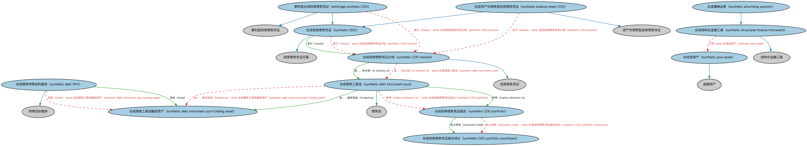

# 合成 CDO 本体（Synthetic CDOs Ontology）结构与公理说明

本文档对应 `SyntheticCDOs.rdf` / `SyntheticCDOs.ttl`，说明该本体的类、继承关系、属性和公理约定。结构图见 `SyntheticCDOs-structure.png`（`SyntheticCDOs-structure.svg` 为可缩放版本）。

## 1. 本体概述

定义合成型担保债务凭证（synthetic CDO）：不持有真实债务资产，而是通过信用违约互换（CDS）构建风险敞口的 CDO。

**在体系中的位置**：SEC 债务模块中 CDO 的衍生形态。

**上下游关系**：上游继承 CDO 本体并依赖 DER 信用违约互换；下游服务结构化信用产品建模。

**与相近概念的差别**：与现金型 CDO 的根本差别——现金型持有真实债券/贷款，合成型只通过 CDS「模拟」资产池的信用表现，也因此可以做空信用、放大风险敞口（2008 年危机的关键工具）。

本本体中类与类的核心关系如下（完整细节见各类小节）：

- **套利型合成担保债务凭证（arbitrage synthetic CDO）** 继承 **套利型担保债务凭证（ArbitrageCDO）**
- **套利型合成担保债务凭证（arbitrage synthetic CDO）** 继承 **合成担保债务凭证（synthetic CDO）**
- **合成摊销证券（synthetic amortizing security）** 继承 **合成结构化金融工具（synthetic structured finance instrument）**
- **合成资产负债表型担保债务凭证（synthetic balance sheet CDO）** 继承 **资产负债表型担保债务凭证（BalanceSheetCDO）**
- **合成资产负债表型担保债务凭证（synthetic balance sheet CDO）** 继承 **合成担保债务凭证（synthetic CDO）**
- **合成担保债务凭证（synthetic CDO）** 继承 **担保债务凭证交易（CDODeal）**
- **合成担保债务凭证分档（synthetic CDO tranche）** 继承 **担保债务凭证（CollateralizedDebtObligation）**
- **合成债务工具池（synthetic debt instrument pool）** 继承 **债务池（DebtPool）**
- **合成债务特殊目的载体（synthetic debt SPV）** 继承 **特殊目的载体（SpecialPurposeVehicle）**
- **合成池资产（synthetic pool asset）** 继承 **金融资产（FinancialAsset）**
- **合成结构化金融工具（synthetic structured finance instrument）** 继承 **结构化金融工具（StructuredFinanceInstrument）**
- **合成债务工具池（synthetic debt instrument pool）** 通过 **由……提供资金（funded by）** 关联 **合成债务工具池融资资产（synthetic debt instrument pool funding asset）**
- 其余 5 条关系从略。

## 2. 类（Class）

| 类（Class） | 定义（Definition） |
|---|---|
| 套利型合成担保债务凭证（arbitrage synthetic CDO） | 出于监管或实务考量而构造的合成 CDO，使银行在保留债务所有权的同时实现风险转移等目的。 Arbitrage synthetic CDO deals are motivated by regulatory or practical considerations that might make a bank want to retain ownership of debt while achieving capital relief through CDSs. In this case, the sponsoring bank has a portfolio of obligations, called the reference portfolio. It retains that portfolio, but offloads its credit risk by transacting CDSs with the CDO. |
| 合成摊销证券（synthetic amortizing security） | 为模拟摊销证券行为而构造的证券。 Security constructed to emulate an amortizing security. |
| 合成资产负债表型担保债务凭证（synthetic balance sheet CDO） | 以合成方式将资产负债表资产风险转移出去的 CDO。 |
| 合成担保债务凭证（synthetic CDO） | 通过信用衍生品（而非真实资产）合成标的组合的担保债务凭证。 |
| 合成担保债务凭证组合（synthetic CDO portfolio） | 合成 CDO 的标的组合，由信用衍生品头寸构成而非实际持有资产。 |
| 合成担保债务凭证组合成分（synthetic CDO portfolio constituent） | 被定义为合成工具池成分的工具；它们并非实际持有，但在其他方面与持有类似。 An instrument which is defined as a constituent of a synthetic pool of instruments. These are not holdings because they are not held, but in all other respects they are the constituents of the portfolio. |
| 合成担保债务凭证分档（synthetic CDO tranche） | 合成 CDO 的一个分档。 |
| 合成债务工具池（synthetic debt instrument pool） | 模拟一篮子债务证券行为的现金流结构，例如用信用衍生品合成的 CDO/债券/ABS 组合。 A cash flow structure which synthesizes the behavior of a portfolio of debt securities. For example a synthesized portfolio of CDO / Bonds / ABS using Total Returns Swaps and CDS. This does exist, it is just manufactured from different instruments. |
| 合成债务工具池融资资产（synthetic debt instrument pool funding asset） | 为合成 CDO 中使用的合成债务工具池提供资金的资产。 An asset which provides the funding for a synthetic debt instrument pool, as used in a synthetic CDO. |
| 合成债务特殊目的载体（synthetic debt SPV） | 为发行合成 CDO 而设立的特殊目的载体（SPV），该实体（同所有 SPV）本身注册为某种法律实体。 A Special Purpose Vehicle set up for the issuance of synthetics CDOs. This entity (like all SPVs) its itself registered as some kind of legal entity, distinct from the sponsoring organization. It becomes the Issuer of Synthetic CDO issues. |
| 合成池资产（synthetic pool asset） | 合成池中的资产成分。 |
| 合成结构化金融工具（synthetic structured finance instrument） | 以合成方式构造的结构化金融工具。 |

以下按类逐个展开：每个类给出继承关系、相关属性与公理约定；子类在父类之下降一级编号。

### 2.1 合成担保债务凭证（synthetic CDO）

定义：通过信用衍生品（而非真实资产）合成标的组合的担保债务凭证。

- 父类：**担保债务凭证交易（CDODeal）**
- 直接子类：**套利型合成担保债务凭证（arbitrage synthetic CDO）**、**合成资产负债表型担保债务凭证（synthetic balance sheet CDO）**

属性：

| 属性 | 定义 | 说明 |
|---|---|---|
| **发行（issues）** | 正式使某事物可得。 | 值域：合成担保债务凭证分档（synthetic CDO tranche） |

公理：

- **发行（issues）**至少有一个取值，类型是**合成担保债务凭证分档（synthetic CDO tranche）**。

#### 2.1.1 套利型合成担保债务凭证（arbitrage synthetic CDO）

定义：出于监管或实务考量而构造的合成 CDO，使银行在保留债务所有权的同时实现风险转移等目的。

- 父类：**套利型担保债务凭证（ArbitrageCDO）**、**合成担保债务凭证（synthetic CDO）**

属性：

| 属性 | 定义 | 说明 |
|---|---|---|
| **资产由……管理（assets managed by）** | 指明管理某一组合资产的管理人。 | 值域：担保债务凭证组合管理人 |
| **发行（issues）** | 正式使某事物可得。 | 值域：合成担保债务凭证分档（synthetic CDO tranche） |

公理：

- **发行（issues）**至少有一个取值，类型是**合成担保债务凭证分档（synthetic CDO tranche）**。
- **资产由……管理（assets managed by）**至少有一个取值，类型是**担保债务凭证组合管理人（CDOPortfolioManager）**。
- 与**合成资产负债表型担保债务凭证（synthetic balance sheet CDO）**互斥：同一个体不能同时属于两者。

#### 2.1.2 合成资产负债表型担保债务凭证（synthetic balance sheet CDO）

定义：以合成方式将资产负债表资产风险转移出去的 CDO。

- 父类：**资产负债表型担保债务凭证（BalanceSheetCDO）**、**合成担保债务凭证（synthetic CDO）**

属性：

| 属性 | 定义 | 说明 |
|---|---|---|
| **发行（issues）** | 正式使某事物可得。 | 值域：合成担保债务凭证分档（synthetic CDO tranche） |

公理：

- **发行（issues）**至少有一个取值，类型是**合成担保债务凭证分档（synthetic CDO tranche）**。

### 2.2 合成担保债务凭证组合（synthetic CDO portfolio）

定义：合成 CDO 的标的组合，由信用衍生品头寸构成而非实际持有资产。

属性：

| 属性 | 定义 | 说明 |
|---|---|---|
| **名义持有（notionally holds）** | 表明以名义（而非实际持有）方式拥有某一资产头寸。 | 值域：合成担保债务凭证组合成分（synthetic CDO portfolio constituent） |

公理：

- **名义持有（notionally holds）**至少有一个取值，类型是**合成担保债务凭证组合成分（synthetic CDO portfolio constituent）**。

### 2.3 合成担保债务凭证组合成分（synthetic CDO portfolio constituent）

定义：被定义为合成工具池成分的工具；它们并非实际持有，但在其他方面与持有类似。

### 2.4 合成担保债务凭证分档（synthetic CDO tranche）

定义：合成 CDO 的一个分档。

- 父类：**担保债务凭证（CollateralizedDebtObligation）**

属性：

| 属性 | 定义 | 说明 |
|---|---|---|
| **是否现金型（is cash）** | 表明 CDO 是否拥有真实资产的标的池：是则为现金型，否则为合成型标的池。 Whether the CDO has an underlying pool of real assets. This is No: the CDO has a synthetic pool of underlying assets. | 值域：xsd:boolean |
| **是……的分档（is tranche of）** | 表明某一档属于某一发行。 | 值域：合成债务工具池（synthetic debt instrument pool） |
| **本分档违约百分比（percentage of defaults this tranche）** | 该分档持有人所暴露的违约百分比，即该分档所代表的违约份额。 The percentage of defaults which holders of this are exposed to, that is the percentage of defaults that this tranche represents. Further Notes Review session notes 21 April: The first, second and so on, to stop paying out when there is a default. In each case you get the first, second etc. x% of defaults. Base underlying may be high or low quality. Create the pool by buying or selling protection depending on hich way you want to go, e..g. have high quality funds, (borrowers), would sell protection. If low quality, would buy protection to improve quality. So risk is no longer bound to the funding. REVIEW: More likely this is a band of percentages (from and to); review and formalize. See also note on attachment and detachment points. | 值域：百分比 |
| **分档类型（tranche type）** | 指明分档的类型。 | 值域：担保债务凭证分档优先级选择 |

公理：

- **是……的分档（is tranche of）**至少有一个取值，类型是**合成债务工具池（synthetic debt instrument pool）**。

### 2.5 合成债务工具池（synthetic debt instrument pool）

定义：模拟一篮子债务证券行为的现金流结构，例如用信用衍生品合成的 CDO/债券/ABS 组合。

- 父类：**债务池（DebtPool）**

属性：

| 属性 | 定义 | 说明 |
|---|---|---|
| **由……提供资金（funded by）** | 指明为某一合成池提供资金的资产。 | 值域：合成债务工具池融资资产（synthetic debt instrument pool funding asset） |
| **具有标的合约（has underlying contract）** | 为在合成组合中实现现金流而创设的标的信用违约互换（CDS）。 The underlying CDS which is created to mechanise the cash flows in the synthetic portfolio. | 值域：信用违约互换 |
| **参考（makes reference to）** | 表明某工具参考某一标的资产或组合。 | 值域：合成担保债务凭证组合（synthetic CDO portfolio） |
| **模拟（simulates）** | 表明某合成工具模拟某一真实工具或组合的行为。 | — |

公理：

- **具有标的合约（has underlying contract）**至少有一个取值，类型是**信用违约互换（CreditDefaultSwap）**。
- **参考（makes reference to）**至少有一个取值，类型是**合成担保债务凭证组合（synthetic CDO portfolio）**。
- **由……提供资金（funded by）**至少有一个取值，类型是**合成债务工具池融资资产（synthetic debt instrument pool funding asset）**。

### 2.6 合成债务工具池融资资产（synthetic debt instrument pool funding asset）

定义：为合成 CDO 中使用的合成债务工具池提供资金的资产。

属性：

| 属性 | 定义 | 说明 |
|---|---|---|
| **具有投资级别（has investment grade）** | 指明工具或分档所具有的投资级别。 | 值域：工具信用评级 |

公理：

- **具有投资级别（has investment grade）**至少有一个取值，类型是**工具信用评级（InstrumentCreditRating）**。

### 2.7 合成债务特殊目的载体（synthetic debt SPV）

定义：为发行合成 CDO 而设立的特殊目的载体（SPV），该实体（同所有 SPV）本身注册为某种法律实体。

- 父类：**特殊目的载体（SpecialPurposeVehicle）**

属性：

| 属性 | 定义 | 说明 |
|---|---|---|
| **持有（holds）** | 参与方与其占有、或对其实施某种所有权或控制、或可自主支配的事物之间的关系。 | 值域：合成债务工具池融资资产（synthetic debt instrument pool funding asset） |

公理：

- **持有（holds）**至少有一个取值，类型是**合成债务工具池融资资产（synthetic debt instrument pool funding asset）**。

### 2.8 合成池资产（synthetic pool asset）

定义：合成池中的资产成分。

- 父类：**金融资产（FinancialAsset）**

属性：

| 属性 | 定义 | 说明 |
|---|---|---|
| **由……模拟（simulated by）** | 为在合成组合中实现现金流而创设的标的信用违约互换（CDS）。 The underlying CDS which is created to mechanise the cash flows in the synthetic portfolio. | 值域：信用违约互换 |
| **模拟（simulates）** | 表明某合成工具模拟某一真实工具或组合的行为。 | — |

公理：

- **由……模拟（simulated by）**至少有一个取值，类型是**信用违约互换（CreditDefaultSwap）**。

### 2.9 合成结构化金融工具（synthetic structured finance instrument）

定义：以合成方式构造的结构化金融工具。

- 父类：**结构化金融工具（StructuredFinanceInstrument）**
- 直接子类：**合成摊销证券（synthetic amortizing security）**

属性：

| 属性 | 定义 | 说明 |
|---|---|---|
| **引用（refersTo）** | — | — |

公理：

- **引用（refersTo）**至少有一个取值，类型是**合成池资产（synthetic pool asset）**。

#### 2.9.1 合成摊销证券（synthetic amortizing security）

定义：为模拟摊销证券行为而构造的证券。

- 父类：**合成结构化金融工具（synthetic structured finance instrument）**

## 3. 依赖（owl:imports，12 个）

本本体通过 `owl:imports` 引入以下本体，各项的中文名称与简介如下：

| 导入本体 | 中文名称 | 简介 |
|---|---|---|
| `BE/LegalEntities/LegalPersons.rdf` | 法律主体本体（Legal Persons Ontology） | 定义法律主体（legal person）与法定实体（legal entity）的核心概念：能持有权利义务、可起诉与被诉的主体。 |
| `DER/CreditDerivatives/CreditDefaultSwaps.rdf` | 信用违约互换本体（Credit Default Swaps Ontology） | 定义信用违约互换（CDS）：保护买方与卖方、参考实体、信用事件与结算方式。 |
| `FBC/DebtAndEquities/CreditRatings.rdf` | 信用评级本体（Credit Ratings Ontology） | 定义信用评级、评级机构与评级结果，刻画债务人与债务工具的信用水平。 |
| `FND/OwnershipAndControl/Ownership.rdf` | 所有权本体（Ownership Ontology） | 定义「拥有」关系：所有者、被拥有资产及所有权份额。 |
| `FND/Utilities/AnnotationVocabulary.rdf` | FIBO 标注词汇表（FIBO Annotation Vocabulary） | 定义 FIBO 专用的标注属性（如释义来源、成熟度等级），用于本体自身的元数据标注。 |
| `SEC/Debt/CollateralizedDebtObligations.rdf` | 担保债务凭证本体（Collateralized Debt Obligations Ontology） | 定义担保债务凭证（CDO）：以债务资产池分层发行的证券。 |
| `SEC/Debt/PoolBackedSecurities.rdf` | 池支持证券本体（Pool-backed Securities Ontology） | 定义以资产池为支持的证券的通用结构：资产池、分层（tranche）与过手安排。 |
| `SEC/Funds/Funds.rdf` | 基金本体（Funds Ontology） | 定义投资基金（fund）：基金份额、净值与管理结构。 |
| `SEC/Securities/Pools.rdf` | 证券池本体（Securities Pools Ontology） | 定义证券池（pool）：归集起来作为证券化基础的一组资产。 |
| `https://www.omg.org/spec/Commons/AnnotationVocabulary/` | OMG 通用标注词汇表（OMG Commons Annotation Vocabulary） | OMG 通用本体库（Commons）中的标注词汇表，提供概念映射等标注属性，FIBO 用它标注术语与外部标准的对应关系。 |
| `https://www.omg.org/spec/Commons/Documents/` | OMG 通用文档本体（OMG Commons Documents） | Commons 库中的文档本体，定义文档及其组成部分的通用概念。 |
| `https://www.omg.org/spec/Commons/QuantitiesAndUnits/` | OMG 通用量与单位本体（OMG Commons Quantities and Units） | Commons 库中的量与单位本体，定义数量、度量单位、量纲的通用概念，支撑金额、比率等数值表达。 |

## 4. 文件

- 官方 RDF/XML：`SyntheticCDOs.rdf`
- 中文 Turtle：`SyntheticCDOs.ttl`
- 结构图：`SyntheticCDOs-structure.png` / `SyntheticCDOs-structure.svg`