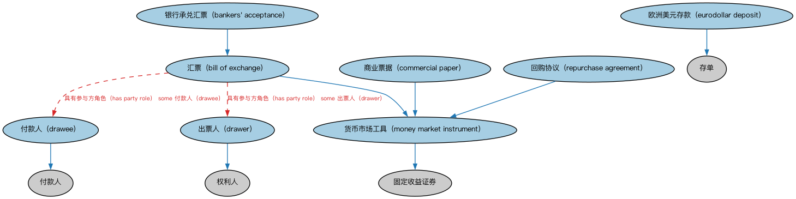

# 短期交易债务本体（Traded Short-Term Debt Ontology）结构与公理说明

本文档对应 `TradedShortTermDebt.rdf` / `TradedShortTermDebt.ttl`，说明该本体的类、继承关系、属性和公理约定。结构图见 `TradedShortTermDebt-structure.png`（`TradedShortTermDebt-structure.svg` 为可缩放版本）。

## 1. 本体概述

定义短期可交易债务工具（货币市场工具）：国库券（T-bill）、商业票据（CP）、存单（CD）等，期限通常在一年以内。

**在体系中的位置**：SEC 债务模块的品种本体之一。

**上下游关系**：上游继承债务工具本体；下游服务货币市场与流动性管理建模。

**与相近概念的差别**：与债券的差别——期限短、多以贴现方式发行（无票面利率）、信用风险与利率风险都低；货币市场工具是「类现金」资产。

本本体中类与类的核心关系如下（完整细节见各类小节）：

- **银行承兑汇票（bankers' acceptance）** 继承 **汇票（bill of exchange）**
- **汇票（bill of exchange）** 继承 **货币市场工具（money market instrument）**
- **商业票据（commercial paper）** 继承 **货币市场工具（money market instrument）**
- **付款人（drawee）** 继承 **付款人（Payer）**
- **出票人（drawer）** 继承 **权利人（Obligee）**
- **欧洲美元存款（eurodollar deposit）** 继承 **存单（CertificateOfDeposit）**
- **货币市场工具（money market instrument）** 继承 **固定收益证券（FixedIncomeSecurity）**
- **回购协议（repurchase agreement）** 继承 **货币市场工具（money market instrument）**

## 2. 类（Class）

| 类（Class） | 定义（Definition） |
|---|---|
| 银行承兑汇票（bankers' acceptance） | 由银行担保并兑付的短期债务工具，用作大额交易中相对安全的支付形式。 short-term debt instrument that is guaranteed and paid by a bank and used as a relatively safe form of payment for large transactions |
| 汇票（bill of exchange） | 一种短期可转让金融票据，由一人（货物卖方）向另一人（买方）签发书面付款指令。 short-term negotiable financial instrument consisting of an order in writing addressed by one person (the seller of goods) to another (the buyer), requiring the latter to pay a fixed amount of money on demand (a sight draft) or on a predetermined date (a time draft) |
| 商业票据（commercial paper） | 通常由银行、公司或外国政府发行、用于筹措资金满足短期债务需要的无担保短期债务工具。 an unsecured short-term debt instrument typically issued by a bank, corporation, or foreign government to obtain funds to meet short-term debt obligations, such as accounts receivable, inventories, or payroll, backed only by an issuing bank or company promise to pay the face amount on the maturity date specified on the note |
| 付款人（drawee） | 被要求向收款人支付汇票所载金额的一方。 party that is required to pay the amount stated on the bill of exchange to the payee |
| 出票人（drawer） | 就汇票要求付款人向第三方或自己付款的一方。 party that requires a drawee to pay either a third party or themselves with respect to a bill of exchange |
| 欧洲美元存款（eurodollar deposit） | 在联邦储备管辖范围之外以美元发行、存放于美国境外银行的固定利率存单。 a certificate of deposit with a fixed interest rate issued in U.S. dollars outside the jurisdiction of the Federal Reserve, held at banks outside of the United States, including branches of U.S. banks located outside of the U.S. |
| 货币市场工具（money market instrument） | 赋予所有者在指定日期无条件收取既定固定金额之权利的短期债务证券。 a short-term debt security that gives the owner the unconditional right to receive a stated, fixed sum of money on a specified date |
| 回购协议（repurchase agreement） | 双方之间的协议：一方按指定价格向另一方出让证券，并承诺在日后按约定价格购回。 agreement between two parties whereby one party lends the other a security at a specified price with a commitment to take the security back at a later date for another specified price |

以下按类逐个展开：每个类给出继承关系、相关属性与公理约定；子类在父类之下降一级编号。

### 2.1 付款人（drawee）

定义：被要求向收款人支付汇票所载金额的一方。

- 父类：**付款人（Payer）**

属性：

| 属性 | 定义 | 说明 |
|---|---|---|
| **由…扮演（is played by）** | — | — |

公理：

- **由…扮演（is played by）**至少有一个取值，该取值满足：**是…的参与方（is a party to）**至少有一个取值，类型是**汇票（bill of exchange）**。

### 2.2 出票人（drawer）

定义：就汇票要求付款人向第三方或自己付款的一方。

- 父类：**权利人（Obligee）**

属性：

| 属性 | 定义 | 说明 |
|---|---|---|
| **由…扮演（is played by）** | — | — |

公理：

- **由…扮演（is played by）**至少有一个取值，该取值满足：**是…的参与方（is a party to）**至少有一个取值，类型是**汇票（bill of exchange）**。

### 2.3 欧洲美元存款（eurodollar deposit）

定义：在联邦储备管辖范围之外以美元发行、存放于美国境外银行的固定利率存单。

- 父类：**存单（CertificateOfDeposit）**

### 2.4 货币市场工具（money market instrument）

定义：赋予所有者在指定日期无条件收取既定固定金额之权利的短期债务证券。

- 父类：**固定收益证券（FixedIncomeSecurity）**
- 直接子类：**汇票（bill of exchange）**、**商业票据（commercial paper）**、**回购协议（repurchase agreement）**

#### 2.4.1 汇票（bill of exchange）

定义：一种短期可转让金融票据，由一人（货物卖方）向另一人（买方）签发书面付款指令。

- 父类：**货币市场工具（money market instrument）**
- 直接子类：**银行承兑汇票（bankers' acceptance）**

属性：

| 属性 | 定义 | 说明 |
|---|---|---|
| **由……发行（isIssuedBy）** | — | — |
| **具有参与方角色（has party role）** | — | — |

公理：

- **具有参与方角色（has party role）**可以有 0 个或多个**收款人（Payee）**。
- **具有参与方角色（has party role）**至少有一个取值，类型是**付款人（drawee）**。
- **具有参与方角色（has party role）**至少有一个取值，类型是**出票人（drawer）**。
- **由……发行（isIssuedBy）**可以有 0 个或多个**金融机构（FinancialInstitution）**。

##### 2.4.1.1 银行承兑汇票（bankers' acceptance）

定义：由银行担保并兑付的短期债务工具，用作大额交易中相对安全的支付形式。

- 父类：**汇票（bill of exchange）**

属性：

| 属性 | 定义 | 说明 |
|---|---|---|
| **具有担保人（hasGuarantor）** | — | — |
| **具有发行时相对价格（hasRelativePriceAtIssue）** | — | — |
| **具有到期时相对价格（hasRelativePriceAtMaturity）** | — | — |

公理：

- **具有到期时相对价格（hasRelativePriceAtMaturity）**的取值固定为 ParValue。
- **具有发行时相对价格（hasRelativePriceAtIssue）**的取值固定为 AtADiscount。
- **具有担保人（hasGuarantor）**至少有一个取值，类型是**银行（Bank）**。

#### 2.4.2 商业票据（commercial paper）

定义：通常由银行、公司或外国政府发行、用于筹措资金满足短期债务需要的无担保短期债务工具。

- 父类：**货币市场工具（money market instrument）**

属性：

| 属性 | 定义 | 说明 |
|---|---|---|
| **具有发行时相对价格（hasRelativePriceAtIssue）** | — | — |
| **具有到期时相对价格（hasRelativePriceAtMaturity）** | — | — |

公理：

- **具有到期时相对价格（hasRelativePriceAtMaturity）**的取值固定为 ParValue。
- **具有发行时相对价格（hasRelativePriceAtIssue）**的取值固定为 AtADiscount。

#### 2.4.3 回购协议（repurchase agreement）

定义：双方之间的协议：一方按指定价格向另一方出让证券，并承诺在日后按约定价格购回。

- 父类：**货币市场工具（money market instrument）**

属性：

| 属性 | 定义 | 说明 |
|---|---|---|
| **具有时长（hasDuration）** | — | — |

公理：

- **具有时长（hasDuration）**至多有 1 个**时长（Duration）**。

## 3. 依赖（owl:imports，14 个）

本本体通过 `owl:imports` 引入以下本体，各项的中文名称与简介如下：

| 导入本体 | 中文名称 | 简介 |
|---|---|---|
| `FBC/DebtAndEquities/Guaranty.rdf` | 担保本体（Guaranty Ontology） | 定义担保（guaranty）：担保人、被担保债务与担保范围。 |
| `FBC/FinancialInstruments/FinancialInstruments.rdf` | 金融工具本体（Financial Instruments Ontology） | FIBO 核心本体之一，定义金融工具（financial instrument）的通用概念：可交易、代表某种权利义务的合同工具，是证券、衍生品等具体工具的共同基础。 |
| `FBC/FunctionalEntities/FinancialServicesEntities.rdf` | 金融服务实体本体（Financial Services Entities Ontology） | FBC 域核心本体，定义金融服务机构（银行、券商、保险公司、资管机构等）的功能分类体系。 |
| `FBC/ProductsAndServices/ClientsAndAccounts.rdf` | 客户与账户本体（Clients and Accounts Ontology） | 定义金融机构的客户、账户及账户持有关系。 |
| `FND/Agreements/Agreements.rdf` | 协议本体（Agreements Ontology） | 定义两个或以上参与方之间协议（agreement）的通用概念：协议的当事方、条款、生效与终止，是合同等一切契约性安排的上位模型。 |
| `FND/Agreements/Contracts.rdf` | 合同本体（Contracts Ontology） | 在协议之上定义具有法律约束力的合同（contract）：合同当事方、合同条款、义务与权利，是金融工具与交易合同建模的基石。 |
| `FND/ProductsAndServices/PaymentsAndSchedules.rdf` | 付款与计划表本体（Payments and Schedules Ontology） | 定义付款、付款计划表（payment schedule）及其日期与金额结构，是贷款还款、债券付息建模的基础。 |
| `FND/Relations/Relations.rdf` | 关系本体（Relations Ontology） | FIBO 最底层的基础本体，定义参考（reference）、分类（classify）等通用关系与抽象概念，全库普遍依赖。 |
| `FND/Utilities/AnnotationVocabulary.rdf` | FIBO 标注词汇表（FIBO Annotation Vocabulary） | 定义 FIBO 专用的标注属性（如释义来源、成熟度等级），用于本体自身的元数据标注。 |
| `SEC/Debt/DebtInstruments.rdf` | 债务工具本体（Debt Instruments Ontology） | 定义债务工具（debt instrument）的通用概念：可交易的债权凭证，是债券、票据等的上位模型。 |
| `https://www.omg.org/spec/Commons/AnnotationVocabulary/` | OMG 通用标注词汇表（OMG Commons Annotation Vocabulary） | OMG 通用本体库（Commons）中的标注词汇表，提供概念映射等标注属性，FIBO 用它标注术语与外部标准的对应关系。 |
| `https://www.omg.org/spec/Commons/DatesAndTimes/` | OMG 通用日期与时间本体（OMG Commons Dates and Times） | Commons 库中的日期时间本体，定义日期、期间、时间点等通用时间概念。 |
| `https://www.omg.org/spec/Commons/PartiesAndSituations/` | OMG 通用参与方与情境本体（OMG Commons Parties and Situations） | Commons 库中的参与方本体，定义独立主体、参与方及其角色扮演的通用概念，是 FIBO 参与方模型的上游。 |
| `https://www.omg.org/spec/Commons/RolesAndCompositions/` | OMG 通用角色与构成本体（OMG Commons Roles and Compositions） | Commons 库中的角色本体，定义角色及整体—部分构成关系的通用概念。 |

## 4. 文件

- 官方 RDF/XML：`TradedShortTermDebt.rdf`
- 中文 Turtle：`TradedShortTermDebt.ttl`
- 结构图：`TradedShortTermDebt-structure.png` / `TradedShortTermDebt-structure.svg`