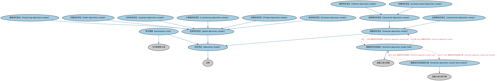

# 存托凭证本体（Depositary Receipts Ontology）结构与公理说明

本文档对应 `DepositaryReceipts.rdf` / `DepositaryReceipts.ttl`，说明该本体的类、继承关系、属性和公理约定。结构图见 `DepositaryReceipts-structure.png`（`DepositaryReceipts-structure.svg` 为可缩放版本）。

## 1. 本体概述

定义存托凭证（depositary receipt，DR）：由存托银行发行、代表境外公司股票的可交易凭证，如美国存托凭证（ADR）、全球存托凭证（GDR）。

**在体系中的位置**：SEC 权益模块的品种本体之一，解决跨境持股问题。

**上下游关系**：上游继承股权工具本体并依赖 BE 跨境实体概念；下游服务跨境投资建模。

**与相近概念的差别**：存托凭证≠股票本身——它是存托银行发行的「代表凭证」，底层股票由银行托管在境外；持有人享有经济权益但表决权行使受存托协议约束。

## 2. 类（Class）

| 类（Class） | 定义（Definition） |
|---|---|
| 美国存托凭证（American depositary receipt） | 代表外国公司证券、使该公司证券得以在美国金融市场交易的存托凭证（ADR）。 |
| 美国存托凭证级别（American depositary receipt level） | 按外国公司进入美国市场程度对美国存托凭证（ADR）进行分级的分类器。 |
| 美国存托凭证级别方案（American depositary receipt level scheme） | 按外国公司进入美国市场程度对美国存托凭证（ADR）进行分级的方案。 |
| 中国存托凭证（Chinese depositary receipt） | 代表非中国公司证券所有权、在中国境内公开交易所交易的全球存托凭证（CDR）。 |
| 欧洲存托凭证（European depositary receipt） | 代表非欧洲公司证券所有权、在欧洲金融市场交易的全球存托凭证（EDR）。 |
| 香港存托凭证（Hong Kong depositary receipt） | 代表购买或拥有存放于香港存托银行之外国资产的全球存托凭证（HDR）。 |
| 印度存托凭证（Indian depositary receipt） | 代表购买或拥有存放于印度账户（由境内托管人管理）之外国资产的全球存托凭证（IDR）。 |
| 日本存托凭证（Japanese depositary receipt） | 代表购买或拥有存放于日本信托银行之外国资产的全球存托凭证（JDR）。 |
| 卢森堡存托凭证（Luxembourg depositary receipt） | 代表购买或拥有存放于卢森堡账户之外国资产的全球存托凭证。 |
| 存托凭证（depositary receipt） | 由信托公司、证券存管机构或银行签发的可转让金融工具，是公开交易证券存托的凭证。 |
| 全球存托凭证（global depositary receipt） | 由购入外国公司证券的存托银行签发凭证、在本地交易所创设证券的存托凭证（GDR）。 |
| 离岸存托凭证（offshore depositary receipt） | 依美国证券交易委员会（SEC）S 条例发行的存托凭证。 |
| 参与票据（participatory note） | 便于持有在其他司法管辖区交易之证券的可交易债务工具。 |
| 私募存托凭证（privately placed depositary receipt） | 代表依美国证券交易委员会（SEC）144A 规则私募配售之股份的存托凭证。 |
| 有保荐存托凭证（sponsored depositary receipt） | 与外国公司合作发行、使其能够直接进入国际资本市场的存托凭证。 |
| 无保荐存托凭证（unsponsored depositary receipt） | 未经该公司合作而设立的存托凭证。 |

### 2.1 继承关系（Inheritance）

- 美国存托凭证（American depositary receipt） ⊑ 存托凭证（depositary receipt）
- 美国存托凭证级别（American depositary receipt level） ⊑ 金融工具分类器
- 美国存托凭证级别方案（American depositary receipt level scheme） ⊑ 金融工具分类方案
- 中国存托凭证（Chinese depositary receipt） ⊑ 全球存托凭证（global depositary receipt）
- 欧洲存托凭证（European depositary receipt） ⊑ 全球存托凭证（global depositary receipt）
- 香港存托凭证（Hong Kong depositary receipt） ⊑ 全球存托凭证（global depositary receipt）
- 印度存托凭证（Indian depositary receipt） ⊑ 全球存托凭证（global depositary receipt）
- 日本存托凭证（Japanese depositary receipt） ⊑ 全球存托凭证（global depositary receipt）
- 卢森堡存托凭证（Luxembourg depositary receipt） ⊑ 全球存托凭证（global depositary receipt）
- 存托凭证（depositary receipt） ⊑ 证券
- 全球存托凭证（global depositary receipt） ⊑ 存托凭证（depositary receipt）
- 离岸存托凭证（offshore depositary receipt） ⊑ 有保荐存托凭证（sponsored depositary receipt）
- 参与票据（participatory note） ⊑ 可交易债务工具
- 参与票据（participatory note） ⊑ 存托凭证（depositary receipt）
- 私募存托凭证（privately placed depositary receipt） ⊑ 有保荐存托凭证（sponsored depositary receipt）
- 有保荐存托凭证（sponsored depositary receipt） ⊑ 美国存托凭证（American depositary receipt）
- 无保荐存托凭证（unsponsored depositary receipt） ⊑ 美国存托凭证（American depositary receipt）

## 3. 对象属性（Object Property）

| 属性（Property） | 中文（English） | 定义（Definition） | 说明 |
|---|---|---|---|
| fibo-sec-eq-dr:hasTradedSecurity | 具有所代表证券（has traded security） | 将存托凭证与其所代表的工具关联起来。 | 定义域（domain）：存托凭证（depositary receipt）；值域（range）：证券；子属性（subPropertyOf）：指代 |
| fibo-sec-eq-dr:hasTradedShare | 具有所代表股份（has traded share） | 将存托凭证与其所代表的工具（股票或交易所交易基金）关联起来。 | 定义域（domain）：存托凭证（depositary receipt）；值域（range）：股份；子属性（subPropertyOf）：具有所代表证券（has traded security） |

## 4. 数据属性（Datatype Property）

| 属性（Property） | 中文（English） | 定义（Definition） |
|---|---|---|
| fibo-sec-eq-dr:hasMultiplier | 具有乘数（has multiplier） | 指明单张存托凭证所代表的标的股份数量（可为多股或零碎股）。 |
| fibo-sec-eq-dr:hasNumberOfDepositaryReceiptsIssued | 具有存托凭证发行数量（has number of depositary receipts issued） | 指明向公众发行的凭证数量。 |

## 5. 公理约定（Axioms）

- 美国存托凭证（American depositary receipt）：restriction
- 美国存托凭证（American depositary receipt）：由……分类 美国存托凭证级别（American depositary receipt level） ≥0
- 美国存托凭证级别（American depositary receipt level）：分类 some 美国存托凭证（American depositary receipt）
- 美国存托凭证级别（American depositary receipt level）：定义于 some 美国存托凭证级别方案（American depositary receipt level scheme）
- 美国存托凭证级别方案（American depositary receipt level scheme）：定义 some 美国存托凭证级别（American depositary receipt level）
- 中国存托凭证（Chinese depositary receipt）：restriction
- 欧洲存托凭证（European depositary receipt）：restriction
- 香港存托凭证（Hong Kong depositary receipt）：restriction
- 印度存托凭证（Indian depositary receipt）：restriction
- 日本存托凭证（Japanese depositary receipt）：restriction
- 卢森堡存托凭证（Luxembourg depositary receipt）：restriction
- 存托凭证（depositary receipt）：restriction
- 存托凭证（depositary receipt）：具有所代表证券（has traded security） some 证券
- 离岸存托凭证（offshore depositary receipt）：restriction
- 参与票据（participatory note）：具有所代表证券（has traded security） some 可交易债务工具
- 私募存托凭证（privately placed depositary receipt）：restriction
- 无保荐存托凭证（unsponsored depositary receipt）：restriction
- 无保荐存托凭证（unsponsored depositary receipt） 与 有保荐存托凭证（sponsored depositary receipt） 互斥（disjointWith）

## 6. 依赖（owl:imports，15 个）

本本体通过 `owl:imports` 引入以下本体，各项的中文名称与简介如下：

| 导入本体 | 中文名称 | 简介 |
|---|---|---|
| `BE/GovernmentEntities/AsianJurisdiction/EasternAsiaGovernmentEntitiesAndJurisdictions.rdf` | 东亚政府实体与法域本体（Eastern Asia Government Entities and Jurisdictions Ontology） | 收录东亚地区各国（中国、日本、韩国等）的政体、政府与法域个体。 |
| `BE/GovernmentEntities/AsianJurisdiction/SouthernAsiaGovernmentEntitiesAndJurisdictions.rdf` | 南亚政府实体与法域本体（Southern Asia Government Entities and Jurisdictions Ontology） | 收录南亚地区各国（印度、巴基斯坦等）的政体、政府与法域个体。 |
| `BE/GovernmentEntities/EuropeanJurisdiction/EUGovernmentEntitiesAndJurisdictions.rdf` | 欧盟政府实体与法域本体（EU Government Entities and Jurisdictions Ontology） | 收录欧盟层面的政体、机构与法域个体（欧盟本身及其超国家机构）。 |
| `BE/GovernmentEntities/EuropeanJurisdiction/WesternEuropeGovernmentEntitiesAndJurisdictions.rdf` | 西欧政府实体与法域本体（Western Europe Government Entities and Jurisdictions Ontology） | 收录西欧各国（法国、德国、荷兰等）的政体、政府与法域个体。 |
| `BE/GovernmentEntities/NorthAmericanJurisdiction/USGovernmentEntitiesAndJurisdictions.rdf` | 美国政府实体与法域本体（US Government Entities and Jurisdictions Ontology） | 收录美国的政体、联邦与各州政府、法域个体，是北美金融建模最常用的法域参考数据。 |
| `FBC/FinancialInstruments/FinancialInstruments.rdf` | 金融工具本体（Financial Instruments Ontology） | FIBO 核心本体之一，定义金融工具（financial instrument）的通用概念：可交易、代表某种权利义务的合同工具，是证券、衍生品等具体工具的共同基础。 |
| `FND/Utilities/AnnotationVocabulary.rdf` | FIBO 标注词汇表（FIBO Annotation Vocabulary） | 定义 FIBO 专用的标注属性（如释义来源、成熟度等级），用于本体自身的元数据标注。 |
| `SEC/Debt/DebtInstruments.rdf` | 债务工具本体（Debt Instruments Ontology） | 定义债务工具（debt instrument）的通用概念：可交易的债权凭证，是债券、票据等的上位模型。 |
| `SEC/Equities/EquityInstruments.rdf` | 股权工具本体（Equity Instruments Ontology） | 定义股票等股权工具：普通股、优先股及其附带的权利。 |
| `SEC/Securities/NorthAmericanSecurities/USSecuritiesRestrictions.rdf` | 美国证券限制本体（US Securities Restrictions Ontology） | 定义美国证券法下的发行与转售限制（如 Rule 144、Regulation S）。 |
| `SEC/Securities/SecuritiesClassification.rdf` | 证券分类本体（Securities Classification Ontology） | 定义证券分类方案：按 CFI 代码、按资产类别等对证券归类。 |
| `SEC/Securities/SecuritiesRestrictions.rdf` | 证券限制本体（Securities Restrictions Ontology） | 定义证券发行与转让限制的通用概念，是各法域具体限制本体的基础。 |
| `https://www.omg.org/spec/Commons/AnnotationVocabulary/` | OMG 通用标注词汇表（OMG Commons Annotation Vocabulary） | OMG 通用本体库（Commons）中的标注词汇表，提供概念映射等标注属性，FIBO 用它标注术语与外部标准的对应关系。 |
| `https://www.omg.org/spec/Commons/Classifiers/` | OMG 通用分类器本体（OMG Commons Classifiers） | OMG 通用本体库（Commons）中的分类器本体，定义分类方案、类别与归类关系的通用概念，FIBO 的分类建模建立在其上。 |
| `https://www.omg.org/spec/Commons/Designators/` | OMG 通用指称符本体（OMG Commons Designators） | Commons 库中的指称符本体，定义名称、标识符等「指代某物的符号」的通用概念。 |

## 7. 文件

- 官方 RDF/XML：`DepositaryReceipts.rdf`
- 中文 Turtle：`DepositaryReceipts.ttl`
- 结构图：`DepositaryReceipts-structure.png` / `DepositaryReceipts-structure.svg`