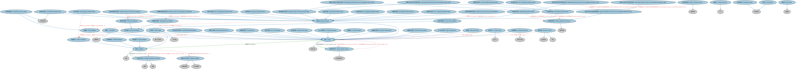

# 股权工具本体（Equity Instruments Ontology）结构与公理说明

本文档对应 `EquityInstruments.rdf` / `EquityInstruments.ttl`，说明该本体的类、继承关系、属性和公理约定。结构图见 `EquityInstruments-structure.png`（`EquityInstruments-structure.svg` 为可缩放版本）。

## 1. 本体概述

定义股权工具（equity instrument）：普通股、优先股及其附带的权利（表决权、分红权、剩余索取权）。

**在体系中的位置**：SEC 权益模块的核心，股票类证券的概念基础。

**上下游关系**：上游继承 FBC 金融工具并依赖 BE 公司所有权概念；下游被存托凭证、股指示例、股票 CFI 分类引用。

**与相近概念的差别**：股权≠债权——股权是所有权份额（无到期、无固定回报），债权是固定偿付承诺；普通股与优先股的差别在表决权与分红/清偿顺序的取舍。

本本体中类与类的核心关系如下（完整细节见各类小节）：

- **普通股（CommonShare）** 继承 **股份（share）**
- **可变利益实体份额（VariableInterestEntityShare）** 继承 **股份（share）**
- **可调整利率股息（adjustable rate dividend）** 继承 **优先股息（preferred dividend）**
- **拍卖利率股息（auction rate dividend）** 继承 **优先股息（preferred dividend）**
- **可转换普通股（convertible common share）** 继承 **普通股（CommonShare）**
- **可转换普通股（convertible common share）** 继承 **可转换证券（ConvertibleSecurity）**
- **可转换优先股（convertible preferred share）** 继承 **优先股（preferred share）**
- **可转换优先股（convertible preferred share）** 继承 **可转换证券（ConvertibleSecurity）**
- **累积优先股（cumulative preferred share）** 继承 **优先股（preferred share）**
- **托管人（custodian）** 继承 **金融机构（FinancialInstitution）**
- **托管人（custodian）** 继承 **第三方代理人（ThirdPartyAgent）**
- **股息（dividend）** 继承 **承诺（Commitment）**
- 其余 60 条关系从略。

## 2. 类（Class）

| 类（Class） | 定义（Definition） |
|---|---|
| 普通股（CommonShare） | 表示公司所有权单位、并代表对公司部分资产和收益的请求权的股份。 share that signifies a unit of ownership in a corporation and represents a claim on part of the corporation's assets and earnings |
| 可变利益实体份额（VariableInterestEntityShare） | 证明持有对公司一定比例利润之合同权利所有权的份额。 share that certifies ownership of a contractual right to a percentage of a company's profits |
| 可调整利率股息（adjustable rate dividend） | 随基准利率变动的股息。 dividend that varies with a benchmark |
| 拍卖利率股息（auction rate dividend） | 利率通过拍卖定期重置（通常每 7、14、28 或 35 天）的优先股股息。 preferred share dividend whose rate is periodically reset through an auction, typically every 7, 14, 28, or 35 days |
| 可转换普通股（convertible common share） | 可转换为另一证券的普通股。 common share that is convertible into another security |
| 可转换优先股（convertible preferred share） | 包含持有人可在预定日期后将股份转换为固定数量普通股之选择权的优先股。 preferred share that includes an option for the holder to convert the shares into a fixed number of common shares after a predetermined date |
| 累积优先股（cumulative preferred share） | 股息如未按时支付则累积递延至日后支付的优先股。 preferred share whose dividends, if not paid on time, accumulate until paid out |
| 托管人（custodian） | 为客户保管证券的金融机构。 financial institution that holds customers' securities for safekeeping |
| 股息（dividend） | 宣布按证券类别按比例向股东分配部分收益的承诺。 announced commitment to make a specific distribution of a portion of earnings to shareholders, prorated by class of security |
| 股息分配方式（dividend distribution method） | 向股东提供股息的惯例。 convention by which dividends are provided to shareholders |
| 股息支付计划表（dividend schedule） | 指明股息到期应付日期的付款计划表。 payment schedule indicating the dates on which dividends are due to be paid |
| 增强表决权股（enhanced voting share） | 每股享有超过一票表决权的股份。 share that confers more than one vote per share |
| 股权转换条款（equity conversion terms） | 规定股份转换为其他证券之细节的转换条款。 conversion terms specifying the details regarding conversion of shares into other securities |
| 股票头寸（equity position） | 在权益工具中的头寸。 position in an equity instrument |
| 股权赎回条款（equity redemption provision） | 规定发行人或股东可赎回股份之条件的赎回条款。 redemption provision that specifies the conditions under which the issuer or shareholder may redeem the shares |
| 赎回日可延长的股权赎回条款（equity redemption provision with extendable redemption date） | 允许将赎回日修改至原定日期之后的股权赎回条款。 equity redemption provision that allows modification of the redemption date beyond the original specified date |
| 可交换优先股（exchangeable preferred share） | 可交换为另一发行人证券的优先股。 preferred share that may be exchanged for a security of another issuer |
| 可展期优先股（extendable preferred share） | 赎回日可由发行人或持有人选择延长的优先股。 preferred share whose redemption date can be extended at the issuer or holder option |
| 固定利率股息（fixed rate dividend） | 按股份名义价值（及任何溢价）提供固定年度回报的股息。 dividend that provides a specified annual return on the nominal value (and any premium) paid on shares |
| 缴足股（fully paid share） | 付款状态表明股东无需就股份价值再向公司缴付任何款项的股份。 share whose payment status indicates that no additional money is owed to the company by shareholders on the value of the shares |
| 硬回售优先股（hard retractable preferred share） | 回售价值必须以现金支付的可回售优先股。 retractable preferred share whose retraction value must be paid in cash |
| 有限合伙份额（limited partnership unit） | 有限合伙中的份额：除一名或多名普通合伙人（GP）外，还有一名或多名承担有限责任的有限合伙人（LP）。 share in a form of partnership similar to a general partnership, except that in addition to one or more general partners (GPs), there are one or more limited partners (LPs) |
| 上市股份（listed share） | 在至少一个平台挂牌的股份。 share that is listed on at least one platform |
| 未缴股款股份（nil paid share） | 付款状态表明公司尚未收到股份任何市值款项的股份。 share whose payment status indicates that none of the market value has been received by the company for the shares |
| 非累积优先股（non-cumulative preferred share） | 股息不予递延的优先股。 preferred share whose dividend payments are not carried forward |
| 非参与优先股（non-participating preferred share） | 不属于参与优先股的优先股。 preferred share that is not a participating preferred share |
| 无表决权股（non-voting share） | 不享有表决权的股份。 share that has no voting right |
| 普通股息（ordinary dividend） | 定期向股东支付的股息。 dividend that is paid to shareholders periodically |
| 部分缴足股（partially paid share） | 付款状态表明公司仅收到股份部分市值款项的股份。 share whose payment status indicates that only a portion of the market value has been received by the company for the shares |
| 参与优先股（participating preferred share） | 除支付约定股息外，还赋予持有人与普通股股东分享额外收益之权利的优先股。 preferred share that, in addition to paying a stipulated dividend, gives the holder the right to participate with common share holders in additional distributions of earnings under specified conditions |
| 永续优先股（perpetual preferred share） | 无固定到期日的优先股。 preferred share that has no fixed maturity date |
| 优先受偿权（precedence right） | 使股东就特定预定股息支付优先于其他股东、并在公司清算时先行受偿的权利。 right that give the shareholder higher priority with respect to certain pre-defined dividend payments over other shareholders and that pay out first in the case of liquidation |
| 优先股息（preferred dividend） | 向股东分配部分收益的承诺，类似于股息，但通常金额和支付计划固定。 commitment to distribute a portion of earnings to shareholders, similar to a dividend but often with a fixed payment amount and schedule |
| 优先股（preferred share） | 按约定利率支付股息、并在股息支付和公司资产清算方面优先于普通股的股份。 share that pays dividends at a specified rate and has preference over common shares in the payment of dividends and liquidation of corporate assets |
| 可调整利率股息优先股（preferred share with adjustable rate dividend） | 股息率随某一基准利率变动的优先股。 preferred share whose dividend rate varies according to some benchmark |
| 拍卖利率股息优先股（preferred share with auction rate dividend） | 股息率通过拍卖（如荷兰式拍卖）定期重置的优先股。 preferred share whose dividend rate is periodically reset through an auction, such as a Dutch auction |
| 固定到期日优先股（preferred share with fixed maturity date） | 到期日既定（通常按招募说明书条款确定）的优先股。 preferred share whose maturity date is set, typically according to the terms of the prospectus |
| 固定利率股息优先股（preferred share with fixed rate dividend） | 股息既定（通常按招募说明书条款确定）的优先股。 preferred share whose dividends are set, typically according to the terms of the prospectus |
| 每股价格（price per share） | 某一证券在某一时点的单股价格。 price for one share of a given security at some point in time |
| 私人持有股份（privately held share） | 代表对非公开交易实体之所有权的股份。 share in a security that signifies ownership in an entity that is not publicly traded |
| 合资格股息（qualified dividend） | 适用低于普通（不合资格）股息所得税率的资本利得税率的股息。 dividend that falls under capital gains tax rates that are lower than the income tax rates on unqualified (ordinary) dividends |
| 可赎回优先股（redeemable preferred share） | 赋予发行人在规定条件下赎回股份之权利的优先股。 preferred share that gives the issuer the right to redeem the stock under specified conditions |
| 到期日可延长的可赎回优先股（redeemable preferred share with extendable maturity date） | 有固定到期日、且发行人可选择延长到期日的可赎回优先股。 redeemable preferred share with a fixed maturity date whose issuer has the option to extend the maturity date |
| 赎回日可延长的可赎回优先股（redeemable preferred share with extendable redemption date） | 赎回日可以修改的可赎回优先股。 redeemable preferred share whose redemption date can be modified |
| 受限股份（restricted share） | 其所有权/转让/出售受特殊条件（包括特定国家限制）约束的股份。 share whose ownership/transfer/sale is subject to special conditions including country-specific restrictions |
| 受限表决权股（restricted voting share） | 每股享有不足一票表决权的股份。 share that confers less than one vote per share |
| 可回售优先股（retractable preferred share） | 赋予所有人（股东）在规定条件下要求赎回股份之权利的优先股。 preferred share that gives the owner (shareholder) the right to redeem the stock under specified conditions |
| 到期日可延长的可回售优先股（retractable preferred share with extendable maturity date） | 有固定到期日、且发行人和/或持有人可选择延长到期日的可回售优先股。 retractable preferred share with a fixed maturity date whose issuer and/or holders have the option to extend the maturity date |
| 赎回日可延长的可回售优先股（retractable preferred share with extendable redemption date） | 赎回日可以修改的可回售优先股。 retractable preferred share whose redemption date can be modified |
| 股份（share） | 表示公司股权所有权单位、共同基金所有权单位、或合伙中权益的金融工具。 financial instrument that signifies a unit of equity ownership in a corporation, or a unit of ownership in a mutual fund, or interest in a general or limited partnership, or a unit of ownership in a structured product, such as a real estate investment trust |
| 股份发行人（share issuer） | 发行代表对某事物所有权权益之证券的发行人。 issuer of securities that represent an ownership interest in something |
| 股份缴款状态（share payment status） | 规定已发行股份总体缴款状态的分类器。 classifier that specifies the overall payment status for shares issued |
| 股息率（share yield） | 每股年化股息除以每股（当前）价格的比率。 ratio of the annualized dividend per share divided by the (current) price per share |
| 单一表决权股（single voting share） | 每股享有一票表决权的股份。 share that has the right to exactly one vote |
| 软回售优先股（soft retractable preferred share） | 回售价值可由发行人选择以现金或等值发行人普通股支付的可回售优先股。 retractable preferred share whose retraction value may be paid in cash or in an equal value of common stock of the issuer, at the option of the issuer |
| 特别股息（special dividend） | 一次性向股东支付的股息。 dividend that is paid to shareholders on a one-time basis |
| 非受限股份（unrestricted share） | 其所有权/转让/出售不受特殊条件（包括特定国家限制）约束的股份。 share whose ownership/transfer/sale is not subject to special conditions including country-specific restrictions |
| 表决权（voting right） | 规定股东表决权利（如选举董事、选举外部审计师、就公司事项表决）的合同权利。 contractual right that specifies shareholder voting entitlements, such as to elect directors, elect outside auditors, and vote on matters of corporate policy |

以下按类逐个展开：每个类给出继承关系、相关属性与公理约定；子类在父类之下降一级编号。

### 2.1 托管人（custodian）

定义：为客户保管证券的金融机构。

- 父类：**金融机构（FinancialInstitution）**、**第三方代理人（ThirdPartyAgent）**

属性：

| 属性 | 定义 | 说明 |
|---|---|---|
| **持有（holds）** | — | — |

公理：

- **持有（holds）**至少有一个取值，类型是**股份（share）**。

### 2.2 股息（dividend）

定义：宣布按证券类别按比例向股东分配部分收益的承诺。

- 父类：**承诺（Commitment）**
- 直接子类：**普通股息（ordinary dividend）**、**优先股息（preferred dividend）**、**合资格股息（qualified dividend）**、**特别股息（special dividend）**

属性：

| 属性 | 定义 | 说明 |
|---|---|---|
| **具有进度表（hasSchedule）** | — | — |
| **具有支付金额（hasPaymentAmount）** | — | — |
| **具有分配方式（has distribution method）** | 指明股息支付的分配方式。 indicates the method by which dividend payments are to be distributed | 值域：股息分配方式（dividend distribution method）；子属性：具有战略 |

公理：

- **具有分配方式（has distribution method）**至多有 1 个**股息分配方式（dividend distribution method）**。
- **具有支付金额（hasPaymentAmount）**可以有 0 个或多个**货币数量（MonetaryAmount）**。
- **具有进度表（hasSchedule）**可以有 0 个或多个**股息支付计划表（dividend schedule）**。

#### 2.2.1 普通股息（ordinary dividend）

定义：定期向股东支付的股息。

- 父类：**股息（dividend）**

属性：

| 属性 | 定义 | 说明 |
|---|---|---|
| **具有支付金额（hasPaymentAmount）** | — | — |

公理：

- **具有支付金额（hasPaymentAmount）**恰好有 1 个**货币数量（MonetaryAmount）**。

#### 2.2.2 优先股息（preferred dividend）

定义：向股东分配部分收益的承诺，类似于股息，但通常金额和支付计划固定。

- 父类：**股息（dividend）**
- 直接子类：**可调整利率股息（adjustable rate dividend）**、**拍卖利率股息（auction rate dividend）**、**固定利率股息（fixed rate dividend）**

属性：

| 属性 | 定义 | 说明 |
|---|---|---|
| **具有可调整股息率（has adjustable dividend rate）** | 指明可变股息率，通常在招募说明书中规定为基于基准的公式或经拍卖确定。 indicates a variable dividend rate, typically specified in the prospectus as a formula based on a benchmark or set at auction | 值域：百分比货币数量；子属性：具有量值 |
| **具有股息宽限期（has dividend grace period）** | 指明股息到期应付后、发行人受罚之前的时间段。 indicates a period of time after a dividend payment becomes due, before the issuer is subject to penalties | 值域：时长；子属性：具有时长 |
| **具有固定股息率（has fixed dividend rate）** | 指明优先股的预定固定股息率，通常在招募说明书中规定。 indicates a pre-arranged fixed dividend rate, typically specified in the prospectus, for a preferred share | 值域：百分比货币数量；子属性：具有量值 |

公理：

- **具有固定股息率（has fixed dividend rate）**至多有 1 个**百分比货币数量（PercentageMonetaryAmount）**。
- **具有股息宽限期（has dividend grace period）**至多有 1 个**时长（Duration）**。

##### 2.2.2.1 可调整利率股息（adjustable rate dividend）

定义：随基准利率变动的股息。

- 父类：**优先股息（preferred dividend）**

属性：

| 属性 | 定义 | 说明 |
|---|---|---|
| **具有可调整股息率（has adjustable dividend rate）** | 指明可变股息率，通常在招募说明书中规定为基于基准的公式或经拍卖确定。 indicates a variable dividend rate, typically specified in the prospectus as a formula based on a benchmark or set at auction | 值域：百分比货币数量；子属性：具有量值 |
| **描述实际表达式（describesActualExpression）** | — | — |
| **具有量类（hasQuantityKind）** | — | — |

公理：

- **具有可调整股息率（has adjustable dividend rate）**至少有一个取值，类型是**百分比货币数量（PercentageMonetaryAmount）**。
- **具有量类（hasQuantityKind）**可以有 0 个或多个**利率基准（InterestRateBenchmark）**。
- **描述实际表达式（describesActualExpression）**存在取值约束。

##### 2.2.2.2 拍卖利率股息（auction rate dividend）

定义：利率通过拍卖定期重置（通常每 7、14、28 或 35 天）的优先股股息。

- 父类：**优先股息（preferred dividend）**

属性：

| 属性 | 定义 | 说明 |
|---|---|---|
| **具有可调整股息率（has adjustable dividend rate）** | 指明可变股息率，通常在招募说明书中规定为基于基准的公式或经拍卖确定。 indicates a variable dividend rate, typically specified in the prospectus as a formula based on a benchmark or set at auction | 值域：百分比货币数量；子属性：具有量值 |

公理：

- **具有可调整股息率（has adjustable dividend rate）**至少有一个取值，类型是**百分比货币数量（PercentageMonetaryAmount）**。

##### 2.2.2.3 固定利率股息（fixed rate dividend）

定义：按股份名义价值（及任何溢价）提供固定年度回报的股息。

- 父类：**优先股息（preferred dividend）**

属性：

| 属性 | 定义 | 说明 |
|---|---|---|
| **具有固定股息率（has fixed dividend rate）** | 指明优先股的预定固定股息率，通常在招募说明书中规定。 indicates a pre-arranged fixed dividend rate, typically specified in the prospectus, for a preferred share | 值域：百分比货币数量；子属性：具有量值 |

公理：

- **具有固定股息率（has fixed dividend rate）**至少有一个取值，类型是**百分比货币数量（PercentageMonetaryAmount）**。

#### 2.2.3 合资格股息（qualified dividend）

定义：适用低于普通（不合资格）股息所得税率的资本利得税率的股息。

- 父类：**股息（dividend）**

#### 2.2.4 特别股息（special dividend）

定义：一次性向股东支付的股息。

- 父类：**股息（dividend）**

### 2.3 股息分配方式（dividend distribution method）

定义：向股东提供股息的惯例。

- 父类：**惯例（Convention）**、**战略（Strategy）**

### 2.4 股息支付计划表（dividend schedule）

定义：指明股息到期应付日期的付款计划表。

- 父类：**定期进度表（RegularSchedule）**、**支付进度表（PaymentSchedule）**

### 2.5 股权转换条款（equity conversion terms）

定义：规定股份转换为其他证券之细节的转换条款。

- 父类：**转换条款（ConversionTerms）**

属性：

| 属性 | 定义 | 说明 |
|---|---|---|
| **规定转换日（specifies conversion date）** | 指明可以发生转换的日期或其后日期。 indicates the date on which, or after which, conversion may occur | 值域：日期 |
| **规定转换为（specifiesConversionInto）** | — | — |

公理：

- **规定转换为（specifiesConversionInto）**至少有一个取值，类型是**证券（Security）**。
- **规定转换日（specifies conversion date）**至少有一个取值，类型是**日期（Date）**。

### 2.6 股票头寸（equity position）

定义：在权益工具中的头寸。

- 父类：**头寸（Position）**

属性：

| 属性 | 定义 | 说明 |
|---|---|---|
| **具有自有资产（hasOwnedAsset）** | — | — |
| **具有所有方（hasOwningParty）** | — | — |
| **由……持有（isHeldBy）** | — | — |

公理：

- **具有所有方（hasOwningParty）**可以有 0 个或多个**股东（Shareholder）**。
- **具有自有资产（hasOwnedAsset）**至少有一个取值，类型是**持股（Shareholding）**。
- **由……持有（isHeldBy）**恰好有 1 个**Nb3c17ae84d574899a80a0cc8464a6708**。

### 2.7 股权赎回条款（equity redemption provision）

定义：规定发行人或股东可赎回股份之条件的赎回条款。

- 父类：**赎回条款（RedemptionProvision）**
- 直接子类：**赎回日可延长的股权赎回条款（equity redemption provision with extendable redemption date）**

属性：

| 属性 | 定义 | 说明 |
|---|---|---|
| **具有最早赎回日（has earliest redemption date）** | 指明股份可赎回的最早日期或其后日期。 indicates a date on or after which a stock can be redeemed | 值域：显式日期；子属性：具有显式日期 |
| **是否具有可延长赎回日（has extendable redemption date）** | 表明有指定赎回日的可赎回股份的发行人和/或持有人是否可选择延长该日期。 indicates whether the issuer and/or holders of redeemable shares with a specified redemption date have the option to extend that date | 值域：xsd:boolean |
| **具有最低赎回价格（has minimum redemption price）** | 指明股份可赎回的最低市场价格门槛。 indicates the lowest market price above which a share may be redeemed | 值域：货币数量；子属性：具有价格 |
| **具有赎回溢价（has redemption premium）** | 指明为赎回股份须支付的超过市场价格的每股溢价（如有）。 indicates the premium price per share over the market price, if any, that must be paid in order to redeem the stock | 值域：货币价格；子属性：具有价格 |
| **发行人是否可赎回（is redeemable at issuer option）** | 表明发行人是否有权发起回购，类似于赎回特征。 indicates whether the issuer has the option of initiating the buy-back, similar to a call feature | 值域：xsd:boolean |
| **股东是否可回售（is redeemable at shareholder option）** | 表明股东是否有权发起回售，类似于回售特征。 indicates whether the shareholder has the option of initiating the buy-back, similar to a put feature | 值域：xsd:boolean |

公理：

- **具有最低赎回价格（has minimum redemption price）**可以有 0 个或多个**货币价格（MonetaryPrice）**。
- **具有最早赎回日（has earliest redemption date）**可以有 0 个或多个**显式日期（ExplicitDate）**。
- **具有赎回溢价（has redemption premium）**可以有 0 个或多个**货币价格（MonetaryPrice）**。
- **发行人是否可赎回（is redeemable at issuer option）**存在取值约束。
- **是否具有可延长赎回日（has extendable redemption date）**存在取值约束。
- **股东是否可回售（is redeemable at shareholder option）**存在取值约束。

#### 2.7.1 赎回日可延长的股权赎回条款（equity redemption provision with extendable redemption date）

定义：允许将赎回日修改至原定日期之后的股权赎回条款。

- 父类：**股权赎回条款（equity redemption provision）**

属性：

| 属性 | 定义 | 说明 |
|---|---|---|
| **是否具有可延长赎回日（has extendable redemption date）** | 表明有指定赎回日的可赎回股份的发行人和/或持有人是否可选择延长该日期。 indicates whether the issuer and/or holders of redeemable shares with a specified redemption date have the option to extend that date | 值域：xsd:boolean |

公理：

- **是否具有可延长赎回日（has extendable redemption date）**的取值固定为 true。

### 2.8 优先受偿权（precedence right）

定义：使股东就特定预定股息支付优先于其他股东、并在公司清算时先行受偿的权利。

- 父类：**合同权利（ContractualRight）**

### 2.9 每股价格（price per share）

定义：某一证券在某一时点的单股价格。

- 父类：**证券价格（SecurityPrice）**、**单价（UnitPrice）**

属性：

| 属性 | 定义 | 说明 |
|---|---|---|
| **是……的价格（isPriceFor）** | — | — |

公理：

- **是……的价格（isPriceFor）**至少有一个取值，类型是**股份（share）**。

### 2.10 股份（share）

定义：表示公司股权所有权单位、共同基金所有权单位、或合伙中权益的金融工具。

- 父类：**权益工具（EquityInstrument）**
- 直接子类：**普通股（CommonShare）**、**可变利益实体份额（VariableInterestEntityShare）**、**增强表决权股（enhanced voting share）**、**缴足股（fully paid share）**、**有限合伙份额（limited partnership unit）**、**上市股份（listed share）**、**未缴股款股份（nil paid share）**、**无表决权股（non-voting share）**、**部分缴足股（partially paid share）**、**优先股（preferred share）**、**私人持有股份（privately held share）**、**受限股份（restricted share）**、**受限表决权股（restricted voting share）**、**单一表决权股（single voting share）**、**非受限股份（unrestricted share）**

属性：

| 属性 | 定义 | 说明 |
|---|---|---|
| **具有授权股份数（hasSharesAuthorized）** | — | — |
| **每股表决票数（number of votes per share）** | 按每股基准授予股东表决权的票数。 grants the right to vote on a per share basis to the shareholder | 值域：xsd:decimal；子属性：具有金额 |
| **授予……的所有权（confers ownership of）** | 表明某凭证或分档授予对某一资产或现金流的权利。 grants ownership via contract | 子属性：授予 |
| **具有可交易股份数（has available shares）** | 指明流通股数量减去受限股份后的数量，即可供交易的股份数。 indicates the number of shares outstanding less those shares that are restricted, i.e., those that are available for trading | 值域：xsd:nonNegativeInteger；子属性：具有金额 |
| **具有股息（has dividend）** | 将股份与适用于该股份或该股份可能支付的股息关联起来。 relates a share to a dividend that applies to that share, or that the share may pay | 值域：股息（dividend）；子属性：由……分类 |
| **具有宣派日（has declaration date）** | 指明机构宣布预期支付股息的日期，包括股息金额、除息日等信息。 indicates a date on which an organization states that a dividend payment may be anticipated, including the the dividend amount and the ex-dividend and payment dates | 值域：显式日期；子属性：具有显式日期 |
| **具有除息日（has ex-dividend date）** | 指明股票「除息」的日期，通常在向登记股东支付股息前约三周。 indicates a date on which a stock 'goes ex-dividend', typically about three weeks before the dividend is paid to shareholders of record | 值域：显式日期；子属性：具有显式日期 |
| **具有流通股数量（has floating stock）** | 指明可供交易的股份数量，即流通股减去内部人持有股份后的数量。 indicates the number of shares that are available for trading, i.e., the number of shares outstanding less closely held shares (those held by insiders) and restricted shares | 值域：xsd:nonNegativeInteger；子属性：具有金额 |
| **具有股权登记日（has record date）** | 指明发行人核查某方是否在规定时点登记于公司股东名册的日期。 indicates the date on which the issuer checks to determine whether a party was on the company's books as a shareholder when required (i.e., they must have been on the books prior to the ex-dividend date), to identify who is eligible to receive the next dividend | 值域：显式日期；子属性：具有显式日期 |
| **具有股类（has share class）** | 指明股份所属的类别，通常按表决权等特权区分。 indicates the class to which the share belongs, typically differentiated by privileges, such as voting rights | 值域：xsd:string |
| **具有股份缴款状态（has share payment status）** | 指明已发行股份的缴款状态。 indicates the payment status for shares issued | 值域：股份缴款状态（share payment status）；子属性：由……分类 |
| **具有已发行股份数（has shares issued）** | 指明股东实际持有的股份（即流通股）加库存股的总数。 indicates the actual number of shares held by shareholders (i.e., shares outstanding) and treasury shares | 值域：xsd:nonNegativeInteger；子属性：具有金额 |
| **具有流通股数（has shares outstanding）** | 指明当前由股东持有的股份数量，包括散户投资者、机构投资者和内部人持有的股份。 indicates the number of shares currently held by shareholders, including those held by retail investors, institutional investors and insiders, and typically available for trading | 值域：xsd:nonNegativeInteger；子属性：具有金额 |
| **具有库存股数（has treasury shares）** | 指明已发行但未流通的股份数量，包括曾在市场上流通但已被公司回购的股份。 indicates the number of shares issued but not outstanding, including those that were available in the market at one time but have been repurchased by the company | 值域：xsd:nonNegativeInteger；子属性：具有金额 |
| **具有表决权限制（has voting restriction）** | 规定对表决权的限制（如有）。 specifies restrictions on voting rights, if any | 值域：xsd:string |
| **优先于（is senior to）** | 表明给定股份（股类）优先级别高于相关股份，即持有人对公司资产和收益享有更高请求权。 indicates that a given share (share class) has higher seniority than the related share, meaning that it gives the holder a higher claim on the assets of the issuer | 值域：股份（share） |

公理：

- **具有可交易股份数（has available shares）**存在取值约束。
- **具有已发行股份数（has shares issued）**存在取值约束。
- **具有库存股数（has treasury shares）**存在取值约束。
- **具有授权股份数（hasSharesAuthorized）**至少有一个取值，类型是**xsd:nonNegativeInteger（nonNegativeInteger）**。
- **具有流通股数量（has floating stock）**存在取值约束。
- **具有流通股数（has shares outstanding）**存在取值约束。
- **具有股份缴款状态（has share payment status）**至少有一个取值，类型是**股份缴款状态（share payment status）**。
- **具有股类（has share class）**存在取值约束。
- **具有表决权限制（has voting restriction）**存在取值约束。
- **授予……的所有权（confers ownership of）**至少有一个取值，类型是**股东权益（ShareholdersEquity）**。
- **每股表决票数（number of votes per share）**至少有一个取值，类型是**xsd:decimal（decimal）**。

#### 2.10.1 普通股（CommonShare）

定义：表示公司所有权单位、并代表对公司部分资产和收益的请求权的股份。

- 父类：**股份（share）**
- 直接子类：**可转换普通股（convertible common share）**

属性：

| 属性 | 定义 | 说明 |
|---|---|---|
| **具有股息（has dividend）** | 将股份与适用于该股份或该股份可能支付的股息关联起来。 relates a share to a dividend that applies to that share, or that the share may pay | 值域：股息（dividend）；子属性：由……分类 |

公理：

- **具有股息（has dividend）**可以有 0 个或多个**普通股息（ordinary dividend）**。
- 与**优先股（preferred share）**互斥：同一个体不能同时属于两者。

##### 2.10.1.1 可转换普通股（convertible common share）

定义：可转换为另一证券的普通股。

- 父类：**普通股（CommonShare）**、**可转换证券（ConvertibleSecurity）**

#### 2.10.2 可变利益实体份额（VariableInterestEntityShare）

定义：证明持有对公司一定比例利润之合同权利所有权的份额。

- 父类：**股份（share）**

属性：

| 属性 | 定义 | 说明 |
|---|---|---|
| **由……发行（isIssuedBy）** | — | — |

公理：

- **由……发行（isIssuedBy）**至少有一个取值，该取值满足：**由…扮演（is played by）**至少有一个取值，类型是**可变利益实体（VariableInterestEntity）**。

#### 2.10.3 增强表决权股（enhanced voting share）

定义：每股享有超过一票表决权的股份。

- 父类：**股份（share）**

属性：

| 属性 | 定义 | 说明 |
|---|---|---|
| **每股表决票数（number of votes per share）** | 按每股基准授予股东表决权的票数。 grants the right to vote on a per share basis to the shareholder | 值域：xsd:decimal；子属性：具有金额 |

公理：

- **每股表决票数（number of votes per share）**至少有一个取值，该取值满足：该属性存在取值约束。

#### 2.10.4 缴足股（fully paid share）

定义：付款状态表明股东无需就股份价值再向公司缴付任何款项的股份。

- 父类：**股份（share）**

属性：

| 属性 | 定义 | 说明 |
|---|---|---|
| **具有股份缴款状态（has share payment status）** | 指明已发行股份的缴款状态。 indicates the payment status for shares issued | 值域：股份缴款状态（share payment status）；子属性：由……分类 |

公理：

- **具有股份缴款状态（has share payment status）**的取值固定为 FullyPaidShareStatus。

#### 2.10.5 有限合伙份额（limited partnership unit）

定义：有限合伙中的份额：除一名或多名普通合伙人（GP）外，还有一名或多名承担有限责任的有限合伙人（LP）。

- 父类：**股份（share）**

属性：

| 属性 | 定义 | 说明 |
|---|---|---|
| **具有交易对手（hasCounterparty）** | — | — |

公理：

- **具有交易对手（hasCounterparty）**至少有一个取值，该取值满足：**由…扮演（is played by）**至少有一个取值，类型是**有限合伙（LimitedPartnership）**。

#### 2.10.6 上市股份（listed share）

定义：在至少一个平台挂牌的股份。

- 父类：**股份（share）**、**上市证券（ListedSecurity）**

#### 2.10.7 未缴股款股份（nil paid share）

定义：付款状态表明公司尚未收到股份任何市值款项的股份。

- 父类：**股份（share）**

属性：

| 属性 | 定义 | 说明 |
|---|---|---|
| **具有股份缴款状态（has share payment status）** | 指明已发行股份的缴款状态。 indicates the payment status for shares issued | 值域：股份缴款状态（share payment status）；子属性：由……分类 |

公理：

- **具有股份缴款状态（has share payment status）**的取值固定为 NilPaidShareStatus。

#### 2.10.8 无表决权股（non-voting share）

定义：不享有表决权的股份。

- 父类：**股份（share）**

属性：

| 属性 | 定义 | 说明 |
|---|---|---|
| **每股表决票数（number of votes per share）** | 按每股基准授予股东表决权的票数。 grants the right to vote on a per share basis to the shareholder | 值域：xsd:decimal；子属性：具有金额 |

公理：

- **每股表决票数（number of votes per share）**的取值固定为 0。

#### 2.10.9 部分缴足股（partially paid share）

定义：付款状态表明公司仅收到股份部分市值款项的股份。

- 父类：**股份（share）**

属性：

| 属性 | 定义 | 说明 |
|---|---|---|
| **具有股份缴款状态（has share payment status）** | 指明已发行股份的缴款状态。 indicates the payment status for shares issued | 值域：股份缴款状态（share payment status）；子属性：由……分类 |

公理：

- **具有股份缴款状态（has share payment status）**的取值固定为 PartiallyPaidShareStatus。

#### 2.10.10 优先股（preferred share）

定义：按约定利率支付股息、并在股息支付和公司资产清算方面优先于普通股的股份。

- 父类：**股份（share）**
- 直接子类：**可转换优先股（convertible preferred share）**、**累积优先股（cumulative preferred share）**、**可交换优先股（exchangeable preferred share）**、**可展期优先股（extendable preferred share）**、**非累积优先股（non-cumulative preferred share）**、**非参与优先股（non-participating preferred share）**、**参与优先股（participating preferred share）**、**永续优先股（perpetual preferred share）**、**可调整利率股息优先股（preferred share with adjustable rate dividend）**、**拍卖利率股息优先股（preferred share with auction rate dividend）**、**固定到期日优先股（preferred share with fixed maturity date）**、**固定利率股息优先股（preferred share with fixed rate dividend）**、**可赎回优先股（redeemable preferred share）**、**可回售优先股（retractable preferred share）**

属性：

| 属性 | 定义 | 说明 |
|---|---|---|
| **具有到期日（hasMaturityDate）** | — | — |
| **具有股息（has dividend）** | 将股份与适用于该股份或该股份可能支付的股息关联起来。 relates a share to a dividend that applies to that share, or that the share may pay | 值域：股息（dividend）；子属性：由……分类 |
| **是否具有可延长到期日（has extendable maturity date）** | 表明有固定到期日的可赎回股份的发行人和/或持有人是否可选择延长到期日。 indicates whether the issuer and/or holders of redeemable shares with a fixed maturity date have the option to extend the maturity date | 值域：xsd:boolean |
| **优先于（is senior to）** | 表明给定股份（股类）优先级别高于相关股份，即持有人对公司资产和收益享有更高请求权。 indicates that a given share (share class) has higher seniority than the related share, meaning that it gives the holder a higher claim on the assets of the issuer | 值域：股份（share） |

公理：

- **优先于（is senior to）**至少有一个取值，类型是**普通股（CommonShare）**。
- **具有到期日（hasMaturityDate）**可以有 0 个或多个**显式日期（ExplicitDate）**。
- **具有股息（has dividend）**至少有一个取值，该取值满足：该属性存在取值约束。

##### 2.10.10.1 可转换优先股（convertible preferred share）

定义：包含持有人可在预定日期后将股份转换为固定数量普通股之选择权的优先股。

- 父类：**优先股（preferred share）**、**可转换证券（ConvertibleSecurity）**

##### 2.10.10.2 累积优先股（cumulative preferred share）

定义：股息如未按时支付则累积递延至日后支付的优先股。

- 父类：**优先股（preferred share）**

##### 2.10.10.3 可交换优先股（exchangeable preferred share）

定义：可交换为另一发行人证券的优先股。

- 父类：**优先股（preferred share）**

##### 2.10.10.4 可展期优先股（extendable preferred share）

定义：赎回日可由发行人或持有人选择延长的优先股。

- 父类：**优先股（preferred share）**

##### 2.10.10.5 非累积优先股（non-cumulative preferred share）

定义：股息不予递延的优先股。

- 父类：**优先股（preferred share）**

公理：

- 与**累积优先股（cumulative preferred share）**互斥：同一个体不能同时属于两者。

##### 2.10.10.6 非参与优先股（non-participating preferred share）

定义：不属于参与优先股的优先股。

- 父类：**优先股（preferred share）**

公理：

- 与**参与优先股（participating preferred share）**互斥：同一个体不能同时属于两者。

##### 2.10.10.7 参与优先股（participating preferred share）

定义：除支付约定股息外，还赋予持有人与普通股股东分享额外收益之权利的优先股。

- 父类：**优先股（preferred share）**

属性：

| 属性 | 定义 | 说明 |
|---|---|---|
| **具有股息（has dividend）** | 将股份与适用于该股份或该股份可能支付的股息关联起来。 relates a share to a dividend that applies to that share, or that the share may pay | 值域：股息（dividend）；子属性：由……分类 |

公理：

- **具有股息（has dividend）**可以有 0 个或多个**普通股息（ordinary dividend）**。

##### 2.10.10.8 永续优先股（perpetual preferred share）

定义：无固定到期日的优先股。

- 父类：**优先股（preferred share）**

属性：

| 属性 | 定义 | 说明 |
|---|---|---|
| **具有到期日（hasMaturityDate）** | — | — |

公理：

- **具有到期日（hasMaturityDate）**至多有 0 个**显式日期（ExplicitDate）**。
- 与**固定到期日优先股（preferred share with fixed maturity date）**互斥：同一个体不能同时属于两者。

##### 2.10.10.9 可调整利率股息优先股（preferred share with adjustable rate dividend）

定义：股息率随某一基准利率变动的优先股。

- 父类：**优先股（preferred share）**

属性：

| 属性 | 定义 | 说明 |
|---|---|---|
| **具有股息（has dividend）** | 将股份与适用于该股份或该股份可能支付的股息关联起来。 relates a share to a dividend that applies to that share, or that the share may pay | 值域：股息（dividend）；子属性：由……分类 |

公理：

- **具有股息（has dividend）**可以有 0 个或多个**可调整利率股息（adjustable rate dividend）**。
- 与**固定利率股息优先股（preferred share with fixed rate dividend）**互斥：同一个体不能同时属于两者。

##### 2.10.10.10 拍卖利率股息优先股（preferred share with auction rate dividend）

定义：股息率通过拍卖（如荷兰式拍卖）定期重置的优先股。

- 父类：**优先股（preferred share）**

属性：

| 属性 | 定义 | 说明 |
|---|---|---|
| **具有股息（has dividend）** | 将股份与适用于该股份或该股份可能支付的股息关联起来。 relates a share to a dividend that applies to that share, or that the share may pay | 值域：股息（dividend）；子属性：由……分类 |

公理：

- **具有股息（has dividend）**可以有 0 个或多个**拍卖利率股息（auction rate dividend）**。
- 与**固定利率股息优先股（preferred share with fixed rate dividend）**互斥：同一个体不能同时属于两者。

##### 2.10.10.11 固定到期日优先股（preferred share with fixed maturity date）

定义：到期日既定（通常按招募说明书条款确定）的优先股。

- 父类：**优先股（preferred share）**
- 直接子类：**到期日可延长的可赎回优先股（redeemable preferred share with extendable maturity date）**、**到期日可延长的可回售优先股（retractable preferred share with extendable maturity date）**

属性：

| 属性 | 定义 | 说明 |
|---|---|---|
| **具有到期日（hasMaturityDate）** | — | — |

公理：

- **具有到期日（hasMaturityDate）**恰好有 1 个**显式日期（ExplicitDate）**。

###### 2.10.10.11.1 到期日可延长的可赎回优先股（redeemable preferred share with extendable maturity date）

定义：有固定到期日、且发行人可选择延长到期日的可赎回优先股。

- 父类：**固定到期日优先股（preferred share with fixed maturity date）**、**可赎回优先股（redeemable preferred share）**

属性：

| 属性 | 定义 | 说明 |
|---|---|---|
| **是否具有可延长到期日（has extendable maturity date）** | 表明有固定到期日的可赎回股份的发行人和/或持有人是否可选择延长到期日。 indicates whether the issuer and/or holders of redeemable shares with a fixed maturity date have the option to extend the maturity date | 值域：xsd:boolean |

公理：

- **是否具有可延长到期日（has extendable maturity date）**的取值固定为 true。

###### 2.10.10.11.2 到期日可延长的可回售优先股（retractable preferred share with extendable maturity date）

定义：有固定到期日、且发行人和/或持有人可选择延长到期日的可回售优先股。

- 父类：**固定到期日优先股（preferred share with fixed maturity date）**、**可回售优先股（retractable preferred share）**

属性：

| 属性 | 定义 | 说明 |
|---|---|---|
| **具有展期条款（hasExtensionProvision）** | — | — |
| **是否具有可延长到期日（has extendable maturity date）** | 表明有固定到期日的可赎回股份的发行人和/或持有人是否可选择延长到期日。 indicates whether the issuer and/or holders of redeemable shares with a fixed maturity date have the option to extend the maturity date | 值域：xsd:boolean |

公理：

- **具有展期条款（hasExtensionProvision）**至少有一个取值，类型是**展期条款（ExtensionProvision）**。
- **是否具有可延长到期日（has extendable maturity date）**的取值固定为 true。
- **是否具有可延长到期日（has extendable maturity date）**的取值固定为 true。

##### 2.10.10.12 固定利率股息优先股（preferred share with fixed rate dividend）

定义：股息既定（通常按招募说明书条款确定）的优先股。

- 父类：**优先股（preferred share）**

属性：

| 属性 | 定义 | 说明 |
|---|---|---|
| **具有股息（has dividend）** | 将股份与适用于该股份或该股份可能支付的股息关联起来。 relates a share to a dividend that applies to that share, or that the share may pay | 值域：股息（dividend）；子属性：由……分类 |

公理：

- **具有股息（has dividend）**可以有 0 个或多个**固定利率股息（fixed rate dividend）**。

##### 2.10.10.13 可赎回优先股（redeemable preferred share）

定义：赋予发行人在规定条件下赎回股份之权利的优先股。

- 父类：**优先股（preferred share）**
- 直接子类：**到期日可延长的可赎回优先股（redeemable preferred share with extendable maturity date）**、**赎回日可延长的可赎回优先股（redeemable preferred share with extendable redemption date）**

属性：

| 属性 | 定义 | 说明 |
|---|---|---|
| **具有赎回条款（hasRedemptionProvision）** | — | — |

公理：

- **具有赎回条款（hasRedemptionProvision）**至少有一个取值，类型是**股权赎回条款（equity redemption provision）**。

###### 2.10.10.13.2 赎回日可延长的可赎回优先股（redeemable preferred share with extendable redemption date）

定义：赎回日可以修改的可赎回优先股。

- 父类：**可赎回优先股（redeemable preferred share）**

属性：

| 属性 | 定义 | 说明 |
|---|---|---|
| **具有展期条款（hasExtensionProvision）** | — | — |

公理：

- **具有展期条款（hasExtensionProvision）**至少有一个取值，类型是**赎回日可延长的股权赎回条款（equity redemption provision with extendable redemption date）**。

##### 2.10.10.14 可回售优先股（retractable preferred share）

定义：赋予所有人（股东）在规定条件下要求赎回股份之权利的优先股。

- 父类：**优先股（preferred share）**
- 直接子类：**硬回售优先股（hard retractable preferred share）**、**到期日可延长的可回售优先股（retractable preferred share with extendable maturity date）**、**赎回日可延长的可回售优先股（retractable preferred share with extendable redemption date）**、**软回售优先股（soft retractable preferred share）**

属性：

| 属性 | 定义 | 说明 |
|---|---|---|
| **具有赎回条款（hasRedemptionProvision）** | — | — |

公理：

- **具有赎回条款（hasRedemptionProvision）**至少有一个取值，类型是**股权赎回条款（equity redemption provision）**。

###### 2.10.10.14.1 硬回售优先股（hard retractable preferred share）

定义：回售价值必须以现金支付的可回售优先股。

- 父类：**可回售优先股（retractable preferred share）**

公理：

- 与**软回售优先股（soft retractable preferred share）**互斥：同一个体不能同时属于两者。

###### 2.10.10.14.3 赎回日可延长的可回售优先股（retractable preferred share with extendable redemption date）

定义：赎回日可以修改的可回售优先股。

- 父类：**可回售优先股（retractable preferred share）**

属性：

| 属性 | 定义 | 说明 |
|---|---|---|
| **具有展期条款（hasExtensionProvision）** | — | — |

公理：

- **具有展期条款（hasExtensionProvision）**至少有一个取值，类型是**赎回日可延长的股权赎回条款（equity redemption provision with extendable redemption date）**。

###### 2.10.10.14.4 软回售优先股（soft retractable preferred share）

定义：回售价值可由发行人选择以现金或等值发行人普通股支付的可回售优先股。

- 父类：**可回售优先股（retractable preferred share）**

#### 2.10.11 私人持有股份（privately held share）

定义：代表对非公开交易实体之所有权的股份。

- 父类：**股份（share）**

公理：

- 与**上市股份（listed share）**互斥：同一个体不能同时属于两者。

#### 2.10.12 受限股份（restricted share）

定义：其所有权/转让/出售受特殊条件（包括特定国家限制）约束的股份。

- 父类：**股份（share）**

公理：

- 与**非受限股份（unrestricted share）**互斥：同一个体不能同时属于两者。

#### 2.10.13 受限表决权股（restricted voting share）

定义：每股享有不足一票表决权的股份。

- 父类：**股份（share）**

属性：

| 属性 | 定义 | 说明 |
|---|---|---|
| **每股表决票数（number of votes per share）** | 按每股基准授予股东表决权的票数。 grants the right to vote on a per share basis to the shareholder | 值域：xsd:decimal；子属性：具有金额 |

公理：

- **每股表决票数（number of votes per share）**至少有一个取值，该取值满足：该属性存在取值约束。

#### 2.10.14 单一表决权股（single voting share）

定义：每股享有一票表决权的股份。

- 父类：**股份（share）**

属性：

| 属性 | 定义 | 说明 |
|---|---|---|
| **每股表决票数（number of votes per share）** | 按每股基准授予股东表决权的票数。 grants the right to vote on a per share basis to the shareholder | 值域：xsd:decimal；子属性：具有金额 |

公理：

- **每股表决票数（number of votes per share）**的取值固定为 1。

#### 2.10.15 非受限股份（unrestricted share）

定义：其所有权/转让/出售不受特殊条件（包括特定国家限制）约束的股份。

- 父类：**可转让证券（NegotiableSecurity）**、**股份（share）**

### 2.11 股份发行人（share issuer）

定义：发行代表对某事物所有权权益之证券的发行人。

- 父类：**发行人（Issuer）**

属性：

| 属性 | 定义 | 说明 |
|---|---|---|
| **发行（issues）** | — | — |

公理：

- **发行（issues）**至少有一个取值，类型是**股份（share）**。

### 2.12 股份缴款状态（share payment status）

定义：规定已发行股份总体缴款状态的分类器。

- 父类：**生命周期状态（LifecycleStatus）**

属性：

| 属性 | 定义 | 说明 |
|---|---|---|
| **分类（classifies）** | — | — |

公理：

- **分类（classifies）**至少有一个取值，类型是**股份（share）**。

### 2.13 股息率（share yield）

定义：每股年化股息除以每股（当前）价格的比率。

- 父类：**收益率（Yield）**

属性：

| 属性 | 定义 | 说明 |
|---|---|---|
| **具有自变量（hasArgument）** | — | — |

公理：

- **具有自变量（hasArgument）**至少有一个取值，该取值满足：该属性存在取值约束。

### 2.14 表决权（voting right）

定义：规定股东表决权利（如选举董事、选举外部审计师、就公司事项表决）的合同权利。

- 父类：**合同权利（ContractualRight）**

属性：

| 属性 | 定义 | 说明 |
|---|---|---|
| **由……授予（isConferredBy）** | — | — |

公理：

- **由……授予（isConferredBy）**至少有一个取值，类型是**书面合同（WrittenContract）**。

## 3. 依赖（owl:imports，29 个）

本本体通过 `owl:imports` 引入以下本体，各项的中文名称与简介如下：

| 导入本体 | 中文名称 | 简介 |
|---|---|---|
| `BE/LegalEntities/CorporateBodies.rdf` | 法人团体本体（Corporate Bodies Ontology） | 定义依法设立、具有独立法律人格的法人团体（corporate body），是股份有限公司等具体法人类型的上位概念。 |
| `BE/LegalEntities/LegalPersons.rdf` | 法律主体本体（Legal Persons Ontology） | 定义法律主体（legal person）与法定实体（legal entity）的核心概念：能持有权利义务、可起诉与被诉的主体。 |
| `BE/OwnershipAndControl/CorporateOwnership.rdf` | 公司所有权本体（Corporate Ownership Ontology） | 定义公司层面的所有权关系：股东、股份持有与受益所有权。 |
| `BE/Partnerships/Partnerships.rdf` | 合伙本体（Partnerships Ontology） | 定义合伙企业及普通合伙、有限合伙等形态，刻画合伙人之间的权利义务。 |
| `FBC/DebtAndEquities/Debt.rdf` | 债务本体（Debt Ontology） | 定义债务（debt）与债权债务关系的核心概念：借款人、贷款人、本金与利息义务。 |
| `FBC/FinancialInstruments/FinancialInstruments.rdf` | 金融工具本体（Financial Instruments Ontology） | FIBO 核心本体之一，定义金融工具（financial instrument）的通用概念：可交易、代表某种权利义务的合同工具，是证券、衍生品等具体工具的共同基础。 |
| `FBC/FinancialInstruments/InstrumentPricing.rdf` | 工具定价本体（Instrument Pricing Ontology） | 定义金融工具的价格、报价与估值概念。 |
| `FBC/FunctionalEntities/FinancialServicesEntities.rdf` | 金融服务实体本体（Financial Services Entities Ontology） | FBC 域核心本体，定义金融服务机构（银行、券商、保险公司、资管机构等）的功能分类体系。 |
| `FBC/ProductsAndServices/FinancialProductsAndServices.rdf` | 金融产品与服务本体（Financial Products and Services Ontology） | 定义金融产品（financial product）与金融服务（financial service）及其提供、购买关系。 |
| `FND/Accounting/CurrencyAmount.rdf` | 货币金额本体（Currency Amount Ontology） | 定义「金额＋币种」的货币金额（currency amount）表示，是 FIBO 中表达价格、债务金额、付款额等一切带币种数值的基础构件。 |
| `FND/Agreements/Agreements.rdf` | 协议本体（Agreements Ontology） | 定义两个或以上参与方之间协议（agreement）的通用概念：协议的当事方、条款、生效与终止，是合同等一切契约性安排的上位模型。 |
| `FND/Agreements/Contracts.rdf` | 合同本体（Contracts Ontology） | 在协议之上定义具有法律约束力的合同（contract）：合同当事方、合同条款、义务与权利，是金融工具与交易合同建模的基石。 |
| `FND/Arrangements/Lifecycles.rdf` | 生命周期本体（Lifecycles Ontology） | 定义生命周期、生命周期阶段与状态转移，用于描述合同、金融工具、机构从创设到终止的演化过程。 |
| `FND/DatesAndTimes/BusinessDates.rdf` | 营业日期本体（Business Dates Ontology） | 定义营业日、营业日历与日期调整规则（如顺延约定），支撑金融合同中的营业日计算。 |
| `FND/DatesAndTimes/FinancialDates.rdf` | 金融日期本体（Financial Dates Ontology） | 定义金融语境下的日期与期间概念：结算日、付息日、到期日、日计数基准等。 |
| `FND/Law/LegalCapacity.rdf` | 法律能力本体（Legal Capacity Ontology） | 定义法律能力、缔约能力、签章权等概念，刻画主体从事法律行为的资格。 |
| `FND/OwnershipAndControl/Ownership.rdf` | 所有权本体（Ownership Ontology） | 定义「拥有」关系：所有者、被拥有资产及所有权份额。 |
| `FND/ProductsAndServices/PaymentsAndSchedules.rdf` | 付款与计划表本体（Payments and Schedules Ontology） | 定义付款、付款计划表（payment schedule）及其日期与金额结构，是贷款还款、债券付息建模的基础。 |
| `FND/Relations/Relations.rdf` | 关系本体（Relations Ontology） | FIBO 最底层的基础本体，定义参考（reference）、分类（classify）等通用关系与抽象概念，全库普遍依赖。 |
| `FND/Utilities/AnnotationVocabulary.rdf` | FIBO 标注词汇表（FIBO Annotation Vocabulary） | 定义 FIBO 专用的标注属性（如释义来源、成熟度等级），用于本体自身的元数据标注。 |
| `IND/InterestRates/InterestRates.rdf` | 利率本体（Interest Rates Ontology） | 定义利率（interest rate）的结构：基准利率、利差、期限与重置机制。 |
| `SEC/Securities/SecuritiesIssuance.rdf` | 证券发行本体（Securities Issuance Ontology） | 定义证券发行（issuance）：发行人、发行条款与发行结果。 |
| `SEC/Securities/SecuritiesListings.rdf` | 证券上市本体（Securities Listings Ontology） | 定义证券在交易所上市（listing）及其上市状态。 |
| `https://www.omg.org/spec/Commons/AnnotationVocabulary/` | OMG 通用标注词汇表（OMG Commons Annotation Vocabulary） | OMG 通用本体库（Commons）中的标注词汇表，提供概念映射等标注属性，FIBO 用它标注术语与外部标准的对应关系。 |
| `https://www.omg.org/spec/Commons/Classifiers/` | OMG 通用分类器本体（OMG Commons Classifiers） | OMG 通用本体库（Commons）中的分类器本体，定义分类方案、类别与归类关系的通用概念，FIBO 的分类建模建立在其上。 |
| `https://www.omg.org/spec/Commons/DatesAndTimes/` | OMG 通用日期与时间本体（OMG Commons Dates and Times） | Commons 库中的日期时间本体，定义日期、期间、时间点等通用时间概念。 |
| `https://www.omg.org/spec/Commons/Documents/` | OMG 通用文档本体（OMG Commons Documents） | Commons 库中的文档本体，定义文档及其组成部分的通用概念。 |
| `https://www.omg.org/spec/Commons/QuantitiesAndUnits/` | OMG 通用量与单位本体（OMG Commons Quantities and Units） | Commons 库中的量与单位本体，定义数量、度量单位、量纲的通用概念，支撑金额、比率等数值表达。 |
| `https://www.omg.org/spec/Commons/RolesAndCompositions/` | OMG 通用角色与构成本体（OMG Commons Roles and Compositions） | Commons 库中的角色本体，定义角色及整体—部分构成关系的通用概念。 |

## 4. 文件

- 官方 RDF/XML：`EquityInstruments.rdf`
- 中文 Turtle：`EquityInstruments.ttl`
- 结构图：`EquityInstruments-structure.png` / `EquityInstruments-structure.svg`