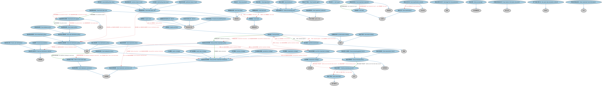

# 集合投资工具本体（Collective Investment Vehicles Ontology）结构与公理说明

本文档对应 `CollectiveInvestmentVehicles.rdf` / `CollectiveInvestmentVehicles.ttl`，说明该本体的类、继承关系、属性和公理约定。结构图见 `CollectiveInvestmentVehicles-structure.png`（`CollectiveInvestmentVehicles-structure.svg` 为可缩放版本）。

## 1. 本体概述

定义集合投资工具（collective investment vehicle，CIV）：汇集众多投资者资金、按既定策略共同投资的载体。

**在体系中的位置**：SEC 基金模块的基础本体，基金、养老金计划的上位概念。

**上下游关系**：上游依赖 FBC 金融工具与 BE 法律实体本体；下游被基金、养老金计划特化。

**与相近概念的差别**：CIV 强调「集合投资」的功能结构，与法律形式无关（可以是公司型、契约型、信托型）；与直接投资的差别——投资者买的是份额，底层资产由管理人统一运作。

本本体中类与类的核心关系如下（完整细节见各类小节）：

- **共同投资基金（FondsCommunDePlacement）** 继承 **集合投资工具（CollectiveInvestmentVehicle）**
- **累积股类（accumulating share class）** 继承 **基金股类单位（fund share class unit）**
- **资产类别策略（asset class strategy）** 继承 **基金组合投资限制（fund portfolio investment limitations）**
- **基金普通份额（common share in fund）** 继承 **基金股类单位（fund share class unit）**
- **货币策略（currency strategy）** 继承 **基金组合投资限制（fund portfolio investment limitations）**
- **分红股类（distributing share class）** 继承 **基金股类单位（fund share class unit）**
- **股票基金（equity fund）** 继承 **集合投资工具（CollectiveInvestmentVehicle）**
- **股票组合（equity portfolio）** 继承 **基金组合（fund portfolio）**
- **基金会计（fund accountant）** 继承 **基金处理参与方（funds processing party）**
- **基金债券类单位（fund bond class unit）** 继承 **基金单位（FundUnit）**
- **基金债券单位票息（fund bond unit coupon）** 继承 **利率（InterestRate）**
- **基金现金分配政策（fund cash distribution policy）** 继承 **基金单位分配政策（fund unit distribution policy）**
- 其余 59 条关系从略。

## 2. 类（Class）

| 类（Class） | 定义（Definition） |
|---|---|
| 共同投资基金（FondsCommunDePlacement） | 开放式集合投资基金，是基金管理人与投资者之间设立的合同形式，而非独立法律实体（法国 FCP）。 open-ended collective investment fund, which is a contractual form set up between the fund manager and investors and not a separate legal entity |
| 累积股类（accumulating share class） | 不提供分红再投资选择、收益累积于份额净值中的股类。 A share class in which there is no option to reinvest. |
| 资产类别策略（asset class strategy） | 基于资产类别的投资策略。 Strategy which is asset class based. |
| 基金普通份额（common share in fund） | 基金中被归类为普通股类的份额单位。 A share unit in a fund, which is classified as a Common Share class. |
| 货币策略（currency strategy） | 基于货币的投资策略。 Strategy which is currency based. |
| 分红股类（distributing share class） | 将收益定期分配给份额持有人的股类。 |
| 股票基金（equity fund） | 至少 85% 投资于股票的基金。 A fund which invests in at least 85% shares. |
| 股票组合（equity portfolio） | 至少 85% 敞口为股票的投资组合。 A portfolio which has at least 85% exposure to shares. |
| 基金会计（fund accountant） | 负责记录基金资产和负债账目的一方，计算交易价格、基金资产净值（NAV）等。 The party that keeps accounting records of the available assets and liabilities of the Fund. It calculates dealing prices, the Net Asset Value (NAV) of the Fund, and may provide fund performance and tax data. Can be subcontracted by the FundAdministrator. |
| 基金债券类单位（fund bond class unit） | 以对该基金之债权形式存在的基金单位。 A fund unit which takes the form of debt in that fund. |
| 基金债券单位票息（fund bond unit coupon） | 向基金债券单位持有人支付的固定票息。 A fixed coupon paid out to holders of the Fund Bond Unit. |
| 基金现金分配政策（fund cash distribution policy） | 在基金单位分配政策为「现金」而非「再投资」时，关于现金股息或票据分配的政策。 Policy for distribution of cash dividends or notes in the event that the fund units have a distribution policy of "Cash" rather than "Reinvestment". |
| 基金分类（fund classification） | 按资产类别对基金进行的分类，是用于对基金归类的公开代码。 The category of the fund according to the asset class. This is a published code by which the Fund is classified. Further notes: Could be EFCF codes. This is the way in which "Type of fund" is articulated. |
| 基金分类方案（fund classification scheme） | 按资产类别对基金进行分类的公开方案。 A published scheme for the category of a fund according to the asset class. |
| 基金票息政策（fund coupon policy） | 关于债券单位票息预期分配的条款。 Terms for the expected distribution of bond unit coupons. |
| 基金存管人（fund depositary） | 持有并保管基金所持资产的一方，还负责组合符合法定比例等合规事项。 The party that holds and safeguards holdings owned by a fund. It is also responsible for compliance of the portfolio with legal ratios etc. |
| 基金分配政策（fund distribution policy） | 表明基金分配总体策略或限制的政策。 policy indicating the overall strategy or limitations on distribution for the fund |
| 基金分销商（fund distributor） | 投资者通过其购买基金份额的实体，可基于全权委托、咨询或仅执行交易的方式。 an entity through which a fund may be bought by or for an investor. This may be on a discretionary or advisory basis, or as an execution-only service. Definition origin:EFAMA DD |
| 基金股息政策（fund dividend policy） | 关于股息预期分配的条款。 Terms for the expected distributions of dividends. |
| 基金投资目标（fund investment objective） | 基金的目标，例如超越某一基准。 The aim of a Fund e.g outperfom a given benchmark. |
| 基金投资政策（fund investment policy） | 基金为实现既定目标而实施的政策。 policy that the fund implements in order to achieve the stated fund objectives |
| 基金投资限制集（fund investment restrictions set） | 适用于基金整体的限制（如风险因素），用于判断该基金是否适合某类投资者。 Limitations that apply to the fund as a whole, such as risk factors. these are used to determine whether the fund is appropriate for a given type of investor to invest in. |
| 基金法律形式文件（fund legal form documentation） | 依合同法设立的基金的章程或组织文件，以合同形式体现。 For a fund which is constituted under the law of contract, the constitution or articles that define the fund. These are embodied in a Contract. |
| 基金下单台（fund order desk） | 基金下单台账户的一方，负责接收投资者申购赎回指令。 The Fund Order Desk is a party to the Fund Order Desk Account. |
| 基金组合（fund portfolio） | 包含若干金融工具以及一种或多种货币现金头寸、并归属于某一基金的账户。 An account containing a number of financial instruments along with cash positions in one or more currencies and belonging to a Fund |
| 基金组合投资限制（fund portfolio investment limitations） | 关于组合应如何配置以实现既定投资目标的详细政策，构成详细策略的基础。 Detailed Policy on approximately how the portfolio is to be allocated to achieve the stated investment goals. This underpins the detailed strategy of how to achieve this. |
| 基金组合投资政策（fund portfolio investment policy） | 为实现既定投资策略和目标而制定的组合配置政策。 policy with respect to allocation of the portfolio that is designed to meet the stated investment strategy and goals |
| 基金处理一般条款（fund processing general terms） | 基金一般处理的正式条款，规定投资者和基金可以或不可以做什么。 Formal terms for general processing of the fund. These set out what the investor and the fund may or may not do. |
| 基金处理条款（fund processing terms） | 基金处理的正式条款，规定投资者和基金可以或不可以做什么，包括赎回和申购条款。 Formal terms for processing of the fund. These set out what the investor and the fund may or may not do. These include terms for redemption and subscription processing as well as general processing terms. ISO FIBIM definition: Processing characteristics linked to the instrument, ie, not to the market. |
| 基金赎回限制（fund redemption restriction） | 对投资者赎回基金单位施加的限制。 |
| 基金赎回条款（fund redemption terms） | 基金单位赎回的正式条款，规定投资者和基金可以或不可以做什么。 Formal terms for redemption of units in the fund. These set out what the investor and the fund may or may not do. |
| 基金再投资政策（fund reinvestment policy） | 关于基金单位收益预期再投资的条款。 Terms for the expected reinvestment of profits on fund units. |
| 基金股类单位（fund share class unit） | 购买投资池一部分的法律结构，由投资者类型、最低投资额等多种特征定义。 The legal structure in which you can purchase part of an investment pool, defined by a variety of characteristics like investor type, minimum size of investment, distribution type, fee and currency. A fund unit which gives the holder an equity stake in the fund. |
| 基金申购条款（fund subscription terms） | 基金的申购条款，规定投资者和基金在申购环节可以或不可以做什么。 Subscription terms for the fund. Further notes: ISO FIBIM, EFAMA DD and FPP combine terms for subscription, redemption and general holding requirements. These have been separated here as they are different kinds of term, but this can be reviewed. Subscription Terms are identified as terms of the fund and not the fund unit, since terms for how you might subscribe can't be binding one someone who has not yet subscribed. |
| 基金监管机构（fund supervisory authority） | 监管基金或基金行业的一方。 party that supervises the fund or fund industry |
| 基金过户代理人（fund transfer agent） | 代表基金执行申购、赎回和转换指令的实体。 An entity that undertakes the execution of subscription, redemption and switch orders on behalf of a fund. Definition origin:EFAMA DD |
| 基金单位分配方式（fund unit distribution method） | 基金的常规分配政策方式。 The normal distribution policy for funds. |
| 基金单位分配政策（fund unit distribution policy） | 与基金单位相关的政策，例如收益是分配给投资者还是留存于基金中，以及如何处理。 policy relating to the unit, e.g. if income is paid out or retained in the fund and how this is treated, including distribution policy details for dividends and coupons. |
| 基金现金分配（funds cash distribution） | 应计收益定期分配给投资者的方式。 Accrued income is distributed periodically to the investor. |
| 基金处理（funds processing） | 管理和处理基金、发行基金单位等的业务语境，基金相关各方即在此语境中定义。 The context of managing and processing funds, issuing funds units etc. This is the context in which the different parties involved in a fund are defined as parties. |
| 基金处理账户（funds processing account） | 专门用于基金处理的账户，按 FIBIM 定义是两个实体之间的业务关系。 An account used specifically in the processing of funds. Like all accounts this is (per FIBIM definition) a business relationship between two entities; one entity is the account owner, the other entity is the account servicer. Please refer to Financial global model for treatment of accounts relationships in this model. |
| 基金处理参与方（funds processing party） | 参与基金处理的一方。 party involved in the processing of funds |
| 收益累积（income accumulation） | 应计收益不予分配，而是继续反映在单位/份额价格中的方式。 Accrued income is not distributed and instead remains reflected within the unit/share price. |
| 投资策略（investment strategy） | 为实现特定投资目标而制定的计划、方法或一系列策略安排。 plan, method, or series of maneuvers or stratagems for obtaining a specific investment goal |
| 司法管辖区策略（jurisdiction strategy） | 基于司法管辖区的投资策略。 Strategy which is jurisdiction based. |
| 关键投资者信息文件（key investor information document） | 为投资者提供关键信息的简短文件，汇总招募说明书内容以便投资者理解（KIID）。 short document that provides critical information for investors, summarizing content derived from a prospectus such that it can be understood by investors without reference to other documents, as required by law in the European Union |
| 资产净值计算方法（net asset value calculation method） | 计算投资基金/基金类别资产净值（NAV）的参数。 Parameters for the calculation of the net asset value for an investment fund/fund class. |
| 票据基金（note fund） | 向投资者发行债务工具（票据）而非（或同时发行）传统权益的集合投资工具。 pooled investment vehicle that issues debt instruments (notes) to investors rather than (or in addition to) traditional equity interests |
| 票据基金份额（note fund share） | 在基金以公司形式组建时，发行票据而非传统权益的基金中的投资权益。 investment interest in a fund that issues notes rather than traditional equity, in cases where the fund is structured as a company |
| 票据基金单位（note fund unit） | 在基金以信托、合伙或单位信托形式组建时，发行票据而非传统权益的基金中的投资权益。 investment interest in a fund that issues notes rather than traditional equity, in cases where the fund is structured as a trust, partnership, or unitized fund |
| 机构策略（organization strategy） | 基于特定机构的投资策略。 Strategy which is organization based. |
| 其他投资基金信息（other investment fund information） | 不属于招募说明书、但对理解基金很重要的信息。 Things which are not part of the prospectus but are important if you want to understand the fund. |
| 组合基准（portfolio benchmark） | 用于评价组合表现的证券或其他价格基准。 Security or other price against which the performance of the portfolio is evaluated. |
| 组合投资策略（portfolio investment strategy） | 组合管理人试图实现基金目标的方式。 The manner in which the portfolio manager tries to reach the funds objectives. |
| 基金优先份额（preferred share in fund） | 基金中被归类为优先股类的份额单位。 |
| 私募股权持有（private equity holding） | 对私募股权的持有。 A holding of private equity. |
| 房地产持有（real estate holding） | 由个人、组织或实体为投资、运营或战略目的拥有或控制的房地产有形资产。 tangible asset consisting of real estate that is owned or controlled by an individual, organization, or entity for investment, operational, or strategic purposes |
| 须洽基金下单台（refer to fund order desk） | 要求投资者在赎回基金前先与基金下单台联系的限制。 Restriction requiring an investor to refer to the fund order desk prior to redeeming a fund. |
| 风险级别（risk level） | 对基金或投资组合风险程度的度量。 |
| 法国固定资本投资公司（SICAF） | 法国的一种基金载体形式，资本固定的投资公司。 A French fund vehicle type. Designation and definition needed. |
| 可变资本投资公司（SICAV） | 法国及欧洲大陆常见的开放式投资公司形式，资本可变的集合投资公司。 Societe Collective a Capital Variable |
| 行业策略（sector strategy） | 基于行业板块的投资策略。 Strategy which is sector based. |
| 单位发行人（unit issuer） | 发行基金单位的一方。 The party which issues the Fund Unit. |

以下按类逐个展开：每个类给出继承关系、相关属性与公理约定；子类在父类之下降一级编号。

### 2.1 共同投资基金（FondsCommunDePlacement）

定义：开放式集合投资基金，是基金管理人与投资者之间设立的合同形式，而非独立法律实体（法国 FCP）。

- 父类：**集合投资工具（CollectiveInvestmentVehicle）**

### 2.2 股票基金（equity fund）

定义：至少 85% 投资于股票的基金。

- 父类：**集合投资工具（CollectiveInvestmentVehicle）**

属性：

| 属性 | 定义 | 说明 |
|---|---|---|
| **包含（comprises）** | — | — |

公理：

- **包含（comprises）**至少有一个取值，类型是**股票组合（equity portfolio）**。

### 2.3 基金债券类单位（fund bond class unit）

定义：以对该基金之债权形式存在的基金单位。

- 父类：**基金单位（FundUnit）**

属性：

| 属性 | 定义 | 说明 |
|---|---|---|
| **具有战略（hasStrategy）** | — | — |
| **具有预期票息（has expected coupon）** | 指明预期的票息分配。 | 值域：基金债券单位票息（fund bond unit coupon） |

公理：

- **具有战略（hasStrategy）**至少有一个取值，类型是**基金单位分配政策（fund unit distribution policy）**。
- **具有预期票息（has expected coupon）**至少有一个取值，类型是**基金债券单位票息（fund bond unit coupon）**。

### 2.4 基金债券单位票息（fund bond unit coupon）

定义：向基金债券单位持有人支付的固定票息。

- 父类：**利率（InterestRate）**

属性：

| 属性 | 定义 | 说明 |
|---|---|---|
| **具有政策条款（has policy terms）** | 指明基金的政策条款。 | 值域：基金票息政策（fund coupon policy） |

公理：

- **具有政策条款（has policy terms）**至少有一个取值，类型是**基金票息政策（fund coupon policy）**。

### 2.5 基金分类（fund classification）

定义：按资产类别对基金进行的分类，是用于对基金归类的公开代码。

- 父类：**分类符（Classifier）**

属性：

| 属性 | 定义 | 说明 |
|---|---|---|
| **分类（classifies）** | — | — |

公理：

- **分类（classifies）**至少有一个取值，类型是**集合投资工具（CollectiveInvestmentVehicle）**。

### 2.6 基金分类方案（fund classification scheme）

定义：按资产类别对基金进行分类的公开方案。

- 父类：**分类方案（ClassificationScheme）**

属性：

| 属性 | 定义 | 说明 |
|---|---|---|
| **定义（defines）** | — | — |

公理：

- **定义（defines）**至少有一个取值，类型是**基金分类（fund classification）**。

### 2.7 基金分配政策（fund distribution policy）

定义：表明基金分配总体策略或限制的政策。

- 父类：**政策（Policy）**

### 2.8 基金投资目标（fund investment objective）

定义：基金的目标，例如超越某一基准。

- 父类：**投资目标（InvestmentObjective）**

属性：

| 属性 | 定义 | 说明 |
|---|---|---|
| **具有预期风险级别（has intended risk level）** | 指明基金的预期风险级别。 | 值域：风险级别（risk level） |
| **列明于（stated in）** | 指明某信息列明于某一文件。 | 值域：招募说明书 |
| **列明投资目标（stated investment aim）** | 以文字表述的基金目标，例如超越某一基准。 The stated aim of the Fund in words, e.g outperfom a given benchmark. | 值域：xsd:string |

公理：

- **具有预期风险级别（has intended risk level）**至少有一个取值，类型是**风险级别（risk level）**。
- **列明于（stated in）**至少有一个取值，类型是**招募说明书（Prospectus）**。

### 2.9 基金投资政策（fund investment policy）

定义：基金为实现既定目标而实施的政策。

- 父类：**政策（Policy）**

属性：

| 属性 | 定义 | 说明 |
|---|---|---|
| **规定基准（stipulates benchmark）** | 规定组合业绩评价所用的基准。 | 值域：市场利率 |
| **定义（defines）** | — | — |
| **管辖（governs）** | — | — |

公理：

- **定义（defines）**至少有一个取值，类型是**基金投资限制集（fund investment restrictions set）**。
- **管辖（governs）**至少有一个取值，类型是**组合投资策略（portfolio investment strategy）**。
- **规定基准（stipulates benchmark）**至多有 1 个**市场利率（MarketRate）**。

### 2.10 基金投资限制集（fund investment restrictions set）

定义：适用于基金整体的限制（如风险因素），用于判断该基金是否适合某类投资者。

- 父类：**证券限制（SecuritiesRestriction）**
- 直接子类：**基金组合投资限制（fund portfolio investment limitations）**

属性：

| 属性 | 定义 | 说明 |
|---|---|---|
| **最低评级限制（minimum rating restriction）** | 可投资证券的最低评级要求。 The minimum rating of securities to be invested in. | 值域：评级得分 |
| **投资比例（percentage invested）** | 任一给定时间应投资的资金百分比。 The percentage of funds that is to be invested at any given time. | 值域：百分比 |
| **跟踪误差（tracking error）** | 组合回报与基准回报之间差异的度量。 See RiskFactors narrative in EFAMA DD | 值域：百分比 |
| **证券类型（type of securities）** | 可投资的证券或其他持有资产的类型。 The type of securities or other holdings that may be invested in. | 值域：xsd:string |
| **风险价值（value at risk）** | 对基金（而非组合）在给定置信水平下潜在损失的度量（VaR）。 See RiskClassification_NameOf in EFAMA DD Applies to Fund not Portfolio. | 值域：百分比 |
| **是……的部分（isPartOf）** | — | — |

公理：

- **是……的部分（isPartOf）**至少有一个取值，类型是**招募说明书（Prospectus）**。

#### 2.10.1 基金组合投资限制（fund portfolio investment limitations）

定义：关于组合应如何配置以实现既定投资目标的详细政策，构成详细策略的基础。

- 父类：**基金投资限制集（fund investment restrictions set）**
- 直接子类：**资产类别策略（asset class strategy）**、**货币策略（currency strategy）**、**司法管辖区策略（jurisdiction strategy）**、**机构策略（organization strategy）**、**行业策略（sector strategy）**

属性：

| 属性 | 定义 | 说明 |
|---|---|---|
| **是否纳入（inclusion）** | 所指策略是否被纳入；若为否，则该描述指将所述内容排除于组合之外。 Whether the referred strategy is included. No means this description refers to the exclusion of what is described, from the portfolio. | 值域：xsd:boolean |
| **最大投资金额（maximum investment amount）** | 在指定策略中可投资的最大金额。 Maximum amount that may be invested in the specified strategy. | 值域：货币数量 |
| **最大投资比例（maximum investment percentage）** | 在指定策略中可投资的最大百分比。 Maximum percentage that may be invested in the specified strategy. | 值域：百分比 |
| **最低投资金额（minimum investment amount）** | 在指定策略中必须投资的最低金额。 Minimum amount that has to be invested in the specified strategy. | 值域：货币数量 |
| **最低投资比例（minimum investment percentage）** | 在指定策略中必须投资的最低百分比。 Minimum percentage that has to be invested in the specified strategy. | 值域：百分比 |

##### 2.10.1.1 资产类别策略（asset class strategy）

定义：基于资产类别的投资策略。

- 父类：**基金组合投资限制（fund portfolio investment limitations）**

属性：

| 属性 | 定义 | 说明 |
|---|---|---|
| **以……标识资产类型（identifies asset types by）** | 指明用于标识资产类型的分类方式。 | 值域：金融工具分类器 |

公理：

- **以……标识资产类型（identifies asset types by）**至少有一个取值，类型是**金融工具分类器（FinancialInstrumentClassifier）**。

##### 2.10.1.2 货币策略（currency strategy）

定义：基于货币的投资策略。

- 父类：**基金组合投资限制（fund portfolio investment limitations）**

##### 2.10.1.3 司法管辖区策略（jurisdiction strategy）

定义：基于司法管辖区的投资策略。

- 父类：**基金组合投资限制（fund portfolio investment limitations）**

属性：

| 属性 | 定义 | 说明 |
|---|---|---|
| **适用于情境（isApplicableIn）** | — | — |

公理：

- **适用于情境（isApplicableIn）**至少有一个取值，类型是**管辖权（Jurisdiction）**。

##### 2.10.1.4 机构策略（organization strategy）

定义：基于特定机构的投资策略。

- 父类：**基金组合投资限制（fund portfolio investment limitations）**

属性：

| 属性 | 定义 | 说明 |
|---|---|---|
| **附加限制（additional restrictions）** | 关于该策略及其所指机构的其他限制或处理信息。 Other restrictions or treatment information in respect of this strategy and the organization to which it refers. | 值域：xsd:string |
| **是否列入黑名单（blacklisted）** | 该策略是否将所指商业实体列入黑名单：若是，则该策略禁止投资于该实体。 Whether or not the strategy in framed so as to include the referenced business entity as being blacklisted. If yes, the strategy prevents investment in securities issued by that organization. | 值域：xsd:boolean |
| **相对于……定义（defined in relation to）** | 表明某术语是相对于另一事物定义的。 | 值域：公司 |
| **是否包含关联公司（include related firms）** | 该策略是否包含与所指机构存在某种关联的公司。 Whether or not the strategy includes firms which are related in some way to the referenced organization. | 值域：xsd:boolean |

公理：

- **相对于……定义（defined in relation to）**至少有一个取值，类型是**公司（Corporation）**。

##### 2.10.1.5 行业策略（sector strategy）

定义：基于行业板块的投资策略。

- 父类：**基金组合投资限制（fund portfolio investment limitations）**

### 2.11 基金法律形式文件（fund legal form documentation）

定义：依合同法设立的基金的章程或组织文件，以合同形式体现。

- 父类：**宪章（Constitution）**

### 2.12 基金下单台（fund order desk）

定义：基金下单台账户的一方，负责接收投资者申购赎回指令。

- 父类：**账户提供方（AccountProvider）**

属性：

| 属性 | 定义 | 说明 |
|---|---|---|
| **由…扮演（is played by）** | — | — |

公理：

- **由…扮演（is played by）**至少有一个取值，类型是**法律实体（LegalEntity）**。

### 2.13 基金组合（fund portfolio）

定义：包含若干金融工具以及一种或多种货币现金头寸、并归属于某一基金的账户。

- 父类：**组合（Portfolio）**
- 直接子类：**股票组合（equity portfolio）**

属性：

| 属性 | 定义 | 说明 |
|---|---|---|
| **具有货币数量（hasMonetaryAmount）** | — | — |
| **对照……评估（assessed against）** | 指明用于评估组合表现的基准。 | 值域：组合基准（portfolio benchmark） |
| **战略（strategy）** | 指导决策并协调行动与计划以追求某意向的高层途径。 | 值域：投资策略（investment strategy） |
| **实施基金政策（implements fund policy）** | 表明某一策略实施某一基金政策。 | 值域：基金组合投资政策（fund portfolio investment policy） |
| **包含（comprises）** | — | — |

公理：

- **具有货币数量（hasMonetaryAmount）**至少有一个取值，类型是**余额（Balance）**。
- **包含（comprises）**至少有一个取值，类型是**组合（Portfolio）**。
- **实施基金政策（implements fund policy）**至少有一个取值，类型是**基金组合投资政策（fund portfolio investment policy）**。
- **对照……评估（assessed against）**至少有一个取值，类型是**组合基准（portfolio benchmark）**。
- **战略（strategy）**至少有一个取值，类型是**组合投资策略（portfolio investment strategy）**。

#### 2.13.1 股票组合（equity portfolio）

定义：至少 85% 敞口为股票的投资组合。

- 父类：**基金组合（fund portfolio）**

属性：

| 属性 | 定义 | 说明 |
|---|---|---|
| **包含（comprises）** | — | — |

公理：

- **包含（comprises）**至少有一个取值，类型是**持股（Shareholding）**。

### 2.14 基金组合投资政策（fund portfolio investment policy）

定义：为实现既定投资策略和目标而制定的组合配置政策。

- 父类：**政策（Policy）**

属性：

| 属性 | 定义 | 说明 |
|---|---|---|
| **规定配置（defines allocations）** | 规定组合资产的配置方式。 | 值域：基金组合投资限制（fund portfolio investment limitations）；子属性：定义 |
| **名称（name）** | 以语言表达式对某事物的指称。 Name given to the defined strategy. | 值域：xsd:string |
| **管辖（governs）** | — | — |

公理：

- **管辖（governs）**至少有一个取值，类型是**组合投资策略（portfolio investment strategy）**。
- **规定配置（defines allocations）**至少有一个取值，类型是**基金组合投资限制（fund portfolio investment limitations）**。

### 2.15 基金处理条款（fund processing terms）

定义：基金处理的正式条款，规定投资者和基金可以或不可以做什么，包括赎回和申购条款。

- 父类：**合同承诺（ContractualCommitment）**
- 直接子类：**基金处理一般条款（fund processing general terms）**、**基金赎回条款（fund redemption terms）**、**基金申购条款（fund subscription terms）**

属性：

| 属性 | 定义 | 说明 |
|---|---|---|
| **交易频率描述（dealing frequency description）** | 对申购和赎回执行频率的文字描述。 Description of frequency at which the subscriptions and redemptions are done. | 值域：xsd:string |
| **规定主基金下单台账户（defines main fund order desk account）** | 规定基金的主要下单台账户。 | 值域：基金处理账户（funds processing account） |
| **具有默认结算惯例（has default settlement convention）** | 指明基金交易的默认结算惯例。 | 值域：结算惯例 |
| **是否主基金下单台（main fund order desk）** | 该基金下单台是否为基金指定的接收指令的主要实体。 Whether the fund order desk is the principal entity appointed by the fund to which orders should be submitted. | 值域：xsd:boolean |
| **处理所在国（processing country）** | 该处理特性所适用的国家。 Country in which the processing characteristic applies. | 值域：国家 |

公理：

- **具有默认结算惯例（has default settlement convention）**至少有一个取值，类型是**结算惯例（SettlementConvention）**。
- **规定主基金下单台账户（defines main fund order desk account）**至少有一个取值，类型是**基金处理账户（funds processing account）**。

#### 2.15.1 基金处理一般条款（fund processing general terms）

定义：基金一般处理的正式条款，规定投资者和基金可以或不可以做什么。

- 父类：**基金处理条款（fund processing terms）**

属性：

| 属性 | 定义 | 说明 |
|---|---|---|
| **获准销售国（authorized country）** | 获准在该国销售基金的国家。 Country in which it is authorised to commercialise the fund. | 值域：国家 |
| **是否适用后端收费（back end load applicable）** | 该类别的赎回指令是否可收取退出费用（如或有递延销售费 CDSC）。 Whether an exit charge, eg, CDSC, on redemption orders for this class can be applied. | 值域：xsd:boolean |
| **是否双价基金（dual fund）** | 该基金是否有两个价格。 Whether the fund has two prices. | 值域：xsd:boolean |
| **持有可否转让（holding transferable）** | 注册投资者是否可以将其部分或全部持有转让给第三方。 Whether registered investors are able to transfer some or all of their holdings to third parties. | 值域：xsd:boolean |
| **最短持有期（minimum holding period）** | 单位/份额发行后必须持有、方允许赎回的天数。 Period, in days, during which the units/shares must be held following their issue before redemption will be permitted. | 值域：时长 |
| **最低留存持有金额（minimum remaining holding amount）** | 为避免自动赎回而必须留存的单位/份额最低价值。 Minimum value of units/shares that must be retained to avoid automatic redemption. | 值域：货币数量 |
| **最低留存持有单位数（minimum remaining holding units）** | 为避免自动赎回而必须留存的最低单位/份额数量。 Minimum number of units/shares that must be retained to avoid automatic redemption. | 值域：xsd:integer |
| **是否收取转换费（switching chargeable）** | 同一伞形基金下子基金之间转换是否可收取转换费。 Whether a switching charge for changing between sub-funds of the same umbrella can be applied. | 值域：xsd:boolean |

#### 2.15.2 基金赎回条款（fund redemption terms）

定义：基金单位赎回的正式条款，规定投资者和基金可以或不可以做什么。

- 父类：**基金处理条款（fund processing terms）**

属性：

| 属性 | 定义 | 说明 |
|---|---|---|
| **具有附加赎回限制（has additional redemption restrictions）** | 指明基金的附加赎回限制。 | 值域：须洽基金下单台（refer to fund order desk） |
| **最大赎回金额（maximum redemption amount）** | 以金额表示的可卖出证券最大数量。 Maximum quantity of securities, expressed as an amount that can be sold. | 值域：货币数量 |
| **最大赎回比例（maximum redemption percentage）** | 以百分比表示的可卖出证券最大数量。 Maximum quantity of securities, expressed as a percentage that can be sold. | 值域：百分比 |
| **最大赎回单位数（maximum redemption units）** | 单一交易日可赎回的最大份额/单位数量。 Maximum number of shares/units that may be redeemed on a single dealing day. | 值域：xsd:integer |
| **赎回截止时间（redemption cutoff date time）** | 可以提交赎回指令的最后日期/时间。 Last date/time at which an order to redeem can be given. | 值域：日期时间 |
| **赎回交易频率（redemption dealing frequency）** | 赎回执行的频率。 Frequency at which the redemptions are done. | 值域：重复区间 |
| **赎回申请表（redemption form）** | 投资者赎回单位/份额的纸质书面指令/弃权表格。 Physical written instruction/renunciation form for redemption of units/shares by the investor. | — |
| **是否允许按金额赎回（redemption in amount allowed）** | 是否允许按金额赎回。 Whether redemptions in amount are allowed. | 值域：xsd:boolean |
| **赎回期（redemption period）** | 可以赎回单位/份额的特定期间，例如某些保本基金的赎回期。 Specific period, eg, for some guaranteed funds, during which the units/shares may be redeemed. | 值域：日期区间 |

公理：

- **具有附加赎回限制（has additional redemption restrictions）**至少有一个取值，类型是**须洽基金下单台（refer to fund order desk）**。

#### 2.15.3 基金申购条款（fund subscription terms）

定义：基金的申购条款，规定投资者和基金在申购环节可以或不可以做什么。

- 父类：**基金处理条款（fund processing terms）**

属性：

| 属性 | 定义 | 说明 |
|---|---|---|
| **是否适用前端收费（front end load applicable）** | 该类别的申购指令是否可收取前端费用。 Whether a front end charge on subscription orders for this class can be applied. | 值域：xsd:boolean |
| **首次申请表（initial application form）** | 投资者首次申购的纸质申请表。 Physical application form for the initial subscription by the investor. | — |
| **最高申购费（maximum purchasing fee）** | 购买基金份额时应付的最高百分比或固定金额费用。 Maximum percentage or fixed amount of money due when purchasing fund shares Definition origin:EFAMA DD | 值域：费用 |
| **最高赎回费（maximum redemption fee）** | 赎回基金份额时应付的最高百分比或固定金额费用。 Maximum percentage or fixed amount of money due when redeeming fund shares Definition origin:EFAMA DD | 值域：费用 |
| **最低首次申购金额（minimum initial subscription amount）** | 最低首次申购价值。 Minimum initial subscription value. | 值域：货币数量 |
| **最低首次申购单位数（minimum initial subscription units）** | 首次必须购买的最低单位/份额数量。 Minimum initial number of units/shares that must be purchased. | 值域：xsd:integer |
| **最低申购金额（minimum subscription amount）** | 现有投资者的最低申购价值。 Minimum subscription value for existing investors. | 值域：货币数量 |
| **最低申购单位数（minimum subscription units）** | 现有投资者必须购买的最低单位/份额数量。 Minimum number of units/shares that must be purchased by existing investors. | 值域：xsd:integer |
| **业绩报酬（performance fee）** | 为实现预定超额收益目标而支付的费用。 Fees paid for the achivements of predefined outperformance objectives Definition origin:EFAMA DD | 值域：费用 |
| **申购费（purchasing fee）** | 购买基金份额时应付的实际百分比或固定金额费用。 Actual percentage or fixed amount of money due when purchasing fund shares Definition origin:EFAMA DD | 值域：费用 |
| **赎回费（redemption fee）** | 赎回基金份额时应付的实际百分比或固定金额费用。 Actual percentage or fixed amount of money due when redeeming fund shares Definition origin:EFAMA DD | 值域：费用 |
| **申购截止时间（subscription cutoff date time）** | 可以提交申购指令的最后日期/时间。 Last date/time at which an order to subscribe can be given. | 值域：日期时间 |
| **申购交易频率（subscription dealing frequency）** | 申购执行的频率。 Frequency at which the subscriptions are done. | 值域：重复区间 |
| **认购期间（subscription period）** | 证券可被认购的期间。 Specific period, eg, for some guaranteed funds, during which the units/shares may be subscribed to. | 值域：日期区间 |
| **是否允许按金额申购（subscriptions in amount allowed）** | 是否允许按金额申购。 Whether subscriptions in amount are allowed. | 值域：xsd:boolean |
| **后续申请表（subsequent application form）** | 同一投资者后续投资的纸质申请表。 Physical application form for subsequent investments by the same investor. | — |
| **转换费（switching fee）** | 转换至另一基金时应付的实际百分比或固定金额费用。 Actual percentage or fixed amount of money due when switching to another fund. Definition origin:EFAMA DD | 值域：费用 |
| **适用于（appliesTo）** | — | — |

公理：

- **适用于（appliesTo）**至少有一个取值，类型是**基金单位（FundUnit）**。

### 2.16 基金赎回限制（fund redemption restriction）

定义：对投资者赎回基金单位施加的限制。

- 父类：**证券限制（SecuritiesRestriction）**
- 直接子类：**须洽基金下单台（refer to fund order desk）**

#### 2.16.1 须洽基金下单台（refer to fund order desk）

定义：要求投资者在赎回基金前先与基金下单台联系的限制。

- 父类：**基金赎回限制（fund redemption restriction）**

### 2.17 基金股类单位（fund share class unit）

定义：购买投资池一部分的法律结构，由投资者类型、最低投资额等多种特征定义。

- 父类：**基金单位（FundUnit）**
- 直接子类：**累积股类（accumulating share class）**、**基金普通份额（common share in fund）**、**分红股类（distributing share class）**、**基金优先份额（preferred share in fund）**

属性：

| 属性 | 定义 | 说明 |
|---|---|---|
| **具有战略（hasStrategy）** | — | — |
| **核准设立日（inception date）** | 在原产国获得核准的日期。 Authorization date in the country of origin. Further Notes See definition in Inception Date for Fund. Separate fact exists here. Same definition used. EFAMA Review notes: Inception Date exists as soon as there is a prospectus, so it is a fact about a Share Class even if the share class is never formally issued or offered to the public. Legal structure exists even if something is not launched. Editor question: Review stated this was a fact about Share Class; confirm this fact does not apply to Bond and Note units, or was the term Share Class being used to mean all three? Meanwhile I have put the term "Issue Date" as a fact about all Fund Unit, as this is given a sa separate term in the EFAMA DD spreadsheet. MAy come clearer in the next version of that. | 值域：日期 |
| **是否限量发行份额（limited shares are issued）** | 该基金是否可以发行新份额，这决定其为封闭式还是开放式基金。 Whether or not new shares can be issued in the fund. This is what makes it a closed end or open end fund. | 值域：xsd:boolean |

公理：

- **具有战略（hasStrategy）**至少有一个取值，类型是**基金单位分配政策（fund unit distribution policy）**。

#### 2.17.1 累积股类（accumulating share class）

定义：不提供分红再投资选择、收益累积于份额净值中的股类。

- 父类：**基金股类单位（fund share class unit）**

公理：

- 与**分红股类（distributing share class）**互斥：同一个体不能同时属于两者。

#### 2.17.2 基金普通份额（common share in fund）

定义：基金中被归类为普通股类的份额单位。

- 父类：**基金股类单位（fund share class unit）**

公理：

- 与**基金优先份额（preferred share in fund）**互斥：同一个体不能同时属于两者。

#### 2.17.3 分红股类（distributing share class）

定义：将收益定期分配给份额持有人的股类。

- 父类：**基金股类单位（fund share class unit）**

属性：

| 属性 | 定义 | 说明 |
|---|---|---|
| **持有人可否再投资（holder may reinvest）** | 持有人是否可以将股息再投资于该基金。 Whether or not the holder may reinvest dividends in the fund. | 值域：xsd:boolean |

#### 2.17.4 基金优先份额（preferred share in fund）

定义：基金中被归类为优先股类的份额单位。

- 父类：**基金股类单位（fund share class unit）**

### 2.18 基金监管机构（fund supervisory authority）

定义：监管基金或基金行业的一方。

- 父类：**参与方角色（party role）**

### 2.19 基金单位分配方式（fund unit distribution method）

定义：基金的常规分配政策方式。

- 父类：**分配策略（DistributionStrategy）**
- 直接子类：**基金现金分配（funds cash distribution）**、**收益累积（income accumulation）**

#### 2.19.1 基金现金分配（funds cash distribution）

定义：应计收益定期分配给投资者的方式。

- 父类：**基金单位分配方式（fund unit distribution method）**

#### 2.19.2 收益累积（income accumulation）

定义：应计收益不予分配，而是继续反映在单位/份额价格中的方式。

- 父类：**基金单位分配方式（fund unit distribution method）**

### 2.20 基金单位分配政策（fund unit distribution policy）

定义：与基金单位相关的政策，例如收益是分配给投资者还是留存于基金中，以及如何处理。

- 父类：**政策（Policy）**
- 直接子类：**基金现金分配政策（fund cash distribution policy）**、**基金再投资政策（fund reinvestment policy）**

属性：

| 属性 | 定义 | 说明 |
|---|---|---|
| **具有战略（hasStrategy）** | — | — |

公理：

- **具有战略（hasStrategy）**至少有一个取值，类型是**基金单位分配方式（fund unit distribution method）**。

#### 2.20.1 基金现金分配政策（fund cash distribution policy）

定义：在基金单位分配政策为「现金」而非「再投资」时，关于现金股息或票据分配的政策。

- 父类：**基金单位分配政策（fund unit distribution policy）**
- 直接子类：**基金票息政策（fund coupon policy）**、**基金股息政策（fund dividend policy）**

##### 2.20.1.1 基金票息政策（fund coupon policy）

定义：关于债券单位票息预期分配的条款。

- 父类：**基金现金分配政策（fund cash distribution policy）**

属性：

| 属性 | 定义 | 说明 |
|---|---|---|
| **票息支付日（coupon payment date）** | 票息分配给债券单位持有人的日期。 The date at which the coupon is distributed to the bond unit holder. | 值域：月中日 |
| **除息日（ex coupon date）** | 票息从资产净值（NAV）中扣除的日期。 The date at which the coupon is substracted from the NAV | 值域：月中日 |

##### 2.20.1.2 基金股息政策（fund dividend policy）

定义：关于股息预期分配的条款。

- 父类：**基金现金分配政策（fund cash distribution policy）**

#### 2.20.2 基金再投资政策（fund reinvestment policy）

定义：关于基金单位收益预期再投资的条款。

- 父类：**基金单位分配政策（fund unit distribution policy）**

属性：

| 属性 | 定义 | 说明 |
|---|---|---|
| **分配并再投资（distribution with reinvestment）** | 可以持有这样一类份额：应计收益先予分配，然后自动再投资于额外单位/份额。 It is possible to hold shares for which the accrued income is distributed, but then reinvested automatically in additional units/shares allocated to the investor. | 值域：xsd:boolean |
| **再投资频率（reinvestment frequency）** | 对采取再投资分配方式的单位，再投资发生的频率。 For units where there is Reinvestment distribution, the frequency with which the reinvestment takes place (this will be the same or less frequently than the Dividend Payment Frequency), otherwise this fact does not apply. | 值域：重复区间 |

### 2.21 基金处理（funds processing）

定义：管理和处理基金、发行基金单位等的业务语境，基金相关各方即在此语境中定义。

- 父类：**生命周期阶段（LifecycleStage）**

### 2.22 基金处理账户（funds processing account）

定义：专门用于基金处理的账户，按 FIBIM 定义是两个实体之间的业务关系。

- 父类：**账户（Account）**

属性：

| 属性 | 定义 | 说明 |
|---|---|---|
| **由……提供（isProvidedBy）** | — | — |

公理：

- **由……提供（isProvidedBy）**至少有一个取值，类型是**基金下单台（fund order desk）**。

### 2.23 基金处理参与方（funds processing party）

定义：参与基金处理的一方。

- 父类：**参与方角色（party role）**
- 直接子类：**基金会计（fund accountant）**、**基金存管人（fund depositary）**、**基金分销商（fund distributor）**、**基金过户代理人（fund transfer agent）**、**单位发行人（unit issuer）**

#### 2.23.1 基金会计（fund accountant）

定义：负责记录基金资产和负债账目的一方，计算交易价格、基金资产净值（NAV）等。

- 父类：**基金处理参与方（funds processing party）**

#### 2.23.2 基金存管人（fund depositary）

定义：持有并保管基金所持资产的一方，还负责组合符合法定比例等合规事项。

- 父类：**基金处理参与方（funds processing party）**

属性：

| 属性 | 定义 | 说明 |
|---|---|---|
| **为……提供存管服务（provides depositary service for）** | 指明存管人为某一基金提供存管服务。 | 值域：基金单位 |

公理：

- **为……提供存管服务（provides depositary service for）**至少有一个取值，类型是**基金单位（FundUnit）**。

#### 2.23.3 基金分销商（fund distributor）

定义：投资者通过其购买基金份额的实体，可基于全权委托、咨询或仅执行交易的方式。

- 父类：**基金处理参与方（funds processing party）**

#### 2.23.4 基金过户代理人（fund transfer agent）

定义：代表基金执行申购、赎回和转换指令的实体。

- 父类：**基金处理参与方（funds processing party）**

#### 2.23.5 单位发行人（unit issuer）

定义：发行基金单位的一方。

- 父类：**基金处理参与方（funds processing party）**

属性：

| 属性 | 定义 | 说明 |
|---|---|---|
| **发行（issues）** | — | — |
| **由…扮演（is played by）** | — | — |

公理：

- **发行（issues）**至少有一个取值，类型是**基金单位（FundUnit）**。
- **由…扮演（is played by）**至少有一个取值，类型是**公司（Corporation）**。

### 2.24 投资策略（investment strategy）

定义：为实现特定投资目标而制定的计划、方法或一系列策略安排。

- 父类：**业务战略（BusinessStrategy）**
- 直接子类：**组合投资策略（portfolio investment strategy）**

属性：

| 属性 | 定义 | 说明 |
|---|---|---|
| **具有目标（hasObjective）** | — | — |

公理：

- **具有目标（hasObjective）**至少有一个取值，类型是**投资目标（InvestmentObjective）**。

#### 2.24.1 组合投资策略（portfolio investment strategy）

定义：组合管理人试图实现基金目标的方式。

- 父类：**投资策略（investment strategy）**

属性：

| 属性 | 定义 | 说明 |
|---|---|---|
| **投资重点（investment focus）** | 关于基金主要投资领域的信息（例如德国股票市场）。 The information about the area the fund is mostly invested into (for example stock market in Germany). | 值域：xsd:string |
| **包含（comprises）** | — | — |

公理：

- **包含（comprises）**至少有一个取值，类型是**基金组合投资限制（fund portfolio investment limitations）**。

### 2.25 关键投资者信息文件（key investor information document）

定义：为投资者提供关键信息的简短文件，汇总招募说明书内容以便投资者理解（KIID）。

- 父类：**发行文件（OfferingDocument）**

属性：

| 属性 | 定义 | 说明 |
|---|---|---|
| **适用于（appliesTo）** | — | — |
| **适用于情境（isApplicableIn）** | — | — |

公理：

- **适用于情境（isApplicableIn）**的取值固定为 EuropeanUnionJurisdiction。
- **适用于（appliesTo）**至少有一个取值，类型是**基金单位（FundUnit）**。

### 2.26 资产净值计算方法（net asset value calculation method）

定义：计算投资基金/基金类别资产净值（NAV）的参数。

- 父类：**表达式（Expression）**

属性：

| 属性 | 定义 | 说明 |
|---|---|---|
| **公告渠道（declaration channel）** | 资产净值公布的渠道，例如报纸。 Means of the net asset value publication, eg, a newspaper. | 值域：xsd:string |
| **历史定价标志（historic pricing indicator）** | 表明价格是历史价还是远期价。 Indicates whether the price is historic or forward. | 值域：xsd:boolean |
| **以……计算（is calculated in）** | 指明资产净值等数值计算所用的货币或单位。 | 值域：货币 |
| **估值频率（valuation frequency）** | 资产净值计算的频率。 Frequency of the net asset value calculation. | 值域：重复区间 |
| **估值频率文字描述（valuation frequency textual description）** | 对资产净值计算频率的文字描述。 Description of the frequency of the net asset value calculation. | 值域：xsd:string |

公理：

- **以……计算（is calculated in）**至少有一个取值，类型是**货币（Currency）**。

### 2.27 票据基金（note fund）

定义：向投资者发行债务工具（票据）而非（或同时发行）传统权益的集合投资工具。

- 父类：**管理型投资（ManagedInvestment）**

### 2.28 票据基金份额（note fund share）

定义：在基金以公司形式组建时，发行票据而非传统权益的基金中的投资权益。

- 父类：**基金单位（FundUnit）**

属性：

| 属性 | 定义 | 说明 |
|---|---|---|
| **是……的部分（isPartOf）** | — | — |

公理：

- **是……的部分（isPartOf）**至少有一个取值，类型是**票据基金（note fund）**。

### 2.29 票据基金单位（note fund unit）

定义：在基金以信托、合伙或单位信托形式组建时，发行票据而非传统权益的基金中的投资权益。

- 父类：**基金单位（FundUnit）**

属性：

| 属性 | 定义 | 说明 |
|---|---|---|
| **是……的部分（isPartOf）** | — | — |

公理：

- **是……的部分（isPartOf）**至少有一个取值，类型是**票据基金（note fund）**。

### 2.30 其他投资基金信息（other investment fund information）

定义：不属于招募说明书、但对理解基金很重要的信息。

- 父类：**文件（Document）**

### 2.31 组合基准（portfolio benchmark）

定义：用于评价组合表现的证券或其他价格基准。

- 父类：**度量（Measure）**

属性：

| 属性 | 定义 | 说明 |
|---|---|---|
| **基准权重（benchmark weight）** | 工具在组合基准中的权重。 Instrument weighting in the benchmark for the portfolio. | 值域：百分比 |
| **规定基准（defines benchmark）** | 规定组合所用的基准。 | 值域：市场利率 |
| **最大偏离度（maximum deviation）** | 允许偏离基准的最大幅度。 Maximum allowable deviation from the benchmark. | 值域：百分比 |
| **最小偏离度（minimum deviation）** | 允许偏离基准的最小幅度。 Minimum allowable deviation from the benchmark. | 值域：百分比 |
| **适用于（appliesTo）** | — | — |

公理：

- **规定基准（defines benchmark）**至少有一个取值，类型是**市场利率（MarketRate）**。
- **适用于（appliesTo）**至少有一个取值，类型是**基金组合（fund portfolio）**。

### 2.32 私募股权持有（private equity holding）

定义：对私募股权的持有。

- 父类：**组合（Portfolio）**

属性：

| 属性 | 定义 | 说明 |
|---|---|---|
| **包含（comprises）** | — | — |

公理：

- **包含（comprises）**至少有一个取值，类型是**私人持有股份（PrivatelyHeldShare）**。

### 2.33 房地产持有（real estate holding）

定义：由个人、组织或实体为投资、运营或战略目的拥有或控制的房地产有形资产。

- 父类：**组合（Portfolio）**

属性：

| 属性 | 定义 | 说明 |
|---|---|---|
| **包含（comprises）** | — | — |

公理：

- **包含（comprises）**至少有一个取值，类型是**房地产（RealEstate）**。

### 2.34 风险级别（risk level）

定义：对基金或投资组合风险程度的度量。

- 父类：**分类符（Classifier）**

### 2.35 法国固定资本投资公司（SICAF）

定义：法国的一种基金载体形式，资本固定的投资公司。

- 父类：**集合投资工具（CollectiveInvestmentVehicle）**

### 2.36 可变资本投资公司（SICAV）

定义：法国及欧洲大陆常见的开放式投资公司形式，资本可变的集合投资公司。

- 父类：**集合投资工具（CollectiveInvestmentVehicle）**

## 3. 其他属性

以下属性未绑定到本体的具体类（定义域在外部本体或未声明）：

对象属性（Object Property）：

| 属性 | 定义 | 说明 |
|---|---|---|
| **会计年度截止日（accounting year end date）** | 基金会计年度的最后一天。 Last day of the accounting year for the fund. | 值域：月中日 |
| **由……管理（administered by）** | 标识负责管理某事物的机构。 | 值域：基金管理人；子属性：基金具有相关方（fund has related party） |
| **由……担任顾问（advised by）** | 指明为基金提供投资顾问服务的一方。 | 值域：注册投资顾问；子属性：基金具有相关方（fund has related party） |
| **由……分销（distributed by）** | 指明分销基金的一方。 | 值域：基金分销商（fund distributor）；子属性：基金具有相关方（fund has related party） |
| **财年截止日（end of fiscal year）** | 每年结账并确定损益的日期（月和日）。 Day and month on any given year at which the books are closed and profit and loss is determined. | 值域：月中日 |
| **基金具有相关方（fund has related party）** | 指明与基金相关联的一方。 | 值域：基金处理参与方（funds processing party） |
| **具有附加信息（has additional information）** | 指明基金的附加信息。 | 值域：其他投资基金信息（other investment fund information） |
| **具有审计师（has auditor）** | 指明基金的审计师。 | 值域：外部审计师；子属性：基金具有相关方（fund has related party） |
| **具有数据提供方（has data provider）** | 指明作为数据提供方并对所提供信息承担法律责任的机构。 has an organization which is the data provider and is legally responsible for the information provided | 值域：市场数据提供商；子属性：基金具有相关方（fund has related party） |
| **具有存管人（has depository）** | 指明基金的存管人。 | 值域：基金存管人（fund depositary）；子属性：基金具有相关方（fund has related party） |
| **具有明细（has details）** | 关于投资基金组成部分资产净值计算的信息。 Information on the net asset value calculation of the investment fund component. | 值域：资产净值计算方法（net asset value calculation method） |
| **具有基金政策（has fund policy）** | 关于投资金额、限制等的总体政策，不同于详细的组合政策。 Overall policy for amounts invested, limitations etc. Not the same as the detailed Portfolio policy. | 值域：基金投资政策（fund investment policy） |
| **具有基金处理条款（has fund processing terms）** | 指明基金的处理条款。 | 值域：基金处理条款（fund processing terms）；子属性：具有合同要素 |
| **具有设立日（has issue date）** | 首次资产净值计算和业绩计算开始的日期（同成立日）。 Date of first NAV calculation and start of performance calculations (same as launch date) | 值域：日期 |
| **具有管理公司（has management company）** | 指明基金的管理公司。 | 值域：基金经理；子属性：基金具有相关方（fund has related party） |
| **具有组合（has portfolio）** | 指明基金的投资组合。 | 值域：基金组合（fund portfolio） |
| **具有相关基金条款（has related fund terms）** | 指明基金的相关条款。 | 值域：基金处理条款（fund processing terms）；子属性：具有相关条款（has related terms） |
| **具有相关条款（has related terms）** | 指明相关的条款。 | 值域：合同要素 |
| **具有申购条款（has subscription terms）** | 指明基金的申购条款。 | 值域：基金申购条款（fund subscription terms）；子属性：具有相关基金条款（has related fund terms） |
| **具有可交易单位（has tradable unit）** | 指明基金的可交易单位。 | 值域：基金单位 |
| **具有过户代理（has transfer agent）** | 标识过户代理。 | 值域：基金过户代理人（fund transfer agent）；子属性：基金具有相关方（fund has related party） |
| **核准设立日（inception date）** | 在原产国获得核准的日期。 Authorization date in the country of origin. | 值域：日期 |
| **是单位持有人（is unit holder）** | 表明某方是基金单位的持有人。 | 值域：基金单位 |
| **发行价格（issue price）** | 基金单位首次发行的价格。 The price at which the Fund Unit was first issued. | 值域：价格 |
| **也可以是（may also be）** | 表明某角色也可由另一方担任，例如单位发行人可以是基金管理机构（债券单位除外）。 The unit issuer would be the fund administrator (except when it is a Bond). | 值域：单位发行人（unit issuer） |
| **概述（outlines）** | 表明某文件概述某一事项。 | 值域：基金投资目标（fund investment objective）；逆属性：列明于（stated in） |
| **列明分销费（stated distribution fee）** | 在招募说明书中列明的分销费用。 | 值域：货币数量 |
| **列明管理费（stated management fee）** | 在招募说明书中列明的管理费用，可为货币金额或百分比。 The fee that is stated in the Prospectus as being what is to be charged for management. Further notes: Can be monetary amount or a percentage or a combination. Action: simple type is wrong. | 值域：货币数量 |
| **由……监管（supervised by）** | 指明监管基金的机构。 | 值域：基金监管机构（fund supervisory authority） |

数据属性（Datatype Property）：

| 属性 | 定义 |
|---|---|
| **是否需要资金到账（clear funds required）** | 执行申购指令前是否要求资金已清算到账。 Whether cleared funds may be required before a subscription order can be executed. |
| **首个会计年度截止日（first accounting year end date）** | 基金第一个会计年度的最后一天。 Last day of the first accounting year for the fund. |
| **首次资产净值计算日（first NAV calculation date）** | 首次计算资产净值（NAV）的日期。 The first date of NAV calculation |
| **基金类别类型标识符（fund class type identifier）** | 基金单位类别的文字标识，用于唯一标识某一基金单位类别及其特征。 A textual identification of the class of fund units. This is used to uniquely identify a particular class of fund units, and thereby identify features of this type of unit within the fund. |
| **成立日（launch date）** | 首次资产净值计算和业绩计算开始的日期。 Date of first NAV calculation and start of performance calculations |
| **名称（name）** | 以语言表达式对某事物的指称。 Name of the investment fund. |
| **是否需要纸质文件（physical document required）** | 是否必须通过主基金下单台提交纸质表格。 Whether a phsyical form is required through the main fund order desk. Yes: A phsyical form is required through the main fund order desk. No: A phsyical form is not required through the main fund order desk. |
| **产品组描述（product group description）** | 公司对一组基金的特定描述。 Company specific description of a group of funds. |
| **赎回周期（营业日）（redemption cycle in business days）** | 自赎回指令定价日（T）起算、主基金下单台受理指令应完成结算的最后营业日。 The last business day following the day on which a redemption order is priced (T) by which settlement will be due for orders placed with the main Fund Order Desk. Alternatively, if proceeds will be paid following receipt of written renunciation, the last business day following receipt of the relevant renunciation documentation by the main Fund Order Desk (R) by which the proceeds will be sent. |
| **注册日期（registration date）** | 基金在原产国以外国家获得法律核准的日期。 The date at which the fund is legally approved in a country other than the country of origin. |
| **是否需要签名（signature required）** | 是否必须通过主基金下单台提交附有投资者亲笔签名的纸质表格。 Whether a phsyical form with the investor's written signature is required through the main fund order desk. Yes:A phsyical form with the investor's written signature is required through the main fund order desk. |
| **列明目标（stated objective）** | 以文字表述的基金目标。 The stated objective of the fund, in words. |

## 4. 依赖（owl:imports，49 个）

本本体通过 `owl:imports` 引入以下本体，各项的中文名称与简介如下：

| 导入本体 | 中文名称 | 简介 |
|---|---|---|
| `BE/FunctionalEntities/Publishers.rdf` | 出版方本体（Publishers Ontology） | 定义出版方及其出版物，用于标识金融信息与文档的发布来源。 |
| `BE/GovernmentEntities/EuropeanJurisdiction/EUGovernmentEntitiesAndJurisdictions.rdf` | 欧盟政府实体与法域本体（EU Government Entities and Jurisdictions Ontology） | 收录欧盟层面的政体、机构与法域个体（欧盟本身及其超国家机构）。 |
| `BE/LegalEntities/CorporateBodies.rdf` | 法人团体本体（Corporate Bodies Ontology） | 定义依法设立、具有独立法律人格的法人团体（corporate body），是股份有限公司等具体法人类型的上位概念。 |
| `BE/LegalEntities/FormalBusinessOrganizations.rdf` | 正式商业组织本体（Formal Business Organizations Ontology） | 定义以营利为目的、依法注册的正式商业组织，连接法律实体与其商业功能。 |
| `BE/LegalEntities/LegalPersons.rdf` | 法律主体本体（Legal Persons Ontology） | 定义法律主体（legal person）与法定实体（legal entity）的核心概念：能持有权利义务、可起诉与被诉的主体。 |
| `BE/OwnershipAndControl/CorporateOwnership.rdf` | 公司所有权本体（Corporate Ownership Ontology） | 定义公司层面的所有权关系：股东、股份持有与受益所有权。 |
| `BE/OwnershipAndControl/Executives.rdf` | 高管本体（Executives Ontology） | 定义公司高管（executive）、董事会成员及其职务角色，刻画「谁在管理公司」。 |
| `BE/OwnershipAndControl/OwnershipParties.rdf` | 所有权方本体（Ownership Parties Ontology） | 定义所有权关系中的各方角色：所有者、受益所有人、名义持有人等。 |
| `FBC/DebtAndEquities/Debt.rdf` | 债务本体（Debt Ontology） | 定义债务（debt）与债权债务关系的核心概念：借款人、贷款人、本金与利息义务。 |
| `FBC/FinancialInstruments/FinancialInstruments.rdf` | 金融工具本体（Financial Instruments Ontology） | FIBO 核心本体之一，定义金融工具（financial instrument）的通用概念：可交易、代表某种权利义务的合同工具，是证券、衍生品等具体工具的共同基础。 |
| `FBC/FinancialInstruments/Settlement.rdf` | 结算本体（Settlement Ontology） | 定义交易结算（settlement）：券款对付、结算日期与结算方式。 |
| `FBC/FunctionalEntities/FinancialServicesEntities.rdf` | 金融服务实体本体（Financial Services Entities Ontology） | FBC 域核心本体，定义金融服务机构（银行、券商、保险公司、资管机构等）的功能分类体系。 |
| `FBC/ProductsAndServices/ClientsAndAccounts.rdf` | 客户与账户本体（Clients and Accounts Ontology） | 定义金融机构的客户、账户及账户持有关系。 |
| `FBC/ProductsAndServices/FinancialProductsAndServices.rdf` | 金融产品与服务本体（Financial Products and Services Ontology） | 定义金融产品（financial product）与金融服务（financial service）及其提供、购买关系。 |
| `FND/Accounting/CurrencyAmount.rdf` | 货币金额本体（Currency Amount Ontology） | 定义「金额＋币种」的货币金额（currency amount）表示，是 FIBO 中表达价格、债务金额、付款额等一切带币种数值的基础构件。 |
| `FND/Agreements/Contracts.rdf` | 合同本体（Contracts Ontology） | 在协议之上定义具有法律约束力的合同（contract）：合同当事方、合同条款、义务与权利，是金融工具与交易合同建模的基石。 |
| `FND/Arrangements/Lifecycles.rdf` | 生命周期本体（Lifecycles Ontology） | 定义生命周期、生命周期阶段与状态转移，用于描述合同、金融工具、机构从创设到终止的演化过程。 |
| `FND/Arrangements/Ratings.rdf` | 评级本体（Ratings Ontology） | 定义评级（rating）、评级量表与评级方的通用结构，是信用评级等具体评级体系的基础。 |
| `FND/DatesAndTimes/BusinessDates.rdf` | 营业日期本体（Business Dates Ontology） | 定义营业日、营业日历与日期调整规则（如顺延约定），支撑金融合同中的营业日计算。 |
| `FND/DatesAndTimes/FinancialDates.rdf` | 金融日期本体（Financial Dates Ontology） | 定义金融语境下的日期与期间概念：结算日、付息日、到期日、日计数基准等。 |
| `FND/GoalsAndObjectives/Objectives.rdf` | 目标本体（Objectives Ontology） | 定义目标（objective）及其与组织、计划的关系，用于表达机构的经营目标与投资目标。 |
| `FND/Law/LegalCapacity.rdf` | 法律能力本体（Legal Capacity Ontology） | 定义法律能力、缔约能力、签章权等概念，刻画主体从事法律行为的资格。 |
| `FND/Law/LegalCore.rdf` | 法律核心本体（Legal Core Ontology） | 定义法域（jurisdiction）、法律、法规等核心法律概念，为监管主体与适用法律建模。 |
| `FND/OwnershipAndControl/Ownership.rdf` | 所有权本体（Ownership Ontology） | 定义「拥有」关系：所有者、被拥有资产及所有权份额。 |
| `FND/Places/RealProperty.rdf` | 不动产本体（Real Property Ontology） | 定义不动产（real property）及其与地点、所有权的关系，支撑抵押贷款与房地产金融。 |
| `FND/Relations/Relations.rdf` | 关系本体（Relations Ontology） | FIBO 最底层的基础本体，定义参考（reference）、分类（classify）等通用关系与抽象概念，全库普遍依赖。 |
| `FND/Utilities/AnnotationVocabulary.rdf` | FIBO 标注词汇表（FIBO Annotation Vocabulary） | 定义 FIBO 专用的标注属性（如释义来源、成熟度等级），用于本体自身的元数据标注。 |
| `IND/Indicators/Indicators.rdf` | 指标本体（Indicators Ontology） | 定义「指标」（indicator）的通用概念：对某现象的可度量表示，是经济指标、利率等的上位模型。 |
| `SEC/Equities/EquityInstruments.rdf` | 股权工具本体（Equity Instruments Ontology） | 定义股票等股权工具：普通股、优先股及其附带的权利。 |
| `SEC/Funds/Funds.rdf` | 基金本体（Funds Ontology） | 定义投资基金（fund）：基金份额、净值与管理结构。 |
| `SEC/Securities/Pools.rdf` | 证券池本体（Securities Pools Ontology） | 定义证券池（pool）：归集起来作为证券化基础的一组资产。 |
| `SEC/Securities/SecuritiesClassification.rdf` | 证券分类本体（Securities Classification Ontology） | 定义证券分类方案：按 CFI 代码、按资产类别等对证券归类。 |
| `SEC/Securities/SecuritiesIdentification.rdf` | 证券识别本体（Securities Identification Ontology） | 定义证券标识符（ISIN、CUSIP、SEDOL 等）及其编码方案的结构。 |
| `SEC/Securities/SecuritiesIssuance.rdf` | 证券发行本体（Securities Issuance Ontology） | 定义证券发行（issuance）：发行人、发行条款与发行结果。 |
| `SEC/Securities/SecuritiesRestrictions.rdf` | 证券限制本体（Securities Restrictions Ontology） | 定义证券发行与转让限制的通用概念，是各法域具体限制本体的基础。 |
| `https://www.omg.org/spec/Commons/AnnotationVocabulary/` | OMG 通用标注词汇表（OMG Commons Annotation Vocabulary） | OMG 通用本体库（Commons）中的标注词汇表，提供概念映射等标注属性，FIBO 用它标注术语与外部标准的对应关系。 |
| `https://www.omg.org/spec/Commons/Classifiers/` | OMG 通用分类器本体（OMG Commons Classifiers） | OMG 通用本体库（Commons）中的分类器本体，定义分类方案、类别与归类关系的通用概念，FIBO 的分类建模建立在其上。 |
| `https://www.omg.org/spec/Commons/Collections/` | OMG 通用集合本体（OMG Commons Collections） | Commons 库中的集合本体，定义集合、成员等通用概念。 |
| `https://www.omg.org/spec/Commons/ContextualDesignators/` | OMG 通用语境指称本体（OMG Commons Contextual Designators） | Commons 库中的语境指称本体，定义「在某个语境下指代某物的名称/符号」，是地址、账户号码等语境相关标识的基础。 |
| `https://www.omg.org/spec/Commons/DatesAndTimes/` | OMG 通用日期与时间本体（OMG Commons Dates and Times） | Commons 库中的日期时间本体，定义日期、期间、时间点等通用时间概念。 |
| `https://www.omg.org/spec/Commons/Designators/` | OMG 通用指称符本体（OMG Commons Designators） | Commons 库中的指称符本体，定义名称、标识符等「指代某物的符号」的通用概念。 |
| `https://www.omg.org/spec/Commons/Documents/` | OMG 通用文档本体（OMG Commons Documents） | Commons 库中的文档本体，定义文档及其组成部分的通用概念。 |
| `https://www.omg.org/spec/Commons/Locations/` | OMG 通用位置本体（OMG Commons Locations） | Commons 库中的位置本体，定义地理位置、地点的通用概念。 |
| `https://www.omg.org/spec/Commons/Organizations/` | OMG 通用组织本体（OMG Commons Organizations） | Commons 库中的组织本体，定义组织、组织成员与组织结构的通用概念。 |
| `https://www.omg.org/spec/Commons/PartiesAndSituations/` | OMG 通用参与方与情境本体（OMG Commons Parties and Situations） | Commons 库中的参与方本体，定义独立主体、参与方及其角色扮演的通用概念，是 FIBO 参与方模型的上游。 |
| `https://www.omg.org/spec/Commons/QuantitiesAndUnits/` | OMG 通用量与单位本体（OMG Commons Quantities and Units） | Commons 库中的量与单位本体，定义数量、度量单位、量纲的通用概念，支撑金额、比率等数值表达。 |
| `https://www.omg.org/spec/Commons/RegulatoryAgencies/` | OMG 通用监管机构本体（OMG Commons Regulatory Agencies） | Commons 库中的监管机构本体，定义监管机构及其监管职权的通用概念。 |
| `https://www.omg.org/spec/Commons/RolesAndCompositions/` | OMG 通用角色与构成本体（OMG Commons Roles and Compositions） | Commons 库中的角色本体，定义角色及整体—部分构成关系的通用概念。 |
| `https://www.omg.org/spec/LCC/Countries/CountryRepresentation/` | LCC 国家表示本体（LCC Country Representation） | OMG 国家语言代码库（LCC）中的国家表示本体，定义国家、国家标识等概念，是 ISO 3166 各国代码个体的类定义来源。 |

## 5. 文件

- 官方 RDF/XML：`CollectiveInvestmentVehicles.rdf`
- 中文 Turtle：`CollectiveInvestmentVehicles.ttl`
- 结构图：`CollectiveInvestmentVehicles-structure.png` / `CollectiveInvestmentVehicles-structure.svg`