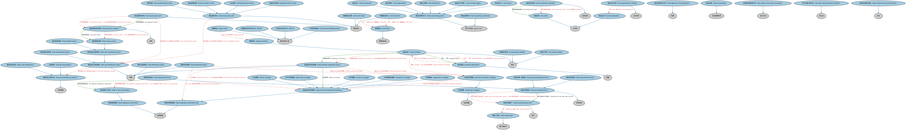

# 集合投资工具本体（Collective Investment Vehicles Ontology）结构与公理说明

本文档对应 `CollectiveInvestmentVehicles.rdf` / `CollectiveInvestmentVehicles.ttl`，说明该本体的类、继承关系、属性和公理约定。结构图见 `CollectiveInvestmentVehicles-structure.png`（`CollectiveInvestmentVehicles-structure.svg` 为可缩放版本）。

## 1. 本体概述

定义集合投资工具（collective investment vehicle，CIV）：汇集众多投资者资金、按既定策略共同投资的载体。

**在体系中的位置**：SEC 基金模块的基础本体，基金、养老金计划的上位概念。

**上下游关系**：上游依赖 FBC 金融工具与 BE 法律实体本体；下游被基金、养老金计划特化。

**与相近概念的差别**：CIV 强调「集合投资」的功能结构，与法律形式无关（可以是公司型、契约型、信托型）；与直接投资的差别——投资者买的是份额，底层资产由管理人统一运作。

## 2. 类（Class）

| 类（Class） | 定义（Definition） |
|---|---|
| 共同投资基金（FondsCommunDePlacement） | 开放式集合投资基金，是基金管理人与投资者之间设立的合同形式，而非独立法律实体（法国 FCP）。 |
| 累积股类（accumulating share class） | 不提供分红再投资选择、收益累积于份额净值中的股类。 |
| 资产类别策略（asset class strategy） | 基于资产类别的投资策略。 |
| 基金普通份额（common share in fund） | 基金中被归类为普通股类的份额单位。 |
| 货币策略（currency strategy） | 基于货币的投资策略。 |
| 分红股类（distributing share class） | 将收益定期分配给份额持有人的股类。 |
| 股票基金（equity fund） | 至少 85% 投资于股票的基金。 |
| 股票组合（equity portfolio） | 至少 85% 敞口为股票的投资组合。 |
| 基金会计（fund accountant） | 负责记录基金资产和负债账目的一方，计算交易价格、基金资产净值（NAV）等。 |
| 基金债券类单位（fund bond class unit） | 以对该基金之债权形式存在的基金单位。 |
| 基金债券单位票息（fund bond unit coupon） | 向基金债券单位持有人支付的固定票息。 |
| 基金现金分配政策（fund cash distribution policy） | 在基金单位分配政策为「现金」而非「再投资」时，关于现金股息或票据分配的政策。 |
| 基金分类（fund classification） | 按资产类别对基金进行的分类，是用于对基金归类的公开代码。 |
| 基金分类方案（fund classification scheme） | 按资产类别对基金进行分类的公开方案。 |
| 基金票息政策（fund coupon policy） | 关于债券单位票息预期分配的条款。 |
| 基金存管人（fund depositary） | 持有并保管基金所持资产的一方，还负责组合符合法定比例等合规事项。 |
| 基金分配政策（fund distribution policy） | 表明基金分配总体策略或限制的政策。 |
| 基金分销商（fund distributor） | 投资者通过其购买基金份额的实体，可基于全权委托、咨询或仅执行交易的方式。 |
| 基金股息政策（fund dividend policy） | 关于股息预期分配的条款。 |
| 基金投资目标（fund investment objective） | 基金的目标，例如超越某一基准。 |
| 基金投资政策（fund investment policy） | 基金为实现既定目标而实施的政策。 |
| 基金投资限制集（fund investment restrictions set） | 适用于基金整体的限制（如风险因素），用于判断该基金是否适合某类投资者。 |
| 基金法律形式文件（fund legal form documentation） | 依合同法设立的基金的章程或组织文件，以合同形式体现。 |
| 基金下单台（fund order desk） | 基金下单台账户的一方，负责接收投资者申购赎回指令。 |
| 基金组合（fund portfolio） | 包含若干金融工具以及一种或多种货币现金头寸、并归属于某一基金的账户。 |
| 基金组合投资限制（fund portfolio investment limitations） | 关于组合应如何配置以实现既定投资目标的详细政策，构成详细策略的基础。 |
| 基金组合投资政策（fund portfolio investment policy） | 为实现既定投资策略和目标而制定的组合配置政策。 |
| 基金处理一般条款（fund processing general terms） | 基金一般处理的正式条款，规定投资者和基金可以或不可以做什么。 |
| 基金处理条款（fund processing terms） | 基金处理的正式条款，规定投资者和基金可以或不可以做什么，包括赎回和申购条款。 |
| 基金赎回限制（fund redemption restriction） | 对投资者赎回基金单位施加的限制。 |
| 基金赎回条款（fund redemption terms） | 基金单位赎回的正式条款，规定投资者和基金可以或不可以做什么。 |
| 基金再投资政策（fund reinvestment policy） | 关于基金单位收益预期再投资的条款。 |
| 基金股类单位（fund share class unit） | 购买投资池一部分的法律结构，由投资者类型、最低投资额等多种特征定义。 |
| 基金申购条款（fund subscription terms） | 基金的申购条款，规定投资者和基金在申购环节可以或不可以做什么。 |
| 基金监管机构（fund supervisory authority） | 监管基金或基金行业的一方。 |
| 基金过户代理人（fund transfer agent） | 代表基金执行申购、赎回和转换指令的实体。 |
| 基金单位分配方式（fund unit distribution method） | 基金的常规分配政策方式。 |
| 基金单位分配政策（fund unit distribution policy） | 与基金单位相关的政策，例如收益是分配给投资者还是留存于基金中，以及如何处理。 |
| 基金现金分配（funds cash distribution） | 应计收益定期分配给投资者的方式。 |
| 基金处理（funds processing） | 管理和处理基金、发行基金单位等的业务语境，基金相关各方即在此语境中定义。 |
| 基金处理账户（funds processing account） | 专门用于基金处理的账户，按 FIBIM 定义是两个实体之间的业务关系。 |
| 基金处理参与方（funds processing party） | 参与基金处理的一方。 |
| 收益累积（income accumulation） | 应计收益不予分配，而是继续反映在单位/份额价格中的方式。 |
| 投资策略（investment strategy） | 为实现特定投资目标而制定的计划、方法或一系列策略安排。 |
| 司法管辖区策略（jurisdiction strategy） | 基于司法管辖区的投资策略。 |
| 关键投资者信息文件（key investor information document） | 为投资者提供关键信息的简短文件，汇总招募说明书内容以便投资者理解（KIID）。 |
| 资产净值计算方法（net asset value calculation method） | 计算投资基金/基金类别资产净值（NAV）的参数。 |
| 票据基金（note fund） | 向投资者发行债务工具（票据）而非（或同时发行）传统权益的集合投资工具。 |
| 票据基金份额（note fund share） | 在基金以公司形式组建时，发行票据而非传统权益的基金中的投资权益。 |
| 票据基金单位（note fund unit） | 在基金以信托、合伙或单位信托形式组建时，发行票据而非传统权益的基金中的投资权益。 |
| 机构策略（organization strategy） | 基于特定机构的投资策略。 |
| 其他投资基金信息（other investment fund information） | 不属于招募说明书、但对理解基金很重要的信息。 |
| 组合基准（portfolio benchmark） | 用于评价组合表现的证券或其他价格基准。 |
| 组合投资策略（portfolio investment strategy） | 组合管理人试图实现基金目标的方式。 |
| 基金优先份额（preferred share in fund） | 基金中被归类为优先股类的份额单位。 |
| 私募股权持有（private equity holding） | 对私募股权的持有。 |
| 房地产持有（real estate holding） | 由个人、组织或实体为投资、运营或战略目的拥有或控制的房地产有形资产。 |
| 须洽基金下单台（refer to fund order desk） | 要求投资者在赎回基金前先与基金下单台联系的限制。 |
| 风险级别（risk level） | 对基金或投资组合风险程度的度量。 |
| 法国固定资本投资公司（SICAF） | 法国的一种基金载体形式，资本固定的投资公司。 |
| 可变资本投资公司（SICAV） | 法国及欧洲大陆常见的开放式投资公司形式，资本可变的集合投资公司。 |
| 行业策略（sector strategy） | 基于行业板块的投资策略。 |
| 单位发行人（unit issuer） | 发行基金单位的一方。 |

### 2.1 继承关系（Inheritance）

- 共同投资基金（FondsCommunDePlacement） ⊑ 集合投资工具
- 累积股类（accumulating share class） ⊑ 基金股类单位（fund share class unit）
- 资产类别策略（asset class strategy） ⊑ 基金组合投资限制（fund portfolio investment limitations）
- 基金普通份额（common share in fund） ⊑ 基金股类单位（fund share class unit）
- 货币策略（currency strategy） ⊑ 基金组合投资限制（fund portfolio investment limitations）
- 分红股类（distributing share class） ⊑ 基金股类单位（fund share class unit）
- 股票基金（equity fund） ⊑ 集合投资工具
- 股票组合（equity portfolio） ⊑ 基金组合（fund portfolio）
- 基金会计（fund accountant） ⊑ 基金处理参与方（funds processing party）
- 基金债券类单位（fund bond class unit） ⊑ 基金单位
- 基金债券单位票息（fund bond unit coupon） ⊑ 利率
- 基金现金分配政策（fund cash distribution policy） ⊑ 基金单位分配政策（fund unit distribution policy）
- 基金分类（fund classification） ⊑ 分类符
- 基金分类方案（fund classification scheme） ⊑ 分类方案
- 基金票息政策（fund coupon policy） ⊑ 基金现金分配政策（fund cash distribution policy）
- 基金存管人（fund depositary） ⊑ 基金处理参与方（funds processing party）
- 基金分配政策（fund distribution policy） ⊑ 政策
- 基金分销商（fund distributor） ⊑ 基金处理参与方（funds processing party）
- 基金股息政策（fund dividend policy） ⊑ 基金现金分配政策（fund cash distribution policy）
- 基金投资目标（fund investment objective） ⊑ 投资目标
- 基金投资政策（fund investment policy） ⊑ 政策
- 基金投资限制集（fund investment restrictions set） ⊑ 证券限制
- 基金法律形式文件（fund legal form documentation） ⊑ 宪章
- 基金下单台（fund order desk） ⊑ 账户提供方
- 基金组合（fund portfolio） ⊑ 组合
- 基金组合投资限制（fund portfolio investment limitations） ⊑ 基金投资限制集（fund investment restrictions set）
- 基金组合投资政策（fund portfolio investment policy） ⊑ 政策
- 基金处理一般条款（fund processing general terms） ⊑ 基金处理条款（fund processing terms）
- 基金处理条款（fund processing terms） ⊑ 合同承诺
- 基金赎回限制（fund redemption restriction） ⊑ 证券限制
- 基金赎回条款（fund redemption terms） ⊑ 基金处理条款（fund processing terms）
- 基金再投资政策（fund reinvestment policy） ⊑ 基金单位分配政策（fund unit distribution policy）
- 基金股类单位（fund share class unit） ⊑ 基金单位
- 基金申购条款（fund subscription terms） ⊑ 基金处理条款（fund processing terms）
- 基金监管机构（fund supervisory authority） ⊑ 参与方角色（party role）
- 基金过户代理人（fund transfer agent） ⊑ 基金处理参与方（funds processing party）
- 基金单位分配方式（fund unit distribution method） ⊑ 分配策略
- 基金单位分配政策（fund unit distribution policy） ⊑ 政策
- 基金现金分配（funds cash distribution） ⊑ 基金单位分配方式（fund unit distribution method）
- 基金处理（funds processing） ⊑ 生命周期阶段
- 基金处理账户（funds processing account） ⊑ 账户
- 基金处理参与方（funds processing party） ⊑ 参与方角色（party role）
- 收益累积（income accumulation） ⊑ 基金单位分配方式（fund unit distribution method）
- 投资策略（investment strategy） ⊑ 业务战略
- 司法管辖区策略（jurisdiction strategy） ⊑ 基金组合投资限制（fund portfolio investment limitations）
- 关键投资者信息文件（key investor information document） ⊑ 发行文件
- 资产净值计算方法（net asset value calculation method） ⊑ 表达式
- 票据基金（note fund） ⊑ 管理型投资
- 票据基金份额（note fund share） ⊑ 基金单位
- 票据基金单位（note fund unit） ⊑ 基金单位
- 机构策略（organization strategy） ⊑ 基金组合投资限制（fund portfolio investment limitations）
- 其他投资基金信息（other investment fund information） ⊑ 文件
- 组合基准（portfolio benchmark） ⊑ 度量
- 组合投资策略（portfolio investment strategy） ⊑ 投资策略（investment strategy）
- 基金优先份额（preferred share in fund） ⊑ 基金股类单位（fund share class unit）
- 私募股权持有（private equity holding） ⊑ 组合
- 房地产持有（real estate holding） ⊑ 组合
- 须洽基金下单台（refer to fund order desk） ⊑ 基金赎回限制（fund redemption restriction）
- 风险级别（risk level） ⊑ 分类符
- 法国固定资本投资公司（SICAF） ⊑ 集合投资工具
- 可变资本投资公司（SICAV） ⊑ 集合投资工具
- 行业策略（sector strategy） ⊑ 基金组合投资限制（fund portfolio investment limitations）
- 单位发行人（unit issuer） ⊑ 基金处理参与方（funds processing party）

## 3. 对象属性（Object Property）

| 属性（Property） | 中文（English） | 定义（Definition） | 说明 |
|---|---|---|---|
| fibo-sec-fund-civ:accountingYearEndDate | 会计年度截止日（accounting year end date） | 基金会计年度的最后一天。 | 值域（range）：月中日 |
| fibo-sec-fund-civ:administeredBy | 由……管理（administered by） | 标识负责管理某事物的机构。 | 定义域（domain）：集合投资工具；值域（range）：基金管理人；子属性（subPropertyOf）：基金具有相关方（fund has related party） |
| fibo-sec-fund-civ:advisedBy | 由……担任顾问（advised by） | 指明为基金提供投资顾问服务的一方。 | 定义域（domain）：集合投资工具；值域（range）：注册投资顾问；子属性（subPropertyOf）：基金具有相关方（fund has related party） |
| fibo-sec-fund-civ:assessedAgainst | 对照……评估（assessed against） | 指明用于评估组合表现的基准。 | 定义域（domain）：基金组合（fund portfolio）；值域（range）：组合基准（portfolio benchmark） |
| fibo-sec-fund-civ:authorizedCountry | 获准销售国（authorized country） | 获准在该国销售基金的国家。 | 定义域（domain）：基金处理一般条款（fund processing general terms）；值域（range）：国家 |
| fibo-sec-fund-civ:benchmarkWeight | 基准权重（benchmark weight） | 工具在组合基准中的权重。 | 定义域（domain）：组合基准（portfolio benchmark）；值域（range）：百分比 |
| fibo-sec-fund-civ:couponPaymentDate | 票息支付日（coupon payment date） | 票息分配给债券单位持有人的日期。 | 定义域（domain）：基金票息政策（fund coupon policy）；值域（range）：月中日 |
| fibo-sec-fund-civ:definedInRelationTo | 相对于……定义（defined in relation to） | 表明某术语是相对于另一事物定义的。 | 定义域（domain）：机构策略（organization strategy）；值域（range）：公司 |
| fibo-sec-fund-civ:definesAllocations | 规定配置（defines allocations） | 规定组合资产的配置方式。 | 定义域（domain）：基金组合投资政策（fund portfolio investment policy）；值域（range）：基金组合投资限制（fund portfolio investment limitations）；子属性（subPropertyOf）：定义 |
| fibo-sec-fund-civ:definesBenchmark | 规定基准（defines benchmark） | 规定组合所用的基准。 | 定义域（domain）：组合基准（portfolio benchmark）；值域（range）：市场利率 |
| fibo-sec-fund-civ:definesMainFundOrderDeskAccount | 规定主基金下单台账户（defines main fund order desk account） | 规定基金的主要下单台账户。 | 定义域（domain）：基金处理条款（fund processing terms）；值域（range）：基金处理账户（funds processing account） |
| fibo-sec-fund-civ:distributedBy | 由……分销（distributed by） | 指明分销基金的一方。 | 定义域（domain）：集合投资工具；值域（range）：基金分销商（fund distributor）；子属性（subPropertyOf）：基金具有相关方（fund has related party） |
| fibo-sec-fund-civ:endOfFiscalYear | 财年截止日（end of fiscal year） | 每年结账并确定损益的日期（月和日）。 | 值域（range）：月中日 |
| fibo-sec-fund-civ:exCouponDate | 除息日（ex coupon date） | 票息从资产净值（NAV）中扣除的日期。 | 定义域（domain）：基金票息政策（fund coupon policy）；值域（range）：月中日 |
| fibo-sec-fund-civ:fundHasRelatedParty | 基金具有相关方（fund has related party） | 指明与基金相关联的一方。 | 定义域（domain）：集合投资工具；值域（range）：基金处理参与方（funds processing party） |
| fibo-sec-fund-civ:hasAdditionalInformation | 具有附加信息（has additional information） | 指明基金的附加信息。 | 定义域（domain）：集合投资工具；值域（range）：其他投资基金信息（other investment fund information） |
| fibo-sec-fund-civ:hasAdditionalRedemptionRestrictions | 具有附加赎回限制（has additional redemption restrictions） | 指明基金的附加赎回限制。 | 定义域（domain）：基金赎回条款（fund redemption terms）；值域（range）：须洽基金下单台（refer to fund order desk） |
| fibo-sec-fund-civ:hasAuditor | 具有审计师（has auditor） | 指明基金的审计师。 | 定义域（domain）：集合投资工具；值域（range）：外部审计师；子属性（subPropertyOf）：基金具有相关方（fund has related party） |
| fibo-sec-fund-civ:hasDataProvider | 具有数据提供方（has data provider） | 指明作为数据提供方并对所提供信息承担法律责任的机构。 | 定义域（domain）：集合投资工具；值域（range）：市场数据提供商；子属性（subPropertyOf）：基金具有相关方（fund has related party） |
| fibo-sec-fund-civ:hasDefaultSettlementConvention | 具有默认结算惯例（has default settlement convention） | 指明基金交易的默认结算惯例。 | 定义域（domain）：基金处理条款（fund processing terms）；值域（range）：结算惯例 |
| fibo-sec-fund-civ:hasDepository | 具有存管人（has depository） | 指明基金的存管人。 | 定义域（domain）：集合投资工具；值域（range）：基金存管人（fund depositary）；子属性（subPropertyOf）：基金具有相关方（fund has related party） |
| fibo-sec-fund-civ:hasDetails | 具有明细（has details） | 关于投资基金组成部分资产净值计算的信息。 | 定义域（domain）：基金单位；值域（range）：资产净值计算方法（net asset value calculation method） |
| fibo-sec-fund-civ:hasExpectedCoupon | 具有预期票息（has expected coupon） | 指明预期的票息分配。 | 定义域（domain）：基金债券类单位（fund bond class unit）；值域（range）：基金债券单位票息（fund bond unit coupon） |
| fibo-sec-fund-civ:hasFundPolicy | 具有基金政策（has fund policy） | 关于投资金额、限制等的总体政策，不同于详细的组合政策。 | 定义域（domain）：集合投资工具；值域（range）：基金投资政策（fund investment policy） |
| fibo-sec-fund-civ:hasFundProcessingTerms | 具有基金处理条款（has fund processing terms） | 指明基金的处理条款。 | 定义域（domain）：基金单位；值域（range）：基金处理条款（fund processing terms）；子属性（subPropertyOf）：具有合同要素 |
| fibo-sec-fund-civ:hasIntendedRiskLevel | 具有预期风险级别（has intended risk level） | 指明基金的预期风险级别。 | 定义域（domain）：基金投资目标（fund investment objective）；值域（range）：风险级别（risk level） |
| fibo-sec-fund-civ:hasIssueDate | 具有设立日（has issue date） | 首次资产净值计算和业绩计算开始的日期（同成立日）。 | 定义域（domain）：基金单位；值域（range）：日期 |
| fibo-sec-fund-civ:hasManagementCompany | 具有管理公司（has management company） | 指明基金的管理公司。 | 定义域（domain）：集合投资工具；值域（range）：基金经理；子属性（subPropertyOf）：基金具有相关方（fund has related party） |
| fibo-sec-fund-civ:hasPolicyTerms | 具有政策条款（has policy terms） | 指明基金的政策条款。 | 定义域（domain）：基金债券单位票息（fund bond unit coupon）；值域（range）：基金票息政策（fund coupon policy） |
| fibo-sec-fund-civ:hasPortfolio | 具有组合（has portfolio） | 指明基金的投资组合。 | 定义域（domain）：集合投资工具；值域（range）：基金组合（fund portfolio） |
| fibo-sec-fund-civ:hasRelatedFundTerms | 具有相关基金条款（has related fund terms） | 指明基金的相关条款。 | 定义域（domain）：集合投资工具；值域（range）：基金处理条款（fund processing terms）；子属性（subPropertyOf）：具有相关条款（has related terms） |
| fibo-sec-fund-civ:hasRelatedTerms | 具有相关条款（has related terms） | 指明相关的条款。 | 值域（range）：合同要素 |
| fibo-sec-fund-civ:hasSubscriptionTerms | 具有申购条款（has subscription terms） | 指明基金的申购条款。 | 定义域（domain）：集合投资工具；值域（range）：基金申购条款（fund subscription terms）；子属性（subPropertyOf）：具有相关基金条款（has related fund terms） |
| fibo-sec-fund-civ:hasTradableUnit | 具有可交易单位（has tradable unit） | 指明基金的可交易单位。 | 定义域（domain）：集合投资工具；值域（range）：基金单位 |
| fibo-sec-fund-civ:hasTransferAgent | 具有过户代理（has transfer agent） | 标识过户代理。 | 定义域（domain）：集合投资工具；值域（range）：基金过户代理人（fund transfer agent）；子属性（subPropertyOf）：基金具有相关方（fund has related party） |
| fibo-sec-fund-civ:identifiesAssetTypesBy | 以……标识资产类型（identifies asset types by） | 指明用于标识资产类型的分类方式。 | 定义域（domain）：资产类别策略（asset class strategy）；值域（range）：金融工具分类器 |
| fibo-sec-fund-civ:implementsFundPolicy | 实施基金政策（implements fund policy） | 表明某一策略实施某一基金政策。 | 定义域（domain）：基金组合（fund portfolio）；值域（range）：基金组合投资政策（fund portfolio investment policy） |
| fibo-sec-fund-civ:inceptionDate | 核准设立日（inception date） | 在原产国获得核准的日期。 | 定义域（domain）：集合投资工具；值域（range）：日期 |
| fibo-sec-fund-civ:inceptionDate.1 | 核准设立日（inception date） | 在原产国获得核准的日期。 | 定义域（domain）：基金股类单位（fund share class unit）；值域（range）：日期 |
| fibo-sec-fund-civ:initialApplicationForm | 首次申请表（initial application form） | 投资者首次申购的纸质申请表。 | 定义域（domain）：基金申购条款（fund subscription terms） |
| fibo-sec-fund-civ:isCalculatedIn | 以……计算（is calculated in） | 指明资产净值等数值计算所用的货币或单位。 | 定义域（domain）：资产净值计算方法（net asset value calculation method）；值域（range）：货币 |
| fibo-sec-fund-civ:isUnitHolder | 是单位持有人（is unit holder） | 表明某方是基金单位的持有人。 | 定义域（domain）：投资者；值域（range）：基金单位 |
| fibo-sec-fund-civ:issuePrice | 发行价格（issue price） | 基金单位首次发行的价格。 | 定义域（domain）：基金单位；值域（range）：价格 |
| fibo-sec-fund-civ:maximumDeviation | 最大偏离度（maximum deviation） | 允许偏离基准的最大幅度。 | 定义域（domain）：组合基准（portfolio benchmark）；值域（range）：百分比 |
| fibo-sec-fund-civ:maximumInvestmentAmount | 最大投资金额（maximum investment amount） | 在指定策略中可投资的最大金额。 | 定义域（domain）：基金组合投资限制（fund portfolio investment limitations）；值域（range）：货币数量 |
| fibo-sec-fund-civ:maximumInvestmentPercentage | 最大投资比例（maximum investment percentage） | 在指定策略中可投资的最大百分比。 | 定义域（domain）：基金组合投资限制（fund portfolio investment limitations）；值域（range）：百分比 |
| fibo-sec-fund-civ:maximumPurchasingFee | 最高申购费（maximum purchasing fee） | 购买基金份额时应付的最高百分比或固定金额费用。 | 定义域（domain）：基金申购条款（fund subscription terms）；值域（range）：费用 |
| fibo-sec-fund-civ:maximumRedemptionAmount | 最大赎回金额（maximum redemption amount） | 以金额表示的可卖出证券最大数量。 | 定义域（domain）：基金赎回条款（fund redemption terms）；值域（range）：货币数量 |
| fibo-sec-fund-civ:maximumRedemptionFee | 最高赎回费（maximum redemption fee） | 赎回基金份额时应付的最高百分比或固定金额费用。 | 定义域（domain）：基金申购条款（fund subscription terms）；值域（range）：费用 |
| fibo-sec-fund-civ:maximumRedemptionPercentage | 最大赎回比例（maximum redemption percentage） | 以百分比表示的可卖出证券最大数量。 | 定义域（domain）：基金赎回条款（fund redemption terms）；值域（range）：百分比 |
| fibo-sec-fund-civ:mayAlsoBe | 也可以是（may also be） | 表明某角色也可由另一方担任，例如单位发行人可以是基金管理机构（债券单位除外）。 | 定义域（domain）：基金管理人；值域（range）：单位发行人（unit issuer） |
| fibo-sec-fund-civ:minimumDeviation | 最小偏离度（minimum deviation） | 允许偏离基准的最小幅度。 | 定义域（domain）：组合基准（portfolio benchmark）；值域（range）：百分比 |
| fibo-sec-fund-civ:minimumHoldingPeriod | 最短持有期（minimum holding period） | 单位/份额发行后必须持有、方允许赎回的天数。 | 定义域（domain）：基金处理一般条款（fund processing general terms）；值域（range）：时长 |
| fibo-sec-fund-civ:minimumInitialSubscriptionAmount | 最低首次申购金额（minimum initial subscription amount） | 最低首次申购价值。 | 定义域（domain）：基金申购条款（fund subscription terms）；值域（range）：货币数量 |
| fibo-sec-fund-civ:minimumInvestmentAmount | 最低投资金额（minimum investment amount） | 在指定策略中必须投资的最低金额。 | 定义域（domain）：基金组合投资限制（fund portfolio investment limitations）；值域（range）：货币数量 |
| fibo-sec-fund-civ:minimumInvestmentPercentage | 最低投资比例（minimum investment percentage） | 在指定策略中必须投资的最低百分比。 | 定义域（domain）：基金组合投资限制（fund portfolio investment limitations）；值域（range）：百分比 |
| fibo-sec-fund-civ:minimumRatingRestriction | 最低评级限制（minimum rating restriction） | 可投资证券的最低评级要求。 | 定义域（domain）：基金投资限制集（fund investment restrictions set）；值域（range）：评级得分 |
| fibo-sec-fund-civ:minimumRemainingHoldingAmount | 最低留存持有金额（minimum remaining holding amount） | 为避免自动赎回而必须留存的单位/份额最低价值。 | 定义域（domain）：基金处理一般条款（fund processing general terms）；值域（range）：货币数量 |
| fibo-sec-fund-civ:minimumSubscriptionAmount | 最低申购金额（minimum subscription amount） | 现有投资者的最低申购价值。 | 定义域（domain）：基金申购条款（fund subscription terms）；值域（range）：货币数量 |
| fibo-sec-fund-civ:outlines | 概述（outlines） | 表明某文件概述某一事项。 | 定义域（domain）：招募说明书；值域（range）：基金投资目标（fund investment objective）；逆属性（inverseOf）：列明于（stated in） |
| fibo-sec-fund-civ:percentageInvested | 投资比例（percentage invested） | 任一给定时间应投资的资金百分比。 | 定义域（domain）：基金投资限制集（fund investment restrictions set）；值域（range）：百分比 |
| fibo-sec-fund-civ:performanceFee | 业绩报酬（performance fee） | 为实现预定超额收益目标而支付的费用。 | 定义域（domain）：基金申购条款（fund subscription terms）；值域（range）：费用 |
| fibo-sec-fund-civ:processingCountry | 处理所在国（processing country） | 该处理特性所适用的国家。 | 定义域（domain）：基金处理条款（fund processing terms）；值域（range）：国家 |
| fibo-sec-fund-civ:providesDepositaryServiceFor | 为……提供存管服务（provides depositary service for） | 指明存管人为某一基金提供存管服务。 | 定义域（domain）：基金存管人（fund depositary）；值域（range）：基金单位 |
| fibo-sec-fund-civ:purchasingFee | 申购费（purchasing fee） | 购买基金份额时应付的实际百分比或固定金额费用。 | 定义域（domain）：基金申购条款（fund subscription terms）；值域（range）：费用 |
| fibo-sec-fund-civ:redemptionCutoffDateTime | 赎回截止时间（redemption cutoff date time） | 可以提交赎回指令的最后日期/时间。 | 定义域（domain）：基金赎回条款（fund redemption terms）；值域（range）：日期时间 |
| fibo-sec-fund-civ:redemptionDealingFrequency | 赎回交易频率（redemption dealing frequency） | 赎回执行的频率。 | 定义域（domain）：基金赎回条款（fund redemption terms）；值域（range）：重复区间 |
| fibo-sec-fund-civ:redemptionFee | 赎回费（redemption fee） | 赎回基金份额时应付的实际百分比或固定金额费用。 | 定义域（domain）：基金申购条款（fund subscription terms）；值域（range）：费用 |
| fibo-sec-fund-civ:redemptionForm | 赎回申请表（redemption form） | 投资者赎回单位/份额的纸质书面指令/弃权表格。 | 定义域（domain）：基金赎回条款（fund redemption terms） |
| fibo-sec-fund-civ:redemptionPeriod | 赎回期（redemption period） | 可以赎回单位/份额的特定期间，例如某些保本基金的赎回期。 | 定义域（domain）：基金赎回条款（fund redemption terms）；值域（range）：日期区间 |
| fibo-sec-fund-civ:reinvestmentFrequency | 再投资频率（reinvestment frequency） | 对采取再投资分配方式的单位，再投资发生的频率。 | 定义域（domain）：基金再投资政策（fund reinvestment policy）；值域（range）：重复区间 |
| fibo-sec-fund-civ:statedDistributionFee | 列明分销费（stated distribution fee） | 在招募说明书中列明的分销费用。 | 定义域（domain）：招募说明书；值域（range）：货币数量 |
| fibo-sec-fund-civ:statedIn | 列明于（stated in） | 指明某信息列明于某一文件。 | 定义域（domain）：基金投资目标（fund investment objective）；值域（range）：招募说明书 |
| fibo-sec-fund-civ:statedManagementFee | 列明管理费（stated management fee） | 在招募说明书中列明的管理费用，可为货币金额或百分比。 | 定义域（domain）：招募说明书；值域（range）：货币数量 |
| fibo-sec-fund-civ:stipulatesBenchmark | 规定基准（stipulates benchmark） | 规定组合业绩评价所用的基准。 | 定义域（domain）：基金投资政策（fund investment policy）；值域（range）：市场利率 |
| fibo-sec-fund-civ:hasInvestmentStrategy | 战略（strategy） | 指导决策并协调行动与计划以追求某意向的高层途径。 | 定义域（domain）：组合；值域（range）：投资策略（investment strategy） |
| fibo-sec-fund-civ:subscriptionCutoffDateTime | 申购截止时间（subscription cutoff date time） | 可以提交申购指令的最后日期/时间。 | 定义域（domain）：基金申购条款（fund subscription terms）；值域（range）：日期时间 |
| fibo-sec-fund-civ:subscriptionDealingFrequency | 申购交易频率（subscription dealing frequency） | 申购执行的频率。 | 定义域（domain）：基金申购条款（fund subscription terms）；值域（range）：重复区间 |
| fibo-sec-fund-civ:subscriptionPeriod | 认购期间（subscription period） | 证券可被认购的期间。 | 定义域（domain）：基金申购条款（fund subscription terms）；值域（range）：日期区间 |
| fibo-sec-fund-civ:subsequentApplicationForm | 后续申请表（subsequent application form） | 同一投资者后续投资的纸质申请表。 | 定义域（domain）：基金申购条款（fund subscription terms） |
| fibo-sec-fund-civ:supervisedBy | 由……监管（supervised by） | 指明监管基金的机构。 | 定义域（domain）：集合投资工具；值域（range）：基金监管机构（fund supervisory authority） |
| fibo-sec-fund-civ:switchingFee | 转换费（switching fee） | 转换至另一基金时应付的实际百分比或固定金额费用。 | 定义域（domain）：基金申购条款（fund subscription terms）；值域（range）：费用 |
| fibo-sec-fund-civ:trackingError | 跟踪误差（tracking error） | 组合回报与基准回报之间差异的度量。 | 定义域（domain）：基金投资限制集（fund investment restrictions set）；值域（range）：百分比 |
| fibo-sec-fund-civ:valuationFrequency | 估值频率（valuation frequency） | 资产净值计算的频率。 | 定义域（domain）：资产净值计算方法（net asset value calculation method）；值域（range）：重复区间 |
| fibo-sec-fund-civ:valueAtRisk | 风险价值（value at risk） | 对基金（而非组合）在给定置信水平下潜在损失的度量（VaR）。 | 定义域（domain）：基金投资限制集（fund investment restrictions set）；值域（range）：百分比 |

## 4. 数据属性（Datatype Property）

| 属性（Property） | 中文（English） | 定义（Definition） |
|---|---|---|
| fibo-sec-fund-civ:additionalRestrictions | 附加限制（additional restrictions） | 关于该策略及其所指机构的其他限制或处理信息。 |
| fibo-sec-fund-civ:backEndLoadApplicable | 是否适用后端收费（back end load applicable） | 该类别的赎回指令是否可收取退出费用（如或有递延销售费 CDSC）。 |
| fibo-sec-fund-civ:blacklisted | 是否列入黑名单（blacklisted） | 该策略是否将所指商业实体列入黑名单：若是，则该策略禁止投资于该实体。 |
| fibo-sec-fund-civ:clearFundsRequired | 是否需要资金到账（clear funds required） | 执行申购指令前是否要求资金已清算到账。 |
| fibo-sec-fund-civ:dealingFrequencyDescription | 交易频率描述（dealing frequency description） | 对申购和赎回执行频率的文字描述。 |
| fibo-sec-fund-civ:declarationChannel | 公告渠道（declaration channel） | 资产净值公布的渠道，例如报纸。 |
| fibo-sec-fund-civ:distributionWithReinvestment | 分配并再投资（distribution with reinvestment） | 可以持有这样一类份额：应计收益先予分配，然后自动再投资于额外单位/份额。 |
| fibo-sec-fund-civ:dualFund | 是否双价基金（dual fund） | 该基金是否有两个价格。 |
| fibo-sec-fund-civ:firstAccountingYearEndDate | 首个会计年度截止日（first accounting year end date） | 基金第一个会计年度的最后一天。 |
| fibo-sec-fund-civ:firstNAVCalculationDate | 首次资产净值计算日（first NAV calculation date） | 首次计算资产净值（NAV）的日期。 |
| fibo-sec-fund-civ:frontEndLoadApplicable | 是否适用前端收费（front end load applicable） | 该类别的申购指令是否可收取前端费用。 |
| fibo-sec-fund-civ:fundClassTypeIdentifier | 基金类别类型标识符（fund class type identifier） | 基金单位类别的文字标识，用于唯一标识某一基金单位类别及其特征。 |
| fibo-sec-fund-civ:historicPricingIndicator | 历史定价标志（historic pricing indicator） | 表明价格是历史价还是远期价。 |
| fibo-sec-fund-civ:holderMayReinvest | 持有人可否再投资（holder may reinvest） | 持有人是否可以将股息再投资于该基金。 |
| fibo-sec-fund-civ:holdingTransferable | 持有可否转让（holding transferable） | 注册投资者是否可以将其部分或全部持有转让给第三方。 |
| fibo-sec-fund-civ:includeRelatedFirms | 是否包含关联公司（include related firms） | 该策略是否包含与所指机构存在某种关联的公司。 |
| fibo-sec-fund-civ:inclusion | 是否纳入（inclusion） | 所指策略是否被纳入；若为否，则该描述指将所述内容排除于组合之外。 |
| fibo-sec-fund-civ:investmentFocus | 投资重点（investment focus） | 关于基金主要投资领域的信息（例如德国股票市场）。 |
| fibo-sec-fund-civ:launchDate | 成立日（launch date） | 首次资产净值计算和业绩计算开始的日期。 |
| fibo-sec-fund-civ:limitedSharesAreIssued | 是否限量发行份额（limited shares are issued） | 该基金是否可以发行新份额，这决定其为封闭式还是开放式基金。 |
| fibo-sec-fund-civ:mainFundOrderDesk | 是否主基金下单台（main fund order desk） | 该基金下单台是否为基金指定的接收指令的主要实体。 |
| fibo-sec-fund-civ:maximumRedemptionUnits | 最大赎回单位数（maximum redemption units） | 单一交易日可赎回的最大份额/单位数量。 |
| fibo-sec-fund-civ:minimumInitialSubscriptionUnits | 最低首次申购单位数（minimum initial subscription units） | 首次必须购买的最低单位/份额数量。 |
| fibo-sec-fund-civ:minimumRemainingHoldingUnits | 最低留存持有单位数（minimum remaining holding units） | 为避免自动赎回而必须留存的最低单位/份额数量。 |
| fibo-sec-fund-civ:minimumSubscriptionUnits | 最低申购单位数（minimum subscription units） | 现有投资者必须购买的最低单位/份额数量。 |
| fibo-sec-fund-civ:name | 名称（name） | 以语言表达式对某事物的指称。 |
| fibo-sec-fund-civ:name.1 | 名称（name） | 以语言表达式对某事物的指称。 |
| fibo-sec-fund-civ:physicalDocumentRequired | 是否需要纸质文件（physical document required） | 是否必须通过主基金下单台提交纸质表格。 |
| fibo-sec-fund-civ:productGroupDescription | 产品组描述（product group description） | 公司对一组基金的特定描述。 |
| fibo-sec-fund-civ:redemptionCycleInBusinessDays | 赎回周期（营业日）（redemption cycle in business days） | 自赎回指令定价日（T）起算、主基金下单台受理指令应完成结算的最后营业日。 |
| fibo-sec-fund-civ:redemptionInAmountAllowed | 是否允许按金额赎回（redemption in amount allowed） | 是否允许按金额赎回。 |
| fibo-sec-fund-civ:registrationDate | 注册日期（registration date） | 基金在原产国以外国家获得法律核准的日期。 |
| fibo-sec-fund-civ:signatureRequired | 是否需要签名（signature required） | 是否必须通过主基金下单台提交附有投资者亲笔签名的纸质表格。 |
| fibo-sec-fund-civ:statedInvestmentAim | 列明投资目标（stated investment aim） | 以文字表述的基金目标，例如超越某一基准。 |
| fibo-sec-fund-civ:statedObjective | 列明目标（stated objective） | 以文字表述的基金目标。 |
| fibo-sec-fund-civ:subscriptionsInAmountAllowed | 是否允许按金额申购（subscriptions in amount allowed） | 是否允许按金额申购。 |
| fibo-sec-fund-civ:switchingChargeable | 是否收取转换费（switching chargeable） | 同一伞形基金下子基金之间转换是否可收取转换费。 |
| fibo-sec-fund-civ:typeOfSecurities | 证券类型（type of securities） | 可投资的证券或其他持有资产的类型。 |
| fibo-sec-fund-civ:valuationFrequencyTextualDescription | 估值频率文字描述（valuation frequency textual description） | 对资产净值计算频率的文字描述。 |

## 5. 公理约定（Axioms）

- 累积股类（accumulating share class） 与 分红股类（distributing share class） 互斥（disjointWith）
- 资产类别策略（asset class strategy）：以……标识资产类型（identifies asset types by） some 金融工具分类器
- 基金普通份额（common share in fund） 与 基金优先份额（preferred share in fund） 互斥（disjointWith）
- 股票基金（equity fund）：包含 some 股票组合（equity portfolio）
- 股票组合（equity portfolio）：包含 some 持股
- 基金债券类单位（fund bond class unit）：具有战略 some 基金单位分配政策（fund unit distribution policy）
- 基金债券类单位（fund bond class unit）：具有预期票息（has expected coupon） some 基金债券单位票息（fund bond unit coupon）
- 基金债券单位票息（fund bond unit coupon）：具有政策条款（has policy terms） some 基金票息政策（fund coupon policy）
- 基金分类（fund classification）：分类 some 集合投资工具
- 基金分类方案（fund classification scheme）：定义 some 基金分类（fund classification）
- 基金存管人（fund depositary）：为……提供存管服务（provides depositary service for） some 基金单位
- 基金投资目标（fund investment objective）：具有预期风险级别（has intended risk level） some 风险级别（risk level）
- 基金投资目标（fund investment objective）：列明于（stated in） some 招募说明书
- 基金投资政策（fund investment policy）：规定基准（stipulates benchmark） 市场利率 ≤1
- 基金投资政策（fund investment policy）：定义 some 基金投资限制集（fund investment restrictions set）
- 基金投资政策（fund investment policy）：管辖 some 组合投资策略（portfolio investment strategy）
- 基金投资限制集（fund investment restrictions set）：是……的部分 some 招募说明书
- 基金下单台（fund order desk）：由…扮演（is played by） some 法律实体
- 基金组合（fund portfolio）：具有货币数量 some 余额
- 基金组合（fund portfolio）：对照……评估（assessed against） some 组合基准（portfolio benchmark）
- 基金组合（fund portfolio）：战略（strategy） some 组合投资策略（portfolio investment strategy）
- 基金组合（fund portfolio）：实施基金政策（implements fund policy） some 基金组合投资政策（fund portfolio investment policy）
- 基金组合（fund portfolio）：包含 some 组合
- 基金组合投资政策（fund portfolio investment policy）：规定配置（defines allocations） some 基金组合投资限制（fund portfolio investment limitations）
- 基金组合投资政策（fund portfolio investment policy）：管辖 some 组合投资策略（portfolio investment strategy）
- 基金处理条款（fund processing terms）：规定主基金下单台账户（defines main fund order desk account） some 基金处理账户（funds processing account）
- 基金处理条款（fund processing terms）：具有默认结算惯例（has default settlement convention） some 结算惯例
- 基金赎回条款（fund redemption terms）：具有附加赎回限制（has additional redemption restrictions） some 须洽基金下单台（refer to fund order desk）
- 基金股类单位（fund share class unit）：具有战略 some 基金单位分配政策（fund unit distribution policy）
- 基金申购条款（fund subscription terms）：适用于 some 基金单位
- 基金单位分配政策（fund unit distribution policy）：具有战略 some 基金单位分配方式（fund unit distribution method）
- 基金处理账户（funds processing account）：由……提供 some 基金下单台（fund order desk）
- 投资策略（investment strategy）：具有目标 some 投资目标
- 司法管辖区策略（jurisdiction strategy）：适用于情境 some 管辖权
- 关键投资者信息文件（key investor information document）：restriction
- 关键投资者信息文件（key investor information document）：适用于 some 基金单位
- 资产净值计算方法（net asset value calculation method）：以……计算（is calculated in） some 货币
- 票据基金份额（note fund share）：是……的部分 some 票据基金（note fund）
- 票据基金单位（note fund unit）：是……的部分 some 票据基金（note fund）
- 机构策略（organization strategy）：相对于……定义（defined in relation to） some 公司
- 组合基准（portfolio benchmark）：规定基准（defines benchmark） some 市场利率
- 组合基准（portfolio benchmark）：适用于 some 基金组合（fund portfolio）
- 组合投资策略（portfolio investment strategy）：包含 some 基金组合投资限制（fund portfolio investment limitations）
- 私募股权持有（private equity holding）：包含 some 私人持有股份
- 房地产持有（real estate holding）：包含 some 房地产
- 单位发行人（unit issuer）：发行 some 基金单位
- 单位发行人（unit issuer）：由…扮演（is played by） some 公司

## 6. 依赖（owl:imports，49 个）

本本体通过 `owl:imports` 引入以下本体，各项的中文名称与简介如下：

| 导入本体 | 中文名称 | 简介 |
|---|---|---|
| `BE/FunctionalEntities/Publishers.rdf` | 出版方本体（Publishers Ontology） | 定义出版方及其出版物，用于标识金融信息与文档的发布来源。 |
| `BE/GovernmentEntities/EuropeanJurisdiction/EUGovernmentEntitiesAndJurisdictions.rdf` | 欧盟政府实体与法域本体（EU Government Entities and Jurisdictions Ontology） | 收录欧盟层面的政体、机构与法域个体（欧盟本身及其超国家机构）。 |
| `BE/LegalEntities/CorporateBodies.rdf` | 法人团体本体（Corporate Bodies Ontology） | 定义依法设立、具有独立法律人格的法人团体（corporate body），是股份有限公司等具体法人类型的上位概念。 |
| `BE/LegalEntities/FormalBusinessOrganizations.rdf` | 正式商业组织本体（Formal Business Organizations Ontology） | 定义以营利为目的、依法注册的正式商业组织，连接法律实体与其商业功能。 |
| `BE/LegalEntities/LegalPersons.rdf` | 法律主体本体（Legal Persons Ontology） | 定义法律主体（legal person）与法定实体（legal entity）的核心概念：能持有权利义务、可起诉与被诉的主体。 |
| `BE/OwnershipAndControl/CorporateOwnership.rdf` | 公司所有权本体（Corporate Ownership Ontology） | 定义公司层面的所有权关系：股东、股份持有与受益所有权。 |
| `BE/OwnershipAndControl/Executives.rdf` | 高管本体（Executives Ontology） | 定义公司高管（executive）、董事会成员及其职务角色，刻画「谁在管理公司」。 |
| `BE/OwnershipAndControl/OwnershipParties.rdf` | 所有权方本体（Ownership Parties Ontology） | 定义所有权关系中的各方角色：所有者、受益所有人、名义持有人等。 |
| `FBC/DebtAndEquities/Debt.rdf` | 债务本体（Debt Ontology） | 定义债务（debt）与债权债务关系的核心概念：借款人、贷款人、本金与利息义务。 |
| `FBC/FinancialInstruments/FinancialInstruments.rdf` | 金融工具本体（Financial Instruments Ontology） | FIBO 核心本体之一，定义金融工具（financial instrument）的通用概念：可交易、代表某种权利义务的合同工具，是证券、衍生品等具体工具的共同基础。 |
| `FBC/FinancialInstruments/Settlement.rdf` | 结算本体（Settlement Ontology） | 定义交易结算（settlement）：券款对付、结算日期与结算方式。 |
| `FBC/FunctionalEntities/FinancialServicesEntities.rdf` | 金融服务实体本体（Financial Services Entities Ontology） | FBC 域核心本体，定义金融服务机构（银行、券商、保险公司、资管机构等）的功能分类体系。 |
| `FBC/ProductsAndServices/ClientsAndAccounts.rdf` | 客户与账户本体（Clients and Accounts Ontology） | 定义金融机构的客户、账户及账户持有关系。 |
| `FBC/ProductsAndServices/FinancialProductsAndServices.rdf` | 金融产品与服务本体（Financial Products and Services Ontology） | 定义金融产品（financial product）与金融服务（financial service）及其提供、购买关系。 |
| `FND/Accounting/CurrencyAmount.rdf` | 货币金额本体（Currency Amount Ontology） | 定义「金额＋币种」的货币金额（currency amount）表示，是 FIBO 中表达价格、债务金额、付款额等一切带币种数值的基础构件。 |
| `FND/Agreements/Contracts.rdf` | 合同本体（Contracts Ontology） | 在协议之上定义具有法律约束力的合同（contract）：合同当事方、合同条款、义务与权利，是金融工具与交易合同建模的基石。 |
| `FND/Arrangements/Lifecycles.rdf` | 生命周期本体（Lifecycles Ontology） | 定义生命周期、生命周期阶段与状态转移，用于描述合同、金融工具、机构从创设到终止的演化过程。 |
| `FND/Arrangements/Ratings.rdf` | 评级本体（Ratings Ontology） | 定义评级（rating）、评级量表与评级方的通用结构，是信用评级等具体评级体系的基础。 |
| `FND/DatesAndTimes/BusinessDates.rdf` | 营业日期本体（Business Dates Ontology） | 定义营业日、营业日历与日期调整规则（如顺延约定），支撑金融合同中的营业日计算。 |
| `FND/DatesAndTimes/FinancialDates.rdf` | 金融日期本体（Financial Dates Ontology） | 定义金融语境下的日期与期间概念：结算日、付息日、到期日、日计数基准等。 |
| `FND/GoalsAndObjectives/Objectives.rdf` | 目标本体（Objectives Ontology） | 定义目标（objective）及其与组织、计划的关系，用于表达机构的经营目标与投资目标。 |
| `FND/Law/LegalCapacity.rdf` | 法律能力本体（Legal Capacity Ontology） | 定义法律能力、缔约能力、签章权等概念，刻画主体从事法律行为的资格。 |
| `FND/Law/LegalCore.rdf` | 法律核心本体（Legal Core Ontology） | 定义法域（jurisdiction）、法律、法规等核心法律概念，为监管主体与适用法律建模。 |
| `FND/OwnershipAndControl/Ownership.rdf` | 所有权本体（Ownership Ontology） | 定义「拥有」关系：所有者、被拥有资产及所有权份额。 |
| `FND/Places/RealProperty.rdf` | 不动产本体（Real Property Ontology） | 定义不动产（real property）及其与地点、所有权的关系，支撑抵押贷款与房地产金融。 |
| `FND/Relations/Relations.rdf` | 关系本体（Relations Ontology） | FIBO 最底层的基础本体，定义参考（reference）、分类（classify）等通用关系与抽象概念，全库普遍依赖。 |
| `FND/Utilities/AnnotationVocabulary.rdf` | FIBO 标注词汇表（FIBO Annotation Vocabulary） | 定义 FIBO 专用的标注属性（如释义来源、成熟度等级），用于本体自身的元数据标注。 |
| `IND/Indicators/Indicators.rdf` | 指标本体（Indicators Ontology） | 定义「指标」（indicator）的通用概念：对某现象的可度量表示，是经济指标、利率等的上位模型。 |
| `SEC/Equities/EquityInstruments.rdf` | 股权工具本体（Equity Instruments Ontology） | 定义股票等股权工具：普通股、优先股及其附带的权利。 |
| `SEC/Funds/Funds.rdf` | 基金本体（Funds Ontology） | 定义投资基金（fund）：基金份额、净值与管理结构。 |
| `SEC/Securities/Pools.rdf` | 证券池本体（Securities Pools Ontology） | 定义证券池（pool）：归集起来作为证券化基础的一组资产。 |
| `SEC/Securities/SecuritiesClassification.rdf` | 证券分类本体（Securities Classification Ontology） | 定义证券分类方案：按 CFI 代码、按资产类别等对证券归类。 |
| `SEC/Securities/SecuritiesIdentification.rdf` | 证券识别本体（Securities Identification Ontology） | 定义证券标识符（ISIN、CUSIP、SEDOL 等）及其编码方案的结构。 |
| `SEC/Securities/SecuritiesIssuance.rdf` | 证券发行本体（Securities Issuance Ontology） | 定义证券发行（issuance）：发行人、发行条款与发行结果。 |
| `SEC/Securities/SecuritiesRestrictions.rdf` | 证券限制本体（Securities Restrictions Ontology） | 定义证券发行与转让限制的通用概念，是各法域具体限制本体的基础。 |
| `https://www.omg.org/spec/Commons/AnnotationVocabulary/` | OMG 通用标注词汇表（OMG Commons Annotation Vocabulary） | OMG 通用本体库（Commons）中的标注词汇表，提供概念映射等标注属性，FIBO 用它标注术语与外部标准的对应关系。 |
| `https://www.omg.org/spec/Commons/Classifiers/` | OMG 通用分类器本体（OMG Commons Classifiers） | OMG 通用本体库（Commons）中的分类器本体，定义分类方案、类别与归类关系的通用概念，FIBO 的分类建模建立在其上。 |
| `https://www.omg.org/spec/Commons/Collections/` | OMG 通用集合本体（OMG Commons Collections） | Commons 库中的集合本体，定义集合、成员等通用概念。 |
| `https://www.omg.org/spec/Commons/ContextualDesignators/` | OMG 通用语境指称本体（OMG Commons Contextual Designators） | Commons 库中的语境指称本体，定义「在某个语境下指代某物的名称/符号」，是地址、账户号码等语境相关标识的基础。 |
| `https://www.omg.org/spec/Commons/DatesAndTimes/` | OMG 通用日期与时间本体（OMG Commons Dates and Times） | Commons 库中的日期时间本体，定义日期、期间、时间点等通用时间概念。 |
| `https://www.omg.org/spec/Commons/Designators/` | OMG 通用指称符本体（OMG Commons Designators） | Commons 库中的指称符本体，定义名称、标识符等「指代某物的符号」的通用概念。 |
| `https://www.omg.org/spec/Commons/Documents/` | OMG 通用文档本体（OMG Commons Documents） | Commons 库中的文档本体，定义文档及其组成部分的通用概念。 |
| `https://www.omg.org/spec/Commons/Locations/` | OMG 通用位置本体（OMG Commons Locations） | Commons 库中的位置本体，定义地理位置、地点的通用概念。 |
| `https://www.omg.org/spec/Commons/Organizations/` | OMG 通用组织本体（OMG Commons Organizations） | Commons 库中的组织本体，定义组织、组织成员与组织结构的通用概念。 |
| `https://www.omg.org/spec/Commons/PartiesAndSituations/` | OMG 通用参与方与情境本体（OMG Commons Parties and Situations） | Commons 库中的参与方本体，定义独立主体、参与方及其角色扮演的通用概念，是 FIBO 参与方模型的上游。 |
| `https://www.omg.org/spec/Commons/QuantitiesAndUnits/` | OMG 通用量与单位本体（OMG Commons Quantities and Units） | Commons 库中的量与单位本体，定义数量、度量单位、量纲的通用概念，支撑金额、比率等数值表达。 |
| `https://www.omg.org/spec/Commons/RegulatoryAgencies/` | OMG 通用监管机构本体（OMG Commons Regulatory Agencies） | Commons 库中的监管机构本体，定义监管机构及其监管职权的通用概念。 |
| `https://www.omg.org/spec/Commons/RolesAndCompositions/` | OMG 通用角色与构成本体（OMG Commons Roles and Compositions） | Commons 库中的角色本体，定义角色及整体—部分构成关系的通用概念。 |
| `https://www.omg.org/spec/LCC/Countries/CountryRepresentation/` | LCC 国家表示本体（LCC Country Representation） | OMG 国家语言代码库（LCC）中的国家表示本体，定义国家、国家标识等概念，是 ISO 3166 各国代码个体的类定义来源。 |

## 7. 文件

- 官方 RDF/XML：`CollectiveInvestmentVehicles.rdf`
- 中文 Turtle：`CollectiveInvestmentVehicles.ttl`
- 结构图：`CollectiveInvestmentVehicles-structure.png` / `CollectiveInvestmentVehicles-structure.svg`