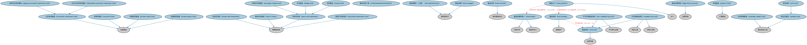

# 基金本体（Funds Ontology）结构与公理说明

本文档对应 `Funds.rdf` / `Funds.ttl`，说明该本体的类、继承关系、属性和公理约定。结构图见 `Funds-structure.png`（`Funds-structure.svg` 为可缩放版本）。

## 1. 本体概述

定义投资基金（fund）：基金份额、净值（NAV）、管理人与托管人结构、申购赎回。

**在体系中的位置**：SEC 基金模块的核心。

**上下游关系**：上游继承集合投资工具本体；下游关联 MD 基金时序（净值序列）与各类具体基金形态。

**与相近概念的差别**：基金≠股票——基金份额代表对组合资产的受益权，股票代表对公司的所有权；开放式与封闭式的差别在份额是否可赎回、是否固定。

## 2. 类（Class）

| 类（Class） | 定义（Definition） |
|---|---|
| 集合投资工具（CollectiveInvestmentVehicle） | 由投资者汇聚的资产池，其股本与该工具的资产保持分离。 |
| 协同社区投资基金（aligned community investment fund） | 从社区成员公开募集资本、并将部分资本投资于其客户企业的社区投资基金。 |
| 封闭式投资（closed-end investment） | 由投资公司通过首次公开发行提供固定数量份额的投资基金。 |
| 社区投资基金（community investment fund） | 专业管理的投资基金，具有三个基本特征：资本来源于社区人士（理想情况下为零售/非合格投资者）、投资于本地、并向社区成员开放。 |
| 多元化社区投资基金（diversified community investment fund） | 主要投资于房地产、但也可投资于任何本地企业或项目的社区投资基金。 |
| 交易所交易基金（exchange-traded fund） | 基金份额像股票一样在交易所交易的投资基金（ETF）。 |
| 基金管理人（行政）（fund administrator） | 负责投资基金运营、会计和合规职能的一方所扮演的角色。 |
| 基金合同（fund contract） | 在不存在独立组织的情况下体现和定义基金法律形式的合同。 |
| 基金份额持有人（fund holder） | 拥有某基金份额或一定比例、并以出资为对价享有相关权利和承担相关责任的一方。 |
| 基金持有（fund holding） | 在基金中的所有权权益，可由赋予财务权利和治理特权的基金单位表示。 |
| 基金经理（fund manager） | 负责作出投资决策并管理投资基金组合的一方所扮演的角色。 |
| 基金中的基金（fund of funds） | 直接投资于其他投资基金（而非股票、债券等证券）的投资基金。 |
| 基金头寸（fund position） | 在某一基金中的头寸，可用基金单位来界定。 |
| 基金单位（fund unit） | 汇集基金中受益权益的计量份额，代表对基金资产、收益或权利的按比例请求权。 |
| 对冲基金（hedge fund） | 追求绝对回报、通常仅向合格投资者开放的投资基金。 |
| 基金法律结构（legal fund structure） | 基金在某一司法管辖区法律组建形式方面的结构。 |
| 共同基金（mutual fund） | 为投资股票、债券、货币市场工具等证券而设立的开放式专业管理投资基金。 |
| 不可交易基金单位（non-tradable fund unit） | 代表基金权益、但不能在基金本身之外交易的证券。 |
| 非营利基金（nonprofit fund） | 旨在支持非营利使命的投资工具，其目标除财务回报外还包括环境责任和/或社会责任。 |
| 开放式投资（open-end investment） | 通过基金公司直接向投资者出售份额的投资基金。 |
| 养老基金（pension fund） | 独立于计划成员个人账户设立、用于为一个或多个养老金计划提供资金而维持的基金。 |
| 私募信贷基金（private credit fund） | 在传统银行体系之外向企业提供贷款或其他形式信贷的投资工具。 |
| 私募股权基金（private equity fund） | 按照特定投资策略投资于各类权益（在较小程度上也包括债务）证券的投资基金。 |
| 房地产投资信托（real estate investment trust） | 向公众发售份额/单位并直接投资于房地产的投资基金（REIT）。 |
| 主权财富基金（sovereign wealth fund） | 由国家储备资金构成的国有投资基金。 |
| 可交易基金单位（tradable fund unit） | 代表基金中可交易权益的证券。 |
| 单位信托（unit trust） | 投资者持有代表对信托管理资产组合之受益所有权的单位的集合投资工具。 |
| 单位化基金（unitized fund） | 投资者持有代表对基金标的资产按比例份额之单位的集合投资工具，常用于养老金计划。 |

### 2.1 继承关系（Inheritance）

- 协同社区投资基金（aligned community investment fund） ⊑ 社区投资基金（community investment fund）
- 封闭式投资（closed-end investment） ⊑ 管理型投资
- 社区投资基金（community investment fund） ⊑ 私募基金
- 多元化社区投资基金（diversified community investment fund） ⊑ 社区投资基金（community investment fund）
- 交易所交易基金（exchange-traded fund） ⊑ 开放式投资（open-end investment）
- 基金管理人（行政）（fund administrator） ⊑ 服务提供方
- 基金合同（fund contract） ⊑ 组织基础协议
- 基金份额持有人（fund holder） ⊑ 受益所有人
- 基金份额持有人（fund holder） ⊑ 交易对手
- 基金持有（fund holding） ⊑ 金融资产
- 基金经理（fund manager） ⊑ 服务提供方
- 基金中的基金（fund of funds） ⊑ 管理型投资
- 基金头寸（fund position） ⊑ 头寸
- 基金单位（fund unit） ⊑ 合同权益
- 对冲基金（hedge fund） ⊑ 开放式投资（open-end investment）
- 基金法律结构（legal fund structure） ⊑ 法律构造
- 共同基金（mutual fund） ⊑ 开放式投资（open-end investment）
- 不可交易基金单位（non-tradable fund unit） ⊑ 不可转让证券
- 不可交易基金单位（non-tradable fund unit） ⊑ 基金单位（fund unit）
- 非营利基金（nonprofit fund） ⊑ 私募基金
- 开放式投资（open-end investment） ⊑ 管理型投资
- 养老基金（pension fund） ⊑ 汇集基金
- 私募信贷基金（private credit fund） ⊑ 私募基金
- 私募股权基金（private equity fund） ⊑ 私募基金
- 房地产投资信托（real estate investment trust） ⊑ 管理型投资
- 主权财富基金（sovereign wealth fund） ⊑ 集合投资工具
- 可交易基金单位（tradable fund unit） ⊑ 权益工具
- 可交易基金单位（tradable fund unit） ⊑ 可转让证券
- 可交易基金单位（tradable fund unit） ⊑ 基金单位（fund unit）
- 单位信托（unit trust） ⊑ 单位化基金（unitized fund）
- 单位化基金（unitized fund） ⊑ 集合投资工具

## 3. 对象属性（Object Property）

| 属性（Property） | 中文（English） | 定义（Definition） | 说明 |
|---|---|---|---|
| fibo-sec-fund-fund:hasLegalStructure | 具有法律结构（has legal structure） | 指明基金所采取的法律形式。 | 定义域（domain）：汇集基金；值域（range）：基金法律结构（legal fund structure） |
| fibo-sec-fund-fund:hasSubFund | 具有子基金（has sub-fund） | 将汇集基金与作为母基金组成部分的子基金关联起来。 | 定义域（domain）：汇集基金；值域（range）：汇集基金；子属性（subPropertyOf）：具有部分 |
| fibo-sec-fund-fund:isSubFundOf | 是……的子基金（is sub-fund of） | 将汇集基金与其母基金关联起来。 | 定义域（domain）：汇集基金；值域（range）：汇集基金；逆属性（inverseOf）：具有子基金（has sub-fund）；子属性（subPropertyOf）：是……的部分 |

## 4. 数据属性（Datatype Property）

| 属性（Property） | 中文（English） | 定义（Definition） |
|---|---|---|
| fibo-sec-fund-fund:isOpenEnded | 是否开放式（is open ended） | 表明该基金是开放式基金还是封闭式基金。 |
| fibo-sec-fund-fund:isPrivate | 是否私募（is private） | 表明该基金不向公众发售其证券。 |

## 5. 公理约定（Axioms）

- 封闭式投资（closed-end investment）：restriction
- 社区投资基金（community investment fund）：具有目标 some 本地投资目标
- 社区投资基金（community investment fund）：具有覆盖区域 some 地理区域
- 基金持有（fund holding）：引用 基金单位（fund unit） ≥0
- 基金持有（fund holding）：restriction
- 基金中的基金（fund of funds）：具有子基金（has sub-fund） some 集合投资工具
- 基金头寸（fund position）：具有所有方 基金份额持有人（fund holder） ≥0
- 基金头寸（fund position）：由……持有 Ne05709bfc9684984bab73796db3c8da6 =1
- 基金头寸（fund position）：具有自有资产 some 基金持有（fund holding）
- 基金单位（fund unit）：具有货币 some 货币
- 基金单位（fund unit）：是……的部分 some 汇集基金
- 基金法律结构（legal fund structure）：restriction
- 基金法律结构（legal fund structure）：受……管辖 some 管辖权
- 不可交易基金单位（non-tradable fund unit） 与 可交易基金单位（tradable fund unit） 互斥（disjointWith）
- 非营利基金（nonprofit fund）：具有目标 三重底线目标 ≥0
- 开放式投资（open-end investment）：restriction
- 开放式投资（open-end investment） 与 封闭式投资（closed-end investment） 互斥（disjointWith）
- 私募信贷基金（private credit fund） 与 私募股权基金（private equity fund） 互斥（disjointWith）
- 房地产投资信托（real estate investment trust）：具有法律结构（has legal structure） some 信托
- 单位信托（unit trust） 与 共同基金（mutual fund） 互斥（disjointWith）

## 6. 依赖（owl:imports，22 个）

本本体通过 `owl:imports` 引入以下本体，各项的中文名称与简介如下：

| 导入本体 | 中文名称 | 简介 |
|---|---|---|
| `BE/LegalEntities/FormalBusinessOrganizations.rdf` | 正式商业组织本体（Formal Business Organizations Ontology） | 定义以营利为目的、依法注册的正式商业组织，连接法律实体与其商业功能。 |
| `BE/OwnershipAndControl/CorporateOwnership.rdf` | 公司所有权本体（Corporate Ownership Ontology） | 定义公司层面的所有权关系：股东、股份持有与受益所有权。 |
| `BE/Trusts/Trusts.rdf` | 信托本体（Trusts Ontology） | 定义信托（trust）及委托人、受托人与受益人之间的信托关系。 |
| `FBC/FinancialInstruments/FinancialInstruments.rdf` | 金融工具本体（Financial Instruments Ontology） | FIBO 核心本体之一，定义金融工具（financial instrument）的通用概念：可交易、代表某种权利义务的合同工具，是证券、衍生品等具体工具的共同基础。 |
| `FBC/FunctionalEntities/FinancialServicesEntities.rdf` | 金融服务实体本体（Financial Services Entities Ontology） | FBC 域核心本体，定义金融服务机构（银行、券商、保险公司、资管机构等）的功能分类体系。 |
| `FBC/ProductsAndServices/FinancialProductsAndServices.rdf` | 金融产品与服务本体（Financial Products and Services Ontology） | 定义金融产品（financial product）与金融服务（financial service）及其提供、购买关系。 |
| `FND/Accounting/CurrencyAmount.rdf` | 货币金额本体（Currency Amount Ontology） | 定义「金额＋币种」的货币金额（currency amount）表示，是 FIBO 中表达价格、债务金额、付款额等一切带币种数值的基础构件。 |
| `FND/Agreements/Contracts.rdf` | 合同本体（Contracts Ontology） | 在协议之上定义具有法律约束力的合同（contract）：合同当事方、合同条款、义务与权利，是金融工具与交易合同建模的基石。 |
| `FND/GoalsAndObjectives/Objectives.rdf` | 目标本体（Objectives Ontology） | 定义目标（objective）及其与组织、计划的关系，用于表达机构的经营目标与投资目标。 |
| `FND/Law/LegalCapacity.rdf` | 法律能力本体（Legal Capacity Ontology） | 定义法律能力、缔约能力、签章权等概念，刻画主体从事法律行为的资格。 |
| `FND/OwnershipAndControl/Ownership.rdf` | 所有权本体（Ownership Ontology） | 定义「拥有」关系：所有者、被拥有资产及所有权份额。 |
| `FND/Relations/Relations.rdf` | 关系本体（Relations Ontology） | FIBO 最底层的基础本体，定义参考（reference）、分类（classify）等通用关系与抽象概念，全库普遍依赖。 |
| `FND/Utilities/AnnotationVocabulary.rdf` | FIBO 标注词汇表（FIBO Annotation Vocabulary） | 定义 FIBO 专用的标注属性（如释义来源、成熟度等级），用于本体自身的元数据标注。 |
| `SEC/Equities/EquityInstruments.rdf` | 股权工具本体（Equity Instruments Ontology） | 定义股票等股权工具：普通股、优先股及其附带的权利。 |
| `SEC/Securities/Pools.rdf` | 证券池本体（Securities Pools Ontology） | 定义证券池（pool）：归集起来作为证券化基础的一组资产。 |
| `https://www.omg.org/spec/Commons/AnnotationVocabulary/` | OMG 通用标注词汇表（OMG Commons Annotation Vocabulary） | OMG 通用本体库（Commons）中的标注词汇表，提供概念映射等标注属性，FIBO 用它标注术语与外部标准的对应关系。 |
| `https://www.omg.org/spec/Commons/Collections/` | OMG 通用集合本体（OMG Commons Collections） | Commons 库中的集合本体，定义集合、成员等通用概念。 |
| `https://www.omg.org/spec/Commons/DatesAndTimes/` | OMG 通用日期与时间本体（OMG Commons Dates and Times） | Commons 库中的日期时间本体，定义日期、期间、时间点等通用时间概念。 |
| `https://www.omg.org/spec/Commons/Documents/` | OMG 通用文档本体（OMG Commons Documents） | Commons 库中的文档本体，定义文档及其组成部分的通用概念。 |
| `https://www.omg.org/spec/Commons/Locations/` | OMG 通用位置本体（OMG Commons Locations） | Commons 库中的位置本体，定义地理位置、地点的通用概念。 |
| `https://www.omg.org/spec/Commons/Organizations/` | OMG 通用组织本体（OMG Commons Organizations） | Commons 库中的组织本体，定义组织、组织成员与组织结构的通用概念。 |
| `https://www.omg.org/spec/Commons/RegulatoryAgencies/` | OMG 通用监管机构本体（OMG Commons Regulatory Agencies） | Commons 库中的监管机构本体，定义监管机构及其监管职权的通用概念。 |

## 7. 文件

- 官方 RDF/XML：`Funds.rdf`
- 中文 Turtle：`Funds.ttl`
- 结构图：`Funds-structure.png` / `Funds-structure.svg`