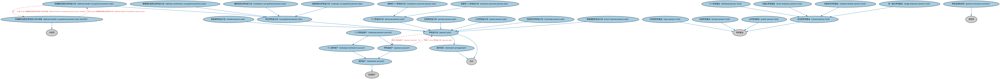

# 养老金计划本体（Pension Plans Ontology）结构与公理说明

本文档对应 `PensionPlans.rdf` / `PensionPlans.ttl`，说明该本体的类、继承关系、属性和公理约定。结构图见 `PensionPlans-structure.png`（`PensionPlans-structure.svg` 为可缩放版本）。

## 1. 本体概述

定义养老金计划（pension plan）：确定缴费型（DC）与确定给付型（DB）等形态，及其发起人、受托管理与受益规则。

**在体系中的位置**：SEC 基金模块的品种本体之一。

**上下游关系**：上游继承集合投资工具并依赖 BE 雇主雇员概念；下游服务养老金资产管理建模。

**与相近概念的差别**：DC 与 DB 的差别——DC 型（如 401(k)）缴费确定、收益不确定，风险在个人；DB 型承诺确定给付，风险在雇主；与普通基金的差别——养老金有税收优惠与领取限制。

## 2. 类（Class）

| 类（Class） | 定义（Definition） |
|---|---|
| 账面储备养老金计划（book reserved pension plan） | 资产负债表反映计划发起人资产负债表中以储备或拨备形式入账之职业养老金计划金额的养老金计划。 |
| 封闭型养老基金（closed pension fund） | 成员资格限于特定人士或特定类别人士的养老基金。 |
| 待遇确定型职业养老金计划（defined benefit occupational pension plan） | 按预定待遇公式预先确定退休待遇的职业养老金计划，由发起雇主承担给付责任。 |
| 待遇确定型职业养老金计划分类器（defined benefit occupational pension plan classifier） | 对按预定待遇公式预先确定退休待遇、并由发起雇主承担义务的职业计划进行分类的分类器。 |
| 缴费确定型职业养老金计划（defined contribution occupational pension plan） | 计划发起人支付固定缴费、且无法定或推定义务支付额外缴费的职业养老金计划。 |
| 基金制养老金计划（funded pension plan） | 积累专门资产以覆盖计划负债的养老金计划。 |
| 个人养老金账户（individual pension account） | 记录归属于个人之金额的养老金账户。 |
| 个人养老基金（individual pension fund） | 支持一个或多个个人养老金计划、并按成员个人为基础维持资产和权益的封闭型养老基金。 |
| 个人退休账户（individual retirement account） | 记录归属于个人之金额的退休账户（IRA）。 |
| 强制性职业养老金计划（mandatory occupational pension plan） | 雇主必须参加的职业养老金计划。 |
| 强制性个人养老金计划（mandatory personal pension plan） | 个人必须加入、或可接收强制性养老金缴费的个人养老金计划。 |
| 多雇主养老基金（multi-employer pension fund） | 汇集多个计划发起人所设养老金计划资产的养老基金。 |
| 职业养老金计划（occupational pension plan） | 与计划成员和设立计划的实体（计划发起人）之间雇佣或职业关系相关联的养老金计划。 |
| 开放型养老基金（open pension fund） | 支持至少一个成员资格不受限制之计划的养老基金。 |
| 养老金账户（pension account） | 记录与养老金计划相关之金额的退休账户。 |
| 养老金保险合同（pension insurance contract） | 规定养老金计划向保险企业缴费、以换取由保险企业支付养老金计划待遇的保险合同。 |
| 养老金计划（pension plan） | 具有明确退休目标的具有法律约束力的安排，或为满足税收相关条件或合同条款而设定受益安排的安排。 |
| 个人养老金计划（personal pension plan） | 无须与雇佣或职业关系相关联的养老金计划。 |
| 私营养老基金（private pension fund） | 受私营部门法律监管的养老基金。 |
| 私营养老金计划（private pension plan） | 由一般政府以外机构管理的养老金计划。 |
| 公共养老基金（public pension fund） | 受公共部门法律监管的养老基金。 |
| 公共养老金计划（public pension plan） | 由一般政府（即中央、州和地方政府以及社会保障机构等其他公共部门机构）管理的养老金计划。 |
| 关联成员养老基金（related member pension fund） | 由数量有限的关联成员资产组成、且成员均为该养老基金管理机构成员的养老基金。 |
| 退休账户（retirement account） | 记录旨在为退休期间提供收入或财务资源之金额的账户。 |
| 退休安排（retirement arrangement） | 确立为退休积累或提供财务资源之条件的安排。 |
| 单一雇主养老基金（single employer pension fund） | 汇集单一发起人所设养老金计划资产的养老基金。 |
| 现收现付养老金计划（unfunded pension plan） | 直接以计划发起人或提供方和/或计划参与人的缴费支付的养老金计划。 |
| 自愿性职业养老金计划（voluntary occupational pension plan） | 雇主自愿设立的职业养老金计划（包括作为雇佣安排一部分自动加入的情形）。 |
| 自愿性个人养老金计划（voluntary personal pension plan） | 个人自愿参加的个人养老金计划。 |

### 2.1 继承关系（Inheritance）

- 账面储备养老金计划（book reserved pension plan） ⊑ 养老金计划（pension plan）
- 封闭型养老基金（closed pension fund） ⊑ 养老基金
- 待遇确定型职业养老金计划（defined benefit occupational pension plan） ⊑ 职业养老金计划（occupational pension plan）
- 待遇确定型职业养老金计划分类器（defined benefit occupational pension plan classifier） ⊑ 分类符
- 缴费确定型职业养老金计划（defined contribution occupational pension plan） ⊑ 职业养老金计划（occupational pension plan）
- 基金制养老金计划（funded pension plan） ⊑ 养老金计划（pension plan）
- 个人养老金账户（individual pension account） ⊑ 个人退休账户（individual retirement account）
- 个人养老金账户（individual pension account） ⊑ 养老金账户（pension account）
- 个人养老基金（individual pension fund） ⊑ 封闭型养老基金（closed pension fund）
- 个人退休账户（individual retirement account） ⊑ 退休账户（retirement account）
- 强制性职业养老金计划（mandatory occupational pension plan） ⊑ 职业养老金计划（occupational pension plan）
- 强制性个人养老金计划（mandatory personal pension plan） ⊑ 个人养老金计划（personal pension plan）
- 多雇主养老基金（multi-employer pension fund） ⊑ 封闭型养老基金（closed pension fund）
- 职业养老金计划（occupational pension plan） ⊑ 养老金计划（pension plan）
- 开放型养老基金（open pension fund） ⊑ 养老基金
- 养老金账户（pension account） ⊑ 退休账户（retirement account）
- 养老金保险合同（pension insurance contract） ⊑ 保险单
- 养老金计划（pension plan） ⊑ 协议
- 养老金计划（pension plan） ⊑ 退休安排（retirement arrangement）
- 个人养老金计划（personal pension plan） ⊑ 养老金计划（pension plan）
- 私营养老基金（private pension fund） ⊑ 养老基金
- 私营养老金计划（private pension plan） ⊑ 养老金计划（pension plan）
- 公共养老基金（public pension fund） ⊑ 养老基金
- 公共养老金计划（public pension plan） ⊑ 养老金计划（pension plan）
- 关联成员养老基金（related member pension fund） ⊑ 封闭型养老基金（closed pension fund）
- 退休账户（retirement account） ⊑ 投资账户
- 退休安排（retirement arrangement） ⊑ 协议
- 单一雇主养老基金（single employer pension fund） ⊑ 封闭型养老基金（closed pension fund）
- 现收现付养老金计划（unfunded pension plan） ⊑ 养老金计划（pension plan）
- 自愿性职业养老金计划（voluntary occupational pension plan） ⊑ 职业养老金计划（occupational pension plan）
- 自愿性个人养老金计划（voluntary personal pension plan） ⊑ 个人养老金计划（personal pension plan）

## 3. 对象属性（Object Property）

| 属性（Property） | 中文（English） | 定义（Definition） | 说明 |
|---|---|---|---|
| fibo-sec-fund-pp:isFundedBy | 由……提供资金（is funded by） | 将计划或基金与为其提供资金的协议或其他资金安排关联起来。 | 逆属性（inverseOf）：为……提供资金（provides funding for）；子属性（subPropertyOf）：由……提供 |
| fibo-sec-fund-pp:providesFundingFor | 为……提供资金（provides funding for） | 将协议或资金安排与其所资助的事物关联起来。 | 逆属性（inverseOf）：由……提供资金（is funded by）；子属性（subPropertyOf）：提供 |

## 4. 数据属性（Datatype Property）

| 属性（Property） | 中文（English） | 定义（Definition） |
|---|---|---|
| fibo-sec-fund-pp:isMandatory | 是否强制（is mandatory） | 表明某事物是否为必需。 |
| fibo-sec-fund-pp:isUnprotected | 是否无保障（is unprotected） | 若为真，表明养老金计划/基金本身或养老金提供方不提供任何投资回报或待遇保证。 |

## 5. 公理约定（Axioms）

- 账面储备养老金计划（book reserved pension plan） 与 基金制养老金计划（funded pension plan） 互斥（disjointWith）
- 账面储备养老金计划（book reserved pension plan） 与 现收现付养老金计划（unfunded pension plan） 互斥（disjointWith）
- 待遇确定型职业养老金计划（defined benefit occupational pension plan）：由……分类 some 待遇确定型职业养老金计划分类器（defined benefit occupational pension plan classifier）
- 待遇确定型职业养老金计划（defined benefit occupational pension plan） 与 缴费确定型职业养老金计划（defined contribution occupational pension plan） 互斥（disjointWith）
- 待遇确定型职业养老金计划分类器（defined benefit occupational pension plan classifier）：分类 some 待遇确定型职业养老金计划（defined benefit occupational pension plan）
- 基金制养老金计划（funded pension plan） 与 现收现付养老金计划（unfunded pension plan） 互斥（disjointWith）
- 个人养老基金（individual pension fund） 与 单一雇主养老基金（single employer pension fund） 互斥（disjointWith）
- 强制性职业养老金计划（mandatory occupational pension plan）：restriction
- 强制性个人养老金计划（mandatory personal pension plan）：restriction
- 多雇主养老基金（multi-employer pension fund） 与 个人养老基金（individual pension fund） 互斥（disjointWith）
- 多雇主养老基金（multi-employer pension fund） 与 关联成员养老基金（related member pension fund） 互斥（disjointWith）
- 多雇主养老基金（multi-employer pension fund） 与 单一雇主养老基金（single employer pension fund） 互斥（disjointWith）
- 开放型养老基金（open pension fund） 与 封闭型养老基金（closed pension fund） 互斥（disjointWith）
- 养老金账户（pension account）：规定于 some 养老金计划（pension plan）
- 养老金计划（pension plan）：规定 养老金账户（pension account） ≥0
- 养老金计划（pension plan）：由……提供资金（is funded by） Na71ebe10dae546d28045739e39a2a6b4 ≥0
- 养老金计划（pension plan）：restriction
- 个人养老金计划（personal pension plan） 与 职业养老金计划（occupational pension plan） 互斥（disjointWith）
- 私营养老基金（private pension fund） 与 公共养老基金（public pension fund） 互斥（disjointWith）
- 私营养老金计划（private pension plan）：restriction
- 私营养老金计划（private pension plan） 与 公共养老金计划（public pension plan） 互斥（disjointWith）
- 关联成员养老基金（related member pension fund） 与 个人养老基金（individual pension fund） 互斥（disjointWith）
- 关联成员养老基金（related member pension fund） 与 单一雇主养老基金（single employer pension fund） 互斥（disjointWith）
- 自愿性职业养老金计划（voluntary occupational pension plan）：restriction
- 自愿性职业养老金计划（voluntary occupational pension plan） 与 强制性职业养老金计划（mandatory occupational pension plan） 互斥（disjointWith）
- 自愿性个人养老金计划（voluntary personal pension plan）：restriction
- 自愿性个人养老金计划（voluntary personal pension plan） 与 强制性个人养老金计划（mandatory personal pension plan） 互斥（disjointWith）

## 6. 依赖（owl:imports，12 个）

本本体通过 `owl:imports` 引入以下本体，各项的中文名称与简介如下：

| 导入本体 | 中文名称 | 简介 |
|---|---|---|
| `FBC/DebtAndEquities/Guaranty.rdf` | 担保本体（Guaranty Ontology） | 定义担保（guaranty）：担保人、被担保债务与担保范围。 |
| `FBC/ProductsAndServices/ClientsAndAccounts.rdf` | 客户与账户本体（Clients and Accounts Ontology） | 定义金融机构的客户、账户及账户持有关系。 |
| `FND/Agreements/Agreements.rdf` | 协议本体（Agreements Ontology） | 定义两个或以上参与方之间协议（agreement）的通用概念：协议的当事方、条款、生效与终止，是合同等一切契约性安排的上位模型。 |
| `FND/Agreements/Contracts.rdf` | 合同本体（Contracts Ontology） | 在协议之上定义具有法律约束力的合同（contract）：合同当事方、合同条款、义务与权利，是金融工具与交易合同建模的基石。 |
| `FND/GoalsAndObjectives/Objectives.rdf` | 目标本体（Objectives Ontology） | 定义目标（objective）及其与组织、计划的关系，用于表达机构的经营目标与投资目标。 |
| `FND/Utilities/AnnotationVocabulary.rdf` | FIBO 标注词汇表（FIBO Annotation Vocabulary） | 定义 FIBO 专用的标注属性（如释义来源、成熟度等级），用于本体自身的元数据标注。 |
| `SEC/Funds/Funds.rdf` | 基金本体（Funds Ontology） | 定义投资基金（fund）：基金份额、净值与管理结构。 |
| `https://www.omg.org/spec/Commons/AnnotationVocabulary/` | OMG 通用标注词汇表（OMG Commons Annotation Vocabulary） | OMG 通用本体库（Commons）中的标注词汇表，提供概念映射等标注属性，FIBO 用它标注术语与外部标准的对应关系。 |
| `https://www.omg.org/spec/Commons/Classifiers/` | OMG 通用分类器本体（OMG Commons Classifiers） | OMG 通用本体库（Commons）中的分类器本体，定义分类方案、类别与归类关系的通用概念，FIBO 的分类建模建立在其上。 |
| `https://www.omg.org/spec/Commons/Designators/` | OMG 通用指称符本体（OMG Commons Designators） | Commons 库中的指称符本体，定义名称、标识符等「指代某物的符号」的通用概念。 |
| `https://www.omg.org/spec/Commons/Documents/` | OMG 通用文档本体（OMG Commons Documents） | Commons 库中的文档本体，定义文档及其组成部分的通用概念。 |
| `https://www.omg.org/spec/Commons/Organizations/` | OMG 通用组织本体（OMG Commons Organizations） | Commons 库中的组织本体，定义组织、组织成员与组织结构的通用概念。 |

## 7. 文件

- 官方 RDF/XML：`PensionPlans.rdf`
- 中文 Turtle：`PensionPlans.ttl`
- 结构图：`PensionPlans-structure.png` / `PensionPlans-structure.svg`