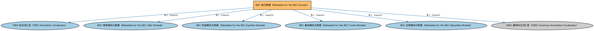

# SEC 域元数据（Metadata for the SEC Domain）说明

本文档对应 `MetadataSEC.rdf` / `MetadataSEC.ttl`。

## 1. 本文件是什么

声明证券（SEC）域由四个模块构成：证券、债务、权益、基金。

从机制上说，这是一个元数据清单（metadata manifest）文件：它本身不定义任何类或属性，而是通过 `dct:hasPart` 声明一个域或模块由哪些本体构成，并携带版本 IRI、版权、许可与成熟度等发布管理信息。它回答的问题是「这个域/模块包含什么、当前是什么版本」，供发布工具和文档系统按模块组织内容；它的 `owl:imports` 只引入标注词汇表，不是用来加载业务本体的入口（加载入口是 `All*` 与 `About*` 聚合文件）。

## 2. 声明的构成（dct:hasPart，4 个）

| 构成项 | 中文名称 | 简介 |
|---|---|---|
| `SEC/Debt/MetadataSECDebt.rdf` | SEC 债务模块元数据（Metadata for the SEC Debt Module） | 声明债务（Debt）模块的构成：债务工具、债券、短期交易债务、行权惯例、分销贷款、池支持证券、资产支持证券、抵押贷款支持证券、担保债务凭证、合成 CDO 十个本体。 |
| `SEC/Equities/MetadataSECEquities.rdf` | SEC 权益模块元数据（Metadata for the SEC Equities Module） | 声明权益（Equities）模块由股权工具、存托凭证、股票 CFI 分类个体三个本体构成，及版本信息。 |
| `SEC/Funds/MetadataSECFunds.rdf` | SEC 基金模块元数据（Metadata for the SEC Funds Module） | 声明基金（Funds）模块由基金、集合投资工具、养老金计划三个本体构成，及版本信息。 |
| `SEC/Securities/MetadataSECSecurities.rdf` | SEC 证券模块元数据（Metadata for the SEC Securities Module） | 声明证券（Securities）模块的构成：证券识别（含个体）、证券分类、证券发行、证券上市、证券限制、参数化计划表、池、篮子及欧美区域限制扩展等本体。 |

## 3. 标注依赖（owl:imports，6 个）

以下导入仅用于支撑元数据标注本身（如成熟度等级、概念映射），不属于业务内容：

| 导入本体 | 中文名称 | 简介 |
|---|---|---|
| `FND/Utilities/AnnotationVocabulary.rdf` | FIBO 标注词汇表（FIBO Annotation Vocabulary） | 定义 FIBO 专用的标注属性（如释义来源、成熟度等级），用于本体自身的元数据标注。 |
| `SEC/Debt/MetadataSECDebt.rdf` | SEC 债务模块元数据（Metadata for the SEC Debt Module） | 声明债务（Debt）模块的构成：债务工具、债券、短期交易债务、行权惯例、分销贷款、池支持证券、资产支持证券、抵押贷款支持证券、担保债务凭证、合成 CDO 十个本体。 |
| `SEC/Equities/MetadataSECEquities.rdf` | SEC 权益模块元数据（Metadata for the SEC Equities Module） | 声明权益（Equities）模块由股权工具、存托凭证、股票 CFI 分类个体三个本体构成，及版本信息。 |
| `SEC/Funds/MetadataSECFunds.rdf` | SEC 基金模块元数据（Metadata for the SEC Funds Module） | 声明基金（Funds）模块由基金、集合投资工具、养老金计划三个本体构成，及版本信息。 |
| `SEC/Securities/MetadataSECSecurities.rdf` | SEC 证券模块元数据（Metadata for the SEC Securities Module） | 声明证券（Securities）模块的构成：证券识别（含个体）、证券分类、证券发行、证券上市、证券限制、参数化计划表、池、篮子及欧美区域限制扩展等本体。 |
| `https://www.omg.org/spec/Commons/AnnotationVocabulary/` | OMG 通用标注词汇表（OMG Commons Annotation Vocabulary） | OMG 通用本体库（Commons）中的标注词汇表，提供概念映射等标注属性，FIBO 用它标注术语与外部标准的对应关系。 |

## 4. 文件

- 官方 RDF/XML：`MetadataSEC.rdf`
- 中文 Turtle：`MetadataSEC.ttl`
- 结构图：`MetadataSEC-structure.png` / `MetadataSEC-structure.svg`