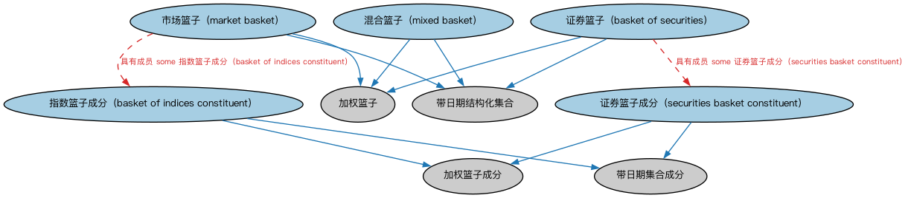

# 篮子本体（Baskets Ontology）结构与公理说明

本文档对应 `Baskets.rdf` / `Baskets.ttl`，说明该本体的类、继承关系、属性和公理约定。结构图见 `Baskets-structure.png`（`Baskets-structure.svg` 为可缩放版本）。

## 1. 本体概述

定义证券篮子（basket）：作为整体交易、定价或参照的一组证券。

**在体系中的位置**：SEC 证券模块的基础构件本体。

**上下游关系**：上游依赖证券与集合概念；下游被篮子指数（IND）、ETF 申赎篮子建模引用。

**与相近概念的差别**：篮子≠池——篮子是参照/交易单位（如指数成分、ETF 申购清单），池是证券化的现金流来源；篮子≠组合（portfolio）——篮子是标准化清单，组合是持有人实际持仓。

本本体中类与类的核心关系如下（完整细节见各类小节）：

- **指数篮子成分（basket of indices constituent）** 继承 **加权篮子成分（WeightedBasketConstituent）**
- **指数篮子成分（basket of indices constituent）** 继承 **带日期集合成分（DatedCollectionConstituent）**
- **证券篮子（basket of securities）** 继承 **加权篮子（WeightedBasket）**
- **证券篮子（basket of securities）** 继承 **带日期结构化集合（DatedStructuredCollection）**
- **市场篮子（market basket）** 继承 **加权篮子（WeightedBasket）**
- **市场篮子（market basket）** 继承 **带日期结构化集合（DatedStructuredCollection）**
- **混合篮子（mixed basket）** 继承 **加权篮子（WeightedBasket）**
- **混合篮子（mixed basket）** 继承 **带日期结构化集合（DatedStructuredCollection）**
- **证券篮子成分（securities basket constituent）** 继承 **加权篮子成分（WeightedBasketConstituent）**
- **证券篮子成分（securities basket constituent）** 继承 **带日期集合成分（DatedCollectionConstituent）**

## 2. 类（Class）

| 类（Class） | 定义（Definition） |
|---|---|
| 指数篮子成分（basket of indices constituent） | 指数篮子的单一成分。 single constituent of a basket of indices |
| 证券篮子（basket of securities） | 由证券组成的篮子，通常为某一特定资产类别（如股票或债券）。 basket composed of securities, typically of a particular asset class such as equities or bonds |
| 市场篮子（market basket） | 由市场指数组成的篮子。 basket composed of market indices |
| 混合篮子（mixed basket） | 成分混合的篮子，同时包含证券和指数。 basket that has a mix of constituents, including securities and indices |
| 证券篮子成分（securities basket constituent） | 被标识为证券篮子组成部分的证券。 security identified as a component of a basket of securities |

以下按类逐个展开：每个类给出继承关系、相关属性与公理约定；子类在父类之下降一级编号。

### 2.1 指数篮子成分（basket of indices constituent）

定义：指数篮子的单一成分。

- 父类：**加权篮子成分（WeightedBasketConstituent）**、**带日期集合成分（DatedCollectionConstituent）**

属性：

| 属性 | 定义 | 说明 |
|---|---|---|
| **具有加入日期（hasDateAdded）** | — | — |
| **包含（comprises）** | — | — |

公理：

- **具有加入日期（hasDateAdded）**至多有 1 个**显式日期（ExplicitDate）**。
- **包含（comprises）**的所有取值只能是**Ne7c2ef8a227c41538734f1c80a498af8**。

### 2.2 证券篮子（basket of securities）

定义：由证券组成的篮子，通常为某一特定资产类别（如股票或债券）。

- 父类：**加权篮子（WeightedBasket）**、**带日期结构化集合（DatedStructuredCollection）**

属性：

| 属性 | 定义 | 说明 |
|---|---|---|
| **具有成员（hasMember）** | — | — |

公理：

- **具有成员（hasMember）**至少有一个取值，类型是**证券篮子成分（securities basket constituent）**。

### 2.3 市场篮子（market basket）

定义：由市场指数组成的篮子。

- 父类：**加权篮子（WeightedBasket）**、**带日期结构化集合（DatedStructuredCollection）**

属性：

| 属性 | 定义 | 说明 |
|---|---|---|
| **具有成员（hasMember）** | — | — |

公理：

- **具有成员（hasMember）**至少有一个取值，类型是**指数篮子成分（basket of indices constituent）**。

### 2.4 混合篮子（mixed basket）

定义：成分混合的篮子，同时包含证券和指数。

- 父类：**加权篮子（WeightedBasket）**、**带日期结构化集合（DatedStructuredCollection）**

属性：

| 属性 | 定义 | 说明 |
|---|---|---|
| **具有成员（hasMember）** | — | — |

公理：

- **具有成员（hasMember）**至少有一个取值，该取值满足：该属性存在取值约束。

### 2.5 证券篮子成分（securities basket constituent）

定义：被标识为证券篮子组成部分的证券。

- 父类：**加权篮子成分（WeightedBasketConstituent）**、**带日期集合成分（DatedCollectionConstituent）**

属性：

| 属性 | 定义 | 说明 |
|---|---|---|
| **具有加入日期（hasDateAdded）** | — | — |
| **包含（comprises）** | — | — |

公理：

- **具有加入日期（hasDateAdded）**至多有 1 个**显式日期（ExplicitDate）**。
- **包含（comprises）**的所有取值只能是**证券（Security）**。

## 3. 依赖（owl:imports，9 个）

本本体通过 `owl:imports` 引入以下本体，各项的中文名称与简介如下：

| 导入本体 | 中文名称 | 简介 |
|---|---|---|
| `FBC/FinancialInstruments/FinancialInstruments.rdf` | 金融工具本体（Financial Instruments Ontology） | FIBO 核心本体之一，定义金融工具（financial instrument）的通用概念：可交易、代表某种权利义务的合同工具，是证券、衍生品等具体工具的共同基础。 |
| `FBC/ProductsAndServices/FinancialProductsAndServices.rdf` | 金融产品与服务本体（Financial Products and Services Ontology） | 定义金融产品（financial product）与金融服务（financial service）及其提供、购买关系。 |
| `FND/DatesAndTimes/FinancialDates.rdf` | 金融日期本体（Financial Dates Ontology） | 定义金融语境下的日期与期间概念：结算日、付息日、到期日、日计数基准等。 |
| `FND/Utilities/AnnotationVocabulary.rdf` | FIBO 标注词汇表（FIBO Annotation Vocabulary） | 定义 FIBO 专用的标注属性（如释义来源、成熟度等级），用于本体自身的元数据标注。 |
| `IND/EconomicIndicators/EconomicIndicators.rdf` | 经济指标本体（Economic Indicators Ontology） | 定义宏观经济指标（GDP、CPI、失业率等）的通用结构：发布机构、发布频率与数值。 |
| `IND/Indicators/Indicators.rdf` | 指标本体（Indicators Ontology） | 定义「指标」（indicator）的通用概念：对某现象的可度量表示，是经济指标、利率等的上位模型。 |
| `https://www.omg.org/spec/Commons/AnnotationVocabulary/` | OMG 通用标注词汇表（OMG Commons Annotation Vocabulary） | OMG 通用本体库（Commons）中的标注词汇表，提供概念映射等标注属性，FIBO 用它标注术语与外部标准的对应关系。 |
| `https://www.omg.org/spec/Commons/Collections/` | OMG 通用集合本体（OMG Commons Collections） | Commons 库中的集合本体，定义集合、成员等通用概念。 |
| `https://www.omg.org/spec/Commons/DatesAndTimes/` | OMG 通用日期与时间本体（OMG Commons Dates and Times） | Commons 库中的日期时间本体，定义日期、期间、时间点等通用时间概念。 |

## 4. 文件

- 官方 RDF/XML：`Baskets.rdf`
- 中文 Turtle：`Baskets.ttl`
- 结构图：`Baskets-structure.png` / `Baskets-structure.svg`