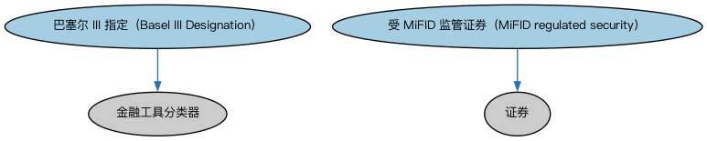

# 欧盟证券限制本体（EU Securities Restrictions Ontology）结构与公理说明

本文档对应 `EUSecuritiesRestrictions.rdf` / `EUSecuritiesRestrictions.ttl`，说明该本体的类、继承关系、属性和公理约定。结构图见 `EUSecuritiesRestrictions-structure.png`（`EUSecuritiesRestrictions-structure.svg` 为可缩放版本）。

## 1. 本体概述

定义欧盟法域下的证券发行与交易限制：招股说明书指令要求、合格投资者规则等。

**在体系中的位置**：SEC 证券模块的欧洲区域扩展，与美国限制本体平行。

**上下游关系**：上游继承证券限制本体并依赖 BE 欧盟法域；下游服务欧洲合规判断。

**与相近概念的差别**：与美国限制的差别——欧盟以指令/条例统一成员国规则（如 Prospectus Regulation），美国以联邦证券法＋SEC 规则为主，限制结构与豁免条件不同。

## 2. 类（Class）

| 类（Class） | 定义（Definition） |
|---|---|
| 巴塞尔 III 指定（Basel III Designation） | 由巴塞尔银行监管委员会（BCBS）定义的欧盟范围内的证券指定，基于证券质量进行分类。 |
| 受 MiFID 监管证券（MiFID regulated security） | 须按金融工具市场指令（MiFID）进行报告的证券。 |

### 2.1 继承关系（Inheritance）

- 巴塞尔 III 指定（Basel III Designation） ⊑ 金融工具分类器
- 受 MiFID 监管证券（MiFID regulated security） ⊑ 证券

## 4. 数据属性（Datatype Property）

| 属性（Property） | 中文（English） | 定义（Definition） |
|---|---|---|
| fibo-sec-sec-eurst:hasUpperLimitOnFloatingShares | 具有流通股数量上限（has upper limit on floating shares） | 指明应报告的自由流通股数量上限（如适用）。 |
| fibo-sec-sec-eurst:isMiFIDReportingRequired | 是否须 MiFID 报告（is MiFID reporting required） | 表明该证券是否须按金融工具市场指令（MiFID）进行报告。 |

## 5. 公理约定（Axioms）

- 巴塞尔 III 指定（Basel III Designation）：restriction
- 巴塞尔 III 指定（Basel III Designation）：分类 some 证券
- 受 MiFID 监管证券（MiFID regulated security）：restriction
- 受 MiFID 监管证券（MiFID regulated security）：restriction

## 6. 依赖（owl:imports，10 个）

本本体通过 `owl:imports` 引入以下本体，各项的中文名称与简介如下：

| 导入本体 | 中文名称 | 简介 |
|---|---|---|
| `FBC/FinancialInstruments/FinancialInstruments.rdf` | 金融工具本体（Financial Instruments Ontology） | FIBO 核心本体之一，定义金融工具（financial instrument）的通用概念：可交易、代表某种权利义务的合同工具，是证券、衍生品等具体工具的共同基础。 |
| `FND/Accounting/CurrencyAmount.rdf` | 货币金额本体（Currency Amount Ontology） | 定义「金额＋币种」的货币金额（currency amount）表示，是 FIBO 中表达价格、债务金额、付款额等一切带币种数值的基础构件。 |
| `FND/Utilities/AnnotationVocabulary.rdf` | FIBO 标注词汇表（FIBO Annotation Vocabulary） | 定义 FIBO 专用的标注属性（如释义来源、成熟度等级），用于本体自身的元数据标注。 |
| `SEC/Equities/EquityInstruments.rdf` | 股权工具本体（Equity Instruments Ontology） | 定义股票等股权工具：普通股、优先股及其附带的权利。 |
| `SEC/Securities/SecuritiesClassification.rdf` | 证券分类本体（Securities Classification Ontology） | 定义证券分类方案：按 CFI 代码、按资产类别等对证券归类。 |
| `SEC/Securities/SecuritiesRestrictions.rdf` | 证券限制本体（Securities Restrictions Ontology） | 定义证券发行与转让限制的通用概念，是各法域具体限制本体的基础。 |
| `https://www.omg.org/spec/Commons/AnnotationVocabulary/` | OMG 通用标注词汇表（OMG Commons Annotation Vocabulary） | OMG 通用本体库（Commons）中的标注词汇表，提供概念映射等标注属性，FIBO 用它标注术语与外部标准的对应关系。 |
| `https://www.omg.org/spec/Commons/Classifiers/` | OMG 通用分类器本体（OMG Commons Classifiers） | OMG 通用本体库（Commons）中的分类器本体，定义分类方案、类别与归类关系的通用概念，FIBO 的分类建模建立在其上。 |
| `https://www.omg.org/spec/Commons/ContextualDesignators/` | OMG 通用语境指称本体（OMG Commons Contextual Designators） | Commons 库中的语境指称本体，定义「在某个语境下指代某物的名称/符号」，是地址、账户号码等语境相关标识的基础。 |
| `https://www.omg.org/spec/Commons/Locations/` | OMG 通用位置本体（OMG Commons Locations） | Commons 库中的位置本体，定义地理位置、地点的通用概念。 |

## 7. 文件

- 官方 RDF/XML：`EUSecuritiesRestrictions.rdf`
- 中文 Turtle：`EUSecuritiesRestrictions.ttl`
- 结构图：`EUSecuritiesRestrictions-structure.png` / `EUSecuritiesRestrictions-structure.svg`