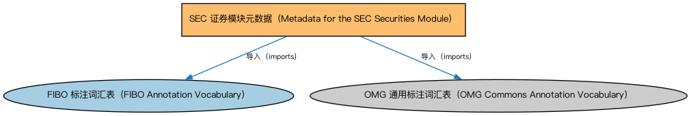

# SEC 证券模块元数据（Metadata for the SEC Securities Module）说明

本文档对应 `MetadataSECSecurities.rdf` / `MetadataSECSecurities.ttl`。

## 1. 本文件是什么

声明证券（Securities）模块的构成：证券识别（含个体）、证券分类、证券发行、证券上市、证券限制、参数化计划表、池、篮子及欧美区域限制扩展等本体。

从机制上说，这是一个元数据清单（metadata manifest）文件：它本身不定义任何类或属性，而是通过 `dct:hasPart` 声明一个域或模块由哪些本体构成，并携带版本 IRI、版权、许可与成熟度等发布管理信息。它回答的问题是「这个域/模块包含什么、当前是什么版本」，供发布工具和文档系统按模块组织内容；它的 `owl:imports` 只引入标注词汇表，不是用来加载业务本体的入口（加载入口是 `All*` 与 `About*` 聚合文件）。

## 2. 声明的构成（dct:hasPart，11 个）

| 构成项 | 中文名称 | 简介 |
|---|---|---|
| `SEC/Securities/Baskets.rdf` | 篮子本体（Baskets Ontology） | 定义证券篮子（basket）：作为整体交易或定价的一组证券。 |
| `SEC/Securities/EuropeanSecurities/EUSecuritiesRestrictions.rdf` | 欧盟证券限制本体（EU Securities Restrictions Ontology） | 定义欧盟法域下的证券发行与交易限制。 |
| `SEC/Securities/NorthAmericanSecurities/USSecuritiesRestrictions.rdf` | 美国证券限制本体（US Securities Restrictions Ontology） | 定义美国证券法下的发行与转售限制（如 Rule 144、Regulation S）。 |
| `SEC/Securities/ParametricSchedules.rdf` | 参数化计划表本体（Parametric Schedules Ontology） | 定义由参数驱动的日期与金额计划表（如分期偿还表、付息表）。 |
| `SEC/Securities/Pools.rdf` | 证券池本体（Securities Pools Ontology） | 定义证券池（pool）：归集起来作为证券化基础的一组资产。 |
| `SEC/Securities/SecuritiesClassification.rdf` | 证券分类本体（Securities Classification Ontology） | 定义证券分类方案：按 CFI 代码、按资产类别等对证券归类。 |
| `SEC/Securities/SecuritiesIdentification.rdf` | 证券识别本体（Securities Identification Ontology） | 定义证券标识符（ISIN、CUSIP、SEDOL 等）及其编码方案的结构。 |
| `SEC/Securities/SecuritiesIdentificationIndividuals.rdf` | 证券识别个体本体（Securities Identification Individuals Ontology） | 收录证券标识方案的参考个体（如 ISIN、CUSIP 编码方案本身）。 |
| `SEC/Securities/SecuritiesIssuance.rdf` | 证券发行本体（Securities Issuance Ontology） | 定义证券发行（issuance）：发行人、发行条款与发行结果。 |
| `SEC/Securities/SecuritiesListings.rdf` | 证券上市本体（Securities Listings Ontology） | 定义证券在交易所上市（listing）及其上市状态。 |
| `SEC/Securities/SecuritiesRestrictions.rdf` | 证券限制本体（Securities Restrictions Ontology） | 定义证券发行与转让限制的通用概念，是各法域具体限制本体的基础。 |

## 3. 标注依赖（owl:imports，2 个）

以下导入仅用于支撑元数据标注本身（如成熟度等级、概念映射），不属于业务内容：

| 导入本体 | 中文名称 | 简介 |
|---|---|---|
| `FND/Utilities/AnnotationVocabulary.rdf` | FIBO 标注词汇表（FIBO Annotation Vocabulary） | 定义 FIBO 专用的标注属性（如释义来源、成熟度等级），用于本体自身的元数据标注。 |
| `https://www.omg.org/spec/Commons/AnnotationVocabulary/` | OMG 通用标注词汇表（OMG Commons Annotation Vocabulary） | OMG 通用本体库（Commons）中的标注词汇表，提供概念映射等标注属性，FIBO 用它标注术语与外部标准的对应关系。 |

## 4. 文件

- 官方 RDF/XML：`MetadataSECSecurities.rdf`
- 中文 Turtle：`MetadataSECSecurities.ttl`
- 结构图：`MetadataSECSecurities-structure.png` / `MetadataSECSecurities-structure.svg`