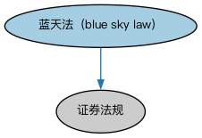

# 美国证券限制本体（US Securities Restrictions Ontology）结构与公理说明

本文档对应 `USSecuritiesRestrictions.rdf` / `USSecuritiesRestrictions.ttl`，说明该本体的类、继承关系、属性和公理约定。结构图见 `USSecuritiesRestrictions-structure.png`（`USSecuritiesRestrictions-structure.svg` 为可缩放版本）。

## 1. 本体概述

定义美国证券法下的发行与转售限制：Rule 144 限售股规则、Regulation S 境外发行豁免等。

**在体系中的位置**：SEC 证券模块的北美区域扩展。

**上下游关系**：上游继承证券限制本体并依赖 BE 美国法域；下游服务美国合规判断。

**与相近概念的差别**：Rule 144 限制「受限证券」的公开转售（锁定期、数量上限），Reg S 规范境外发行不得回流美国——一个是境内转售规则，一个是境外发行安全港。

## 2. 类（Class）

| 类（Class） | 定义（Definition） |
|---|---|
| 蓝天法（blue sky law） | 美国州级证券法规，旨在保护投资者免受证券欺诈，要求发行人注册并披露详细信息。 |

### 2.1 继承关系（Inheritance）

- 蓝天法（blue sky law） ⊑ 证券法规

## 4. 数据属性（Datatype Property）

| 属性（Property） | 中文（English） | 定义（Definition） |
|---|---|---|
| fibo-sec-sec-usrst:isEmployeeRetirementIncomeSecurityActConformant | 是否符合《雇员退休收入保障法》（is Employee Retirement Income Security Act conformant） | 表明该证券是否符合 1974 年《雇员退休收入保障法》（ERISA）这一规范雇员福利计划的联邦法律。 |
| fibo-sec-sec-usrst:isFederalDepositInsuranceCorporationInsured | 是否受联邦存款保险公司承保（is Federal Deposit Insurance Corporation insured） | 表明该证券是否在联邦存款保险公司（FDIC）保险覆盖范围内。 |
| fibo-sec-sec-usrst:isSubjectToFederalReserveBoardRegulationT | 是否受联邦储备委员会 T 条例约束（is subject to Federal Reserve Board Regulation T） | 表明某一现金或保证金账户是否受联邦储备委员会（FRB）保证金要求约束。 |

## 5. 公理约定（Axioms）

- 蓝天法（blue sky law）：适用于情境 地理区域 ≥0

## 6. 依赖（owl:imports，11 个）

本本体通过 `owl:imports` 引入以下本体，各项的中文名称与简介如下：

| 导入本体 | 中文名称 | 简介 |
|---|---|---|
| `BE/GovernmentEntities/NorthAmericanJurisdiction/USGovernmentEntitiesAndJurisdictions.rdf` | 美国政府实体与法域本体（US Government Entities and Jurisdictions Ontology） | 收录美国的政体、联邦与各州政府、法域个体，是北美金融建模最常用的法域参考数据。 |
| `FBC/FinancialInstruments/FinancialInstruments.rdf` | 金融工具本体（Financial Instruments Ontology） | FIBO 核心本体之一，定义金融工具（financial instrument）的通用概念：可交易、代表某种权利义务的合同工具，是证券、衍生品等具体工具的共同基础。 |
| `FBC/ProductsAndServices/ClientsAndAccounts.rdf` | 客户与账户本体（Clients and Accounts Ontology） | 定义金融机构的客户、账户及账户持有关系。 |
| `FND/Utilities/AnnotationVocabulary.rdf` | FIBO 标注词汇表（FIBO Annotation Vocabulary） | 定义 FIBO 专用的标注属性（如释义来源、成熟度等级），用于本体自身的元数据标注。 |
| `SEC/Securities/SecuritiesListings.rdf` | 证券上市本体（Securities Listings Ontology） | 定义证券在交易所上市（listing）及其上市状态。 |
| `SEC/Securities/SecuritiesRestrictions.rdf` | 证券限制本体（Securities Restrictions Ontology） | 定义证券发行与转让限制的通用概念，是各法域具体限制本体的基础。 |
| `https://www.omg.org/spec/Commons/AnnotationVocabulary/` | OMG 通用标注词汇表（OMG Commons Annotation Vocabulary） | OMG 通用本体库（Commons）中的标注词汇表，提供概念映射等标注属性，FIBO 用它标注术语与外部标准的对应关系。 |
| `https://www.omg.org/spec/Commons/ContextualDesignators/` | OMG 通用语境指称本体（OMG Commons Contextual Designators） | Commons 库中的语境指称本体，定义「在某个语境下指代某物的名称/符号」，是地址、账户号码等语境相关标识的基础。 |
| `https://www.omg.org/spec/Commons/DatesAndTimes/` | OMG 通用日期与时间本体（OMG Commons Dates and Times） | Commons 库中的日期时间本体，定义日期、期间、时间点等通用时间概念。 |
| `https://www.omg.org/spec/Commons/Documents/` | OMG 通用文档本体（OMG Commons Documents） | Commons 库中的文档本体，定义文档及其组成部分的通用概念。 |
| `https://www.omg.org/spec/Commons/Locations/` | OMG 通用位置本体（OMG Commons Locations） | Commons 库中的位置本体，定义地理位置、地点的通用概念。 |

## 7. 文件

- 官方 RDF/XML：`USSecuritiesRestrictions.rdf`
- 中文 Turtle：`USSecuritiesRestrictions.ttl`
- 结构图：`USSecuritiesRestrictions-structure.png` / `USSecuritiesRestrictions-structure.svg`