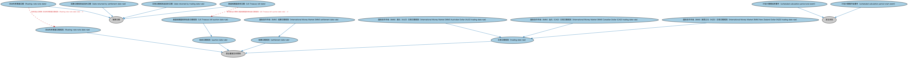

# 参数化计划表本体（Parametric Schedules Ontology）结构与公理说明

本文档对应 `ParametricSchedules.rdf` / `ParametricSchedules.ttl`，说明该本体的类、继承关系、属性和公理约定。结构图见 `ParametricSchedules-structure.png`（`ParametricSchedules-structure.svg` 为可缩放版本）。

## 1. 本体概述

定义参数化计划表：由参数（起息日、频率、偿还规则）驱动生成的日期与金额计划表，如分期偿还表、付息表。

**在体系中的位置**：SEC 证券模块的基础构件本体。

**上下游关系**：上游依赖 FND 付款与计划表、金融日期本体；下游被债券（摊还结构）、结构化产品引用。

**与相近概念的差别**：参数化计划表≠静态付款表——它是由规则生成的「模板」，代入参数即可展开成具体日期金额序列，这是结构化产品条款机器可读化的关键。

## 2. 类（Class）

| 类（Class） | 定义（Definition） |
|---|---|
| 国际货币市场（IMM）澳元（AUD）交易日期规则（International Money Market (IMM) Australian Dollar (AUD) trading date rule） | 定义为澳大利亚证券交易所（ASX）90 天银行承兑期货和期权产品最后一个交易日（悉尼时间）的交易日期规则。 |
| 国际货币市场（IMM）加元（CAD）交易日期规则（International Money Market (IMM) Canadian Dollar (CAD) trading date rule） | 定义为加拿大衍生品交易所（蒙特利尔交易所）三个月银行承兑汇票产品最后一个交易日/到期日的交易日期规则。 |
| 国际货币市场（IMM）新西兰元（NZD）交易日期规则（International Money Market (IMM) New Zealand Dollar (NZD) trading date rule） | 定义为澳大利亚证券交易所（ASX）新西兰 90 天银行承兑期货和期权产品最后一个交易日的交易日期规则。 |
| 国际货币市场（IMM）结算日期规则（International Money Market (IMM) settlement date rule） | 国际货币市场（IMM）结算日期日历中定义的结算日期规则。 |
| 美国短期国库券拍卖日期规则（US Treasury bill auction date rule） | 用于设定美国短期国库券拍卖日期的规则。 |
| 美国短期国库券日期（US Treasury bill date） | 美国 13 周和 26 周短期国库券的拍卖日期。 |
| 拍卖日期规则（auction date rule） | 用于确定某一拍卖事件日期的已发布规则，属于业务重复区间惯例。 |
| 结算日期规则返回的日期（date returned by settlement date rule） | 通过结算规则确定的计算日期。 |
| 交易日期规则返回的日期（date returned by trading date rule） | 通过交易规则确定的计算日期。 |
| 浮动利率票据日期（floating-rate note date） | 与浮动利率票据（亦称浮息票据或 FRN，一种可变利率债务工具）相关联的计算日期。 |
| 浮动利率票据日期规则（floating-rate note date rule） | 适用于浮动利率票据工具的营业日调整规则。 |
| 计划计算期结束事件（scheduled calculation period end event） | 某一特定计算期的结束日期。 |
| 计划计算期开始事件（scheduled calculation period start event） | 某一特定计算期的开始日期。 |
| 结算日期规则（settlement date rule） | 参照某一司法管辖区或由某交易所等交易场所设定的、用于确定结算日期的惯例。 |
| 交易日期规则（trading date rule） | 参照某交易场所或交易所发布的交易日历确定的、用于确定交易日期的惯例。 |

### 2.1 继承关系（Inheritance）

- 国际货币市场（IMM）澳元（AUD）交易日期规则（International Money Market (IMM) Australian Dollar (AUD) trading date rule） ⊑ 交易日期规则（trading date rule）
- 国际货币市场（IMM）加元（CAD）交易日期规则（International Money Market (IMM) Canadian Dollar (CAD) trading date rule） ⊑ 交易日期规则（trading date rule）
- 国际货币市场（IMM）新西兰元（NZD）交易日期规则（International Money Market (IMM) New Zealand Dollar (NZD) trading date rule） ⊑ 交易日期规则（trading date rule）
- 国际货币市场（IMM）结算日期规则（International Money Market (IMM) settlement date rule） ⊑ 结算日期规则（settlement date rule）
- 美国短期国库券拍卖日期规则（US Treasury bill auction date rule） ⊑ 拍卖日期规则（auction date rule）
- 美国短期国库券日期（US Treasury bill date） ⊑ 推算日期
- 拍卖日期规则（auction date rule） ⊑ 营业重复区间惯例
- 结算日期规则返回的日期（date returned by settlement date rule） ⊑ 推算日期
- 交易日期规则返回的日期（date returned by trading date rule） ⊑ 推算日期
- 浮动利率票据日期（floating-rate note date） ⊑ 推算日期
- 浮动利率票据日期规则（floating-rate note date rule） ⊑ 营业重复区间惯例
- 计划计算期结束事件（scheduled calculation period end event） ⊑ 发生类别
- 计划计算期开始事件（scheduled calculation period start event） ⊑ 发生类别
- 结算日期规则（settlement date rule） ⊑ 营业重复区间惯例
- 交易日期规则（trading date rule） ⊑ 营业重复区间惯例

## 5. 公理约定（Axioms）

- 国际货币市场（IMM）加元（CAD）交易日期规则（International Money Market (IMM) Canadian Dollar (CAD) trading date rule）：restriction
- 美国短期国库券拍卖日期规则（US Treasury bill auction date rule）：restriction
- 美国短期国库券日期（US Treasury bill date）：具有营业日惯例 美国短期国库券拍卖日期规则（US Treasury bill auction date rule） =1
- 结算日期规则返回的日期（date returned by settlement date rule）：定义于 only 结算日期规则（settlement date rule）
- 交易日期规则返回的日期（date returned by trading date rule）：定义于 only 交易日期规则（trading date rule）
- 浮动利率票据日期（floating-rate note date）：具有营业日惯例 浮动利率票据日期规则（floating-rate note date rule） =1

## 6. 依赖（owl:imports，8 个）

本本体通过 `owl:imports` 引入以下本体，各项的中文名称与简介如下：

| 导入本体 | 中文名称 | 简介 |
|---|---|---|
| `FND/DatesAndTimes/BusinessDates.rdf` | 营业日期本体（Business Dates Ontology） | 定义营业日、营业日历与日期调整规则（如顺延约定），支撑金融合同中的营业日计算。 |
| `FND/DatesAndTimes/FinancialDates.rdf` | 金融日期本体（Financial Dates Ontology） | 定义金融语境下的日期与期间概念：结算日、付息日、到期日、日计数基准等。 |
| `FND/DatesAndTimes/Occurrences.rdf` | 事件与发生本体（Occurrences Ontology） | 定义「发生」（occurrence）、事件与触发条件，用于表达企业行动、信用事件等「发生了什么」。 |
| `FND/Utilities/AnnotationVocabulary.rdf` | FIBO 标注词汇表（FIBO Annotation Vocabulary） | 定义 FIBO 专用的标注属性（如释义来源、成熟度等级），用于本体自身的元数据标注。 |
| `https://www.omg.org/spec/Commons/AnnotationVocabulary/` | OMG 通用标注词汇表（OMG Commons Annotation Vocabulary） | OMG 通用本体库（Commons）中的标注词汇表，提供概念映射等标注属性，FIBO 用它标注术语与外部标准的对应关系。 |
| `https://www.omg.org/spec/Commons/ContextualDesignators/` | OMG 通用语境指称本体（OMG Commons Contextual Designators） | Commons 库中的语境指称本体，定义「在某个语境下指代某物的名称/符号」，是地址、账户号码等语境相关标识的基础。 |
| `https://www.omg.org/spec/Commons/DatesAndTimes/` | OMG 通用日期与时间本体（OMG Commons Dates and Times） | Commons 库中的日期时间本体，定义日期、期间、时间点等通用时间概念。 |
| `https://www.omg.org/spec/Commons/Designators/` | OMG 通用指称符本体（OMG Commons Designators） | Commons 库中的指称符本体，定义名称、标识符等「指代某物的符号」的通用概念。 |

## 7. 文件

- 官方 RDF/XML：`ParametricSchedules.rdf`
- 中文 Turtle：`ParametricSchedules.ttl`
- 结构图：`ParametricSchedules-structure.png` / `ParametricSchedules-structure.svg`