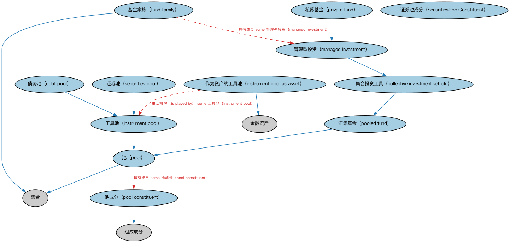

# 证券池本体（Securities Pools Ontology）结构与公理说明

本文档对应 `Pools.rdf` / `Pools.ttl`，说明该本体的类、继承关系、属性和公理约定。结构图见 `Pools-structure.png`（`Pools-structure.svg` 为可缩放版本）。

## 1. 本体概述

定义证券池（pool）：归集起来作为证券化基础的一组资产（贷款、应收账款）。

**在体系中的位置**：SEC 证券模块中支撑资产证券化的本体。

**上下游关系**：上游依赖 FND 安排与集合概念；下游被池支持证券、MBS、ABS 引用。

**与相近概念的差别**：池≠篮子——池是证券化的底层资产组合（产生现金流），篮子是为交易或定价组合的一组证券（参照物）；池的资产通常是贷款而非证券。

## 2. 类（Class）

| 类（Class） | 定义（Definition） |
|---|---|
| 证券池成分（SecuritiesPoolConstituent） | 证券池的组成部分。 |
| 集合投资工具（collective investment vehicle） | 由投资者汇聚的资产池，其股本与该工具的资产保持分离。 |
| 债务池（debt pool） | 由债务工具（如债券、贷款或抵押贷款）组成的池。 |
| 基金家族（fund family） | 由单一投资机构管理的集合投资产品的集合。 |
| 工具池（instrument pool） | 由可纳入同一投资工具的金融工具组成的池。 |
| 作为资产的工具池（instrument pool as asset） | 以工具池形式存在的金融资产。 |
| 管理型投资（managed investment） | 由专业投资管理人控制的投资池，管理人将该池投资于符合既定目标的各类金融工具和资产。 |
| 池（pool） | 为共同目的或利益而组合的资源。 |
| 池成分（pool constituent） | 池的组成部分。 |
| 汇集基金（pooled fund） | 由为共同投资目的而组合和管理的资产构成的基金。 |
| 私募基金（private fund） | 不得向公众发售证券的管理型投资。 |
| 证券池（securities pool） | 为基于这些证券发行票据而组织的证券池。 |

### 2.1 继承关系（Inheritance）

- 集合投资工具（collective investment vehicle） ⊑ 汇集基金（pooled fund）
- 债务池（debt pool） ⊑ 工具池（instrument pool）
- 基金家族（fund family） ⊑ 集合
- 工具池（instrument pool） ⊑ 池（pool）
- 作为资产的工具池（instrument pool as asset） ⊑ 金融资产
- 管理型投资（managed investment） ⊑ 集合投资工具（collective investment vehicle）
- 池（pool） ⊑ 集合
- 池成分（pool constituent） ⊑ 组成成分
- 汇集基金（pooled fund） ⊑ 池（pool）
- 私募基金（private fund） ⊑ 管理型投资（managed investment）
- 证券池（securities pool） ⊑ 工具池（instrument pool）

## 5. 公理约定（Axioms）

- 债务池（debt pool）：具有成员 some 债务工具
- 基金家族（fund family）：由……管理 金融机构 =1
- 基金家族（fund family）：具有成员 some 管理型投资（managed investment）
- 工具池（instrument pool）：具有成员 some 金融工具
- 作为资产的工具池（instrument pool as asset）：是……的资产 some（restriction）
- 作为资产的工具池（instrument pool as asset）：由…扮演（is played by） some 工具池（instrument pool）
- 管理型投资（managed investment）：由……管理 some 金融机构
- 池（pool）：具有成员 some 池成分（pool constituent）
- 证券池（securities pool）：具有成员 some 证券

## 6. 依赖（owl:imports，10 个）

本本体通过 `owl:imports` 引入以下本体，各项的中文名称与简介如下：

| 导入本体 | 中文名称 | 简介 |
|---|---|---|
| `BE/LegalEntities/LegalPersons.rdf` | 法律主体本体（Legal Persons Ontology） | 定义法律主体（legal person）与法定实体（legal entity）的核心概念：能持有权利义务、可起诉与被诉的主体。 |
| `FBC/FinancialInstruments/FinancialInstruments.rdf` | 金融工具本体（Financial Instruments Ontology） | FIBO 核心本体之一，定义金融工具（financial instrument）的通用概念：可交易、代表某种权利义务的合同工具，是证券、衍生品等具体工具的共同基础。 |
| `FBC/FunctionalEntities/FinancialServicesEntities.rdf` | 金融服务实体本体（Financial Services Entities Ontology） | FBC 域核心本体，定义金融服务机构（银行、券商、保险公司、资管机构等）的功能分类体系。 |
| `FND/Accounting/CurrencyAmount.rdf` | 货币金额本体（Currency Amount Ontology） | 定义「金额＋币种」的货币金额（currency amount）表示，是 FIBO 中表达价格、债务金额、付款额等一切带币种数值的基础构件。 |
| `FND/OwnershipAndControl/Ownership.rdf` | 所有权本体（Ownership Ontology） | 定义「拥有」关系：所有者、被拥有资产及所有权份额。 |
| `FND/Utilities/AnnotationVocabulary.rdf` | FIBO 标注词汇表（FIBO Annotation Vocabulary） | 定义 FIBO 专用的标注属性（如释义来源、成熟度等级），用于本体自身的元数据标注。 |
| `https://www.omg.org/spec/Commons/AnnotationVocabulary/` | OMG 通用标注词汇表（OMG Commons Annotation Vocabulary） | OMG 通用本体库（Commons）中的标注词汇表，提供概念映射等标注属性，FIBO 用它标注术语与外部标准的对应关系。 |
| `https://www.omg.org/spec/Commons/Collections/` | OMG 通用集合本体（OMG Commons Collections） | Commons 库中的集合本体，定义集合、成员等通用概念。 |
| `https://www.omg.org/spec/Commons/Organizations/` | OMG 通用组织本体（OMG Commons Organizations） | Commons 库中的组织本体，定义组织、组织成员与组织结构的通用概念。 |
| `https://www.omg.org/spec/Commons/RolesAndCompositions/` | OMG 通用角色与构成本体（OMG Commons Roles and Compositions） | Commons 库中的角色本体，定义角色及整体—部分构成关系的通用概念。 |

## 7. 文件

- 官方 RDF/XML：`Pools.rdf`
- 中文 Turtle：`Pools.ttl`
- 结构图：`Pools-structure.png` / `Pools-structure.svg`