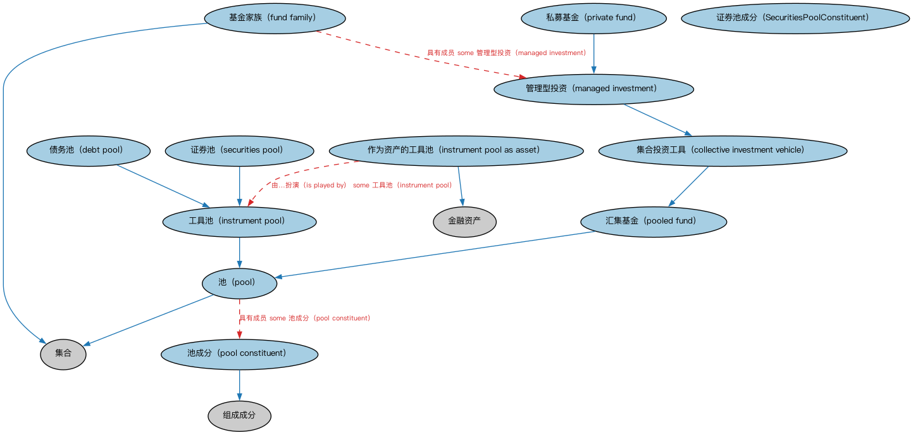

# 证券池本体（Securities Pools Ontology）结构与公理说明

本文档对应 `Pools.rdf` / `Pools.ttl`，说明该本体的类、继承关系、属性和公理约定。结构图见 `Pools-structure.png`（`Pools-structure.svg` 为可缩放版本）。

## 1. 本体概述

定义证券池（pool）：归集起来作为证券化基础的一组资产（贷款、应收账款）。

**在体系中的位置**：SEC 证券模块中支撑资产证券化的本体。

**上下游关系**：上游依赖 FND 安排与集合概念；下游被池支持证券、MBS、ABS 引用。

**与相近概念的差别**：池≠篮子——池是证券化的底层资产组合（产生现金流），篮子是为交易或定价组合的一组证券（参照物）；池的资产通常是贷款而非证券。

本本体中类与类的核心关系如下（完整细节见各类小节）：

- **集合投资工具（collective investment vehicle）** 继承 **汇集基金（pooled fund）**
- **债务池（debt pool）** 继承 **工具池（instrument pool）**
- **基金家族（fund family）** 继承 **集合（Collection）**
- **工具池（instrument pool）** 继承 **池（pool）**
- **作为资产的工具池（instrument pool as asset）** 继承 **金融资产（FinancialAsset）**
- **管理型投资（managed investment）** 继承 **集合投资工具（collective investment vehicle）**
- **池（pool）** 继承 **集合（Collection）**
- **池成分（pool constituent）** 继承 **组成成分（Constituent）**
- **汇集基金（pooled fund）** 继承 **池（pool）**
- **私募基金（private fund）** 继承 **管理型投资（managed investment）**
- **证券池（securities pool）** 继承 **工具池（instrument pool）**

## 2. 类（Class）

| 类（Class） | 定义（Definition） |
|---|---|
| 证券池成分（SecuritiesPoolConstituent） | 证券池的组成部分。 |
| 集合投资工具（collective investment vehicle） | 由投资者汇聚的资产池，其股本与该工具的资产保持分离。 |
| 债务池（debt pool） | 由债务工具（如债券、贷款或抵押贷款）组成的池。 |
| 基金家族（fund family） | 由单一投资机构管理的集合投资产品的集合。 |
| 工具池（instrument pool） | 由可纳入同一投资工具的金融工具组成的池。 |
| 作为资产的工具池（instrument pool as asset） | 以工具池形式存在的金融资产。 |
| 管理型投资（managed investment） | 由专业投资管理人控制的投资池，管理人将该池投资于符合既定目标的各类金融工具和资产。 |
| 池（pool） | 为共同目的或利益而组合的资源。 |
| 池成分（pool constituent） | 池的组成部分。 |
| 汇集基金（pooled fund） | 由为共同投资目的而组合和管理的资产构成的基金。 |
| 私募基金（private fund） | 不得向公众发售证券的管理型投资。 |
| 证券池（securities pool） | 为基于这些证券发行票据而组织的证券池。 |

以下按类逐个展开：每个类给出继承关系、相关属性与公理约定；子类在父类之下降一级编号。

### 2.1 证券池成分（SecuritiesPoolConstituent）

定义：证券池的组成部分。

### 2.2 基金家族（fund family）

定义：由单一投资机构管理的集合投资产品的集合。

- 父类：**集合（Collection）**

属性：

| 属性 | 定义 | 说明 |
|---|---|---|
| **具有成员（hasMember）** | — | — |
| **由……管理（isManagedBy）** | — | — |

公理：

- **具有成员（hasMember）**至少有一个取值，类型是**管理型投资（managed investment）**。
- **由……管理（isManagedBy）**恰好有 1 个**金融机构（FinancialInstitution）**。

### 2.3 作为资产的工具池（instrument pool as asset）

定义：以工具池形式存在的金融资产。

- 父类：**金融资产（FinancialAsset）**

属性：

| 属性 | 定义 | 说明 |
|---|---|---|
| **是……的资产（isAssetOf）** | — | — |
| **由…扮演（is played by）** | — | — |

公理：

- **是……的资产（isAssetOf）**至少有一个取值，该取值满足：该属性存在取值约束。
- **由…扮演（is played by）**至少有一个取值，类型是**工具池（instrument pool）**。

### 2.4 池（pool）

定义：为共同目的或利益而组合的资源。

- 父类：**集合（Collection）**
- 直接子类：**工具池（instrument pool）**、**汇集基金（pooled fund）**

属性：

| 属性 | 定义 | 说明 |
|---|---|---|
| **具有成员（hasMember）** | — | — |

公理：

- **具有成员（hasMember）**至少有一个取值，类型是**池成分（pool constituent）**。

#### 2.4.1 工具池（instrument pool）

定义：由可纳入同一投资工具的金融工具组成的池。

- 父类：**池（pool）**
- 直接子类：**债务池（debt pool）**、**证券池（securities pool）**

属性：

| 属性 | 定义 | 说明 |
|---|---|---|
| **具有成员（hasMember）** | — | — |

公理：

- **具有成员（hasMember）**至少有一个取值，类型是**金融工具（FinancialInstrument）**。

##### 2.4.1.1 债务池（debt pool）

定义：由债务工具（如债券、贷款或抵押贷款）组成的池。

- 父类：**工具池（instrument pool）**

属性：

| 属性 | 定义 | 说明 |
|---|---|---|
| **具有成员（hasMember）** | — | — |

公理：

- **具有成员（hasMember）**至少有一个取值，类型是**债务工具（DebtInstrument）**。

##### 2.4.1.2 证券池（securities pool）

定义：为基于这些证券发行票据而组织的证券池。

- 父类：**工具池（instrument pool）**

属性：

| 属性 | 定义 | 说明 |
|---|---|---|
| **具有成员（hasMember）** | — | — |

公理：

- **具有成员（hasMember）**至少有一个取值，类型是**证券（Security）**。

#### 2.4.2 汇集基金（pooled fund）

定义：由为共同投资目的而组合和管理的资产构成的基金。

- 父类：**池（pool）**
- 直接子类：**集合投资工具（collective investment vehicle）**

##### 2.4.2.1 集合投资工具（collective investment vehicle）

定义：由投资者汇聚的资产池，其股本与该工具的资产保持分离。

- 父类：**汇集基金（pooled fund）**
- 直接子类：**管理型投资（managed investment）**

###### 2.4.2.1.1 管理型投资（managed investment）

定义：由专业投资管理人控制的投资池，管理人将该池投资于符合既定目标的各类金融工具和资产。

- 父类：**集合投资工具（collective investment vehicle）**
- 直接子类：**私募基金（private fund）**

属性：

| 属性 | 定义 | 说明 |
|---|---|---|
| **由……管理（isManagedBy）** | — | — |

公理：

- **由……管理（isManagedBy）**至少有一个取值，类型是**金融机构（FinancialInstitution）**。

###### 2.4.2.1.1.1 私募基金（private fund）

定义：不得向公众发售证券的管理型投资。

- 父类：**管理型投资（managed investment）**

### 2.5 池成分（pool constituent）

定义：池的组成部分。

- 父类：**组成成分（Constituent）**

## 3. 依赖（owl:imports，10 个）

本本体通过 `owl:imports` 引入以下本体，各项的中文名称与简介如下：

| 导入本体 | 中文名称 | 简介 |
|---|---|---|
| `BE/LegalEntities/LegalPersons.rdf` | 法律主体本体（Legal Persons Ontology） | 定义法律主体（legal person）与法定实体（legal entity）的核心概念：能持有权利义务、可起诉与被诉的主体。 |
| `FBC/FinancialInstruments/FinancialInstruments.rdf` | 金融工具本体（Financial Instruments Ontology） | FIBO 核心本体之一，定义金融工具（financial instrument）的通用概念：可交易、代表某种权利义务的合同工具，是证券、衍生品等具体工具的共同基础。 |
| `FBC/FunctionalEntities/FinancialServicesEntities.rdf` | 金融服务实体本体（Financial Services Entities Ontology） | FBC 域核心本体，定义金融服务机构（银行、券商、保险公司、资管机构等）的功能分类体系。 |
| `FND/Accounting/CurrencyAmount.rdf` | 货币金额本体（Currency Amount Ontology） | 定义「金额＋币种」的货币金额（currency amount）表示，是 FIBO 中表达价格、债务金额、付款额等一切带币种数值的基础构件。 |
| `FND/OwnershipAndControl/Ownership.rdf` | 所有权本体（Ownership Ontology） | 定义「拥有」关系：所有者、被拥有资产及所有权份额。 |
| `FND/Utilities/AnnotationVocabulary.rdf` | FIBO 标注词汇表（FIBO Annotation Vocabulary） | 定义 FIBO 专用的标注属性（如释义来源、成熟度等级），用于本体自身的元数据标注。 |
| `https://www.omg.org/spec/Commons/AnnotationVocabulary/` | OMG 通用标注词汇表（OMG Commons Annotation Vocabulary） | OMG 通用本体库（Commons）中的标注词汇表，提供概念映射等标注属性，FIBO 用它标注术语与外部标准的对应关系。 |
| `https://www.omg.org/spec/Commons/Collections/` | OMG 通用集合本体（OMG Commons Collections） | Commons 库中的集合本体，定义集合、成员等通用概念。 |
| `https://www.omg.org/spec/Commons/Organizations/` | OMG 通用组织本体（OMG Commons Organizations） | Commons 库中的组织本体，定义组织、组织成员与组织结构的通用概念。 |
| `https://www.omg.org/spec/Commons/RolesAndCompositions/` | OMG 通用角色与构成本体（OMG Commons Roles and Compositions） | Commons 库中的角色本体，定义角色及整体—部分构成关系的通用概念。 |

## 4. 文件

- 官方 RDF/XML：`Pools.rdf`
- 中文 Turtle：`Pools.ttl`
- 结构图：`Pools-structure.png` / `Pools-structure.svg`