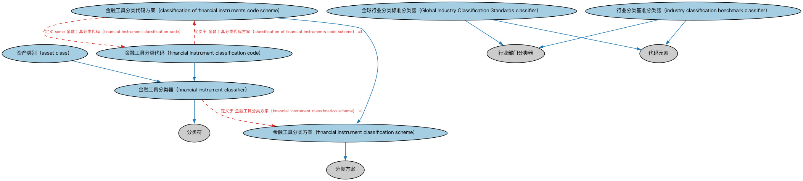

# 证券分类本体（Securities Classification Ontology）结构与公理说明

本文档对应 `SecuritiesClassification.rdf` / `SecuritiesClassification.ttl`，说明该本体的类、继承关系、属性和公理约定。结构图见 `SecuritiesClassification-structure.png`（`SecuritiesClassification-structure.svg` 为可缩放版本）。

## 1. 本体概述

定义证券分类方案：按 ISO 10962 金融工具分类（CFI）、按资产类别等对证券归类的体系。

**在体系中的位置**：SEC 证券模块的基础本体之一。

**上下游关系**：上游依赖 FND 分类方案本体；下游配套的股票 CFI 分类个体提供标准取值。

**与相近概念的差别**：分类≠识别——分类回答「它属于哪一类」（CFI 第六位字母），识别回答「它是哪一个」（ISIN）；与本体类的差别——本体类是逻辑定义，分类方案是行业惯例体系。

## 2. 类（Class）

| 类（Class） | 定义（Definition） |
|---|---|
| 全球行业分类标准分类器（Global Industry Classification Standards classifier） | 基于机构主要业务活动的四级标准化机构分类（GICS）。 |
| 资产类别（asset class） | 金融工具分类器：表现相似特征、在市场中行为相似并受相似法规约束的一组证券。 |
| 金融工具分类代码方案（classification of financial instruments code scheme） | 金融工具代码集的分类方案，可供全球所有参与方用于直通式处理。 |
| 金融工具分类代码（financial instrument classification code） | ISO 10962 金融工具分类（CFI）代码方案中定义的金融工具分类器和代码。 |
| 金融工具分类方案（financial instrument classification scheme） | 定义一组金融工具分类器的分类方案。 |
| 金融工具分类器（financial instrument classifier） | 基于金融工具类型和特征的分类器。 |
| 行业分类基准分类器（industry classification benchmark classifier） | 基于机构主要收入来源的标准化机构分类（ICB）。 |

### 2.1 继承关系（Inheritance）

- 全球行业分类标准分类器（Global Industry Classification Standards classifier） ⊑ 行业部门分类器
- 全球行业分类标准分类器（Global Industry Classification Standards classifier） ⊑ 代码元素
- 资产类别（asset class） ⊑ 金融工具分类器（financial instrument classifier）
- 金融工具分类代码方案（classification of financial instruments code scheme） ⊑ 金融工具分类方案（financial instrument classification scheme）
- 金融工具分类代码（financial instrument classification code） ⊑ 金融工具分类器（financial instrument classifier）
- 金融工具分类方案（financial instrument classification scheme） ⊑ 分类方案
- 金融工具分类器（financial instrument classifier） ⊑ 分类符
- 行业分类基准分类器（industry classification benchmark classifier） ⊑ 行业部门分类器
- 行业分类基准分类器（industry classification benchmark classifier） ⊑ 代码元素

## 5. 公理约定（Axioms）

- 全球行业分类标准分类器（Global Industry Classification Standards classifier）：restriction
- 资产类别（asset class）：分类 some 证券
- 金融工具分类代码方案（classification of financial instruments code scheme）：定义 some 金融工具分类代码（financial instrument classification code）
- 金融工具分类代码（financial instrument classification code）：定义于 金融工具分类代码方案（classification of financial instruments code scheme） =1
- 金融工具分类代码（financial instrument classification code）：restriction
- 金融工具分类方案（financial instrument classification scheme）：定义 only 金融工具分类器（financial instrument classifier）
- 金融工具分类器（financial instrument classifier）：定义于 金融工具分类方案（financial instrument classification scheme） =1
- 金融工具分类器（financial instrument classifier）：分类 some 金融工具
- 行业分类基准分类器（industry classification benchmark classifier）：restriction

## 6. 依赖（owl:imports，7 个）

本本体通过 `owl:imports` 引入以下本体，各项的中文名称与简介如下：

| 导入本体 | 中文名称 | 简介 |
|---|---|---|
| `FBC/FinancialInstruments/FinancialInstruments.rdf` | 金融工具本体（Financial Instruments Ontology） | FIBO 核心本体之一，定义金融工具（financial instrument）的通用概念：可交易、代表某种权利义务的合同工具，是证券、衍生品等具体工具的共同基础。 |
| `FND/Arrangements/ClassificationSchemes.rdf` | 分类方案本体（Classification Schemes Ontology） | 定义分类方案（classification scheme）、类别及「将事物归入类别」的关系，支撑证券分类、行业分类等具体分类体系。 |
| `FND/Utilities/AnnotationVocabulary.rdf` | FIBO 标注词汇表（FIBO Annotation Vocabulary） | 定义 FIBO 专用的标注属性（如释义来源、成熟度等级），用于本体自身的元数据标注。 |
| `https://www.omg.org/spec/Commons/AnnotationVocabulary/` | OMG 通用标注词汇表（OMG Commons Annotation Vocabulary） | OMG 通用本体库（Commons）中的标注词汇表，提供概念映射等标注属性，FIBO 用它标注术语与外部标准的对应关系。 |
| `https://www.omg.org/spec/Commons/Classifiers/` | OMG 通用分类器本体（OMG Commons Classifiers） | OMG 通用本体库（Commons）中的分类器本体，定义分类方案、类别与归类关系的通用概念，FIBO 的分类建模建立在其上。 |
| `https://www.omg.org/spec/Commons/CodesAndCodeSets/` | OMG 通用代码与代码集本体（OMG Commons Codes and Code Sets） | Commons 库中的代码本体，定义代码、代码集及其维护方的通用概念，是 ISO 4217、ISO 3166 等编码体系建模的基础。 |
| `https://www.omg.org/spec/Commons/Designators/` | OMG 通用指称符本体（OMG Commons Designators） | Commons 库中的指称符本体，定义名称、标识符等「指代某物的符号」的通用概念。 |

## 7. 文件

- 官方 RDF/XML：`SecuritiesClassification.rdf`
- 中文 Turtle：`SecuritiesClassification.ttl`
- 结构图：`SecuritiesClassification-structure.png` / `SecuritiesClassification-structure.svg`