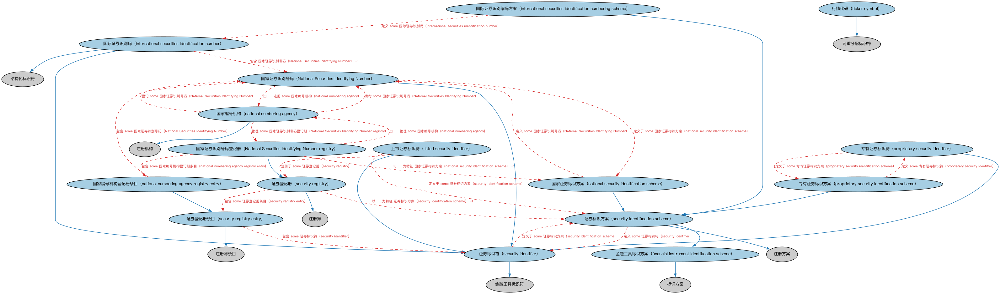

# 证券识别本体（Securities Identification Ontology）结构与公理说明

本文档对应 `SecuritiesIdentification.rdf` / `SecuritiesIdentification.ttl`，说明该本体的类、继承关系、属性和公理约定。结构图见 `SecuritiesIdentification-structure.png`（`SecuritiesIdentification-structure.svg` 为可缩放版本）。

## 1. 本体概述

定义证券标识符体系：国际证券识别编码（ISIN）、CUSIP、SEDOL 等编码的结构与分配机制。

**在体系中的位置**：SEC 证券模块的基础本体之一，是证券「身份证」的概念层。

**上下游关系**：上游依赖 FND 标识符与索引本体；下游配套的个体本体提供各编码方案实例，全库涉及证券引用的地方都用它。

**与相近概念的差别**：证券标识≠ LEI——证券标识符标识「发行的证券」，LEI 标识「发行实体」；同一家公司有多只证券（多个 ISIN）但只有一个 LEI。

## 2. 类（Class）

| 类（Class） | 定义（Definition） |
|---|---|
| 国家证券识别号码（National Securities Identifying Number） | 由国家编号机构按 ISO 6166 标准分配的、用于标识可互换证券的通用九位字母数字代码（NSIN）。 |
| 国家证券识别号码登记册（National Securities Identifying Number registry） | 国家编号机构用于管理其登记的金融工具标识符及相关信息的登记册。 |
| 金融工具标识方案（financial instrument identification scheme） | 对某一特定金融工具标识符集的结构和应用的正式定义。 |
| 国际证券识别码（international securities identification number） | 按 ISO 6166《证券及相关金融工具——国际证券识别编码》规定定义的证券标识符（ISIN）。 |
| 国际证券识别编码方案（international securities identification numbering scheme） | 按 ISO 6166 定义的国际证券识别码（ISIN）结构和应用的正式定义。 |
| 上市证券标识符（listed security identifier） | 在公共领域发布、并在上市文件及其他相关出版物中引用的证券标识符。 |
| 国家编号机构（national numbering agency） | 负责按照 ISO 6166 标准发行和管理国家证券识别号码的注册机构。 |
| 国家编号机构登记册条目（national numbering agency registry entry） | 国家证券识别号码登记册中的条目。 |
| 国家证券标识方案（national security identification scheme） | 规定国家证券识别号码（NSIN）格式和结构、由国家层面代表相关机构发布的证券标识方案。 |
| 专有证券标识方案（proprietary security identification scheme） | 由商业机构发布的证券标识方案。 |
| 专有证券标识符（proprietary security identifier） | 由商业机构提供的标识符。 |
| 证券标识方案（security identification scheme） | 对某一特定证券标识符集的结构和应用的正式定义。 |
| 证券标识符（security identifier） | 任何用于标识证券的公开可用标识符。 |
| 证券登记册（security registry） | 用于管理证券标识符及相关信息的登记册。 |
| 证券登记册条目（security registry entry） | 证券登记册中某一证券的记录。 |
| 行情代码（ticker symbol） | 在某一交易所内对特定金融工具或挂牌唯一的、可重新分配的短字符串标识符。 |

### 2.1 继承关系（Inheritance）

- 国家证券识别号码（National Securities Identifying Number） ⊑ 证券标识符（security identifier）
- 国家证券识别号码登记册（National Securities Identifying Number registry） ⊑ 证券登记册（security registry）
- 金融工具标识方案（financial instrument identification scheme） ⊑ 标识方案
- 国际证券识别码（international securities identification number） ⊑ 证券标识符（security identifier）
- 国际证券识别码（international securities identification number） ⊑ 结构化标识符
- 国际证券识别编码方案（international securities identification numbering scheme） ⊑ 证券标识方案（security identification scheme）
- 上市证券标识符（listed security identifier） ⊑ 证券标识符（security identifier）
- 国家编号机构（national numbering agency） ⊑ 注册机构
- 国家编号机构登记册条目（national numbering agency registry entry） ⊑ 证券登记册条目（security registry entry）
- 国家证券标识方案（national security identification scheme） ⊑ 证券标识方案（security identification scheme）
- 专有证券标识方案（proprietary security identification scheme） ⊑ 证券标识方案（security identification scheme）
- 专有证券标识符（proprietary security identifier） ⊑ 证券标识符（security identifier）
- 证券标识方案（security identification scheme） ⊑ 金融工具标识方案（financial instrument identification scheme）
- 证券标识方案（security identification scheme） ⊑ 注册方案
- 证券标识符（security identifier） ⊑ 金融工具标识符
- 证券登记册（security registry） ⊑ 注册簿
- 证券登记册条目（security registry entry） ⊑ 注册簿条目
- 行情代码（ticker symbol） ⊑ 可重分配标识符

## 5. 公理约定（Axioms）

- 国家证券识别号码（National Securities Identifying Number）：定义于 some 国家证券标识方案（national security identification scheme）
- 国家证券识别号码（National Securities Identifying Number）：由……注册 some 国家编号机构（national numbering agency）
- 国家证券识别号码登记册（National Securities Identifying Number registry）：以……为特征 国家证券标识方案（national security identification scheme） =1
- 国家证券识别号码登记册（National Securities Identifying Number registry）：包含 some 国家编号机构登记册条目（national numbering agency registry entry）
- 国家证券识别号码登记册（National Securities Identifying Number registry）：由……管理 some 国家编号机构（national numbering agency）
- 金融工具标识方案（financial instrument identification scheme）：具有成员 some 金融工具标识符
- 国际证券识别码（international securities identification number）：包含 国家证券识别号码（National Securities Identifying Number） =1
- 国际证券识别码（international securities identification number）：包含 lcc-cr:Alpha2Code =1
- 国际证券识别编码方案（international securities identification numbering scheme）：定义 some 国际证券识别码（international securities identification number）
- 上市证券标识符（listed security identifier）：定义于 some 证券标识方案（security identification scheme）
- 上市证券标识符（listed security identifier）：标识 some 上市证券
- 上市证券标识符（listed security identifier）：由……注册 some 交易所
- 上市证券标识符（listed security identifier）：注册于 some 证券登记册（security registry）
- 国家编号机构（national numbering agency）：发行 some 国家证券识别号码（National Securities Identifying Number）
- 国家编号机构（national numbering agency）：具有覆盖区域 some 地缘政治实体
- 国家编号机构（national numbering agency）：管理 some 国家证券识别号码登记册（National Securities Identifying Number registry）
- 国家编号机构（national numbering agency）：登记 some 国家证券识别号码（National Securities Identifying Number）
- 国家编号机构登记册条目（national numbering agency registry entry）：包含 some 国家证券识别号码（National Securities Identifying Number）
- 国家证券标识方案（national security identification scheme）：适用于 some 地缘政治实体
- 国家证券标识方案（national security identification scheme）：定义 some 国家证券识别号码（National Securities Identifying Number）
- 专有证券标识方案（proprietary security identification scheme）：定义 some 专有证券标识符（proprietary security identifier）
- 专有证券标识符（proprietary security identifier）：定义于 some 专有证券标识方案（proprietary security identification scheme）
- 证券标识方案（security identification scheme）：定义 some 证券标识符（security identifier）
- 证券标识符（security identifier）：定义于 some 证券标识方案（security identification scheme）
- 证券标识符（security identifier）：标识 some 证券
- 证券登记册（security registry）：以……为特征 证券标识方案（security identification scheme） =1
- 证券登记册（security registry）：包含 some 证券登记册条目（security registry entry）
- 证券登记册（security registry）：由……管理 some 注册机构
- 证券登记册条目（security registry entry）：包含 some 证券标识符（security identifier）
- 证券登记册条目（security registry entry）：适用于 some 注册证券
- 行情代码（ticker symbol）：标识 some（restriction）

## 6. 依赖（owl:imports，19 个）

本本体通过 `owl:imports` 引入以下本体，各项的中文名称与简介如下：

| 导入本体 | 中文名称 | 简介 |
|---|---|---|
| `BE/FunctionalEntities/FunctionalEntities.rdf` | 功能实体本体（Functional Entities Ontology） | 定义「功能实体」：按其在商业中承担的功能（而非法律形式）刻画的实体，是出版方、登记机构等功能性主体的基础。 |
| `FBC/FinancialInstruments/FinancialInstruments.rdf` | 金融工具本体（Financial Instruments Ontology） | FIBO 核心本体之一，定义金融工具（financial instrument）的通用概念：可交易、代表某种权利义务的合同工具，是证券、衍生品等具体工具的共同基础。 |
| `FBC/FunctionalEntities/Markets.rdf` | 市场本体（Markets Ontology） | 定义金融市场（market）：交易所、场外市场及其功能。 |
| `FBC/ProductsAndServices/FinancialProductsAndServices.rdf` | 金融产品与服务本体（Financial Products and Services Ontology） | 定义金融产品（financial product）与金融服务（financial service）及其提供、购买关系。 |
| `FND/Arrangements/IdentifiersAndIndices.rdf` | 标识符与索引本体（Identifiers and Indices Ontology） | 定义标识符（identifier）、标识方案与索引（index）的基本结构，是 ISIN、LEI、CUSIP 等编码体系建模的基础。 |
| `FND/Relations/Relations.rdf` | 关系本体（Relations Ontology） | FIBO 最底层的基础本体，定义参考（reference）、分类（classify）等通用关系与抽象概念，全库普遍依赖。 |
| `FND/Utilities/AnnotationVocabulary.rdf` | FIBO 标注词汇表（FIBO Annotation Vocabulary） | 定义 FIBO 专用的标注属性（如释义来源、成熟度等级），用于本体自身的元数据标注。 |
| `SEC/Securities/SecuritiesListings.rdf` | 证券上市本体（Securities Listings Ontology） | 定义证券在交易所上市（listing）及其上市状态。 |
| `https://www.omg.org/spec/Commons/AnnotationVocabulary/` | OMG 通用标注词汇表（OMG Commons Annotation Vocabulary） | OMG 通用本体库（Commons）中的标注词汇表，提供概念映射等标注属性，FIBO 用它标注术语与外部标准的对应关系。 |
| `https://www.omg.org/spec/Commons/Classifiers/` | OMG 通用分类器本体（OMG Commons Classifiers） | OMG 通用本体库（Commons）中的分类器本体，定义分类方案、类别与归类关系的通用概念，FIBO 的分类建模建立在其上。 |
| `https://www.omg.org/spec/Commons/Collections/` | OMG 通用集合本体（OMG Commons Collections） | Commons 库中的集合本体，定义集合、成员等通用概念。 |
| `https://www.omg.org/spec/Commons/ContextualDesignators/` | OMG 通用语境指称本体（OMG Commons Contextual Designators） | Commons 库中的语境指称本体，定义「在某个语境下指代某物的名称/符号」，是地址、账户号码等语境相关标识的基础。 |
| `https://www.omg.org/spec/Commons/ContextualIdentifiers/` | OMG 通用语境标识符本体（OMG Commons Contextual Identifiers） | Commons 库中的语境标识符本体，定义在特定语境下唯一标识事物的标识符结构，是地址、账户类标识的基础。 |
| `https://www.omg.org/spec/Commons/Designators/` | OMG 通用指称符本体（OMG Commons Designators） | Commons 库中的指称符本体，定义名称、标识符等「指代某物的符号」的通用概念。 |
| `https://www.omg.org/spec/Commons/Identifiers/` | OMG 通用标识符本体（OMG Commons Identifiers） | Commons 库中的标识符本体，定义标识符及其编码方案的通用概念。 |
| `https://www.omg.org/spec/Commons/Locations/` | OMG 通用位置本体（OMG Commons Locations） | Commons 库中的位置本体，定义地理位置、地点的通用概念。 |
| `https://www.omg.org/spec/Commons/Organizations/` | OMG 通用组织本体（OMG Commons Organizations） | Commons 库中的组织本体，定义组织、组织成员与组织结构的通用概念。 |
| `https://www.omg.org/spec/Commons/RegistrationAuthorities/` | OMG 通用登记主管机构本体（OMG Commons Registration Authorities） | Commons 库中的登记主管机构本体，定义负责登记注册的主管机构及其登记行为的通用概念。 |
| `https://www.omg.org/spec/LCC/Countries/CountryRepresentation/` | LCC 国家表示本体（LCC Country Representation） | OMG 国家语言代码库（LCC）中的国家表示本体，定义国家、国家标识等概念，是 ISO 3166 各国代码个体的类定义来源。 |

## 7. 文件

- 官方 RDF/XML：`SecuritiesIdentification.rdf`
- 中文 Turtle：`SecuritiesIdentification.ttl`
- 结构图：`SecuritiesIdentification-structure.png` / `SecuritiesIdentification-structure.svg`