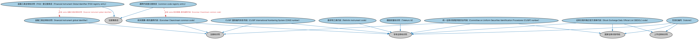

# 证券识别个体本体（Securities Identification Individuals Ontology）结构与公理说明

本文档对应 `SecuritiesIdentificationIndividuals.rdf` / `SecuritiesIdentificationIndividuals.ttl`，说明该本体的类、继承关系、属性和公理约定。结构图见 `SecuritiesIdentificationIndividuals-structure.png`（`SecuritiesIdentificationIndividuals-structure.svg` 为可缩放版本）。

## 1. 本体概述

收录证券标识方案的参考个体（ISIN、CUSIP、SEDOL 等编码方案本身），并含少量配套类定义。

**在体系中的位置**：SEC 证券模块的参考数据层，为「用哪套编码标识证券」提供标准取值。

**上下游关系**：上游依赖证券识别本体（提供标识符的概念结构）与各编码体系的官方方案；下游为按标准方案标注证券标识数据的应用提供实例。

**与相近概念的差别**：标识方案≠标识符——方案是编码体系本身（如 ISIN 这套规则），标识符是按方案分配的具体代码（如 US0378331005）；与股票 CFI 分类个体的差别——CFI 用于分类，标识方案用于唯一识别。

本本体中类与类的核心关系如下（完整细节见各类小节）：

- **CUSIP 国际编号体系号码（CUSIP International Numbering System (CINS) number）** 继承 **专有证券标识符（ProprietarySecurityIdentifier）**
- **CUSIP 国际编号体系号码（CUSIP International Numbering System (CINS) number）** 继承 **注册标识符（RegisteredIdentifier）**
- **统一证券识别程序委员会号码（Committee on Uniform Securities Identification Procedures (CUSIP) number）** 继承 **国家证券识别号码（NationalSecuritiesIdentifyingNumber）**
- **统一证券识别程序委员会号码（Committee on Uniform Securities Identification Procedures (CUSIP) number）** 继承 **专有证券标识符（ProprietarySecurityIdentifier）**
- **统一证券识别程序委员会号码（Committee on Uniform Securities Identification Procedures (CUSIP) number）** 继承 **注册标识符（RegisteredIdentifier）**
- **欧洲清算-明讯通用代码（Euroclear Clearstream common code）** 继承 **专有证券标识符（ProprietarySecurityIdentifier）**
- **欧洲清算-明讯通用代码（Euroclear Clearstream common code）** 继承 **注册标识符（RegisteredIdentifier）**
- **金融工具全球标识符（FIGI）登记册条目（Financial Instrument Global Identifier (FIGI) registry entry）** 继承 **注册簿条目（RegistryEntry）**
- **路孚特工具代码（Refinitiv instrument code）** 继承 **专有证券标识符（ProprietarySecurityIdentifier）**
- **证券交易所每日官方清单代码（Stock Exchange Daily Official List (SEDOL) code）** 继承 **上市证券标识符（ListedSecurityIdentifier）**
- **证券交易所每日官方清单代码（Stock Exchange Daily Official List (SEDOL) code）** 继承 **国家证券识别号码（NationalSecuritiesIdentifyingNumber）**
- **证券交易所每日官方清单代码（Stock Exchange Daily Official List (SEDOL) code）** 继承 **专有证券标识符（ProprietarySecurityIdentifier）**
- 其余 6 条关系从略。

## 2. 类（Class）

| 类（Class） | 定义（Definition） |
|---|---|
| CUSIP 国际编号体系号码（CUSIP International Numbering System (CINS) number） | 9 位字母数字标识符，采用与 CUSIP 相同的 9 位字符，但首位为字母。 9-character alphanumeric identifier that employs the same 9 characters as CUSIP, but also contains a letter of the alphabet in the first position signifying the issuer's country or geographic region, issued by CUSIP Global Services |
| 统一证券识别程序委员会号码（Committee on Uniform Securities Identification Procedures (CUSIP) number） | 用于标识所有北美股票和记名债券的九位字母数字编号，以促进清算和结算。 nine-character alphanumeric number that identifies all North American stocks and registered bonds for the purposes of facilitating clearing and settlement of trades, issued by CUSIP Global Services on behalf of the American Bankers' Association, which is a part of Standard and Poor's Capital IQ, that is the National Numbering Agency Identifier for securities issued in North America, which is also part of the ISIN for the security it identifies |
| 欧洲清算-明讯通用代码（Euroclear Clearstream common code） | 由 Euroclear 和 Clearstream 在卢森堡联合签发的九位字母数字证券标识符。 nine-character alphanumeric securities identifier, issued in Luxembourg, jointly by Euroclear and Clearstream |
| 金融工具全球标识符（FIGI）登记册条目（Financial Instrument Global Identifier (FIGI) registry entry） | 金融工具全球标识符（FIGI）登记册中的条目。 entry in a Financial Instrument Global Identifier (FIGI) registry |
| 路孚特工具代码（Refinitiv instrument code） | 由伦敦证券交易所集团（LSEG）旗下路孚特拥有、管理和分发的金融工具和指数专有代码（RIC）。 proprietary code for financial instruments and indices owned, managed, and distributed by the London Stock Exchange Group's LSEG Financial Solutions (branded as Refinitiv) |
| 证券交易所每日官方清单代码（Stock Exchange Daily Official List (SEDOL) code） | 由伦敦证券交易所签发的七位字符证券标识符，是在英国和爱尔兰发行证券的国家证券识别号码（NSIN）。 seven-character security identifier, issued by the London Stock Exchange, that is the National Securities Identifying Number (NSIN) for securities issued in the United Kingdom, which is also part of the ISIN for the security it identifies |
| 德励财富标识符（Telekurs Id） | 由 SIX 金融信息公司（前身 Telekurs AG）拥有、管理和分发的金融工具标识符。 identifier used to identify financial instruments owned, managed, and distributed by SIX Financial Information (formerly Telekurs AG and subsequently SIX Telekurs Ltd.) |
| 瓦洛伦编号（Valoren） | 由 SIX 金融信息公司签发、分配给瑞士、列支敦士登和比利时金融工具的识别号码，是当地的国家证券识别号码（NSIN）。 identification number assigned to financial instruments in Switzerland, Liechtenstein and Belgium, issued by SIX Financial Information, that is the National Securities Identifying Number (NSIN) for securities issued in those countries and is also part of the ISIN for the security it identifies |
| 通用代码登记册条目（common code registry entry） | 通用代码登记册中的条目。 entry in a common code registry |
| 金融工具全球标识符（financial instrument global identifier） | 按对象管理组织（OMG）金融工具全球标识符（FIGI）规范定义的金融工具标识符。 financial instrument identifier that is defined as specified in the Object Management Group (OMG) Financial Instrument Global Identifier (FIGI) Specification |

以下按类逐个展开：每个类给出继承关系、相关属性与公理约定；子类在父类之下降一级编号。

### 2.1 CUSIP 国际编号体系号码（CUSIP International Numbering System (CINS) number）

定义：9 位字母数字标识符，采用与 CUSIP 相同的 9 位字符，但首位为字母。

- 父类：**专有证券标识符（ProprietarySecurityIdentifier）**、**注册标识符（RegisteredIdentifier）**

属性：

| 属性 | 定义 | 说明 |
|---|---|---|
| **由……发行（isIssuedBy）** | — | — |
| **定义于（isDefinedIn）** | — | — |
| **标识（identifies）** | — | — |
| **由……注册（isRegisteredBy）** | — | — |
| **注册于（isRegisteredIn）** | — | — |

公理：

- **定义于（isDefinedIn）**的取值固定为 CUSIPInternationalNumberingSystemScheme。
- **标识（identifies）**恰好有 1 个**证券（Security）**。
- **注册于（isRegisteredIn）**的取值固定为 CGSCUSIPAccessRepository。
- **由……发行（isIssuedBy）**的取值固定为 CUSIPGlobalServices。
- **由……注册（isRegisteredBy）**的取值固定为 CUSIPGlobalServices。

### 2.2 统一证券识别程序委员会号码（Committee on Uniform Securities Identification Procedures (CUSIP) number）

定义：用于标识所有北美股票和记名债券的九位字母数字编号，以促进清算和结算。

- 父类：**国家证券识别号码（NationalSecuritiesIdentifyingNumber）**、**专有证券标识符（ProprietarySecurityIdentifier）**、**注册标识符（RegisteredIdentifier）**

属性：

| 属性 | 定义 | 说明 |
|---|---|---|
| **由……发行（isIssuedBy）** | — | — |
| **定义于（isDefinedIn）** | — | — |
| **标识（identifies）** | — | — |
| **由……注册（isRegisteredBy）** | — | — |
| **注册于（isRegisteredIn）** | — | — |

公理：

- **定义于（isDefinedIn）**的取值固定为 CommitteeOnUniformSecuritiesIdentificationProceduresScheme。
- **标识（identifies）**恰好有 1 个**证券（Security）**。
- **注册于（isRegisteredIn）**的取值固定为 CGSCUSIPAccessRepository。
- **由……发行（isIssuedBy）**的取值固定为 CUSIPGlobalServices。
- **由……注册（isRegisteredBy）**的取值固定为 CUSIPGlobalServices。

### 2.3 欧洲清算-明讯通用代码（Euroclear Clearstream common code）

定义：由 Euroclear 和 Clearstream 在卢森堡联合签发的九位字母数字证券标识符。

- 父类：**专有证券标识符（ProprietarySecurityIdentifier）**、**注册标识符（RegisteredIdentifier）**

属性：

| 属性 | 定义 | 说明 |
|---|---|---|
| **由……发行（isIssuedBy）** | — | — |
| **定义于（isDefinedIn）** | — | — |
| **标识（identifies）** | — | — |
| **由……注册（isRegisteredBy）** | — | — |
| **注册于（isRegisteredIn）** | — | — |

公理：

- **定义于（isDefinedIn）**的取值固定为 EuroclearClearstreamCommonCodeScheme。
- **标识（identifies）**恰好有 1 个**证券（Security）**。
- **注册于（isRegisteredIn）**的取值固定为 CommonCodeRepository。
- **由……发行（isIssuedBy）**的所有取值只能是**Ncd0a9e6835ce41d2b9acb54394455211**。
- **由……注册（isRegisteredBy）**的所有取值只能是**N8a97fc34050246d58e0785381995520f**。

### 2.4 金融工具全球标识符（FIGI）登记册条目（Financial Instrument Global Identifier (FIGI) registry entry）

定义：金融工具全球标识符（FIGI）登记册中的条目。

- 父类：**注册簿条目（RegistryEntry）**

属性：

| 属性 | 定义 | 说明 |
|---|---|---|
| **包含（comprises）** | — | — |
| **被包含于（isIncludedIn）** | — | — |
| **适用于（appliesTo）** | — | — |

公理：

- **包含（comprises）**至少有一个取值，类型是**金融工具全球标识符（financial instrument global identifier）**。
- **被包含于（isIncludedIn）**的取值固定为 FinancialInstrumentGlobalIdentifierRegistry。
- **适用于（appliesTo）**至少有一个取值，该取值满足：该属性存在取值约束。

### 2.5 路孚特工具代码（Refinitiv instrument code）

定义：由伦敦证券交易所集团（LSEG）旗下路孚特拥有、管理和分发的金融工具和指数专有代码（RIC）。

- 父类：**专有证券标识符（ProprietarySecurityIdentifier）**

属性：

| 属性 | 定义 | 说明 |
|---|---|---|
| **由……发行（isIssuedBy）** | — | — |
| **定义于（isDefinedIn）** | — | — |
| **由……注册（isRegisteredBy）** | — | — |

公理：

- **定义于（isDefinedIn）**的取值固定为 RefinitivInstrumentCodeScheme。
- **由……发行（isIssuedBy）**的取值固定为 LSEGFinancialSolutionsAsMarketDataProvider。
- **由……注册（isRegisteredBy）**的取值固定为 LSEGFinancialSolutionsAsMarketDataProvider。

### 2.6 证券交易所每日官方清单代码（Stock Exchange Daily Official List (SEDOL) code）

定义：由伦敦证券交易所签发的七位字符证券标识符，是在英国和爱尔兰发行证券的国家证券识别号码（NSIN）。

- 父类：**上市证券标识符（ListedSecurityIdentifier）**、**国家证券识别号码（NationalSecuritiesIdentifyingNumber）**、**专有证券标识符（ProprietarySecurityIdentifier）**

属性：

| 属性 | 定义 | 说明 |
|---|---|---|
| **由……发行（isIssuedBy）** | — | — |
| **定义于（isDefinedIn）** | — | — |
| **由……注册（isRegisteredBy）** | — | — |
| **注册于（isRegisteredIn）** | — | — |

公理：

- **定义于（isDefinedIn）**的取值固定为 StockExchangeDailyOfficialListScheme。
- **注册于（isRegisteredIn）**的取值固定为 SEDOLMasterFile。
- **由……发行（isIssuedBy）**的取值固定为 LondonStockExchange。
- **由……注册（isRegisteredBy）**的取值固定为 LondonStockExchange。

### 2.7 德励财富标识符（Telekurs Id）

定义：由 SIX 金融信息公司（前身 Telekurs AG）拥有、管理和分发的金融工具标识符。

- 父类：**专有证券标识符（ProprietarySecurityIdentifier）**

属性：

| 属性 | 定义 | 说明 |
|---|---|---|
| **由……发行（isIssuedBy）** | — | — |
| **定义于（isDefinedIn）** | — | — |
| **由……注册（isRegisteredBy）** | — | — |

公理：

- **定义于（isDefinedIn）**的取值固定为 TelekursSecurityIdentifierScheme。
- **由……发行（isIssuedBy）**的取值固定为 SIXFinancialInformation。
- **由……注册（isRegisteredBy）**的取值固定为 SIXFinancialInformation。

### 2.8 瓦洛伦编号（Valoren）

定义：由 SIX 金融信息公司签发、分配给瑞士、列支敦士登和比利时金融工具的识别号码，是当地的国家证券识别号码（NSIN）。

- 父类：**上市证券标识符（ListedSecurityIdentifier）**、**国家证券识别号码（NationalSecuritiesIdentifyingNumber）**、**专有证券标识符（ProprietarySecurityIdentifier）**

属性：

| 属性 | 定义 | 说明 |
|---|---|---|
| **由……发行（isIssuedBy）** | — | — |
| **定义于（isDefinedIn）** | — | — |
| **由……注册（isRegisteredBy）** | — | — |

公理：

- **定义于（isDefinedIn）**的取值固定为 ValorenScheme。
- **由……发行（isIssuedBy）**的取值固定为 SIXFinancialInformation。
- **由……注册（isRegisteredBy）**的取值固定为 SIXFinancialInformation。

### 2.9 通用代码登记册条目（common code registry entry）

定义：通用代码登记册中的条目。

- 父类：**注册簿条目（RegistryEntry）**

属性：

| 属性 | 定义 | 说明 |
|---|---|---|
| **包含（comprises）** | — | — |
| **被包含于（isIncludedIn）** | — | — |
| **适用于（appliesTo）** | — | — |

公理：

- **包含（comprises）**至少有一个取值，类型是**欧洲清算-明讯通用代码（Euroclear Clearstream common code）**。
- **被包含于（isIncludedIn）**的取值固定为 CommonCodeRepository。
- **适用于（appliesTo）**的所有取值只能是**证券（Security）**。

### 2.10 金融工具全球标识符（financial instrument global identifier）

定义：按对象管理组织（OMG）金融工具全球标识符（FIGI）规范定义的金融工具标识符。

- 父类：**注册标识符（RegisteredIdentifier）**

属性：

| 属性 | 定义 | 说明 |
|---|---|---|
| **由……发行（isIssuedBy）** | — | — |
| **定义于（isDefinedIn）** | — | — |
| **标识（identifies）** | — | — |
| **由……注册（isRegisteredBy）** | — | — |
| **注册于（isRegisteredIn）** | — | — |

公理：

- **定义于（isDefinedIn）**的取值固定为 FinancialInstrumentGlobalIdentifierScheme。
- **标识（identifies）**至少有一个取值，该取值满足：该属性存在取值约束。
- **注册于（isRegisteredIn）**的取值固定为 FinancialInstrumentGlobalIdentifierRegistry。
- **由……发行（isIssuedBy）**的取值固定为 BloombergLP。
- **由……注册（isRegisteredBy）**的取值固定为 BloombergLP。

## 3. 依赖（owl:imports，20 个）

本本体通过 `owl:imports` 引入以下本体，各项的中文名称与简介如下：

| 导入本体 | 中文名称 | 简介 |
|---|---|---|
| `BE/FunctionalEntities/FunctionalEntities.rdf` | 功能实体本体（Functional Entities Ontology） | 定义「功能实体」：按其在商业中承担的功能（而非法律形式）刻画的实体，是出版方、登记机构等功能性主体的基础。 |
| `BE/FunctionalEntities/Publishers.rdf` | 出版方本体（Publishers Ontology） | 定义出版方及其出版物，用于标识金融信息与文档的发布来源。 |
| `BE/GovernmentEntities/GovernmentEntities.rdf` | 政府实体本体（Government Entities Ontology） | 定义政府、政体（polity）、法域（jurisdiction）及政府实体的核心概念，是各区域政府实体本体的共同基础。 |
| `FBC/FinancialInstruments/FinancialInstruments.rdf` | 金融工具本体（Financial Instruments Ontology） | FIBO 核心本体之一，定义金融工具（financial instrument）的通用概念：可交易、代表某种权利义务的合同工具，是证券、衍生品等具体工具的共同基础。 |
| `FBC/FunctionalEntities/CommercialRegistrationAuthorities.rdf` | 商事登记主管机关本体（Commercial Registration Authorities Ontology） | 定义负责商事登记的主管机关及其维护的登记记录。 |
| `FBC/FunctionalEntities/FinancialServicesEntities.rdf` | 金融服务实体本体（Financial Services Entities Ontology） | FBC 域核心本体，定义金融服务机构（银行、券商、保险公司、资管机构等）的功能分类体系。 |
| `FBC/ProductsAndServices/FinancialProductsAndServices.rdf` | 金融产品与服务本体（Financial Products and Services Ontology） | 定义金融产品（financial product）与金融服务（financial service）及其提供、购买关系。 |
| `FND/Relations/Relations.rdf` | 关系本体（Relations Ontology） | FIBO 最底层的基础本体，定义参考（reference）、分类（classify）等通用关系与抽象概念，全库普遍依赖。 |
| `FND/Utilities/AnnotationVocabulary.rdf` | FIBO 标注词汇表（FIBO Annotation Vocabulary） | 定义 FIBO 专用的标注属性（如释义来源、成熟度等级），用于本体自身的元数据标注。 |
| `IND/InterestRates/MarketDataProviders.rdf` | 市场数据提供商本体（Market Data Providers Ontology） | 定义市场数据提供商（交易所、资讯商等）及其发布的数据。 |
| `SEC/Securities/SecuritiesIdentification.rdf` | 证券识别本体（Securities Identification Ontology） | 定义证券标识符（ISIN、CUSIP、SEDOL 等）及其编码方案的结构。 |
| `SEC/Securities/SecuritiesListings.rdf` | 证券上市本体（Securities Listings Ontology） | 定义证券在交易所上市（listing）及其上市状态。 |
| `https://www.omg.org/spec/Commons/AnnotationVocabulary/` | OMG 通用标注词汇表（OMG Commons Annotation Vocabulary） | OMG 通用本体库（Commons）中的标注词汇表，提供概念映射等标注属性，FIBO 用它标注术语与外部标准的对应关系。 |
| `https://www.omg.org/spec/Commons/Collections/` | OMG 通用集合本体（OMG Commons Collections） | Commons 库中的集合本体，定义集合、成员等通用概念。 |
| `https://www.omg.org/spec/Commons/ContextualDesignators/` | OMG 通用语境指称本体（OMG Commons Contextual Designators） | Commons 库中的语境指称本体，定义「在某个语境下指代某物的名称/符号」，是地址、账户号码等语境相关标识的基础。 |
| `https://www.omg.org/spec/Commons/Designators/` | OMG 通用指称符本体（OMG Commons Designators） | Commons 库中的指称符本体，定义名称、标识符等「指代某物的符号」的通用概念。 |
| `https://www.omg.org/spec/Commons/Identifiers/` | OMG 通用标识符本体（OMG Commons Identifiers） | Commons 库中的标识符本体，定义标识符及其编码方案的通用概念。 |
| `https://www.omg.org/spec/Commons/Organizations/` | OMG 通用组织本体（OMG Commons Organizations） | Commons 库中的组织本体，定义组织、组织成员与组织结构的通用概念。 |
| `https://www.omg.org/spec/Commons/RegistrationAuthorities/` | OMG 通用登记主管机构本体（OMG Commons Registration Authorities） | Commons 库中的登记主管机构本体，定义负责登记注册的主管机构及其登记行为的通用概念。 |
| `https://www.omg.org/spec/Commons/RolesAndCompositions/` | OMG 通用角色与构成本体（OMG Commons Roles and Compositions） | Commons 库中的角色本体，定义角色及整体—部分构成关系的通用概念。 |

## 4. 文件

- 官方 RDF/XML：`SecuritiesIdentificationIndividuals.rdf`
- 中文 Turtle：`SecuritiesIdentificationIndividuals.ttl`
- 结构图：`SecuritiesIdentificationIndividuals-structure.png` / `SecuritiesIdentificationIndividuals-structure.svg`