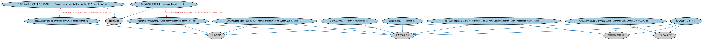

# 证券识别个体本体（Securities Identification Individuals Ontology）结构与公理说明

本文档对应 `SecuritiesIdentificationIndividuals.rdf` / `SecuritiesIdentificationIndividuals.ttl`，说明该本体的类、继承关系、属性和公理约定。结构图见 `SecuritiesIdentificationIndividuals-structure.png`（`SecuritiesIdentificationIndividuals-structure.svg` 为可缩放版本）。

## 1. 本体概述

收录证券标识方案的参考个体（ISIN、CUSIP、SEDOL 等编码方案本身），并含少量配套类定义。

**在体系中的位置**：SEC 证券模块的参考数据层，为「用哪套编码标识证券」提供标准取值。

**上下游关系**：上游依赖证券识别本体（提供标识符的概念结构）与各编码体系的官方方案；下游为按标准方案标注证券标识数据的应用提供实例。

**与相近概念的差别**：标识方案≠标识符——方案是编码体系本身（如 ISIN 这套规则），标识符是按方案分配的具体代码（如 US0378331005）；与股票 CFI 分类个体的差别——CFI 用于分类，标识方案用于唯一识别。

## 2. 类（Class）

| 类（Class） | 定义（Definition） |
|---|---|
| CUSIP 国际编号体系号码（CUSIP International Numbering System (CINS) number） | 9 位字母数字标识符，采用与 CUSIP 相同的 9 位字符，但首位为字母。 |
| 统一证券识别程序委员会号码（Committee on Uniform Securities Identification Procedures (CUSIP) number） | 用于标识所有北美股票和记名债券的九位字母数字编号，以促进清算和结算。 |
| 欧洲清算-明讯通用代码（Euroclear Clearstream common code） | 由 Euroclear 和 Clearstream 在卢森堡联合签发的九位字母数字证券标识符。 |
| 金融工具全球标识符（FIGI）登记册条目（Financial Instrument Global Identifier (FIGI) registry entry） | 金融工具全球标识符（FIGI）登记册中的条目。 |
| 路孚特工具代码（Refinitiv instrument code） | 由伦敦证券交易所集团（LSEG）旗下路孚特拥有、管理和分发的金融工具和指数专有代码（RIC）。 |
| 证券交易所每日官方清单代码（Stock Exchange Daily Official List (SEDOL) code） | 由伦敦证券交易所签发的七位字符证券标识符，是在英国和爱尔兰发行证券的国家证券识别号码（NSIN）。 |
| 德励财富标识符（Telekurs Id） | 由 SIX 金融信息公司（前身 Telekurs AG）拥有、管理和分发的金融工具标识符。 |
| 瓦洛伦编号（Valoren） | 由 SIX 金融信息公司签发、分配给瑞士、列支敦士登和比利时金融工具的识别号码，是当地的国家证券识别号码（NSIN）。 |
| 通用代码登记册条目（common code registry entry） | 通用代码登记册中的条目。 |
| 金融工具全球标识符（financial instrument global identifier） | 按对象管理组织（OMG）金融工具全球标识符（FIGI）规范定义的金融工具标识符。 |

### 2.1 继承关系（Inheritance）

- CUSIP 国际编号体系号码（CUSIP International Numbering System (CINS) number） ⊑ 专有证券标识符
- CUSIP 国际编号体系号码（CUSIP International Numbering System (CINS) number） ⊑ 注册标识符
- 统一证券识别程序委员会号码（Committee on Uniform Securities Identification Procedures (CUSIP) number） ⊑ 国家证券识别号码
- 统一证券识别程序委员会号码（Committee on Uniform Securities Identification Procedures (CUSIP) number） ⊑ 专有证券标识符
- 统一证券识别程序委员会号码（Committee on Uniform Securities Identification Procedures (CUSIP) number） ⊑ 注册标识符
- 欧洲清算-明讯通用代码（Euroclear Clearstream common code） ⊑ 专有证券标识符
- 欧洲清算-明讯通用代码（Euroclear Clearstream common code） ⊑ 注册标识符
- 金融工具全球标识符（FIGI）登记册条目（Financial Instrument Global Identifier (FIGI) registry entry） ⊑ 注册簿条目
- 路孚特工具代码（Refinitiv instrument code） ⊑ 专有证券标识符
- 证券交易所每日官方清单代码（Stock Exchange Daily Official List (SEDOL) code） ⊑ 上市证券标识符
- 证券交易所每日官方清单代码（Stock Exchange Daily Official List (SEDOL) code） ⊑ 国家证券识别号码
- 证券交易所每日官方清单代码（Stock Exchange Daily Official List (SEDOL) code） ⊑ 专有证券标识符
- 德励财富标识符（Telekurs Id） ⊑ 专有证券标识符
- 瓦洛伦编号（Valoren） ⊑ 上市证券标识符
- 瓦洛伦编号（Valoren） ⊑ 国家证券识别号码
- 瓦洛伦编号（Valoren） ⊑ 专有证券标识符
- 通用代码登记册条目（common code registry entry） ⊑ 注册簿条目
- 金融工具全球标识符（financial instrument global identifier） ⊑ 注册标识符

## 5. 公理约定（Axioms）

- CUSIP 国际编号体系号码（CUSIP International Numbering System (CINS) number）：restriction
- CUSIP 国际编号体系号码（CUSIP International Numbering System (CINS) number）：restriction
- CUSIP 国际编号体系号码（CUSIP International Numbering System (CINS) number）：restriction
- CUSIP 国际编号体系号码（CUSIP International Numbering System (CINS) number）：restriction
- CUSIP 国际编号体系号码（CUSIP International Numbering System (CINS) number）：标识 证券 =1
- 统一证券识别程序委员会号码（Committee on Uniform Securities Identification Procedures (CUSIP) number）：restriction
- 统一证券识别程序委员会号码（Committee on Uniform Securities Identification Procedures (CUSIP) number）：restriction
- 统一证券识别程序委员会号码（Committee on Uniform Securities Identification Procedures (CUSIP) number）：restriction
- 统一证券识别程序委员会号码（Committee on Uniform Securities Identification Procedures (CUSIP) number）：restriction
- 统一证券识别程序委员会号码（Committee on Uniform Securities Identification Procedures (CUSIP) number）：标识 证券 =1
- 欧洲清算-明讯通用代码（Euroclear Clearstream common code）：由……注册 only N1f58861c47b04a8d89babb2c55125128
- 欧洲清算-明讯通用代码（Euroclear Clearstream common code）：由……发行 only N06e9cb65a9864e1e811ec6316329d477
- 欧洲清算-明讯通用代码（Euroclear Clearstream common code）：restriction
- 欧洲清算-明讯通用代码（Euroclear Clearstream common code）：restriction
- 欧洲清算-明讯通用代码（Euroclear Clearstream common code）：标识 证券 =1
- 金融工具全球标识符（FIGI）登记册条目（Financial Instrument Global Identifier (FIGI) registry entry）：restriction
- 金融工具全球标识符（FIGI）登记册条目（Financial Instrument Global Identifier (FIGI) registry entry）：包含 some 金融工具全球标识符（financial instrument global identifier）
- 金融工具全球标识符（FIGI）登记册条目（Financial Instrument Global Identifier (FIGI) registry entry）：适用于 some（restriction）
- 路孚特工具代码（Refinitiv instrument code）：restriction
- 路孚特工具代码（Refinitiv instrument code）：restriction
- 路孚特工具代码（Refinitiv instrument code）：restriction
- 证券交易所每日官方清单代码（Stock Exchange Daily Official List (SEDOL) code）：restriction
- 证券交易所每日官方清单代码（Stock Exchange Daily Official List (SEDOL) code）：restriction
- 证券交易所每日官方清单代码（Stock Exchange Daily Official List (SEDOL) code）：restriction
- 证券交易所每日官方清单代码（Stock Exchange Daily Official List (SEDOL) code）：restriction
- 德励财富标识符（Telekurs Id）：restriction
- 德励财富标识符（Telekurs Id）：restriction
- 德励财富标识符（Telekurs Id）：restriction
- 瓦洛伦编号（Valoren）：restriction
- 瓦洛伦编号（Valoren）：restriction
- 瓦洛伦编号（Valoren）：restriction
- 通用代码登记册条目（common code registry entry）：适用于 only 证券
- 通用代码登记册条目（common code registry entry）：restriction
- 通用代码登记册条目（common code registry entry）：包含 some 欧洲清算-明讯通用代码（Euroclear Clearstream common code）
- 金融工具全球标识符（financial instrument global identifier）：restriction
- 金融工具全球标识符（financial instrument global identifier）：restriction
- 金融工具全球标识符（financial instrument global identifier）：restriction
- 金融工具全球标识符（financial instrument global identifier）：restriction
- 金融工具全球标识符（financial instrument global identifier）：标识 some（restriction）

## 6. 依赖（owl:imports，20 个）

本本体通过 `owl:imports` 引入以下本体，各项的中文名称与简介如下：

| 导入本体 | 中文名称 | 简介 |
|---|---|---|
| `BE/FunctionalEntities/FunctionalEntities.rdf` | 功能实体本体（Functional Entities Ontology） | 定义「功能实体」：按其在商业中承担的功能（而非法律形式）刻画的实体，是出版方、登记机构等功能性主体的基础。 |
| `BE/FunctionalEntities/Publishers.rdf` | 出版方本体（Publishers Ontology） | 定义出版方及其出版物，用于标识金融信息与文档的发布来源。 |
| `BE/GovernmentEntities/GovernmentEntities.rdf` | 政府实体本体（Government Entities Ontology） | 定义政府、政体（polity）、法域（jurisdiction）及政府实体的核心概念，是各区域政府实体本体的共同基础。 |
| `FBC/FinancialInstruments/FinancialInstruments.rdf` | 金融工具本体（Financial Instruments Ontology） | FIBO 核心本体之一，定义金融工具（financial instrument）的通用概念：可交易、代表某种权利义务的合同工具，是证券、衍生品等具体工具的共同基础。 |
| `FBC/FunctionalEntities/CommercialRegistrationAuthorities.rdf` | 商事登记主管机关本体（Commercial Registration Authorities Ontology） | 定义负责商事登记的主管机关及其维护的登记记录。 |
| `FBC/FunctionalEntities/FinancialServicesEntities.rdf` | 金融服务实体本体（Financial Services Entities Ontology） | FBC 域核心本体，定义金融服务机构（银行、券商、保险公司、资管机构等）的功能分类体系。 |
| `FBC/ProductsAndServices/FinancialProductsAndServices.rdf` | 金融产品与服务本体（Financial Products and Services Ontology） | 定义金融产品（financial product）与金融服务（financial service）及其提供、购买关系。 |
| `FND/Relations/Relations.rdf` | 关系本体（Relations Ontology） | FIBO 最底层的基础本体，定义参考（reference）、分类（classify）等通用关系与抽象概念，全库普遍依赖。 |
| `FND/Utilities/AnnotationVocabulary.rdf` | FIBO 标注词汇表（FIBO Annotation Vocabulary） | 定义 FIBO 专用的标注属性（如释义来源、成熟度等级），用于本体自身的元数据标注。 |
| `IND/InterestRates/MarketDataProviders.rdf` | 市场数据提供商本体（Market Data Providers Ontology） | 定义市场数据提供商（交易所、资讯商等）及其发布的数据。 |
| `SEC/Securities/SecuritiesIdentification.rdf` | 证券识别本体（Securities Identification Ontology） | 定义证券标识符（ISIN、CUSIP、SEDOL 等）及其编码方案的结构。 |
| `SEC/Securities/SecuritiesListings.rdf` | 证券上市本体（Securities Listings Ontology） | 定义证券在交易所上市（listing）及其上市状态。 |
| `https://www.omg.org/spec/Commons/AnnotationVocabulary/` | OMG 通用标注词汇表（OMG Commons Annotation Vocabulary） | OMG 通用本体库（Commons）中的标注词汇表，提供概念映射等标注属性，FIBO 用它标注术语与外部标准的对应关系。 |
| `https://www.omg.org/spec/Commons/Collections/` | OMG 通用集合本体（OMG Commons Collections） | Commons 库中的集合本体，定义集合、成员等通用概念。 |
| `https://www.omg.org/spec/Commons/ContextualDesignators/` | OMG 通用语境指称本体（OMG Commons Contextual Designators） | Commons 库中的语境指称本体，定义「在某个语境下指代某物的名称/符号」，是地址、账户号码等语境相关标识的基础。 |
| `https://www.omg.org/spec/Commons/Designators/` | OMG 通用指称符本体（OMG Commons Designators） | Commons 库中的指称符本体，定义名称、标识符等「指代某物的符号」的通用概念。 |
| `https://www.omg.org/spec/Commons/Identifiers/` | OMG 通用标识符本体（OMG Commons Identifiers） | Commons 库中的标识符本体，定义标识符及其编码方案的通用概念。 |
| `https://www.omg.org/spec/Commons/Organizations/` | OMG 通用组织本体（OMG Commons Organizations） | Commons 库中的组织本体，定义组织、组织成员与组织结构的通用概念。 |
| `https://www.omg.org/spec/Commons/RegistrationAuthorities/` | OMG 通用登记主管机构本体（OMG Commons Registration Authorities） | Commons 库中的登记主管机构本体，定义负责登记注册的主管机构及其登记行为的通用概念。 |
| `https://www.omg.org/spec/Commons/RolesAndCompositions/` | OMG 通用角色与构成本体（OMG Commons Roles and Compositions） | Commons 库中的角色本体，定义角色及整体—部分构成关系的通用概念。 |

## 7. 文件

- 官方 RDF/XML：`SecuritiesIdentificationIndividuals.rdf`
- 中文 Turtle：`SecuritiesIdentificationIndividuals.ttl`
- 结构图：`SecuritiesIdentificationIndividuals-structure.png` / `SecuritiesIdentificationIndividuals-structure.svg`