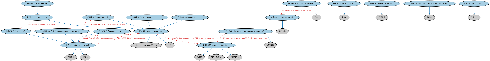

# 证券发行本体（Securities Issuance Ontology）结构与公理说明

本文档对应 `SecuritiesIssuance.rdf` / `SecuritiesIssuance.ttl`，说明该本体的类、继承关系、属性和公理约定。结构图见 `SecuritiesIssuance-structure.png`（`SecuritiesIssuance-structure.svg` 为可缩放版本）。

## 1. 本体概述

定义证券发行（issuance）：发行人、发行条款（规模、价格、日期）与发行结果。

**在体系中的位置**：SEC 证券模块的核心之一，建模发行的「结果与条款」。

**上下游关系**：上游依赖证券、BE 发行人概念与 FND 日期本体；下游与 BP 发行流程本体互补（一静一动），被上市本体衔接。

**与相近概念的差别**：发行≠上市——发行是把证券卖给投资者（一级市场），上市是让证券能在交易所挂牌（二级市场准入）；一次发行可以不上市，上市必须先发行。

## 2. 类（Class）

| 类（Class） | 定义（Definition） |
|---|---|
| 代销发行（best efforts offering） | 投资银行承诺尽力出售所发行证券、但不承担承销商全部风险的证券发行。 |
| 转换条款（conversion terms） | 规定证券何时以及如何转换为另一证券（通常为同一发行人）的合同条款。 |
| 可转换证券（convertible security） | 可转换为另一证券的证券。 |
| 豁免发行人（exempt issuer） | 所发行证券免于某些监管报告要求的发行人。 |
| 豁免发行（exempt offering） | 涉及免于某些监管报告要求之证券的公开发行。 |
| 豁免交易（exempt transaction） | 无须向监管机构办理注册的证券交易。 |
| 金融工具简称（financial instrument short name） | 按 ISO 18774 规定结构定义的金融工具缩写名称（FISN）。 |
| 包销发行（firm commitment offering） | 承销商以自己名义全额购入证券的证券发行。 |
| 发行文件（offering document） | 说明一项投资的目标、风险和条款的法律文件。 |
| 发行说明书（offering statement） | 符合 1933 年《证券法》A 条例《发行说明书》要求的发行备忘录。 |
| 私募发行（private offering） | 私下向有限数量的合格潜在投资者发售证券的发行。 |
| 私募配售备忘录（private placement memorandum） | 说明私募配售所涉投资目标、风险和条款的法律文件。 |
| 招募说明书（prospectus） | 为出售证券而出具的正式书面发行文件，提供投资者作出知情投资决策所需的事实。 |
| 公开发行（public offering） | 在遵守相关监管机构注册要求后向投资公众出售证券的发行。 |
| 证券发行（securities offering） | 出售一种或多种证券的发行。 |
| 证券形式（security form） | 证券所有权凭证的性质。 |
| 证券承销商（security underwriter） | 从发行人处购入证券以图分销、或为发行人销售证券、或参与证券分销的一方。 |
| 证券承销安排（security underwriting arrangement） | 机构（通常为投资银行）与证券发行人之间的承销协议，承诺承销商承担分销风险。 |

### 2.1 继承关系（Inheritance）

- 代销发行（best efforts offering） ⊑ 证券发行（securities offering）
- 转换条款（conversion terms） ⊑ 赎回条款
- 可转换证券（convertible security） ⊑ 证券
- 豁免发行人（exempt issuer） ⊑ 发行人
- 豁免发行（exempt offering） ⊑ 公开发行（public offering）
- 豁免交易（exempt transaction） ⊑ 证券交易
- 金融工具简称（financial instrument short name） ⊑ 标识符
- 包销发行（firm commitment offering） ⊑ 证券发行（securities offering）
- 发行文件（offering document） ⊑ 出版物
- 发行文件（offering document） ⊑ 法律文件
- 发行说明书（offering statement） ⊑ 发行文件（offering document）
- 私募发行（private offering） ⊑ 证券发行（securities offering）
- 私募配售备忘录（private placement memorandum） ⊑ 发行文件（offering document）
- 招募说明书（prospectus） ⊑ 发行文件（offering document）
- 公开发行（public offering） ⊑ 证券发行（securities offering）
- 证券发行（securities offering） ⊑ fibo-fbc-pas-fpas:Offering
- 证券发行（securities offering） ⊑ 协议
- 证券形式（security form） ⊑ 合同文件
- 证券承销商（security underwriter） ⊑ 承销商
- 证券承销商（security underwriter） ⊑ 第三方代理人
- 证券承销商（security underwriter） ⊑ 合同第三方
- 证券承销安排（security underwriting arrangement） ⊑ 承销安排

## 3. 对象属性（Object Property）

| 属性（Property） | 中文（English） | 定义（Definition） | 说明 |
|---|---|---|---|
| fibo-sec-sec-iss:hasActualClosingDate | 具有实际截止日（has actual closing date） | 指明发行或交易正式截止的日期，与预定截止日相区别。 | 值域（range）：显式日期；子属性（subPropertyOf）：具有日期 |
| fibo-sec-sec-iss:hasAnnouncementDate | 具有公告日（has announcement date） | 指明公众首次获得新证券发行信息的日期。 | 值域（range）：日期；子属性（subPropertyOf）：具有日期 |
| fibo-sec-sec-iss:hasFinancialInstrumentShortName | 具有金融工具简称（has financial instrument short name） | 将证券与其符合 ISO 18774 的简称（含发行人简称、工具特征缩写等）关联起来。 | 定义域（domain）：金融工具；值域（range）：金融工具简称（financial instrument short name）；子属性（subPropertyOf）：由……标识 |
| fibo-sec-sec-iss:hasFirstTradeDate | 具有首个交易日（has first trade date） | 指明新发行证券开始交易的日期。 | 值域（range）：显式日期；子属性（subPropertyOf）：具有日期 |
| fibo-sec-sec-iss:hasFirstTradeSettlementDate | 具有首次交易结算日（has first trade settlement date） | 指明新发行证券首笔交易结算的日期。 | 值域（range）：日期 |
| fibo-sec-sec-iss:hasSubscriptionPeriod | 具有认购期（has subscription period） | 指明投资者可承诺购买待发行股份（或单位）的时间段。 | 值域（range）：日期区间；子属性（subPropertyOf）：具有日期区间 |
| fibo-sec-sec-iss:isIssuedInForm | 以……形式发行（is issued in form） | 指明证券发行的形式，通常为记名形式。 | 定义域（domain）：证券；值域（range）：证券形式（security form）；子属性（subPropertyOf）：由……证明 |
| fibo-sec-sec-iss:isRegisteredWith | 注册于（is registered） | 指明某一证券的注册机构，即以所有人名义登记于发行人或其登记机构名册。 | 定义域（domain）：证券；值域（range）：注册机构；子属性（subPropertyOf）：由……注册 |
| fibo-sec-sec-iss:isUnderwrittenBy | 由……承销（is underwritten by） | 将发行与参与募集资金或分销发行标的工具的承销商关联起来。 | 定义域（domain）：证券发行（securities offering）；值域（range）：承销商 |
| fibo-sec-sec-iss:specifiesConversionInto | 规定转换为（specifies conversion into） | 规定按协议条款将替换可转换证券的证券。 | 定义域（domain）：转换条款（conversion terms）；值域（range）：证券 |
| fibo-sec-sec-iss:underwrites | 承销（underwrites） | 对发行进行承销。 | 定义域（domain）：承销商；值域（range）：证券发行（securities offering）；逆属性（inverseOf）：由……承销（is underwritten by） |

## 4. 数据属性（Datatype Property）

| 属性（Property） | 中文（English） | 定义（Definition） |
|---|---|---|
| fibo-sec-sec-iss:hasInstrumentDescription | 具有工具描述（has instrument description） | 将金融工具或 FISN 与符合 ISO 18774 的工具描述（即特征属性集合）关联起来。 |
| fibo-sec-sec-iss:hasIssuerShortName | 具有发行人简称（has issuer short name） | 将证券发行人或 FISN 与符合 ISO 18774 的发行人简称（官方发行人名称的缩写，有长度上限）关联起来。 |
| fibo-sec-sec-iss:hasSeries | 具有系列（has series） | 指明工具分多个系列（亦称分档）发行时发行人所标识的系列。 |
| fibo-sec-sec-iss:hasSubscriptionAmount | 具有认购数量（has subscription amount） | 指明认购的股份或单位数量。 |
| fibo-sec-sec-iss:isOverAllotted | 是否超额认购（is over-allotted） | 表明认购是否超额。 |

## 5. 公理约定（Axioms）

- 转换条款（conversion terms）：规定转换为（specifies conversion into） some 证券
- 转换条款（conversion terms）：适用于 some 证券
- 可转换证券（convertible security）：具有合同要素 some 转换条款（conversion terms）
- 豁免发行（exempt offering）：restriction
- 金融工具简称（financial instrument short name）：restriction
- 金融工具简称（financial instrument short name）：restriction
- 包销发行（firm commitment offering） 与 代销发行（best efforts offering） 互斥（disjointWith）
- 发行文件（offering document）：是……的证据 证券发行（securities offering） =1
- 发行文件（offering document）：具有到期日 日期 =1
- 发行文件（offering document）：具有签发日期 日期 =1
- 发行文件（offering document）：适用于 some 证券
- 私募发行（private offering）：由……证明 some 私募配售备忘录（private placement memorandum）
- 公开发行（public offering）：由……证明 some 招募说明书（prospectus）
- 证券发行（securities offering）：具有参与方角色（has party role） 第三方代理人 ≥0
- 证券发行（securities offering）：由……承销（is underwritten by） 证券承销商（security underwriter） ≥0
- 证券发行（securities offering）：具有要约价格 货币价格 =1
- 证券发行（securities offering）：具有管辖辖区 some 管辖权
- 证券发行（securities offering）：由……证明 some 发行文件（offering document）
- 证券发行（securities offering）：由……发行 some（restriction）
- 证券发行（securities offering）：适用于 some 证券
- 证券形式（security form）：例证 some 金融资产
- 证券形式（security form）：适用于 some 证券
- 证券承销商（security underwriter）：由…扮演（is played by） some（是…的参与方（is a party to） some 证券发行（securities offering））
- 证券承销商（security underwriter）：由…扮演（is played by） some（是…的参与方（is a party to） some 证券承销安排（security underwriting arrangement））
- 证券承销安排（security underwriting arrangement）：具有参与方角色（has party role） some 证券承销商（security underwriter）

## 6. 依赖（owl:imports，23 个）

本本体通过 `owl:imports` 引入以下本体，各项的中文名称与简介如下：

| 导入本体 | 中文名称 | 简介 |
|---|---|---|
| `BE/FunctionalEntities/Publishers.rdf` | 出版方本体（Publishers Ontology） | 定义出版方及其出版物，用于标识金融信息与文档的发布来源。 |
| `BE/OwnershipAndControl/Executives.rdf` | 高管本体（Executives Ontology） | 定义公司高管（executive）、董事会成员及其职务角色，刻画「谁在管理公司」。 |
| `FBC/DebtAndEquities/Debt.rdf` | 债务本体（Debt Ontology） | 定义债务（debt）与债权债务关系的核心概念：借款人、贷款人、本金与利息义务。 |
| `FBC/FinancialInstruments/FinancialInstruments.rdf` | 金融工具本体（Financial Instruments Ontology） | FIBO 核心本体之一，定义金融工具（financial instrument）的通用概念：可交易、代表某种权利义务的合同工具，是证券、衍生品等具体工具的共同基础。 |
| `FBC/FunctionalEntities/FinancialServicesEntities.rdf` | 金融服务实体本体（Financial Services Entities Ontology） | FBC 域核心本体，定义金融服务机构（银行、券商、保险公司、资管机构等）的功能分类体系。 |
| `FBC/ProductsAndServices/FinancialProductsAndServices.rdf` | 金融产品与服务本体（Financial Products and Services Ontology） | 定义金融产品（financial product）与金融服务（financial service）及其提供、购买关系。 |
| `FND/Accounting/CurrencyAmount.rdf` | 货币金额本体（Currency Amount Ontology） | 定义「金额＋币种」的货币金额（currency amount）表示，是 FIBO 中表达价格、债务金额、付款额等一切带币种数值的基础构件。 |
| `FND/Agreements/Agreements.rdf` | 协议本体（Agreements Ontology） | 定义两个或以上参与方之间协议（agreement）的通用概念：协议的当事方、条款、生效与终止，是合同等一切契约性安排的上位模型。 |
| `FND/Agreements/Contracts.rdf` | 合同本体（Contracts Ontology） | 在协议之上定义具有法律约束力的合同（contract）：合同当事方、合同条款、义务与权利，是金融工具与交易合同建模的基石。 |
| `FND/Arrangements/Documents.rdf` | 文档本体（Documents Ontology） | 定义文档、文档类型及文档与其所记载内容的关系，为合同文本、募集说明书等法律文书建模。 |
| `FND/OwnershipAndControl/Ownership.rdf` | 所有权本体（Ownership Ontology） | 定义「拥有」关系：所有者、被拥有资产及所有权份额。 |
| `FND/ProductsAndServices/ProductsAndServices.rdf` | 产品与服务本体（Products and Services Ontology） | 定义产品、服务及其提供者与客户的通用关系。 |
| `FND/Relations/Relations.rdf` | 关系本体（Relations Ontology） | FIBO 最底层的基础本体，定义参考（reference）、分类（classify）等通用关系与抽象概念，全库普遍依赖。 |
| `FND/Utilities/AnnotationVocabulary.rdf` | FIBO 标注词汇表（FIBO Annotation Vocabulary） | 定义 FIBO 专用的标注属性（如释义来源、成熟度等级），用于本体自身的元数据标注。 |
| `https://www.omg.org/spec/Commons/AnnotationVocabulary/` | OMG 通用标注词汇表（OMG Commons Annotation Vocabulary） | OMG 通用本体库（Commons）中的标注词汇表，提供概念映射等标注属性，FIBO 用它标注术语与外部标准的对应关系。 |
| `https://www.omg.org/spec/Commons/ContextualDesignators/` | OMG 通用语境指称本体（OMG Commons Contextual Designators） | Commons 库中的语境指称本体，定义「在某个语境下指代某物的名称/符号」，是地址、账户号码等语境相关标识的基础。 |
| `https://www.omg.org/spec/Commons/DatesAndTimes/` | OMG 通用日期与时间本体（OMG Commons Dates and Times） | Commons 库中的日期时间本体，定义日期、期间、时间点等通用时间概念。 |
| `https://www.omg.org/spec/Commons/Documents/` | OMG 通用文档本体（OMG Commons Documents） | Commons 库中的文档本体，定义文档及其组成部分的通用概念。 |
| `https://www.omg.org/spec/Commons/Identifiers/` | OMG 通用标识符本体（OMG Commons Identifiers） | Commons 库中的标识符本体，定义标识符及其编码方案的通用概念。 |
| `https://www.omg.org/spec/Commons/PartiesAndSituations/` | OMG 通用参与方与情境本体（OMG Commons Parties and Situations） | Commons 库中的参与方本体，定义独立主体、参与方及其角色扮演的通用概念，是 FIBO 参与方模型的上游。 |
| `https://www.omg.org/spec/Commons/RegistrationAuthorities/` | OMG 通用登记主管机构本体（OMG Commons Registration Authorities） | Commons 库中的登记主管机构本体，定义负责登记注册的主管机构及其登记行为的通用概念。 |
| `https://www.omg.org/spec/Commons/RegulatoryAgencies/` | OMG 通用监管机构本体（OMG Commons Regulatory Agencies） | Commons 库中的监管机构本体，定义监管机构及其监管职权的通用概念。 |
| `https://www.omg.org/spec/Commons/RolesAndCompositions/` | OMG 通用角色与构成本体（OMG Commons Roles and Compositions） | Commons 库中的角色本体，定义角色及整体—部分构成关系的通用概念。 |

## 7. 文件

- 官方 RDF/XML：`SecuritiesIssuance.rdf`
- 中文 Turtle：`SecuritiesIssuance.ttl`
- 结构图：`SecuritiesIssuance-structure.png` / `SecuritiesIssuance-structure.svg`