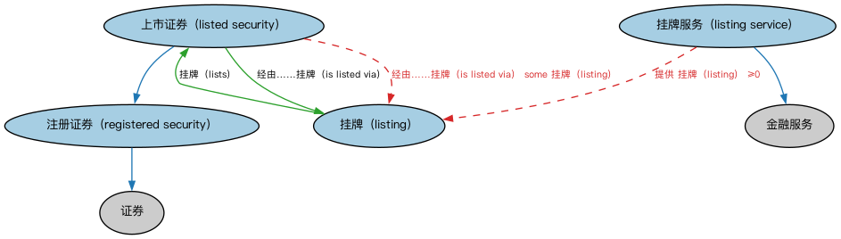

# 证券上市本体（Securities Listings Ontology）结构与公理说明

本文档对应 `SecuritiesListings.rdf` / `SecuritiesListings.ttl`，说明该本体的类、继承关系、属性和公理约定。结构图见 `SecuritiesListings-structure.png`（`SecuritiesListings-structure.svg` 为可缩放版本）。

## 1. 本体概述

定义证券在交易所的上市（listing）：上市市场、上市日期、上市状态与退市。

**在体系中的位置**：SEC 证券模块的核心之一，连接证券与市场。

**上下游关系**：上游依赖证券与 FBC 市场本体；下游服务行情归属、交易权限判断。

**与相近概念的差别**：上市≠交易——上市是获得挂牌资格，交易是日常的买卖行为；一只证券可以在多个市场上市（交叉上市）。

## 2. 类（Class）

| 类（Class） | 定义（Definition） |
|---|---|
| 上市证券（listed security） | 在至少一个交易所挂牌的注册证券。 |
| 挂牌（listing） | 由交易所管理的证券发行的目录条目，规定该证券在该交易所可供交易的条款。 |
| 挂牌服务（listing service） | 交易所为促进证券交易提供的服务。 |
| 注册证券（registered security） | 已在某一注册机构注册的证券。 |

### 2.1 继承关系（Inheritance）

- 上市证券（listed security） ⊑ 注册证券（registered security）
- 挂牌服务（listing service） ⊑ 金融服务
- 注册证券（registered security） ⊑ 证券

## 3. 对象属性（Object Property）

| 属性（Property） | 中文（English） | 定义（Definition） | 说明 |
|---|---|---|---|
| fibo-sec-sec-lst:hasHomeExchange | 具有主场交易所（has home exchange） | 指明被视为某证券主要市场的交易所，通常（但不一定）位于该证券的发行国。 | 值域（range）：交易所；子属性（subPropertyOf）：由……提供 |
| fibo-sec-sec-lst:hasLastTradingDateTime | 具有最后交易日期时间（has last trading date and time） | 规定该证券在交易所最后成交的日期和时间。 | 定义域（domain）：挂牌（listing）；值域（range）：日期时间；子属性（subPropertyOf）：具有日期时间 |
| fibo-sec-sec-lst:hasOriginalPlaceOfListing | 具有原始挂牌地（has original place of listing） | 指明最初为证券挂牌的交易所。 | 值域（range）：交易所 |
| fibo-sec-sec-lst:hasTickSize | 具有最小报价单位（has tick size） | 规定该证券在某一交易所的最小价格变动单位。 | 定义域（domain）：挂牌（listing）；值域（range）：货币数量；子属性（subPropertyOf）：具有货币数量 |
| fibo-sec-sec-lst:isListedVia | 经由……挂牌（is listed via） | 标识负责该证券挂牌的服务。 | 定义域（domain）：上市证券（listed security）；值域（range）：挂牌（listing）；逆属性（inverseOf）：挂牌（lists） |
| fibo-sec-sec-lst:isTradedOn | 在……交易（is traded on） | 标识该证券交易的交易场所。 | 定义域（domain）：上市证券（listed security）；值域（range）：交易所；子属性（subPropertyOf）：由……提供 |
| fibo-sec-sec-lst:lists | 挂牌（lists） | 将某一交易所特定的证券挂牌与其发行关联起来。 | 定义域（domain）：挂牌（listing）；值域（range）：上市证券（listed security） |

## 4. 数据属性（Datatype Property）

| 属性（Property） | 中文（English） | 定义（Definition） |
|---|---|---|
| fibo-sec-sec-lst:hasDelistingDate | 具有退市日期（has delisting date） | 规定交易所为证券设定的退市日期。 |
| fibo-sec-sec-lst:hasListingDate | 具有上市日期（has listing date） | 指明证券挂牌的日期。 |
| fibo-sec-sec-lst:isSeasoned | 是否已成熟（is seasoned） | 表明该证券公开交易时间已足够长，其首次公开发行带来的短期成交量波动已消除。 |

## 5. 公理约定（Axioms）

- 上市证券（listed security）：具有主场交易所（has home exchange） 交易所 =1
- 上市证券（listed security）：具有原始挂牌地（has original place of listing） 交易所 =1
- 上市证券（listed security）：经由……挂牌（is listed via） some 挂牌（listing）
- 挂牌（listing）：具有登记状态 登记状态 ≤1
- 挂牌（listing）：具有最小报价单位（has tick size） 货币数量 ≥0
- 挂牌（listing）：具有最后交易日期时间（has last trading date and time） 日期时间 ≥0
- 挂牌（listing）：restriction
- 挂牌（listing）：restriction
- 挂牌（listing）：挂牌（lists） 证券发行 =1
- 挂牌（listing）：restriction
- 挂牌（listing）：具有货币 some 货币
- 挂牌服务（listing service）：由……配置提供 交易所 ≥0
- 挂牌服务（listing service）：由……提供 交易所 ≥0
- 挂牌服务（listing service）：提供 挂牌（listing） ≥0
- 注册证券（registered security）：以……形式发行 some（restriction）
- 注册证券（registered security）：注册于 some 注册机构
- 注册证券（registered security）：具有注册日期 some cmns-dt:CombinedDateTime
- 注册证券（registered security） 与 豁免证券 互斥（disjointWith）

## 6. 依赖（owl:imports，15 个）

本本体通过 `owl:imports` 引入以下本体，各项的中文名称与简介如下：

| 导入本体 | 中文名称 | 简介 |
|---|---|---|
| `FBC/FinancialInstruments/FinancialInstruments.rdf` | 金融工具本体（Financial Instruments Ontology） | FIBO 核心本体之一，定义金融工具（financial instrument）的通用概念：可交易、代表某种权利义务的合同工具，是证券、衍生品等具体工具的共同基础。 |
| `FBC/FinancialInstruments/InstrumentPricing.rdf` | 工具定价本体（Instrument Pricing Ontology） | 定义金融工具的价格、报价与估值概念。 |
| `FBC/FunctionalEntities/BusinessRegistries.rdf` | 商业登记机构本体（Business Registries Ontology） | 定义商业登记机构（如公司注册处）及其登记职能。 |
| `FBC/FunctionalEntities/Markets.rdf` | 市场本体（Markets Ontology） | 定义金融市场（market）：交易所、场外市场及其功能。 |
| `FBC/ProductsAndServices/FinancialProductsAndServices.rdf` | 金融产品与服务本体（Financial Products and Services Ontology） | 定义金融产品（financial product）与金融服务（financial service）及其提供、购买关系。 |
| `FND/Accounting/CurrencyAmount.rdf` | 货币金额本体（Currency Amount Ontology） | 定义「金额＋币种」的货币金额（currency amount）表示，是 FIBO 中表达价格、债务金额、付款额等一切带币种数值的基础构件。 |
| `FND/Parties/Parties.rdf` | 参与方本体（Parties Ontology） | 定义参与方（party）、独立主体（autonomous agent）与「角色扮演」（party in role），是 FIBO 全库使用最广的基础本体之一。 |
| `FND/ProductsAndServices/ProductsAndServices.rdf` | 产品与服务本体（Products and Services Ontology） | 定义产品、服务及其提供者与客户的通用关系。 |
| `FND/Utilities/AnnotationVocabulary.rdf` | FIBO 标注词汇表（FIBO Annotation Vocabulary） | 定义 FIBO 专用的标注属性（如释义来源、成熟度等级），用于本体自身的元数据标注。 |
| `SEC/Securities/SecuritiesIssuance.rdf` | 证券发行本体（Securities Issuance Ontology） | 定义证券发行（issuance）：发行人、发行条款与发行结果。 |
| `https://www.omg.org/spec/Commons/AnnotationVocabulary/` | OMG 通用标注词汇表（OMG Commons Annotation Vocabulary） | OMG 通用本体库（Commons）中的标注词汇表，提供概念映射等标注属性，FIBO 用它标注术语与外部标准的对应关系。 |
| `https://www.omg.org/spec/Commons/DatesAndTimes/` | OMG 通用日期与时间本体（OMG Commons Dates and Times） | Commons 库中的日期时间本体，定义日期、期间、时间点等通用时间概念。 |
| `https://www.omg.org/spec/Commons/Organizations/` | OMG 通用组织本体（OMG Commons Organizations） | Commons 库中的组织本体，定义组织、组织成员与组织结构的通用概念。 |
| `https://www.omg.org/spec/Commons/RegistrationAuthorities/` | OMG 通用登记主管机构本体（OMG Commons Registration Authorities） | Commons 库中的登记主管机构本体，定义负责登记注册的主管机构及其登记行为的通用概念。 |
| `https://www.omg.org/spec/Commons/SitesAndFacilities/` | OMG 通用场所与设施本体（OMG Commons Sites and Facilities） | Commons 库中的场所与设施本体，定义物理场所、设施及其位置的通用概念。 |

## 7. 文件

- 官方 RDF/XML：`SecuritiesListings.rdf`
- 中文 Turtle：`SecuritiesListings.ttl`
- 结构图：`SecuritiesListings-structure.png` / `SecuritiesListings-structure.svg`