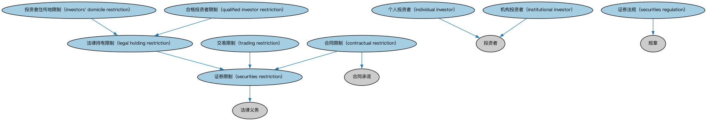

# 证券限制本体（Securities Restrictions Ontology）结构与公理说明

本文档对应 `SecuritiesRestrictions.rdf` / `SecuritiesRestrictions.ttl`，说明该本体的类、继承关系、属性和公理约定。结构图见 `SecuritiesRestrictions-structure.png`（`SecuritiesRestrictions-structure.svg` 为可缩放版本）。

## 1. 本体概述

定义证券发行与转让限制的通用概念：锁定期、合格投资者限制、转售限制。

**在体系中的位置**：SEC 证券模块的合规基础本体，欧盟与美国限制本体都继承它。

**上下游关系**：上游依赖证券与 FND 法律本体；下游被 EU、US 区域限制本体特化。

**与相近概念的差别**：限制≠禁令——限制是条件性的（满足条件即可交易），禁令是完全禁止；限制的来源可以是法律（法定）也可以是合同（约定）。

## 2. 类（Class）

| 类（Class） | 定义（Definition） |
|---|---|
| 合同限制（contractual restriction） | 在工具本身条款中规定、对证券持有人或发行人施加限制的合同条款。 |
| 个人投资者（individual investor） | 作为自然人（而非组织）的投资者，从法律角度看可能是也可能不是合格投资者。 |
| 机构投资者（institutional investor） | 汇集资金购买证券、不动产和其他投资资产或发放贷款的投资者。 |
| 投资者住所地限制（investors' domicile restriction） | 规定证券持有人住所地要求的法律持有限制。 |
| 法律持有限制（legal holding restriction） | 适用于持有证券的证券限制。 |
| 合格投资者限制（qualified investor restriction） | 为特定目的定义合格投资者概念、并规定仅合格投资者可持有该证券的法律持有限制。 |
| 证券法规（securities regulation） | 在法律中成文化、专门针对证券和投资的法规。 |
| 证券限制（securities restriction） | 依法律或合同规定、适用于金融工具或挂牌的法定义务。 |
| 交易限制（trading restriction） | 以某种方式限制交易的限制，通常概述于条款清单或其他文件中，包括但不限于转让限制。 |

### 2.1 继承关系（Inheritance）

- 合同限制（contractual restriction） ⊑ 合同承诺
- 合同限制（contractual restriction） ⊑ 证券限制（securities restriction）
- 个人投资者（individual investor） ⊑ 投资者
- 机构投资者（institutional investor） ⊑ 投资者
- 投资者住所地限制（investors' domicile restriction） ⊑ 法律持有限制（legal holding restriction）
- 法律持有限制（legal holding restriction） ⊑ 证券限制（securities restriction）
- 合格投资者限制（qualified investor restriction） ⊑ 法律持有限制（legal holding restriction）
- 证券法规（securities regulation） ⊑ 规章
- 证券限制（securities restriction） ⊑ 法律义务
- 交易限制（trading restriction） ⊑ 证券限制（securities restriction）

## 3. 对象属性（Object Property）

| 属性（Property） | 中文（English） | 定义（Definition） | 说明 |
|---|---|---|---|
| fibo-sec-sec-rst:hasHoldingPeriod | 具有持有期（has holding period） | 标识适用于某一金融资产的持有期。 | 值域（range）：日期区间；子属性（subPropertyOf）：具有日期区间 |
| fibo-sec-sec-rst:hasRestriction | 具有限制（has restriction） | 标识适用于给定金融工具或挂牌的限制。 | 值域（range）：证券限制（securities restriction）；子属性（subPropertyOf）：规定 |

## 5. 公理约定（Axioms）

- 合同限制（contractual restriction）：由……授权要求 only 合同
- 个人投资者（individual investor）：由…扮演（is played by） only 具有法律行为能力的自然人
- 机构投资者（institutional investor）：由…扮演（is played by） only 法律实体
- 机构投资者（institutional investor） 与 个人投资者（individual investor） 互斥（disjointWith）
- 合格投资者限制（qualified investor restriction）：具有持有期（has holding period） only 日期区间
- 证券法规（securities regulation）：定义 only 证券限制（securities restriction）
- 证券法规（securities regulation）：由……授予 some 成文法
- 证券限制（securities restriction）：适用于 only N17b8b2a9eb584048a2f2c9ab169c58dc
- 证券限制（securities restriction）：由……授权要求 only N5cb0883e1feb468fac8e7316c7395f89

## 6. 依赖（owl:imports，16 个）

本本体通过 `owl:imports` 引入以下本体，各项的中文名称与简介如下：

| 导入本体 | 中文名称 | 简介 |
|---|---|---|
| `BE/LegalEntities/LegalPersons.rdf` | 法律主体本体（Legal Persons Ontology） | 定义法律主体（legal person）与法定实体（legal entity）的核心概念：能持有权利义务、可起诉与被诉的主体。 |
| `BE/OwnershipAndControl/OwnershipParties.rdf` | 所有权方本体（Ownership Parties Ontology） | 定义所有权关系中的各方角色：所有者、受益所有人、名义持有人等。 |
| `FBC/FinancialInstruments/FinancialInstruments.rdf` | 金融工具本体（Financial Instruments Ontology） | FIBO 核心本体之一，定义金融工具（financial instrument）的通用概念：可交易、代表某种权利义务的合同工具，是证券、衍生品等具体工具的共同基础。 |
| `FND/Agreements/Contracts.rdf` | 合同本体（Contracts Ontology） | 在协议之上定义具有法律约束力的合同（contract）：合同当事方、合同条款、义务与权利，是金融工具与交易合同建模的基石。 |
| `FND/Law/LegalCapacity.rdf` | 法律能力本体（Legal Capacity Ontology） | 定义法律能力、缔约能力、签章权等概念，刻画主体从事法律行为的资格。 |
| `FND/Law/LegalCore.rdf` | 法律核心本体（Legal Core Ontology） | 定义法域（jurisdiction）、法律、法规等核心法律概念，为监管主体与适用法律建模。 |
| `FND/Relations/Relations.rdf` | 关系本体（Relations Ontology） | FIBO 最底层的基础本体，定义参考（reference）、分类（classify）等通用关系与抽象概念，全库普遍依赖。 |
| `FND/Utilities/AnnotationVocabulary.rdf` | FIBO 标注词汇表（FIBO Annotation Vocabulary） | 定义 FIBO 专用的标注属性（如释义来源、成熟度等级），用于本体自身的元数据标注。 |
| `SEC/Securities/SecuritiesListings.rdf` | 证券上市本体（Securities Listings Ontology） | 定义证券在交易所上市（listing）及其上市状态。 |
| `https://www.omg.org/spec/Commons/AnnotationVocabulary/` | OMG 通用标注词汇表（OMG Commons Annotation Vocabulary） | OMG 通用本体库（Commons）中的标注词汇表，提供概念映射等标注属性，FIBO 用它标注术语与外部标准的对应关系。 |
| `https://www.omg.org/spec/Commons/ContextualDesignators/` | OMG 通用语境指称本体（OMG Commons Contextual Designators） | Commons 库中的语境指称本体，定义「在某个语境下指代某物的名称/符号」，是地址、账户号码等语境相关标识的基础。 |
| `https://www.omg.org/spec/Commons/DatesAndTimes/` | OMG 通用日期与时间本体（OMG Commons Dates and Times） | Commons 库中的日期时间本体，定义日期、期间、时间点等通用时间概念。 |
| `https://www.omg.org/spec/Commons/Designators/` | OMG 通用指称符本体（OMG Commons Designators） | Commons 库中的指称符本体，定义名称、标识符等「指代某物的符号」的通用概念。 |
| `https://www.omg.org/spec/Commons/Documents/` | OMG 通用文档本体（OMG Commons Documents） | Commons 库中的文档本体，定义文档及其组成部分的通用概念。 |
| `https://www.omg.org/spec/Commons/Organizations/` | OMG 通用组织本体（OMG Commons Organizations） | Commons 库中的组织本体，定义组织、组织成员与组织结构的通用概念。 |
| `https://www.omg.org/spec/Commons/RolesAndCompositions/` | OMG 通用角色与构成本体（OMG Commons Roles and Compositions） | Commons 库中的角色本体，定义角色及整体—部分构成关系的通用概念。 |

## 7. 文件

- 官方 RDF/XML：`SecuritiesRestrictions.rdf`
- 中文 Turtle：`SecuritiesRestrictions.ttl`
- 结构图：`SecuritiesRestrictions-structure.png` / `SecuritiesRestrictions-structure.svg`