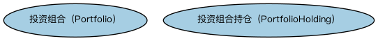

# 证券资产本体（Security Assets Ontology）结构与公理说明

本文档对应 `SecurityAssets.rdf` / `SecurityAssets.ttl`，说明该本体的类、继承关系、属性和公理约定。结构图见 `SecurityAssets-structure.png`（`SecurityAssets-structure.svg` 为可缩放版本）。

## 1. 本体概述

定义作为资产持有的证券：证券在投资组合语境下的资产属性（持仓、市值、资产类别）。

**在体系中的位置**：SEC 证券模块中连接「证券」与「资产管理」视角的本体。

**上下游关系**：上游依赖证券与 FND 所有权、货币金额本体；下游服务持仓、估值与绩效分析建模。

**与相近概念的差别**：证券≠证券资产——证券是工具本身的定义（条款），证券资产是「某人持有的若干单位该证券」这一持仓事实；同一只债券作为发行条款和作为持仓是两个视角。

## 2. 类（Class）

| 类（Class） | 定义（Definition） |
|---|---|
| 投资组合（Portfolio） | 由投资者或机构持有的一组金融资产。 |
| 投资组合持仓（PortfolioHolding） | 投资组合中持有的某一项资产。 |

### 2.1 继承关系（Inheritance）

## 3. 对象属性（Object Property）

| 属性（Property） | 中文（English） | 定义（Definition） | 说明 |
|---|---|---|---|
| fibo-sec-sec-ast:hasAcquisitionPrice | 具有取得价格（hasAcquisitionPrice） | 指明取得某一持仓时的价格。 | — |

## 6. 依赖（owl:imports，3 个）

本本体通过 `owl:imports` 引入以下本体，各项的中文名称与简介如下：

| 导入本体 | 中文名称 | 简介 |
|---|---|---|
| `FND/OwnershipAndControl/Ownership.rdf` | 所有权本体（Ownership Ontology） | 定义「拥有」关系：所有者、被拥有资产及所有权份额。 |
| `FND/Utilities/AnnotationVocabulary.rdf` | FIBO 标注词汇表（FIBO Annotation Vocabulary） | 定义 FIBO 专用的标注属性（如释义来源、成熟度等级），用于本体自身的元数据标注。 |
| `https://www.omg.org/spec/Commons/AnnotationVocabulary/` | OMG 通用标注词汇表（OMG Commons Annotation Vocabulary） | OMG 通用本体库（Commons）中的标注词汇表，提供概念映射等标注属性，FIBO 用它标注术语与外部标准的对应关系。 |

## 7. 文件

- 官方 RDF/XML：`SecurityAssets.rdf`
- 中文 Turtle：`SecurityAssets.ttl`
- 结构图：`SecurityAssets-structure.png` / `SecurityAssets-structure.svg`