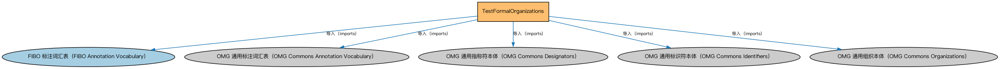

# TestFormalOrganizations说明

本文档对应 `TestFormalOrganizations.rdf` / `TestFormalOrganizations.ttl`。

## 1. 本文件是什么

从机制上说，这是一个个体（individuals）文件：它本身不定义任何新的类或属性，装的全是命名个体（owl:NamedIndividual）——也就是一条条真实存在的实例数据（如具体的货币、市场、监管机构、法域）。它的 `owl:imports` 引入的是这些个体所属的类定义所在的本体。应用需要实例级参考数据时加载这类文件。

## 2. 个体构成（共 28 个）

按个体所属类型统计（类型名为中文（English）对照）：

| 类型（Class） | 个体数量 |
|---|---|
| 正式组织（FormalOrganization） | 14 |
| 标识符（Identifier） | 14 |

个体数量较多，仅举前 10 个示例，完整清单见同名 `.ttl` 文件：

| 个体（示例） | 类型 |
|---|---|
| AtlasBank | 正式组织（FormalOrganization） |
| AtlasBankIdentifier | 标识符（Identifier） |
| BigBank | 正式组织（FormalOrganization） |
| BigBankIdentifier | 标识符（Identifier） |
| CaliforniaBank | 正式组织（FormalOrganization） |
| CaliforniaBankIdentifier | 标识符（Identifier） |
| FrankfurtBank | 正式组织（FormalOrganization） |
| FrankfurtBankIdentifier | 标识符（Identifier） |
| GlobalBank | 正式组织（FormalOrganization） |
| GlobalbankIdentifier | 标识符（Identifier） |

## 3. 依赖的本体（owl:imports，5 个）

以下导入提供个体所属的类定义与相关参考数据：

| 导入本体 | 中文名称 | 简介 |
|---|---|---|
| `FND/Utilities/AnnotationVocabulary.rdf` | FIBO 标注词汇表（FIBO Annotation Vocabulary） | 定义 FIBO 专用的标注属性（如释义来源、成熟度等级），用于本体自身的元数据标注。 |
| `https://www.omg.org/spec/Commons/AnnotationVocabulary/` | OMG 通用标注词汇表（OMG Commons Annotation Vocabulary） | OMG 通用本体库（Commons）中的标注词汇表，提供概念映射等标注属性，FIBO 用它标注术语与外部标准的对应关系。 |
| `https://www.omg.org/spec/Commons/Designators/` | OMG 通用指称符本体（OMG Commons Designators） | Commons 库中的指称符本体，定义名称、标识符等「指代某物的符号」的通用概念。 |
| `https://www.omg.org/spec/Commons/Identifiers/` | OMG 通用标识符本体（OMG Commons Identifiers） | Commons 库中的标识符本体，定义标识符及其编码方案的通用概念。 |
| `https://www.omg.org/spec/Commons/Organizations/` | OMG 通用组织本体（OMG Commons Organizations） | Commons 库中的组织本体，定义组织、组织成员与组织结构的通用概念。 |

## 4. 文件

- 官方 RDF/XML：`TestFormalOrganizations.rdf`
- 中文 Turtle：`TestFormalOrganizations.ttl`
- 结构图：`TestFormalOrganizations-structure.png` / `TestFormalOrganizations-structure.svg`