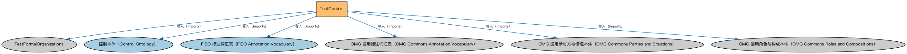

# TestControl说明

本文档对应 `TestControl.rdf` / `TestControl.ttl`。

## 1. 本文件是什么

从机制上说，这是一个个体（individuals）文件：它本身不定义任何新的类或属性，装的全是命名个体（owl:NamedIndividual）——也就是一条条真实存在的实例数据（如具体的货币、市场、监管机构、法域）。它的 `owl:imports` 引入的是这些个体所属的类定义所在的本体。应用需要实例级参考数据时加载这类文件。

## 2. 个体构成（共 6 个）

按个体所属类型统计（类型名为中文（English）对照）：

| 类型（Class） | 个体数量 |
|---|---|
| 参与方角色（party role）（PartyRole） | 4 |
| 控制（Control） | 2 |

个体数量较少，全部列出：

| 个体 | 类型 |
|---|---|
| AssociativeControlRelation | 控制（Control） |
| BigBankControlsGoodBankPIR | 参与方角色（party role）（PartyRole） |
| CaliforniaBankPartyInRole | 参与方角色（party role）（PartyRole） |
| GoodBankControlledByBigBankPIR | 参与方角色（party role）（PartyRole） |
| LatticeControlRelation | 控制（Control） |
| SecuritiesIncPartyInRole | 参与方角色（party role）（PartyRole） |

## 3. 依赖的本体（owl:imports，6 个）

以下导入提供个体所属的类定义与相关参考数据：

| 导入本体 | 中文名称 | 简介 |
|---|---|---|
| `FND/Organizations/TestFormalOrganizations` | TestFormalOrganizations | FIBO 上游声明引用，但本版本仓库未包含对应文件。 |
| `FND/OwnershipAndControl/Control.rdf` | 控制本体（Control Ontology） | 定义「控制」关系：控制方、被控制方与控制程度，用于公司治理与合并报表判断。 |
| `FND/Utilities/AnnotationVocabulary.rdf` | FIBO 标注词汇表（FIBO Annotation Vocabulary） | 定义 FIBO 专用的标注属性（如释义来源、成熟度等级），用于本体自身的元数据标注。 |
| `https://www.omg.org/spec/Commons/AnnotationVocabulary/` | OMG 通用标注词汇表（OMG Commons Annotation Vocabulary） | OMG 通用本体库（Commons）中的标注词汇表，提供概念映射等标注属性，FIBO 用它标注术语与外部标准的对应关系。 |
| `https://www.omg.org/spec/Commons/PartiesAndSituations/` | OMG 通用参与方与情境本体（OMG Commons Parties and Situations） | Commons 库中的参与方本体，定义独立主体、参与方及其角色扮演的通用概念，是 FIBO 参与方模型的上游。 |
| `https://www.omg.org/spec/Commons/RolesAndCompositions/` | OMG 通用角色与构成本体（OMG Commons Roles and Compositions） | Commons 库中的角色本体，定义角色及整体—部分构成关系的通用概念。 |

## 4. 文件

- 官方 RDF/XML：`TestControl.rdf`
- 中文 Turtle：`TestControl.ttl`
- 结构图：`TestControl-structure.png` / `TestControl-structure.svg`