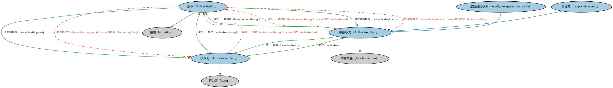

# Commons 业务授权本体（Commons Business Authorizations Ontology）结构与公理说明

本文档对应 `BusinessAuthorizations.rdf` / `BusinessAuthorizations.ttl`，说明该本体的类、继承关系、属性和公理约定。结构图见 `BusinessAuthorizations-structure.png`（`BusinessAuthorizations-structure.svg` 为可缩放版本）。

## 1. 本体概述

定义业务授权（business authorization）、许可（license）及其相关角色：谁授予谁、在什么范围内、做什么事的权限。

**在体系中的位置**：Commons 中处理「权限」的模块，处于参与方与组织概念之上。

**上下游关系**：上游依赖参与方与情境、组织、角色与构成、语境指称等模块；下游被登记主管机构、监管机构模块引用（发照、核准都是授权行为）。

**与相近概念的差别**：授权≠法律能力——授权是「某个组织授予的具体权限」（如营业执照），法律能力（FND/Law）是「主体有没有资格」的抽象属性。

本本体中类与类的核心关系如下（完整细节见各类小节）：

- **授权（Authorization）** 继承 **情境（situation）**
- **被授权方（AuthorizedParty）** 继承 **功能角色（functional role）**
- **授权方（AuthorizingParty）** 继承 **行为者（actor）**
- **法定受托权限（legally delegated authority）** 继承 **被授权方（AuthorizedParty）**
- **责任方（responsible party）** 继承 **被授权方（AuthorizedParty）**
- **授权方（AuthorizingParty）** 通过 **授权（authorizes）** 关联 **被授权方（AuthorizedParty）**
- **授权方（AuthorizingParty）** 通过 **通过……授权（authorizes through）** 关联 **授权（Authorization）**
- **授权（Authorization）** 通过 **具有被授权方（has authorized party）** 关联 **被授权方（AuthorizedParty）**
- **授权（Authorization）** 通过 **具有授权方（has authorizing party）** 关联 **授权方（AuthorizingParty）**
- **被授权方（AuthorizedParty）** 通过 **由……授权（is authorized by）** 关联 **授权方（AuthorizingParty）**
- **被授权方（AuthorizedParty）** 通过 **通过……被授权（is authorized through）** 关联 **授权（Authorization）**

## 2. 类（Class）

| 类（Class） | 定义（Definition） |
|---|---|
| 授权（Authorization） | 一方授权他人在特定条件下、特定时期内代表其行事或具备特定能力的情形。 |
| 被授权方（AuthorizedParty） | 在一定规则下、一定时期内被赋予代表他方行事能力或特定能力的参与方。 |
| 授权方（AuthorizingParty） | 将某个角色、权限或控制权委托给他方的参与方。 |
| 法定受托权限（legally delegated authority） | 被赋予一定法律控制权及相应责任的被授权方。 |
| 责任方（responsible party） | 以某种角色承担正式责任的法律主体。 |

以下按类逐个展开：每个类给出继承关系、相关属性与公理约定；子类在父类之下降一级编号。

### 2.1 授权（Authorization）

定义：一方授权他人在特定条件下、特定时期内代表其行事或具备特定能力的情形。

- 父类：**情境（situation）**

属性：

| 属性 | 定义 | 说明 |
|---|---|---|
| **具有被授权方（has authorized party）** | 标识在该情形中被认可、使能、赋权或许可行事的参与方（角色）。 | 值域：被授权方（AuthorizedParty）；子属性：具有承受者（has undergoer） |
| **具有被授权人（has authorizee）** | 标识在该情形中被认可、使能、赋权或许可行事的法律主体。 | 值域：法律主体；子属性：被…经历（is experienced by） |
| **具有授权方（has authorizing party）** | 标识在该情形中给予认可、使能、赋权或许可的参与方（角色）。 | 值域：授权方（AuthorizingParty）；子属性：具有行为者（has actor） |
| **具有授权人（has authorizor）** | 标识在该情形中给予认可、使能、赋权或许可的法律主体。 | 值域：法律主体；子属性：具有主动参与方（has active party） |

公理：

- **具有授权方（has authorizing party）**至少有一个取值，类型是**授权方（AuthorizingParty）**。
- **具有被授权方（has authorized party）**至少有一个取值，类型是**被授权方（AuthorizedParty）**。

### 2.2 被授权方（AuthorizedParty）

定义：在一定规则下、一定时期内被赋予代表他方行事能力或特定能力的参与方。

- 父类：**功能角色（functional role）**
- 直接子类：**法定受托权限（legally delegated authority）**、**责任方（responsible party）**

属性：

| 属性 | 定义 | 说明 |
|---|---|---|
| **由……授权（is authorized by）** | 由……认可、使能、赋权或许可。 | 值域：授权方（AuthorizingParty）；子属性：受…影响（is affected by） |
| **通过……被授权（is authorized through）** | 标识促成被授权方为某目的获得认可的情形。 | 值域：授权（Authorization）；逆属性：具有被授权方（has authorized party）；子属性：承受（undergoes） |
| **由…扮演（is played by）** | — | — |

公理：

- **由…扮演（is played by）**至少有一个取值，类型是**法律主体（LegalPerson）**。
- **通过……被授权（is authorized through）**至少有一个取值，类型是**授权（Authorization）**。

#### 2.2.1 法定受托权限（legally delegated authority）

定义：被赋予一定法律控制权及相应责任的被授权方。

- 父类：**被授权方（AuthorizedParty）**

属性：

| 属性 | 定义 | 说明 |
|---|---|---|
| **受托控制（has delegated control of）** | 标识通过委托而被控制的某事物或某参与方。 | — |

#### 2.2.2 责任方（responsible party）

定义：以某种角色承担正式责任的法律主体。

- 父类：**被授权方（AuthorizedParty）**

### 2.3 授权方（AuthorizingParty）

定义：将某个角色、权限或控制权委托给他方的参与方。

- 父类：**行为者（actor）**

属性：

| 属性 | 定义 | 说明 |
|---|---|---|
| **授权（authorizes）** | 认可、使能、赋权或给予许可。 | 值域：被授权方（AuthorizedParty）；逆属性：由……授权（is authorized by）；子属性：对…采取行动（acts on） |
| **直接授权（authorizes directly）** | 直接认可、使能、赋权或给予许可。 | 值域：法律主体；逆属性：由……直接授权（is directly authorized by）；子属性：直接影响（directly affects） |
| **通过……授权（authorizes through）** | 标识促成授权方为某目的指定被授权方的情形。 | 值域：授权（Authorization）；逆属性：具有授权方（has authorizing party）；子属性：在…中行动（acts in） |
| **由…扮演（is played by）** | — | — |

公理：

- **由…扮演（is played by）**至少有一个取值，类型是**法律主体（LegalPerson）**。
- **通过……授权（authorizes through）**至少有一个取值，类型是**授权（Authorization）**。

## 3. 其他属性

以下属性未绑定到本体的具体类（定义域在外部本体或未声明）：

对象属性（Object Property）：

| 属性 | 定义 | 说明 |
|---|---|---|
| **将控制权委托给（delegates control to）** | 标识授权方已将某些权限或控制权委托给的参与方。 | 值域：法定受托权限（legally delegated authority）；子属性：授权（authorizes） |
| **具有授权（has authorization）** | 将某事物关联到在特定情境下适用于它的授权。 | 值域：授权（Authorization）；子属性：适用于情境 |
| **具有责任方（has responsible party）** | 标识对某情形或组织负有任务、承诺或义务的参与方。 | 值域：责任方（responsible party）；子属性：具有参与方角色（has party role） |
| **在……中为被授权人（is authorizee in）** | 标识促成法律主体被指定为被授权方的情形。 | 值域：授权（Authorization）；逆属性：具有被授权人（has authorizee）；子属性：经历（experiences） |
| **在……中为授权人（is authorizor in）** | 标识促成法律主体指定被授权方的情形。 | 值域：授权（Authorization）；逆属性：具有授权人（has authorizor）；子属性：在…中扮演主动角色（plays active role in） |
| **由……直接授权（is directly authorized by）** | 由……直接认可、使能、赋权或许可。 | 值域：授权方（AuthorizingParty）；子属性：直接受…影响（is directly affected by） |

## 4. 依赖（owl:imports，5 个）

本本体通过 `owl:imports` 引入以下本体，各项的中文名称与简介如下：

| 导入本体 | 中文名称 | 简介 |
|---|---|---|
| `AnnotationVocabulary/AnnotationVocabulary.rdf` | Commons 标注词汇表（Commons Annotation Vocabulary） | 提供文档标注常用的属性，如摘要、定义、解释、版权、同义词等，并梳理 SKOS 与 Dublin Core 标注属性之间的关系。 |
| `ContextualDesignators/ContextualDesignators.rdf` | Commons 上下文指称本体（Commons Contextual Designators Ontology） | 定义在特定上下文中有意义的指称、名称和标识符。 |
| `Organizations/Organizations.rdf` | Commons 组织本体（Commons Organizations Ontology） | 定义组织、组织单元及其标识和关系。 |
| `PartiesAndSituations/PartiesAndSituations.rdf` | Commons 参与方与情境本体（Commons Parties and Situations Ontology） | 定义参与方、角色、情境以及它们之间关系的高层概念，是 FIBO 等多领域的上层本体。 |
| `RolesAndCompositions/RolesAndCompositions.rdf` | Commons 角色与组合本体（Commons Roles and Compositions Ontology） | 定义角色、组合及其扮演/组成关系的基础本体。 |

## 5. 文件

- 官方 RDF/XML：`BusinessAuthorizations.rdf`
- 中文 Turtle：`BusinessAuthorizations.ttl`
- 结构图：`BusinessAuthorizations-structure.png` / `BusinessAuthorizations-structure.svg`