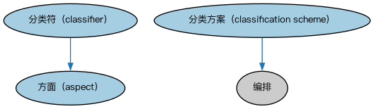

# Commons 分类器本体（Commons Classifiers Ontology）结构与公理说明

本文档对应 `Classifiers.rdf` / `Classifiers.ttl`，说明该本体的类、继承关系、属性和公理约定。结构图见 `Classifiers-structure.png`（`Classifiers-structure.svg` 为可缩放版本）。

## 1. 本体概述

定义分类器（classifier）、分类方案（classification scheme）与归类关系：把事物按某种体系归入类别的通用机制。

**在体系中的位置**：Commons 的基础构件模块之一，为一切「按类别组织事物」的场景提供模型。

**上下游关系**：上游依赖集合、指称符模块；下游被量与单位、地点、组织、结构化集合等模块引用。

**与相近概念的差别**：分类器≠标识符——分类器把事物归入「一类」（如「商业银行」这个类别），标识符唯一指向「一个」事物；与本体的类（Class）的差别——分类方案是业务数据层面的分类体系，不是逻辑类定义。

本本体中类与类的核心关系如下（完整细节见各类小节）：

- **分类方案（classification scheme）** 继承 **编排（Arrangement）**
- **分类符（classifier）** 继承 **方面（aspect）**

## 2. 类（Class）

| 类（Class） | 定义（Definition） |
|---|---|
| 方面（aspect） | 可用于对一类、一集合事物进行维度化、过滤或划分子集的特征或特性。 characteristic or feature that can be used to dimensionalize, filter, or subset a class, collection, or set of things |
| 分类方案（classification scheme） | 为事物分配分类符的体系。 system for allocating classifiers to things |
| 分类符（classifier） | 在特定情境下、依据某种划分体系对事物的标准化分类或划定。 standardized classification or delineation for something, per some scheme for such delineation, within a specified context |

以下按类逐个展开：每个类给出继承关系、相关属性与公理约定；子类在父类之下降一级编号。

### 2.1 方面（aspect）

定义：可用于对一类、一集合事物进行维度化、过滤或划分子集的特征或特性。

- 直接子类：**分类符（classifier）**

属性：

| 属性 | 定义 | 说明 |
|---|---|---|
| **刻画（characterizes）** | 提供……的区分性特征或性质。 provides a discriminating feature or quality of | 子属性：描述 |

公理：

- **刻画（characterizes）**至少有 0 个取值。

#### 2.1.1 分类符（classifier）

定义：在特定情境下、依据某种划分体系对事物的标准化分类或划定。

- 父类：**方面（aspect）**

属性：

| 属性 | 定义 | 说明 |
|---|---|---|
| **分类（classifies）** | 按一个或多个共同特征将……归入类别。 arranges in categories according to one or more shared characteristics | 子属性：刻画（characterizes） |
| **定义于（isDefinedIn）** | — | — |

公理：

- **分类（classifies）**至少有 0 个取值。
- **定义于（isDefinedIn）**的所有取值只能是**分类方案（classification scheme）**。

### 2.2 分类方案（classification scheme）

定义：为事物分配分类符的体系。

- 父类：**编排（Arrangement）**

属性：

| 属性 | 定义 | 说明 |
|---|---|---|
| **互斥（is exclusive）** | 表明该方案中的分类符两两不相交，一个事物只能用一个分类符分类。 indicates that the classifiers in the scheme are all disjoint and that only one classifier may be used to classify something | 值域：xsd:boolean |

## 3. 其他属性

以下属性未绑定到本体的具体类（定义域在外部本体或未声明）：

对象属性（Object Property）：

| 属性 | 定义 | 说明 |
|---|---|---|
| **以……为特征（is characterized by）** | 标识某事物区别于他物的性质或特征。 indicates a quality or feature of something, distinguishing it from something else | 逆属性：刻画（characterizes）；子属性：由……描述 |
| **由……分类（is classified by）** | 由……基于特征进行系统化归类。 is systematically grouped based on characteristics by | 逆属性：分类（classifies）；子属性：以……为特征（is characterized by） |

## 4. 依赖（owl:imports，3 个）

本本体通过 `owl:imports` 引入以下本体，各项的中文名称与简介如下：

| 导入本体 | 中文名称 | 简介 |
|---|---|---|
| `AnnotationVocabulary/AnnotationVocabulary.rdf` | Commons 标注词汇表（Commons Annotation Vocabulary） | 提供文档标注常用的属性，如摘要、定义、解释、版权、同义词等，并梳理 SKOS 与 Dublin Core 标注属性之间的关系。 |
| `Collections/Collections.rdf` | Commons 集合本体（Commons Collections Ontology） | 定义集合、成员关系及集合操作的基础概念。 |
| `Designators/Designators.rdf` | Commons 指称本体（Commons Designators Ontology） | 定义名称、标识符等指称事物的通用概念。 |

## 5. 文件

- 官方 RDF/XML：`Classifiers.rdf`
- 中文 Turtle：`Classifiers.ttl`
- 结构图：`Classifiers-structure.png` / `Classifiers-structure.svg`