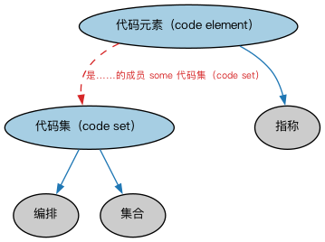

# Commons 代码与代码集本体（Commons Codes and Code Sets Ontology）结构与公理说明

本文档对应 `CodesAndCodeSets.rdf` / `CodesAndCodeSets.ttl`，说明该本体的类、继承关系、属性和公理约定。结构图见 `CodesAndCodeSets-structure.png`（`CodesAndCodeSets-structure.svg` 为可缩放版本）。

## 1. 本体概述

定义代码（code）与代码集（code set）：一套受控的编码及其维护方，如国家代码、货币代码这类编码体系的通用模型。

**在体系中的位置**：Commons 的基础构件模块，是 ISO 系列标准代码（LCC 国家代码、ISO 4217 货币代码）的类定义来源。

**上下游关系**：上游依赖集合、指称符模块；下游被语境标识符、语言、地点模块及 LCC 代码库引用。

**与相近概念的差别**：代码集≠分类方案——代码集是「标准取值的清单」（如 USD、CNY），分类方案是「归类的规则体系」；代码是编码方案中的单个取值。

本本体中类与类的核心关系如下（完整细节见各类小节）：

- **代码元素（code element）** 继承 **指称（Designation）**
- **代码集（code set）** 继承 **编排（Arrangement）**
- **代码集（code set）** 继承 **集合（Collection）**

## 2. 类（Class）

| 类（Class） | 定义（Definition） |
|---|---|
| 代码元素（code element） | 在特定情境下按某种规则集为某目的表示某事物的字符序列。 |
| 代码集（code set） | 在某情境中代表特定值的字母数字符号或其组合的体系。 |

以下按类逐个展开：每个类给出继承关系、相关属性与公理约定；子类在父类之下降一级编号。

### 2.1 代码元素（code element）

定义：在特定情境下按某种规则集为某目的表示某事物的字符序列。

- 父类：**指称（Designation）**

属性：

| 属性 | 定义 | 说明 |
|---|---|---|
| **是……的成员（isMemberOf）** | — | — |

公理：

- **是……的成员（isMemberOf）**至少有一个取值，类型是**代码集（code set）**。

### 2.2 代码集（code set）

定义：在某情境中代表特定值的字母数字符号或其组合的体系。

- 父类：**编排（Arrangement）**、**集合（Collection）**

属性：

| 属性 | 定义 | 说明 |
|---|---|---|
| **具有成员（hasMember）** | — | — |

公理：

- **具有成员（hasMember）**的所有取值只能是**代码元素（code element）**。

## 3. 依赖（owl:imports，3 个）

本本体通过 `owl:imports` 引入以下本体，各项的中文名称与简介如下：

| 导入本体 | 中文名称 | 简介 |
|---|---|---|
| `AnnotationVocabulary/AnnotationVocabulary.rdf` | Commons 标注词汇表（Commons Annotation Vocabulary） | 提供文档标注常用的属性，如摘要、定义、解释、版权、同义词等，并梳理 SKOS 与 Dublin Core 标注属性之间的关系。 |
| `Collections/Collections.rdf` | Commons 集合本体（Commons Collections Ontology） | 定义集合、成员关系及集合操作的基础概念。 |
| `Designators/Designators.rdf` | Commons 指称本体（Commons Designators Ontology） | 定义名称、标识符等指称事物的通用概念。 |

## 4. 文件

- 官方 RDF/XML：`CodesAndCodeSets.rdf`
- 中文 Turtle：`CodesAndCodeSets.ttl`
- 结构图：`CodesAndCodeSets-structure.png` / `CodesAndCodeSets-structure.svg`