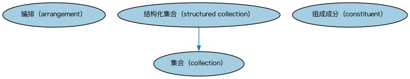

# Commons 集合本体（Commons Collections Ontology）结构与公理说明

本文档对应 `Collections.rdf` / `Collections.ttl`，说明该本体的类、继承关系、属性和公理约定。结构图见 `Collections-structure.png`（`Collections-structure.svg` 为可缩放版本）。

## 1. 本体概述

定义集合（collection）与成员关系的最基础概念：把若干事物当作一个整体对待。

**在体系中的位置**：Commons 最底层的构件之一，被分类、代码、标识、参与方等模块广泛依赖。

**上下游关系**：上游仅依赖标注词汇表与文本数据类型；下游被全库大多数模块引用。

**与相近概念的差别**：集合≠结构化集合——本模块只有「集合＋成员」，结构化集合（StructuredCollections）进一步定义序列、层次等有内部结构的集合。

本本体中类与类的核心关系如下（完整细节见各类小节）：

- **结构化集合（structured collection）** 继承 **集合（collection）**

## 2. 类（Class）

| 类（Class） | 定义（Definition） |
|---|---|
| 编排（arrangement） | 制作、执行、实现或组织某事物的系统性计划、方式或方法。 |
| 集合（collection） | 具有某种共同意义的事物的分组（可为零个）。 |
| 组成成分（constituent） | 集合或事物组合中的组成部分。 |
| 结构化集合（structured collection） | 具有明确定义的结构或组织的集合。 |

以下按类逐个展开：每个类给出继承关系、相关属性与公理约定；子类在父类之下降一级编号。

### 2.1 编排（arrangement）

定义：制作、执行、实现或组织某事物的系统性计划、方式或方法。

属性：

| 属性 | 定义 | 说明 |
|---|---|---|
| **具有方法（has method）** | 提供完成某事所用途径或方法的文本描述。 | 子属性：具有文本值 |

公理：

- **具有方法（has method）**至少有 0 个取值。

### 2.2 集合（collection）

定义：具有某种共同意义的事物的分组（可为零个）。

- 直接子类：**结构化集合（structured collection）**

#### 2.2.1 结构化集合（structured collection）

定义：具有明确定义的结构或组织的集合。

- 父类：**集合（collection）**

属性：

| 属性 | 定义 | 说明 |
|---|---|---|
| **具有编排（has arrangement）** | 按……组织或构造。 | 值域：编排（arrangement） |

公理：

- **具有编排（has arrangement）**的所有取值只能是**编排（arrangement）**。

### 2.3 组成成分（constituent）

定义：集合或事物组合中的组成部分。

## 3. 其他属性

以下属性未绑定到本体的具体类（定义域在外部本体或未声明）：

对象属性（Object Property）：

| 属性 | 定义 | 说明 |
|---|---|---|
| **遵从（complies with）** | 遵守……中规定的政策或规则。 | 值域：编排（arrangement）；子属性：具有编排（has arrangement） |
| **包含（comprises）** | 尤其在特定范围内包括、由……组成或含有。 | — |
| **具有组成成分（has constituent）** | 由……组成或含有。 | 子属性：包含（comprises） |
| **具有直接部分（has direct part）** | 标识某事物的直接「子」部分。 | 子属性：具有部分（has part） |
| **具有成员（has member）** | 将……作为离散元素包含。 | 子属性：包含（comprises） |
| **具有部分（has part）** | 标识某事物的任意部分，无论该部分是否与整体相连、是否认知显著或任意划定。 | — |
| **是……的组成成分（is constituent of）** | 是其他事物的组成部分。 | 逆属性：具有组成成分（has constituent）；子属性：被包含于（is included in） |
| **是……的直接部分（is direct part of）** | 标识该部分的直接「父」整体。 | 逆属性：具有直接部分（has direct part）；子属性：是……的部分（is part of） |
| **被包含于（is included in）** | 被包含于……或是……的元素。 | 逆属性：包含（comprises） |
| **是……的成员（is member of）** | 是……的离散元素。 | 逆属性：具有成员（has member）；子属性：被包含于（is included in） |
| **是……的部分（is part of）** | 将某事物关联到它作为组成部分或部分的另一事物，无论整体-部分关系如何体现。 | 逆属性：具有部分（has part） |

## 4. 依赖（owl:imports，2 个）

本本体通过 `owl:imports` 引入以下本体，各项的中文名称与简介如下：

| 导入本体 | 中文名称 | 简介 |
|---|---|---|
| `AnnotationVocabulary/AnnotationVocabulary.rdf` | Commons 标注词汇表（Commons Annotation Vocabulary） | 提供文档标注常用的属性，如摘要、定义、解释、版权、同义词等，并梳理 SKOS 与 Dublin Core 标注属性之间的关系。 |
| `TextDatatype/TextDatatype.rdf` | Commons 文本数据类型本体（Commons Text Datatype Ontology） | 定义文本、字符串及其数据类型的基础概念。 |

## 5. 文件

- 官方 RDF/XML：`Collections.rdf`
- 中文 Turtle：`Collections.ttl`
- 结构图：`Collections-structure.png` / `Collections-structure.svg`