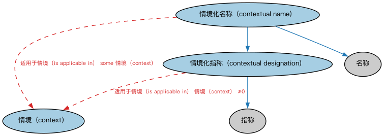

# Commons 上下文指称本体（Commons Contextual Designators Ontology）结构与公理说明

本文档对应 `ContextualDesignators.rdf` / `ContextualDesignators.ttl`，说明该本体的类、继承关系、属性和公理约定。结构图见 `ContextualDesignators-structure.png`（`ContextualDesignators-structure.svg` 为可缩放版本）。

## 1. 本体概述

定义语境指称（contextual designator）：在特定语境下指代某物的名称或符号，如「某人的法定姓名」「某地的邮政地址」都依赖语境。

**在体系中的位置**：Commons 的基础构件模块，是指称符（Designators）的语境化扩展。

**上下游关系**：上游依赖指称符、集合、日期模块；下游被语境标识符、参与方、组织、监管机构等模块引用。

**与相近概念的差别**：指称符≠语境指称——指称符是「名字指代事物」的一般概念，语境指称强调「在哪个语境下这个名字有效」；例如同一个人在不同法域可以有不同法定姓名。

本本体中类与类的核心关系如下（完整细节见各类小节）：

- **情境化指称（contextual designation）** 继承 **指称（Designation）**
- **情境化名称（contextual name）** 继承 **情境化指称（contextual designation）**
- **情境化名称（contextual name）** 继承 **名称（Name）**

## 2. 类（Class）

| 类（Class） | 定义（Definition） |
|---|---|
| 情境（context） | 某事物适用、存在、发生或被使用的情形或参照框架，有助于说明或解释该事物。 |
| 情境化指称（contextual designation） | 在某情境中适用于某事物的指称。 |
| 情境化名称（contextual name） | 某人、某地或某物在某情境中为人所知的指称。 |

以下按类逐个展开：每个类给出继承关系、相关属性与公理约定；子类在父类之下降一级编号。

### 2.1 情境（context）

定义：某事物适用、存在、发生或被使用的情形或参照框架，有助于说明或解释该事物。

### 2.2 情境化指称（contextual designation）

定义：在某情境中适用于某事物的指称。

- 父类：**指称（Designation）**
- 直接子类：**情境化名称（contextual name）**

属性：

| 属性 | 定义 | 说明 |
|---|---|---|
| **具有适用期间（has applicable period）** | 标识某事物可使用、适用、有效或准确相关的日期区间。 | 值域：日期区间；子属性：适用于情境（is applicable in） |
| **适用于情境（is applicable in）** | 标识某事物在其中具有相关性的情境。 | 逆属性：适用于（applies to） |

公理：

- **具有适用期间（has applicable period）**的所有取值只能是**日期区间（DatePeriod）**。
- **适用于情境（is applicable in）**可以有 0 个或多个**情境（context）**。

#### 2.2.1 情境化名称（contextual name）

定义：某人、某地或某物在某情境中为人所知的指称。

- 父类：**情境化指称（contextual designation）**、**名称（Name）**

属性：

| 属性 | 定义 | 说明 |
|---|---|---|
| **适用于情境（is applicable in）** | 标识某事物在其中具有相关性的情境。 | 逆属性：适用于（applies to） |

公理：

- **适用于情境（is applicable in）**至少有一个取值，类型是**情境（context）**。

## 3. 其他属性

以下属性未绑定到本体的具体类（定义域在外部本体或未声明）：

对象属性（Object Property）：

| 属性 | 定义 | 说明 |
|---|---|---|
| **适用于（applies to）** | 标识某情境与之相关、切题或适用的某事物。 | — |
| **被……使用（is used by）** | 为……发挥功能或用途。 | 逆属性：使用（uses） |
| **使用（uses）** | 运用……以完成某项任务或达成某个结果。 | — |

## 4. 依赖（owl:imports，4 个）

本本体通过 `owl:imports` 引入以下本体，各项的中文名称与简介如下：

| 导入本体 | 中文名称 | 简介 |
|---|---|---|
| `AnnotationVocabulary/AnnotationVocabulary.rdf` | Commons 标注词汇表（Commons Annotation Vocabulary） | 提供文档标注常用的属性，如摘要、定义、解释、版权、同义词等，并梳理 SKOS 与 Dublin Core 标注属性之间的关系。 |
| `Collections/Collections.rdf` | Commons 集合本体（Commons Collections Ontology） | 定义集合、成员关系及集合操作的基础概念。 |
| `DatesAndTimes/DatesAndTimes.rdf` | Commons 日期与时间本体（Commons Dates and Times Ontology） | 定义日期、时间、时间段及其表示方式。 |
| `Designators/Designators.rdf` | Commons 指称本体（Commons Designators Ontology） | 定义名称、标识符等指称事物的通用概念。 |

## 5. 文件

- 官方 RDF/XML：`ContextualDesignators.rdf`
- 中文 Turtle：`ContextualDesignators.ttl`
- 结构图：`ContextualDesignators-structure.png` / `ContextualDesignators-structure.svg`