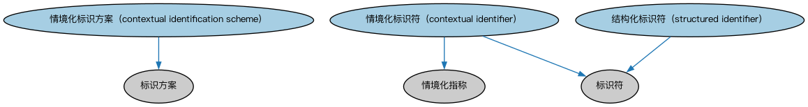

# Commons 上下文标识符本体（Commons Contextual Identifiers Ontology）结构与公理说明

本文档对应 `ContextualIdentifiers.rdf` / `ContextualIdentifiers.ttl`，说明该本体的类、继承关系、属性和公理约定。结构图见 `ContextualIdentifiers-structure.png`（`ContextualIdentifiers-structure.svg` 为可缩放版本）。

## 1. 本体概述

定义语境标识符（contextual identifier）：在特定语境（法域、机构、系统）内唯一标识事物的标识符，如税号、身份证号、账户号。

**在体系中的位置**：Commons 的基础构件模块，是标识符（Identifiers）的语境化扩展。

**上下游关系**：上游依赖标识符、代码与代码集、语境指称模块；下游被登记主管机构、场所与设施模块引用。

**与相近概念的差别**：语境标识符≠全局标识符——税号只在税务语境唯一，LEI 才是全局唯一；现实世界的标识大多带语境，这正是本模块存在的意义。

本本体中类与类的核心关系如下（完整细节见各类小节）：

- **情境化标识方案（contextual identification scheme）** 继承 **标识方案（IdentificationScheme）**
- **情境化标识符（contextual identifier）** 继承 **情境化指称（ContextualDesignation）**
- **情境化标识符（contextual identifier）** 继承 **标识符（Identifier）**
- **结构化标识符（structured identifier）** 继承 **标识符（Identifier）**

## 2. 类（Class）

| 类（Class） | 定义（Definition） |
|---|---|
| 情境化标识方案（contextual identification scheme） | 在一个或多个情境内适用的标识方案。 identification scheme that applies within one or more contexts |
| 情境化标识符（contextual identifier） | 在特定情境内唯一标识其所关联事物的字符序列。 sequence of characters uniquely identifying that with which it is associated, within a specified context |
| 结构化标识符（structured identifier） | 唯一标识其所关联事物的字符序列，其中包含其他代码或标识符，或由其他要素构造而成。 sequence of characters uniquely identifying that with which it is associated, that includes other codes or identifiers, or that is constructed from other notions |

以下按类逐个展开：每个类给出继承关系、相关属性与公理约定；子类在父类之下降一级编号。

### 2.1 情境化标识方案（contextual identification scheme）

定义：在一个或多个情境内适用的标识方案。

- 父类：**标识方案（IdentificationScheme）**

属性：

| 属性 | 定义 | 说明 |
|---|---|---|
| **适用于情境（isApplicableIn）** | — | — |

公理：

- **适用于情境（isApplicableIn）**至少有一个取值，类型是**情境（Context）**。

### 2.2 情境化标识符（contextual identifier）

定义：在特定情境内唯一标识其所关联事物的字符序列。

- 父类：**情境化指称（ContextualDesignation）**、**标识符（Identifier）**

属性：

| 属性 | 定义 | 说明 |
|---|---|---|
| **适用于情境（isApplicableIn）** | — | — |

公理：

- **适用于情境（isApplicableIn）**至少有一个取值，类型是**情境（Context）**。

### 2.3 结构化标识符（structured identifier）

定义：唯一标识其所关联事物的字符序列，其中包含其他代码或标识符，或由其他要素构造而成。

- 父类：**标识符（Identifier）**

属性：

| 属性 | 定义 | 说明 |
|---|---|---|
| **包含（comprises）** | — | — |

公理：

- **包含（comprises）**可以有 0 个或多个**代码元素（CodeElement）**。
- **包含（comprises）**可以有 0 个或多个**标识符（Identifier）**。

## 3. 依赖（owl:imports，5 个）

本本体通过 `owl:imports` 引入以下本体，各项的中文名称与简介如下：

| 导入本体 | 中文名称 | 简介 |
|---|---|---|
| `AnnotationVocabulary/AnnotationVocabulary.rdf` | Commons 标注词汇表（Commons Annotation Vocabulary） | 提供文档标注常用的属性，如摘要、定义、解释、版权、同义词等，并梳理 SKOS 与 Dublin Core 标注属性之间的关系。 |
| `CodesAndCodeSets/CodesAndCodeSets.rdf` | Commons 代码与代码集本体（Commons Codes and Code Sets Ontology） | 定义代码、代码集、编码方案及其标识方式。 |
| `Collections/Collections.rdf` | Commons 集合本体（Commons Collections Ontology） | 定义集合、成员关系及集合操作的基础概念。 |
| `ContextualDesignators/ContextualDesignators.rdf` | Commons 上下文指称本体（Commons Contextual Designators Ontology） | 定义在特定上下文中有意义的指称、名称和标识符。 |
| `Identifiers/Identifiers.rdf` | Commons 标识符本体（Commons Identifiers Ontology） | 定义标识符及其发布、管理与解析的基础概念。 |

## 4. 文件

- 官方 RDF/XML：`ContextualIdentifiers.rdf`
- 中文 Turtle：`ContextualIdentifiers.ttl`
- 结构图：`ContextualIdentifiers-structure.png` / `ContextualIdentifiers-structure.svg`