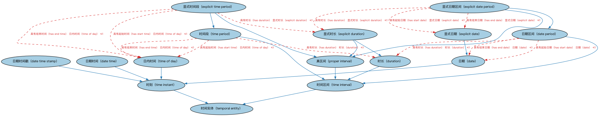

# Commons 日期与时间本体（Commons Dates and Times Ontology）结构与公理说明

本文档对应 `DatesAndTimes.rdf` / `DatesAndTimes.ttl`，说明该本体的类、继承关系、属性和公理约定。结构图见 `DatesAndTimes-structure.png`（`DatesAndTimes-structure.svg` 为可缩放版本）。

## 1. 本体概述

定义日期、时间点、期间（period）、持续时间（duration）等通用时间概念。

**在体系中的位置**：Commons 的时间基础模块，为合同期限、角色有效期、授权期间等提供时间表达。

**上下游关系**：上游仅依赖标注词汇表；下游被参与方与情境、角色与构成、语境指称、登记主管机构、结构化集合等模块引用。

**与相近概念的差别**：期间≠时间点——期间有起止，时间点是瞬间；与 FIBO 金融日期本体的差别——Commons 管通用时间概念，FIBO 管金融特有的日期规则（日计数基准、营业日调整）。

本本体中类与类的核心关系如下（完整细节见各类小节）：

- **日期（date）** 继承 **时刻（time instant）**
- **日期区间（date period）** 继承 **时间区间（time interval）**
- **日期时间（date time）** 继承 **时刻（time instant）**
- **日期时间戳（date time stamp）** 继承 **时刻（time instant）**
- **时长（duration）** 继承 **时间区间（time interval）**
- **显式日期（explicit date）** 继承 **日期（date）**
- **显式日期区间（explicit date period）** 继承 **日期区间（date period）**
- **显式日期区间（explicit date period）** 继承 **真区间（proper interval）**
- **显式时长（explicit duration）** 继承 **时长（duration）**
- **显式时长（explicit duration）** 继承 **真区间（proper interval）**
- **显式时间段（explicit time period）** 继承 **真区间（proper interval）**
- **显式时间段（explicit time period）** 继承 **时间段（time period）**
- 其余 5 条关系从略。

## 2. 类（Class）

| 类（Class） | 定义（Definition） |
|---|---|
| 日期（date） | 某日历上的一个历日。 |
| 日期区间（date period） | 跨越一个或多个历日的时间段。 |
| 日期时间（date time） | 包含日期和时间的时间点，可选含时区偏移。 |
| 日期时间戳（date time stamp） | 包含日期和时间且必须含时区偏移的时间点。 |
| 时长（duration） | 具有特定长度的时间区间。 |
| 显式日期（explicit date） | 必须具备「具有日期值」属性的日期。 |
| 显式日期区间（explicit date period） | 必须具备起始日期、结束日期和/或时长的日期区间。 |
| 显式时长（explicit duration） | 「具有时长值」属性必须有值的时长。 |
| 显式时间段（explicit time period） | 必须具备起始时间、结束时间和/或时长的时间段。 |
| 真区间（proper interval） | 具有非零跨度或时长的时间区间。 |
| 时间实体（temporal entity） | 时间区间或时刻。 |
| 时刻（time instant） | 属于某时间标尺的时间实体，无跨度或时长。 |
| 时间区间（time interval） | 时间轴上的一段，即时间中的一个位置，具有跨度或时长。 |
| 日内时间（time of day） | 按钟表表示的显式时间。 |
| 时间段（time period） | 某个有限窗口上的时间跨度。 |

以下按类逐个展开：每个类给出继承关系、相关属性与公理约定；子类在父类之下降一级编号。

### 2.1 时间实体（temporal entity）

定义：时间区间或时刻。

- 直接子类：**时刻（time instant）**、**时间区间（time interval）**

#### 2.1.1 时刻（time instant）

定义：属于某时间标尺的时间实体，无跨度或时长。

- 父类：**时间实体（temporal entity）**
- 直接子类：**日期（date）**、**日期时间（date time）**、**日期时间戳（date time stamp）**、**日内时间（time of day）**

##### 2.1.1.1 日期（date）

定义：某日历上的一个历日。

- 父类：**时刻（time instant）**
- 直接子类：**显式日期（explicit date）**

属性：

| 属性 | 定义 | 说明 |
|---|---|---|
| **具有日期值（has date value）** | 指明按 xsd:date（即 ISO 8601）格式记录的字面（显式）日期，不含时间或时区信息。 | 值域：xsd:string |

公理：

- **具有日期值（has date value）**存在取值约束。

###### 2.1.1.1.1 显式日期（explicit date）

定义：必须具备「具有日期值」属性的日期。

- 父类：**日期（date）**

属性：

| 属性 | 定义 | 说明 |
|---|---|---|
| **具有日期值（has date value）** | 指明按 xsd:date（即 ISO 8601）格式记录的字面（显式）日期，不含时间或时区信息。 | 值域：xsd:string |

公理：

- **具有日期值（has date value）**存在取值约束。

##### 2.1.1.2 日期时间（date time）

定义：包含日期和时间的时间点，可选含时区偏移。

- 父类：**时刻（time instant）**

属性：

| 属性 | 定义 | 说明 |
|---|---|---|
| **具有日期时间值（has date time value）** | 指明一个字面（显式）日期时间。 | 值域：xsd:dateTime |

公理：

- **具有日期时间值（has date time value）**存在取值约束。

##### 2.1.1.3 日期时间戳（date time stamp）

定义：包含日期和时间且必须含时区偏移的时间点。

- 父类：**时刻（time instant）**

属性：

| 属性 | 定义 | 说明 |
|---|---|---|
| **具有日期时间戳值（has date time stamp value）** | 指明一个字面（显式）日期时间，含时区。 | 值域：xsd:dateTimeStamp |

公理：

- **具有日期时间戳值（has date time stamp value）**存在取值约束。

##### 2.1.1.4 日内时间（time of day）

定义：按钟表表示的显式时间。

- 父类：**时刻（time instant）**

属性：

| 属性 | 定义 | 说明 |
|---|---|---|
| **具有时间值（has time value）** | 指明按 xsd:time（即 ISO 8601）格式记录的显式时间，不含日期或时区信息。 | 值域：xsd:string |

公理：

- **具有时间值（has time value）**存在取值约束。

#### 2.1.2 时间区间（time interval）

定义：时间轴上的一段，即时间中的一个位置，具有跨度或时长。

- 父类：**时间实体（temporal entity）**
- 直接子类：**日期区间（date period）**、**时长（duration）**、**真区间（proper interval）**、**时间段（time period）**

##### 2.1.2.1 日期区间（date period）

定义：跨越一个或多个历日的时间段。

- 父类：**时间区间（time interval）**
- 直接子类：**显式日期区间（explicit date period）**

属性：

| 属性 | 定义 | 说明 |
|---|---|---|
| **具有时长（has duration）** | 指明某事物持续的时间。 | 值域：时长（duration）；子属性：具有时间（has time） |
| **具有结束日期（has end date）** | 标识与某事物关联的最终或结束日期。 | 值域：日期（date）；子属性：具有日期（has date） |
| **具有起始日期（has start date）** | 标识与某事物关联的初始日期。 | 值域：日期（date）；子属性：具有日期（has date） |

公理：

- **具有时长（has duration）**至多有 1 个**时长（duration）**。
- **具有结束日期（has end date）**至多有 1 个**日期（date）**。
- **具有起始日期（has start date）**至多有 1 个**日期（date）**。

###### 2.1.2.1.1 显式日期区间（explicit date period）

定义：必须具备起始日期、结束日期和/或时长的日期区间。

- 父类：**日期区间（date period）**、**真区间（proper interval）**

属性：

| 属性 | 定义 | 说明 |
|---|---|---|
| **具有时长（has duration）** | 指明某事物持续的时间。 | 值域：时长（duration）；子属性：具有时间（has time） |
| **具有结束日期（has end date）** | 标识与某事物关联的最终或结束日期。 | 值域：日期（date）；子属性：具有日期（has date） |
| **具有起始日期（has start date）** | 标识与某事物关联的初始日期。 | 值域：日期（date）；子属性：具有日期（has date） |

公理：

- **具有时长（has duration）**至多有 1 个**显式时长（explicit duration）**。
- **具有结束日期（has end date）**至多有 1 个**显式日期（explicit date）**。
- **具有起始日期（has start date）**至多有 1 个**显式日期（explicit date）**。

##### 2.1.2.2 时长（duration）

定义：具有特定长度的时间区间。

- 父类：**时间区间（time interval）**
- 直接子类：**显式时长（explicit duration）**

属性：

| 属性 | 定义 | 说明 |
|---|---|---|
| **具有时长值（has duration value）** | 指明按 xsd:duration（即 ISO 8601）格式记录的字面（显式）时长。 | 值域：xsd:string |

公理：

- **具有时长值（has duration value）**存在取值约束。

###### 2.1.2.2.1 显式时长（explicit duration）

定义：「具有时长值」属性必须有值的时长。

- 父类：**时长（duration）**、**真区间（proper interval）**

属性：

| 属性 | 定义 | 说明 |
|---|---|---|
| **具有时长值（has duration value）** | 指明按 xsd:duration（即 ISO 8601）格式记录的字面（显式）时长。 | 值域：xsd:string |

公理：

- **具有时长值（has duration value）**存在取值约束。

##### 2.1.2.3 真区间（proper interval）

定义：具有非零跨度或时长的时间区间。

- 父类：**时间区间（time interval）**
- 直接子类：**显式日期区间（explicit date period）**、**显式时长（explicit duration）**、**显式时间段（explicit time period）**

公理：

- 与**时刻（time instant）**互斥：同一个体不能同时属于两者。

###### 2.1.2.3.3 显式时间段（explicit time period）

定义：必须具备起始时间、结束时间和/或时长的时间段。

- 父类：**真区间（proper interval）**、**时间段（time period）**

属性：

| 属性 | 定义 | 说明 |
|---|---|---|
| **具有时长（has duration）** | 指明某事物持续的时间。 | 值域：时长（duration）；子属性：具有时间（has time） |
| **具有结束时间（has end time）** | 标识与某事物关联的最终或结束时间。 | 值域：日内时间（time of day）；子属性：具有终点（has end） |
| **具有起始时间（has start time）** | 标识与某事物关联的初始或起始时间。 | 值域：日内时间（time of day）；子属性：具有起点（has start） |

公理：

- **具有时长（has duration）**至多有 1 个**显式时长（explicit duration）**。
- **具有结束时间（has end time）**至多有 1 个**日内时间（time of day）**。
- **具有起始时间（has start time）**至多有 1 个**日内时间（time of day）**。

##### 2.1.2.4 时间段（time period）

定义：某个有限窗口上的时间跨度。

- 父类：**时间区间（time interval）**
- 直接子类：**显式时间段（explicit time period）**

属性：

| 属性 | 定义 | 说明 |
|---|---|---|
| **具有时长（has duration）** | 指明某事物持续的时间。 | 值域：时长（duration）；子属性：具有时间（has time） |
| **具有结束时间（has end time）** | 标识与某事物关联的最终或结束时间。 | 值域：日内时间（time of day）；子属性：具有终点（has end） |
| **具有起始时间（has start time）** | 标识与某事物关联的初始或起始时间。 | 值域：日内时间（time of day）；子属性：具有起点（has start） |

公理：

- **具有时长（has duration）**至多有 1 个**时长（duration）**。
- **具有结束时间（has end time）**至多有 1 个**日内时间（time of day）**。
- **具有起始时间（has start time）**至多有 1 个**日内时间（time of day）**。

## 3. 其他属性

以下属性未绑定到本体的具体类（定义域在外部本体或未声明）：

对象属性（Object Property）：

| 属性 | 定义 | 说明 |
|---|---|---|
| **具有日期（has date）** | 标识一个历日、月和年。 | 值域：日期（date）；子属性：具有时间（has time） |
| **具有签发日期（has date of issuance）** | 将协议、合同、许可或报告等关联到其发布日期。 | 值域：日期（date）；子属性：具有起始日期（has start date） |
| **具有日期区间（has date period）** | 标识一个具体时间窗口，含起始日期、结束日期和/或时长。 | 值域：日期区间（date period）；子属性：具有时间（has time） |
| **具有日期时间（has date time）** | 标识特定的日期与日内时间，可能不含时区。 | 值域：日期时间（date time）；子属性：具有时间（has time） |
| **具有日期时间戳（has date time stamp）** | 标识特定的日期与日内时间，明确包含时区。 | 值域：日期时间戳（date time stamp）；子属性：具有时间（has time） |
| **具有终点（has end）** | 标识与某事物关联的最终或结束时间点。 | 值域：时刻（time instant）；子属性：具有时间（has time） |
| **具有显式日期（has explicit date）** | 标识与某事物关联的明示日期，而非推算或未知日期。 | 值域：显式日期（explicit date）；子属性：具有日期（has date） |
| **具有起点（has start）** | 标识与某事物关联的初始时间点。 | 值域：时刻（time instant）；子属性：具有时间（has time） |
| **具有时间（has time）** | 指明可与任意元素关联的一般时间。 | 值域：时间实体（temporal entity） |
| **具有时间段（has time period）** | 标识一个具体时间窗口，含起始时间、结束时间和/或时长。 | 值域：时间段（time period）；子属性：具有时间（has time） |
| **先于（precedes）** | 基于空间或时间上的在先邻近而关联；在逻辑次序或序列中发生在前。 | — |
| **后于（succeeds）** | 基于空间或时间上的在后邻近而关联；在逻辑次序或序列中跟随在后。 | 逆属性：先于（precedes） |

数据属性（Datatype Property）：

| 属性 | 定义 |
|---|---|
| **具有观测日期时间（has observed date and time）** | 标识与事件、度量、记录或观测关联的日期时间。 |

## 4. 依赖（owl:imports，1 个）

本本体通过 `owl:imports` 引入以下本体，各项的中文名称与简介如下：

| 导入本体 | 中文名称 | 简介 |
|---|---|---|
| `AnnotationVocabulary/AnnotationVocabulary.rdf` | Commons 标注词汇表（Commons Annotation Vocabulary） | 提供文档标注常用的属性，如摘要、定义、解释、版权、同义词等，并梳理 SKOS 与 Dublin Core 标注属性之间的关系。 |

## 5. 文件

- 官方 RDF/XML：`DatesAndTimes.rdf`
- 中文 Turtle：`DatesAndTimes.ttl`
- 结构图：`DatesAndTimes-structure.png` / `DatesAndTimes-structure.svg`