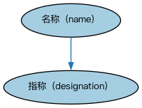

# Commons 指称本体（Commons Designators Ontology）结构与公理说明

本文档对应 `Designators.rdf` / `Designators.ttl`，说明该本体的类、继承关系、属性和公理约定。结构图见 `Designators-structure.png`（`Designators-structure.svg` 为可缩放版本）。

## 1. 本体概述

定义指称符（designator）：指代某事物的名称、符号或表达方式的最抽象概念。

**在体系中的位置**：Commons 最底层的构件之一，是标识符、语境指称、代码等概念的上游。

**上下游关系**：上游仅依赖标注词汇表与文本数据类型；下游被分类、代码、标识、语言、地点等大量模块引用。

**与相近概念的差别**：指称符≠标识符——指称符泛指一切「用来指代的东西」（名字、符号），标识符特指「用于唯一识别的指称符」。

本本体中类与类的核心关系如下（完整细节见各类小节）：

- **名称（name）** 继承 **指称（designation）**

## 2. 类（Class）

| 类（Class） | 定义（Definition） |
|---|---|
| 指称（designation） | 在某领域或主题中指代某事物（或其概念化）的表示。 representation for something, or for a conceptualization thereof, that denotes it in a domain or subject |
| 名称（name） | 以语言表达式对某事物的指称。 designation for something by a linguistic expression |

以下按类逐个展开：每个类给出继承关系、相关属性与公理约定；子类在父类之下降一级编号。

### 2.1 指称（designation）

定义：在某领域或主题中指代某事物（或其概念化）的表示。

- 直接子类：**名称（name）**

属性：

| 属性 | 定义 | 说明 |
|---|---|---|
| **指代（denotes）** | 作为某事物（或其概念化）的符号。 serves as a sign for something, or for a conceptualization thereof | — |
| **具有文本值（hasTextValue）** | — | — |

公理：

- **具有文本值（hasTextValue）**存在取值约束。
- **指代（denotes）**至少有一个取值，类型是**owl:Thing（Thing）**。

#### 2.1.1 名称（name）

定义：以语言表达式对某事物的指称。

- 父类：**指称（designation）**

属性：

| 属性 | 定义 | 说明 |
|---|---|---|
| **是……的名称（is name of）** | 在某情境中指代……。 denotes in some context | 子属性：指代（denotes） |

公理：

- **是……的名称（is name of）**至少有一个取值，类型是**owl:Thing（Thing）**。

## 3. 其他属性

以下属性未绑定到本体的具体类（定义域在外部本体或未声明）：

对象属性（Object Property）：

| 属性 | 定义 | 说明 |
|---|---|---|
| **定义（defines）** | 以一个或多个本质属性指明某事物的含义。 specifies the meaning of something in terms of one or more of its essential qualities | 逆属性：定义于（is defined in） |
| **描述（describes）** | 传达……的性质。 conveys the nature of | 逆属性：由……描述（is described by） |
| **具有名称（has name）** | 以……为人所知。 is known by | 值域：名称（name）；逆属性：是……的名称（is name of）；子属性：由……表示（is signified by） |
| **定义于（is defined in）** | 标识规定主语含义的某事物。 indicates something that specifies the meaning associated with the subject | — |
| **由……描述（is described by）** | 具有……的一般性质或描述。 has general nature or description of | — |
| **由……表示（is signified by）** | 具有……的表示、指称或符号。 has representation, denotation or sign of | 值域：指称（designation）；逆属性：指代（denotes） |

数据属性（Datatype Property）：

| 属性 | 定义 |
|---|---|
| **具有描述（has description）** | 提供描述某事物的文字陈述、文字画面或说明。 provides a textual statement, picture in words, or account that describes something |
| **具有标签（has tag）** | 关联与某事物指称对应的唯一字母数字组合。 associates unique combination of alphanumeric characters corresponding to a designator for something |
| **具有文本名称（has textual name）** | 将名称、引用名或称谓与某个体概念关联。 associates a name, reference name, or appellation with an individual concept |

## 4. 依赖（owl:imports，2 个）

本本体通过 `owl:imports` 引入以下本体，各项的中文名称与简介如下：

| 导入本体 | 中文名称 | 简介 |
|---|---|---|
| `AnnotationVocabulary/AnnotationVocabulary.rdf` | Commons 标注词汇表（Commons Annotation Vocabulary） | 提供文档标注常用的属性，如摘要、定义、解释、版权、同义词等，并梳理 SKOS 与 Dublin Core 标注属性之间的关系。 |
| `TextDatatype/TextDatatype.rdf` | Commons 文本数据类型本体（Commons Text Datatype Ontology） | 定义文本、字符串及其数据类型的基础概念。 |

## 5. 文件

- 官方 RDF/XML：`Designators.rdf`
- 中文 Turtle：`Designators.ttl`
- 结构图：`Designators-structure.png` / `Designators-structure.svg`