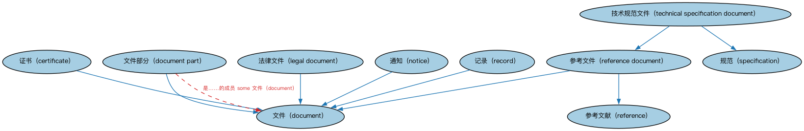

# Commons 文档本体（Commons Documents Ontology）结构与公理说明

本文档对应 `Documents.rdf` / `Documents.ttl`，说明该本体的类、继承关系、属性和公理约定。结构图见 `Documents-structure.png`（`Documents-structure.svg` 为可缩放版本）。

## 1. 本体概述

定义文档（document）、文档组成部分与文档类型：合同文本、证书、报告等文书的通用模型。

**在体系中的位置**：Commons 的通用构件模块，为一切「以文书为载体」的业务提供基础。

**上下游关系**：上游依赖集合与标注词汇表；下游被量与单位、登记主管机构、监管机构、结构化集合等模块引用。

**与相近概念的差别**：文档≠合同——文档是信息的物理/电子载体，合同是法律关系（同一份合同可以有多个文档副本）；与报告的差别——报告是带报送行为的文档。

本本体中类与类的核心关系如下（完整细节见各类小节）：

- **证书（certificate）** 继承 **文件（document）**
- **文件部分（document part）** 继承 **文件（document）**
- **法律文件（legal document）** 继承 **文件（document）**
- **通知（notice）** 继承 **文件（document）**
- **记录（record）** 继承 **文件（document）**
- **参考文件（reference document）** 继承 **文件（document）**
- **参考文件（reference document）** 继承 **参考文献（reference）**
- **技术规范文件（technical specification document）** 继承 **参考文件（reference document）**
- **技术规范文件（technical specification document）** 继承 **规范（specification）**

## 2. 类（Class）

| 类（Class） | 定义（Definition） |
|---|---|
| 证书（certificate） | 证明某个或某组事实属实的文件。 document attesting to the truth of some fact or set of facts |
| 文件（document） | 某种智力或艺术作品实现的单一表达。 unitary expression of some realization of an intellectual or artistic work |
| 文件部分（document part） | 文件在结构上可区分的子划分。 structurally distinct subdivision of a document |
| 法律文件（legal document） | 规定协议、证明、认证、条件、许可和/或法律主体、政府实体决定的条款，或为其提供证据的文件。 document specifying the terms of, or provides evidence for, an agreement, attestation, certification, conditions, permissions, and/or decisions of legal persons, government entities, or courts of law, drawn up in accordance with certain rules that apply in the relevant jurisdiction(s) |
| 通知（notice） | 对某事的公告、传达、告知或预先警示，通常（但非必然）用于让人有所准备。 announcement, communication, intimation, or advance warning of something, usually, but not necessarily, to allow preparations to be made |
| 记录（record） | 对已完成的活动、已发生的事件、已达成结果或已作陈述的备忘与客观证据，无论其特性、媒介、物理形式如何。 memorialization and objective evidence of activities performed, events occurred, results achieved, or statements made, regardless of its characteristics, media, physical form, or the manner in which it is recorded or stored |
| 参考文献（reference） | 可用于查明、解释或理解某事物的来源。 source that may be used to ascertain, interpret, or understand something |
| 参考文件（reference document） | 用作某事物参考的文件。 document that is used as a reference for something |
| 规范（specification） | 某事物（如产品、材料、模型、过程或系统）须满足的明确要求或要求集。 explicit requirement or set of requirements to be satisfied by something, such as a product, material, model, process or system |
| 技术规范文件（technical specification document） | 规定产品、材料、过程或系统须满足的详细要求及符合性检查程序的文件。 document that sets out detailed requirements to be satisfied by a product, material, process or system and the procedures for checking conformity to these requirements |

以下按类逐个展开：每个类给出继承关系、相关属性与公理约定；子类在父类之下降一级编号。

### 2.1 文件（document）

定义：某种智力或艺术作品实现的单一表达。

- 直接子类：**证书（certificate）**、**文件部分（document part）**、**法律文件（legal document）**、**通知（notice）**、**记录（record）**、**参考文件（reference document）**

属性：

| 属性 | 定义 | 说明 |
|---|---|---|
| **关于（is about）** | 标识某事物（如文件）的主题或话题。 indicates the subject or topic of something, such as a document | — |

公理：

- **关于（is about）**至少有 0 个取值。

#### 2.1.1 证书（certificate）

定义：证明某个或某组事实属实的文件。

- 父类：**文件（document）**

#### 2.1.2 文件部分（document part）

定义：文件在结构上可区分的子划分。

- 父类：**文件（document）**

属性：

| 属性 | 定义 | 说明 |
|---|---|---|
| **是……的成员（isMemberOf）** | — | — |

公理：

- **是……的成员（isMemberOf）**至少有一个取值，类型是**文件（document）**。

#### 2.1.3 法律文件（legal document）

定义：规定协议、证明、认证、条件、许可和/或法律主体、政府实体决定的条款，或为其提供证据的文件。

- 父类：**文件（document）**

#### 2.1.4 通知（notice）

定义：对某事的公告、传达、告知或预先警示，通常（但非必然）用于让人有所准备。

- 父类：**文件（document）**

#### 2.1.5 记录（record）

定义：对已完成的活动、已发生的事件、已达成结果或已作陈述的备忘与客观证据，无论其特性、媒介、物理形式如何。

- 父类：**文件（document）**

#### 2.1.6 参考文件（reference document）

定义：用作某事物参考的文件。

- 父类：**文件（document）**、**参考文献（reference）**
- 直接子类：**技术规范文件（technical specification document）**

##### 2.1.6.1 技术规范文件（technical specification document）

定义：规定产品、材料、过程或系统须满足的详细要求及符合性检查程序的文件。

- 父类：**参考文件（reference document）**、**规范（specification）**

### 2.2 参考文献（reference）

定义：可用于查明、解释或理解某事物的来源。

- 直接子类：**参考文件（reference document）**

### 2.3 规范（specification）

定义：某事物（如产品、材料、模型、过程或系统）须满足的明确要求或要求集。

- 直接子类：**技术规范文件（technical specification document）**

## 3. 其他属性

以下属性未绑定到本体的具体类（定义域在外部本体或未声明）：

对象属性（Object Property）：

| 属性 | 定义 | 说明 |
|---|---|---|
| **具有数据来源（has data source）** | 将协议、合同、文件、记录、报告或过程等关联到用于分析、编制、解释或生成它的数据来源。 relates something, such as an agreement, contract, document, record, report, or process, to a source of data used to analyze, develop, explain, produce, or otherwise create it | 子属性：引用（refers to） |
| **被……引用（is referred to by）** | 标识将某事物作为信息或解释来源引用的事物。 indicates something that is referenced as a source for information or explanation | 逆属性：引用（refers to） |
| **规定于（is specified in）** | 标识某项要求、事实或事实集的明确出处。 indicates the explicit source for some requirement, fact, or set of facts | 逆属性：规定（specifies）；子属性：引用（refers to） |
| **记录（records）** | 将……形诸文件以备日后查阅。 documents for later reference | — |
| **引用（refers to）** | 将……作为信息或解释来源加以引用。 makes reference to as a source for information or explanation | — |
| **规定（specifies）** | 清晰而确定地提及、命名或陈述某事物。 mentions, names or states something clearly and definitively | — |

## 4. 依赖（owl:imports，2 个）

本本体通过 `owl:imports` 引入以下本体，各项的中文名称与简介如下：

| 导入本体 | 中文名称 | 简介 |
|---|---|---|
| `AnnotationVocabulary/AnnotationVocabulary.rdf` | Commons 标注词汇表（Commons Annotation Vocabulary） | 提供文档标注常用的属性，如摘要、定义、解释、版权、同义词等，并梳理 SKOS 与 Dublin Core 标注属性之间的关系。 |
| `Collections/Collections.rdf` | Commons 集合本体（Commons Collections Ontology） | 定义集合、成员关系及集合操作的基础概念。 |

## 5. 文件

- 官方 RDF/XML：`Documents.rdf`
- 中文 Turtle：`Documents.ttl`
- 结构图：`Documents-structure.png` / `Documents-structure.svg`