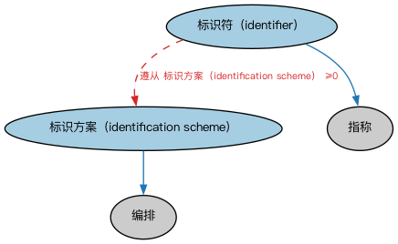

# Commons 标识符本体（Commons Identifiers Ontology）结构与公理说明

本文档对应 `Identifiers.rdf` / `Identifiers.ttl`，说明该本体的类、继承关系、属性和公理约定。结构图见 `Identifiers-structure.png`（`Identifiers-structure.svg` 为可缩放版本）。

## 1. 本体概述

定义标识符（identifier）与标识方案：用于唯一识别事物的指称符及其分配规则。

**在体系中的位置**：Commons 的基础构件模块，是 ISIN、LEI 等一切编码标识的上层概念。

**上下游关系**：上游依赖指称符、集合模块；下游被语境标识符、语言、地点、组织等模块引用。

**与相近概念的差别**：标识符≠代码——代码强调「编码体系中的取值」，标识符强调「唯一识别某个体」；很多标识符由代码实现，但目的不同。

本本体中类与类的核心关系如下（完整细节见各类小节）：

- **标识方案（identification scheme）** 继承 **编排（Arrangement）**
- **标识符（identifier）** 继承 **指称（Designation）**

## 2. 类（Class）

| 类（Class） | 定义（Definition） |
|---|---|
| 标识方案（identification scheme） | 为事物生成标识符的体系，规定标识符结构的约束。 |
| 标识符（identifier） | 唯一标识其所关联事物的字符序列。 |

以下按类逐个展开：每个类给出继承关系、相关属性与公理约定；子类在父类之下降一级编号。

### 2.1 标识方案（identification scheme）

定义：为事物生成标识符的体系，规定标识符结构的约束。

- 父类：**编排（Arrangement）**

### 2.2 标识符（identifier）

定义：唯一标识其所关联事物的字符序列。

- 父类：**指称（Designation）**

属性：

| 属性 | 定义 | 说明 |
|---|---|---|
| **遵从（compliesWith）** | — | — |
| **标识（identifies）** | 在某情境内识别或确立身份。 | 子属性：指代 |

公理：

- **标识（identifies）**至少有一个取值，类型是**owl:Thing（Thing）**。
- **遵从（compliesWith）**可以有 0 个或多个**标识方案（identification scheme）**。
- 与**名称（Name）**互斥：同一个体不能同时属于两者。

## 3. 其他属性

以下属性未绑定到本体的具体类（定义域在外部本体或未声明）：

对象属性（Object Property）：

| 属性 | 定义 | 说明 |
|---|---|---|
| **由……标识（is identified by）** | 具有在某情境内唯一的标识符。 | 值域：标识符（identifier）；逆属性：标识（identifies）；子属性：由……表示 |

## 4. 依赖（owl:imports，3 个）

本本体通过 `owl:imports` 引入以下本体，各项的中文名称与简介如下：

| 导入本体 | 中文名称 | 简介 |
|---|---|---|
| `AnnotationVocabulary/AnnotationVocabulary.rdf` | Commons 标注词汇表（Commons Annotation Vocabulary） | 提供文档标注常用的属性，如摘要、定义、解释、版权、同义词等，并梳理 SKOS 与 Dublin Core 标注属性之间的关系。 |
| `Collections/Collections.rdf` | Commons 集合本体（Commons Collections Ontology） | 定义集合、成员关系及集合操作的基础概念。 |
| `Designators/Designators.rdf` | Commons 指称本体（Commons Designators Ontology） | 定义名称、标识符等指称事物的通用概念。 |

## 5. 文件

- 官方 RDF/XML：`Identifiers.rdf`
- 中文 Turtle：`Identifiers.ttl`
- 结构图：`Identifiers-structure.png` / `Identifiers-structure.svg`