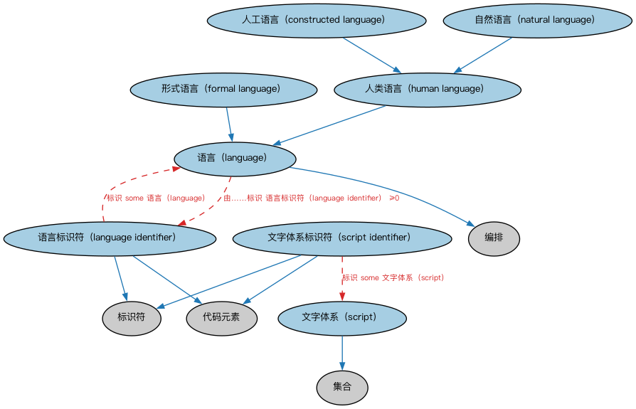

# Commons 语言本体（Commons Languages Ontology）结构与公理说明

本文档对应 `Languages.rdf` / `Languages.ttl`，说明该本体的类、继承关系、属性和公理约定。结构图见 `Languages-structure.png`（`Languages-structure.svg` 为可缩放版本）。

## 1. 本体概述

定义语言（language）、语言代码及其使用：自然语言的标识与语境化表达。

**在体系中的位置**：Commons 的通用构件模块，支撑多语言文本、翻译与国际化场景。

**上下游关系**：上游依赖代码与代码集、标识符、语境指称、集合、指称符模块；下游被需要语言标注的应用引用。

**与相近概念的差别**：语言≠文本数据类型——语言是「哪种自然语言」的概念实体，文本数据类型是「带语言标记的字符串」的格式定义，两者配合使用。

本本体中类与类的核心关系如下（完整细节见各类小节）：

- **人工语言（constructed language）** 继承 **人类语言（human language）**
- **形式语言（formal language）** 继承 **语言（language）**
- **人类语言（human language）** 继承 **语言（language）**
- **语言（language）** 继承 **编排（Arrangement）**
- **语言标识符（language identifier）** 继承 **代码元素（CodeElement）**
- **语言标识符（language identifier）** 继承 **标识符（Identifier）**
- **自然语言（natural language）** 继承 **人类语言（human language）**
- **文字体系（script）** 继承 **集合（Collection）**
- **文字体系标识符（script identifier）** 继承 **代码元素（CodeElement）**
- **文字体系标识符（script identifier）** 继承 **标识符（Identifier）**

## 2. 类（Class）

| 类（Class） | 定义（Definition） |
|---|---|
| 人工语言（constructed language） | 规则在使用前被明确制定的个体语言。 |
| 形式语言（formal language） | 由有限字母表按一套组合方法（称为文法）构造的有限长字符串（即词的整体）所组成的语言。 |
| 人类语言（human language） | 可用于人与人之间表达或传达意义或讯息的语言。 |
| 语言（language） | 声音、视觉空间符号、文字或其他书写符号的系统性使用，可组合以表达或传达意义，并为某社群所理解。 |
| 语言标识符（language identifier） | 为无歧义标识某种个体语言或语群而分配的字符串。 |
| 自然语言（natural language） | 在某语言社群中（曾）活跃使用、代代相传的个体语言。 |
| 文字体系（script） | 用于一种或多种个体语言书写形式的图形字符的完备集合。 |
| 文字体系标识符（script identifier） | 为无歧义表示某文字体系而分配的字符串。 |

以下按类逐个展开：每个类给出继承关系、相关属性与公理约定；子类在父类之下降一级编号。

### 2.1 语言（language）

定义：声音、视觉空间符号、文字或其他书写符号的系统性使用，可组合以表达或传达意义，并为某社群所理解。

- 父类：**编排（Arrangement）**
- 直接子类：**形式语言（formal language）**、**人类语言（human language）**

属性：

| 属性 | 定义 | 说明 |
|---|---|---|
| **具有名称（hasName）** | — | — |
| **具有文本名称（hasTextualName）** | — | — |
| **由……标识（isIdentifiedBy）** | — | — |

公理：

- **具有名称（hasName）**可以有 0 个或多个**名称（Name）**。
- **具有文本名称（hasTextualName）**至少有 0 个取值。
- **由……标识（isIdentifiedBy）**可以有 0 个或多个**语言标识符（language identifier）**。

#### 2.1.1 形式语言（formal language）

定义：由有限字母表按一套组合方法（称为文法）构造的有限长字符串（即词的整体）所组成的语言。

- 父类：**语言（language）**

#### 2.1.2 人类语言（human language）

定义：可用于人与人之间表达或传达意义或讯息的语言。

- 父类：**语言（language）**
- 直接子类：**人工语言（constructed language）**、**自然语言（natural language）**

##### 2.1.2.1 人工语言（constructed language）

定义：规则在使用前被明确制定的个体语言。

- 父类：**人类语言（human language）**

公理：

- 与**形式语言（formal language）**互斥：同一个体不能同时属于两者。

##### 2.1.2.2 自然语言（natural language）

定义：在某语言社群中（曾）活跃使用、代代相传的个体语言。

- 父类：**人类语言（human language）**

### 2.2 语言标识符（language identifier）

定义：为无歧义标识某种个体语言或语群而分配的字符串。

- 父类：**代码元素（CodeElement）**、**标识符（Identifier）**

属性：

| 属性 | 定义 | 说明 |
|---|---|---|
| **具有标签（hasTag）** | — | — |
| **标识（identifies）** | — | — |

公理：

- **具有标签（hasTag）**至少有一个取值，类型是**xsd:string（string）**。
- **标识（identifies）**至少有一个取值，类型是**语言（language）**。

### 2.3 文字体系（script）

定义：用于一种或多种个体语言书写形式的图形字符的完备集合。

- 父类：**集合（Collection）**

### 2.4 文字体系标识符（script identifier）

定义：为无歧义表示某文字体系而分配的字符串。

- 父类：**代码元素（CodeElement）**、**标识符（Identifier）**

属性：

| 属性 | 定义 | 说明 |
|---|---|---|
| **具有标签（hasTag）** | — | — |
| **标识（identifies）** | — | — |

公理：

- **具有标签（hasTag）**至少有一个取值，类型是**xsd:string（string）**。
- **标识（identifies）**至少有一个取值，类型是**文字体系（script）**。

## 3. 其他属性

以下属性未绑定到本体的具体类（定义域在外部本体或未声明）：

对象属性（Object Property）：

| 属性 | 定义 | 说明 |
|---|---|---|
| **具有语言（has language）** | 在某情境中以某语言表达或使用某语言。 | 值域：语言（language）；子属性：使用 |

## 4. 依赖（owl:imports，6 个）

本本体通过 `owl:imports` 引入以下本体，各项的中文名称与简介如下：

| 导入本体 | 中文名称 | 简介 |
|---|---|---|
| `AnnotationVocabulary/AnnotationVocabulary.rdf` | Commons 标注词汇表（Commons Annotation Vocabulary） | 提供文档标注常用的属性，如摘要、定义、解释、版权、同义词等，并梳理 SKOS 与 Dublin Core 标注属性之间的关系。 |
| `CodesAndCodeSets/CodesAndCodeSets.rdf` | Commons 代码与代码集本体（Commons Codes and Code Sets Ontology） | 定义代码、代码集、编码方案及其标识方式。 |
| `Collections/Collections.rdf` | Commons 集合本体（Commons Collections Ontology） | 定义集合、成员关系及集合操作的基础概念。 |
| `ContextualDesignators/ContextualDesignators.rdf` | Commons 上下文指称本体（Commons Contextual Designators Ontology） | 定义在特定上下文中有意义的指称、名称和标识符。 |
| `Designators/Designators.rdf` | Commons 指称本体（Commons Designators Ontology） | 定义名称、标识符等指称事物的通用概念。 |
| `Identifiers/Identifiers.rdf` | Commons 标识符本体（Commons Identifiers Ontology） | 定义标识符及其发布、管理与解析的基础概念。 |

## 5. 文件

- 官方 RDF/XML：`Languages.rdf`
- 中文 Turtle：`Languages.ttl`
- 结构图：`Languages-structure.png` / `Languages-structure.svg`