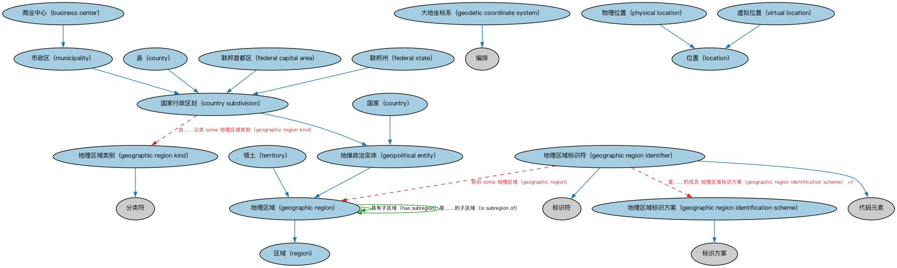

# Commons 位置本体（Commons Locations Ontology）结构与公理说明

本文档对应 `Locations.rdf` / `Locations.ttl`，说明该本体的类、继承关系、属性和公理约定。结构图见 `Locations-structure.png`（`Locations-structure.svg` 为可缩放版本）。

## 1. 本体概述

定义地点（location）、地理区域、地址相关概念：物理空间位置的通用模型。

**在体系中的位置**：Commons 的通用构件模块，是组织注册地、设施位置等概念的基础。

**上下游关系**：上游依赖分类、代码、标识、量与单位、文本类型等模块；下游被组织、场所与设施、监管机构模块引用。

**与相近概念的差别**：地点≠地址——地点是空间位置本身，地址是指代地点的文字结构（语境指称的一种）；与场所的差别——场所（SitesAndFacilities）强调「有用途的物理空间」，地点是抽象位置。

本本体中类与类的核心关系如下（完整细节见各类小节）：

- **商业中心（business center）** 继承 **市政区（municipality）**
- **国家（country）** 继承 **地缘政治实体（geopolitical entity）**
- **国家行政区划（country subdivision）** 继承 **地缘政治实体（geopolitical entity）**
- **县（county）** 继承 **国家行政区划（country subdivision）**
- **联邦首都区（federal capital area）** 继承 **国家行政区划（country subdivision）**
- **联邦州（federal state）** 继承 **国家行政区划（country subdivision）**
- **大地坐标系（geodetic coordinate system）** 继承 **编排（Arrangement）**
- **地理区域（geographic region）** 继承 **区域（region）**
- **地理区域标识方案（geographic region identification scheme）** 继承 **标识方案（IdentificationScheme）**
- **地理区域标识符（geographic region identifier）** 继承 **代码元素（CodeElement）**
- **地理区域标识符（geographic region identifier）** 继承 **标识符（Identifier）**
- **地理区域类别（geographic region kind）** 继承 **分类符（Classifier）**
- 其余 7 条关系从略。

## 2. 类（Class）

| 类（Class） | 定义（Definition） |
|---|---|
| 商业中心（business center） | 开展商业活动的市政区，尤指被视为金融中心的市政区。 municipality where business is conducted, especially one that is considered a financial center |
| 国家（country） | 代表独立领土实体、政治实体或属地的地缘政治实体。 geopolitical entity representing a distinct territorial body or political entity or dependent territory |
| 国家行政区划（country subdivision） | 作为国家、属地或其他特殊地缘政治利益区域的法定划分的地缘政治实体。 geopolitical entity that is a legal division of a country, dependency, or other area of special geopolitical interest related to a country or other geopolitical entity |
| 县（county） | 国家、州或省的政治行政划分，提供特定的地方政府服务。 political and administrative division of a country, state or province, providing certain local governmental services |
| 联邦首都区（federal capital area） | 作为联邦政府所在地的市政区或首都城市，或包含该市政区的国家行政区划。 country subdivision that is or includes the municipality or capital city that acts as the seat of the federal government |
| 联邦州（federal state） | 自治的地缘政治单位，构成被承认为国家的更大地缘政治单位的一部分。 self-governing geopolitical unit which forms part of a wider geopolitical unit that is recognized as a country |
| 大地坐标系（geodetic coordinate system） | 以大地测量方式精确表示地球或其他行星体上位置的三维参考系。 three-dimensional reference system that is a global frame of reference for precisely representing the position of locations on Earth or other planetary bodies by means of geodetic coordinates |
| 地理区域（geographic region） | 具有共同特征的陆地区域。 area of land that has common features |
| 地理区域标识方案（geographic region identification scheme） | 专用于唯一标识地理区域的标识方案。 identification scheme dedicated to the unique identification of geographic regions |
| 地理区域标识符（geographic region identifier） | 为在某情境内唯一标识地理区域而分配的代码或其他标识符字符串。 string of letters that indicates a code or other identifier for geographical region, assigned for the purpose of uniquely identifying it within some context |
| 地理区域类别（geographic region kind） | 地理区域的分类符，包括但不限于地缘政治实体的细分。 classifier for a geographic region, including but not limited to a subdivision of a geopolitical entity, (noting that there may be more than one kind for a given country or other entity) |
| 地缘政治实体（geopolitical entity） | 与某种政治结构相关联的地理区域。 geographic area that represents a geophysical location associated with some form of political structure |
| 位置（location） | 时间和/或空间中的地点或方位，包括虚拟地点。 place or position in time and/or space, including a virtual place |
| 市政区（municipality） | 具有法人地位、通常拥有自治权或管辖权的城市行政划分。 urban administrative division having corporate status and usually powers of self-government or jurisdiction |
| 物理位置（physical location） | 物理空间中的位置。 location in physical space |
| 区域（region） | 表面、空间或物体中连续的部分。 area that is a continuous part of a surface, space, or body |
| 领土（territory） | 受某国家或其他实体主权、控制或管辖的地理区域，通常被视为特殊地缘政治利益区域。 geographic area, typically considered an area of special geopolitical interest, subject to the sovereignty, control, or jurisdiction of a state or other entity |
| 虚拟位置（virtual location） | 不存在于任何单一物理位置的地点。 place that does not exist in any single physical location |

以下按类逐个展开：每个类给出继承关系、相关属性与公理约定；子类在父类之下降一级编号。

### 2.1 大地坐标系（geodetic coordinate system）

定义：以大地测量方式精确表示地球或其他行星体上位置的三维参考系。

- 父类：**编排（Arrangement）**

### 2.2 地理区域标识方案（geographic region identification scheme）

定义：专用于唯一标识地理区域的标识方案。

- 父类：**标识方案（IdentificationScheme）**

### 2.3 地理区域标识符（geographic region identifier）

定义：为在某情境内唯一标识地理区域而分配的代码或其他标识符字符串。

- 父类：**代码元素（CodeElement）**、**标识符（Identifier）**

属性：

| 属性 | 定义 | 说明 |
|---|---|---|
| **是……的成员（isMemberOf）** | — | — |
| **标识（identifies）** | — | — |
| **具有文本值（hasTextValue）** | — | — |

公理：

- **具有文本值（hasTextValue）**至少有一个取值，类型是**xsd:string（string）**。
- **是……的成员（isMemberOf）**恰好有 1 个**地理区域标识方案（geographic region identification scheme）**。
- **标识（identifies）**至少有一个取值，类型是**地理区域（geographic region）**。

### 2.4 地理区域类别（geographic region kind）

定义：地理区域的分类符，包括但不限于地缘政治实体的细分。

- 父类：**分类符（Classifier）**

属性：

| 属性 | 定义 | 说明 |
|---|---|---|
| **分类（classifies）** | — | — |

公理：

- **分类（classifies）**的所有取值只能是**地理区域（geographic region）**。

### 2.5 位置（location）

定义：时间和/或空间中的地点或方位，包括虚拟地点。

- 直接子类：**物理位置（physical location）**、**虚拟位置（virtual location）**

#### 2.5.1 物理位置（physical location）

定义：物理空间中的位置。

- 父类：**位置（location）**

#### 2.5.2 虚拟位置（virtual location）

定义：不存在于任何单一物理位置的地点。

- 父类：**位置（location）**

公理：

- 与**物理位置（physical location）**互斥：同一个体不能同时属于两者。

### 2.6 区域（region）

定义：表面、空间或物体中连续的部分。

- 直接子类：**地理区域（geographic region）**

#### 2.6.1 地理区域（geographic region）

定义：具有共同特征的陆地区域。

- 父类：**区域（region）**
- 直接子类：**地缘政治实体（geopolitical entity）**、**领土（territory）**

属性：

| 属性 | 定义 | 说明 |
|---|---|---|
| **具有名称（hasName）** | — | — |
| **具有文本名称（hasTextualName）** | — | — |
| **具有子区域（has subregion）** | 将一个地理区域关联到其指定的子区域。 relates a geographic region to another geographic region that is a designated subregion of it | 值域：地理区域（geographic region）；子属性：具有部分 |
| **是……的子区域（is subregion of）** | 将一个地理区域关联到它所属的更大地理区域。 relates a geographic region to another geographic region that it is a part of | 值域：地理区域（geographic region）；逆属性：具有子区域（has subregion）；子属性：是……的部分 |

公理：

- **具有名称（hasName）**可以有 0 个或多个**名称（Name）**。
- **具有文本名称（hasTextualName）**至少有 0 个取值。

##### 2.6.1.1 地缘政治实体（geopolitical entity）

定义：与某种政治结构相关联的地理区域。

- 父类：**地理区域（geographic region）**
- 直接子类：**国家（country）**、**国家行政区划（country subdivision）**

属性：

| 属性 | 定义 | 说明 |
|---|---|---|
| **独立（is independent）** | 表明某地缘政治实体是独立的还是被视为另一地缘政治实体（如国家）的一部分。 indicates whether a geopolitical entity stands alone or is considered part of another geopolitical entity (e.g., a country) | 值域：xsd:boolean |

###### 2.6.1.1.1 国家（country）

定义：代表独立领土实体、政治实体或属地的地缘政治实体。

- 父类：**地缘政治实体（geopolitical entity）**

属性：

| 属性 | 定义 | 说明 |
|---|---|---|
| **独立（is independent）** | 表明某地缘政治实体是独立的还是被视为另一地缘政治实体（如国家）的一部分。 indicates whether a geopolitical entity stands alone or is considered part of another geopolitical entity (e.g., a country) | 值域：xsd:boolean |

公理：

- **独立（is independent）**存在取值约束。

###### 2.6.1.1.2 国家行政区划（country subdivision）

定义：作为国家、属地或其他特殊地缘政治利益区域的法定划分的地缘政治实体。

- 父类：**地缘政治实体（geopolitical entity）**
- 直接子类：**县（county）**、**联邦首都区（federal capital area）**、**联邦州（federal state）**、**市政区（municipality）**

属性：

| 属性 | 定义 | 说明 |
|---|---|---|
| **由……分类（isClassifiedBy）** | — | — |

公理：

- **由……分类（isClassifiedBy）**至少有一个取值，类型是**地理区域类别（geographic region kind）**。

###### 2.6.1.1.2.1 县（county）

定义：国家、州或省的政治行政划分，提供特定的地方政府服务。

- 父类：**国家行政区划（country subdivision）**

###### 2.6.1.1.2.2 联邦首都区（federal capital area）

定义：作为联邦政府所在地的市政区或首都城市，或包含该市政区的国家行政区划。

- 父类：**国家行政区划（country subdivision）**

###### 2.6.1.1.2.3 联邦州（federal state）

定义：自治的地缘政治单位，构成被承认为国家的更大地缘政治单位的一部分。

- 父类：**国家行政区划（country subdivision）**

###### 2.6.1.1.2.4 市政区（municipality）

定义：具有法人地位、通常拥有自治权或管辖权的城市行政划分。

- 父类：**国家行政区划（country subdivision）**
- 直接子类：**商业中心（business center）**

###### 2.6.1.1.2.4.1 商业中心（business center）

定义：开展商业活动的市政区，尤指被视为金融中心的市政区。

- 父类：**市政区（municipality）**

##### 2.6.1.2 领土（territory）

定义：受某国家或其他实体主权、控制或管辖的地理区域，通常被视为特殊地缘政治利益区域。

- 父类：**地理区域（geographic region）**

## 3. 其他属性

以下属性未绑定到本体的具体类（定义域在外部本体或未声明）：

对象属性（Object Property）：

| 属性 | 定义 | 说明 |
|---|---|---|
| **具有商业中心（has business center）** | 标识开展商业活动的位置，进而确定用于调整日期的商业日历。 identifies a location where business is conducted, and hence the business calendar used to adjust dates | 值域：商业中心（business center）；子属性：具有市政区（has municipality） |
| **具有国家（has country）** | 标识一个国家，如联合国承认的国家。 indicates a country, such as one that is recognized by the United Nations | 值域：国家（country）；子属性：具有区域（has region） |
| **具有县（has county）** | 标识提供特定地方政府服务的国家行政区划。 indicates a country subdivision providing certain local governmental services | 值域：县（county）；子属性：具有行政区划（has subdivision） |
| **具有覆盖区域（has coverage area）** | 标识某项服务提供、某项政策适用或某事物可用的地理区域。 indicates a geographic region in which some service is provided, or to which some policy applies, or in which something is available | 值域：地理区域（geographic region）；子属性：具有区域（has region） |
| **具有位置（has location）** | 将某事物关联到一个位置，可为物理或虚拟位置。 relates something to a location, which might be physical or virtual | 值域：位置（location） |
| **具有市政区（has municipality）** | 标识一个商业中心、城市或市政区。 indicates a business center, city, or municipality | 值域：市政区（municipality）；子属性：具有区域（has region） |
| **具有主要行政区划（has primary subdivision）** | 标识一个国家最直接、最主要的行政区划，如州或省。 identifies the most immediate and main subdivision of a country, such as a state or province | 值域：国家行政区划（country subdivision）；子属性：具有直接部分 |
| **具有区域（has region）** | 标识地球表面一块划定的区域。 indicates a demarcated area on the surface of the Earth | 值域：地理区域（geographic region） |
| **具有行政区划（has subdivision）** | 标识国家行政区划（州、省、地区等）。 identifies a country subdivision (state, province, region, etc.) | 值域：国家行政区划（country subdivision）；子属性：具有区域（has region） |

数据属性（Datatype Property）：

| 属性 | 定义 |
|---|---|
| **具有海拔（has altitude）** | 某点高出参考面的高度或垂直标高。 the height or vertical elevation of a point above a reference surface |
| **具有城市名称（has city name）** | 标识一个通常为大型、永久且人口稠密的定居地的名称。 indicates the name of a typically large, permanent, and densely settled place |
| **具有纬度（has latitude）** | 某点处垂直于地球（或其他天体）表面的直线与赤道平面相交所成的角。 the angle formed by the intersection of a line perpendicular to the Earth's (or other celestial body's) surface at a point and the plane of the Equator |
| **具有经度（has longitude）** | 过某点及南北极的平面与参考平面之间的夹角。 the angle between a plane that passes through the point and the North and South poles, and a reference plane |
| **具有最大纬度（has maximum latitude）** | 标识某范围内纬度的最高值。 indicates the highest value / maximum for latitude with respect to a range |
| **具有最大经度（has maximum longitude）** | 标识某范围内经度的最高值。 indicates the highest value / maximum for longitude with respect to a range |
| **具有最小纬度（has minimum latitude）** | 标识某范围内纬度的最低值。 indicates the lowest value / latitude with respect to a range |
| **具有最小经度（has minimum longitude）** | 标识某范围内经度的最低值。 indicates the lowest value / longitude with respect to a range |

## 4. 依赖（owl:imports，8 个）

本本体通过 `owl:imports` 引入以下本体，各项的中文名称与简介如下：

| 导入本体 | 中文名称 | 简介 |
|---|---|---|
| `AnnotationVocabulary/AnnotationVocabulary.rdf` | Commons 标注词汇表（Commons Annotation Vocabulary） | 提供文档标注常用的属性，如摘要、定义、解释、版权、同义词等，并梳理 SKOS 与 Dublin Core 标注属性之间的关系。 |
| `Classifiers/Classifiers.rdf` | Commons 分类器本体（Commons Classifiers Ontology） | 定义用于对事物进行分类、分面或归类的通用概念。 |
| `CodesAndCodeSets/CodesAndCodeSets.rdf` | Commons 代码与代码集本体（Commons Codes and Code Sets Ontology） | 定义代码、代码集、编码方案及其标识方式。 |
| `Collections/Collections.rdf` | Commons 集合本体（Commons Collections Ontology） | 定义集合、成员关系及集合操作的基础概念。 |
| `Designators/Designators.rdf` | Commons 指称本体（Commons Designators Ontology） | 定义名称、标识符等指称事物的通用概念。 |
| `Identifiers/Identifiers.rdf` | Commons 标识符本体（Commons Identifiers Ontology） | 定义标识符及其发布、管理与解析的基础概念。 |
| `QuantitiesAndUnits/QuantitiesAndUnits.rdf` | Commons 量与单位本体（Commons Quantities and Units Ontology） | 定义数量、度量单位、量纲及其转换。 |
| `TextDatatype/TextDatatype.rdf` | Commons 文本数据类型本体（Commons Text Datatype Ontology） | 定义文本、字符串及其数据类型的基础概念。 |

## 5. 文件

- 官方 RDF/XML：`Locations.rdf`
- 中文 Turtle：`Locations.ttl`
- 结构图：`Locations-structure.png` / `Locations-structure.svg`